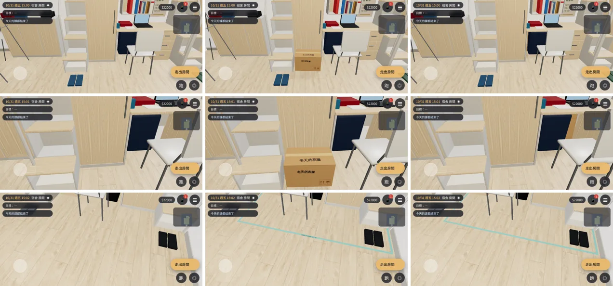
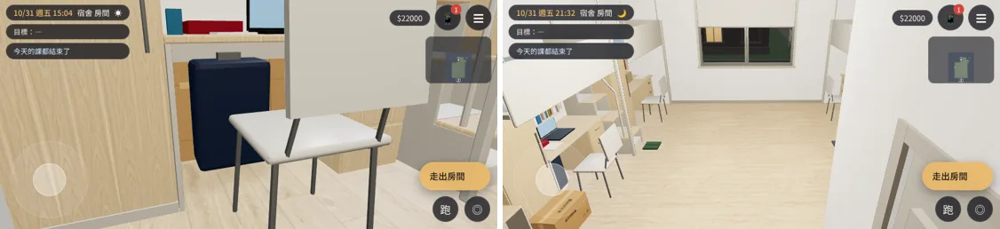

# ART-Y1-BOX-1021：大一 203 的「冬天的衣服」紙箱＋阿凱的國界紙膠帶

LAWWW2-C，2026-10-21。
- 起因：LAWWW-C 09:29Z 派工。
- 依據：
  - AA_347 5-1：「冬天的衣服」紙箱；
  - AA_347 1-1：阿凱的國界；擺法照 AA_209「繞他自己那組床桌一圈」；
  - 互動點、台詞在開發分支 `src/y1fill3d.js`、`src/data/y1fill_events.js`，**這次一個字都沒改**。
- 環境：Playwright 手機模擬（橫向 844×390）、SwiftShader。**不是 iPhone 實機**。

## 狀態
| 項目 | 狀態 |
|---|---|
| `dorm_y1_items.glb` | **MODEL_READY**：40 個三角形、1 個材質、32 KB |
| 接進遊戲 | **INTEGRATED（只在我的測試工作樹）**：開發分支 `382236a5`＋patch [`../../patches/dorm_y1_items.diff`](../../patches/dorm_y1_items.diff)（`assets3d.js` manifest 一列、`zones3d.js` 載入與狀態、`y1fill3d.js` 每一幀叫一次） |
| 測試（Playwright 手機模擬） | `aa347_y1_unit.js` ALL PASS；`reachability_all.py --zones dorm` ALL PASS；截圖沒有 JS 例外；`check_coplanar` 0 對 |
| 美術 | **READY_FOR_ART_REVIEW**；BB-C 畫面驗收待做 |

## 擺在哪裡、為什麼
- **紙箱**：
  - y1fill3d.js 的互動點寫「床底下（玩家那組床的書桌和梯子中間）」。四人房的這個位置本來是**衣櫃**（`dorm_room4.py`：衣櫃離牆 0～0.585 m）。
  - 所以紙箱推在**衣櫃門前、床板底下**（離牆 0.62～0.93 m、高 0.34 m），擋著衣櫃。
    - 劇情是「拆。」以後「把外套掛進衣櫃」，沒拆就擋著衣櫃剛好說得通；
    - 互動點 (−1.55, 0.628) 站在紙箱正前方 0.4 m。
  - 樣子：
    - 塞得很滿，上蓋微微鼓起；封箱膠帶沿接縫、往兩端包下來；
    - 頂面和朝走道那一面有媽媽用黑色麥克筆寫的「冬天的衣服」；
    - 推進去時歪了 3.5°；
    - 印著通用的「向上」「怕濕」圖示，**沒有品牌**（D77）。
- **拆了以後（BOX_WINTER_OPEN；寒流那天才拆的也一樣）**：
  - 壓平的紙箱靠在書桌底下的牆邊（抽屜櫃和右側板中間），「紙箱摺好，塞回床底下」；
  - 書桌底下的深藍色東西擋住一半，看得到紙板的邊。
- **阿凱的國界（KAI_TAPE 以後、還是室友）**：
  - 淺藍綠色紙膠帶、3 cm 寬，圍住阿凱（R2）那組床桌：
    - 走道那一條離牆 1.38 m，椅子、拖鞋都圈在裡面；
    - 兩端各一條回到牆邊。
  - 一段一段撕下來貼：
    - 每段 0.6～1.1 m，接頭重疊幾公分、角度差一點、斷口斜斜的；
    - 重疊的段一高一低差 0.7 mm（不疊面）。
- **ev_kai_tape2 演過以後**：
  - 走道那一條中間那一段換成寫了「法律系可以無條件入境」的版本：黑色麥克筆，字頭朝阿凱那邊，站在走道看得懂；
  - 兩版只顯示一個。
- 導航都不用改：紙箱在床桌組裡面；膠帶貼在地上，離地 1.5～2.2 mm。

## 截圖（左：開發分支 `382236a5`；中：紙箱沒拆＋膠帶寫了字；右：拆了＋膠帶還沒寫字；10/31 週五 15:00；[捷徑] 讀檔、旗標、電影鏡頭）
1. 祐廷那組床桌；
2. 紙箱近看；
3. 阿凱那組前面的膠帶（中間那段的字）。

- 左：拆了以後，書桌底下的壓平紙箱；
- 右：21:30 從門口看整間（紙箱在左下）。

## 接線（patch，套在開發分支 `382236a5`）
- `src/assets3d.js`：manifest 加 `bldg.dorm_y1_items`。
- `src/zones3d.js`：
  - 宿舍房間正式模型載好以後，`dormSetKey==='203'`（大一）載這個 GLB；
  - `z.setY1Items(G)` 照旗標決定顯示哪幾個節點，狀態沒變就不動：
    - 紙箱：`BOX_WINTER_OPEN` → 壓平；否則 8/29 起 → 封好；
    - 膠帶：`KAI_TAPE` 而且還是室友；
    - 字：`events.done.ev_kai_tape2`。
- `src/y1fill3d.js`：`S.tick` 每一幀叫 `z.setY1Items`（跟著 `S.boxPlace`）。

## 要 LAWWW-C 決定（不影響這次交件）
- **膠帶什麼時候撕掉**：
  - 現在的條件是「KAI_TAPE、還是室友、沒有 `KAI_TAPE_GONE`」：大二搬進 312 以後自然不見。
  - 但 `rel_lines.js` 大一的好朋友那句（「（地上的紙膠帶不見了。）」「膠帶我撕掉了啦，反正你一直過來。」）演過以後，膠帶也該不見。
  - 開發分支沒有記這件事的旗標；`KAI_TAPE_GONE` 是我先留的名字。請在那句演完時設它，或告訴我改用哪個條件。

## 已知、還沒做
- 媽媽的字是字型一個字一個字歪一點畫的，近看比較工整，不完全像手寫。
- 外套掛進衣櫃這件事沒有畫面（衣櫃門關著）。
- iPhone 實機沒有測過。
