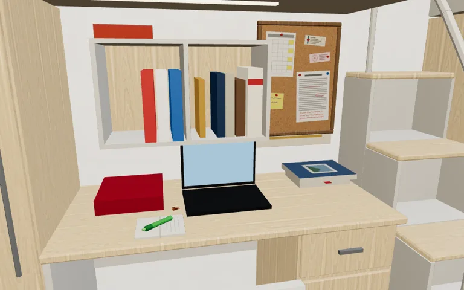
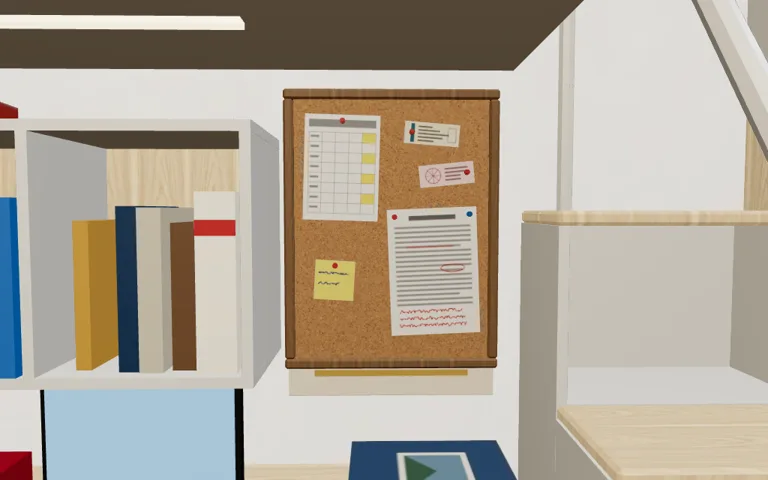
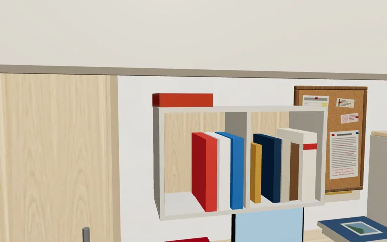
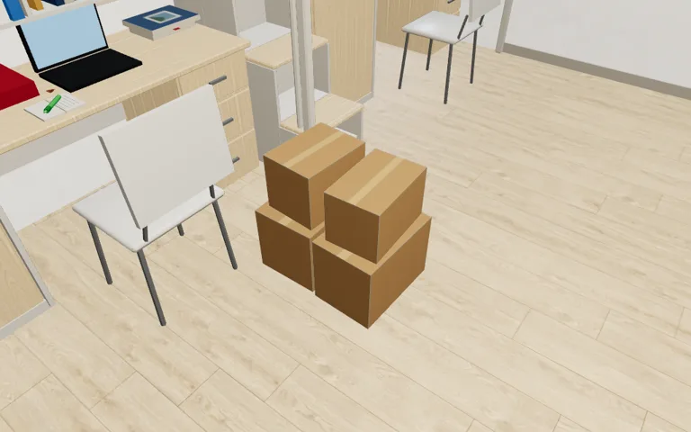
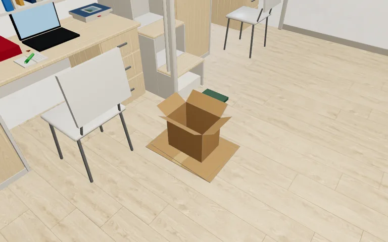
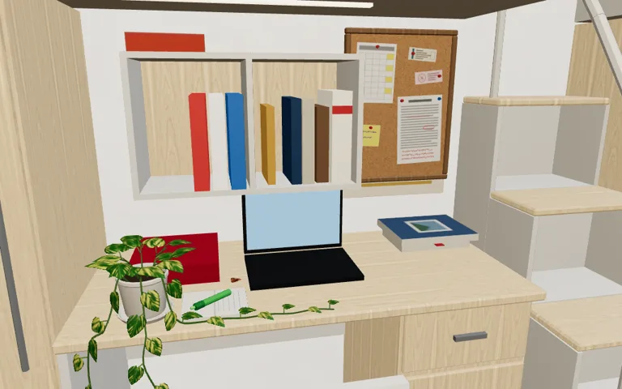

# 大二房間拆箱的物件（主線 3）搬到四人房｜LAWWW2-C 2026-10-17｜READY_FOR_ART_REVIEW

SCN-V3-01 的另一半：`assets/models/env/second_ai/dorm_y2_items.glb`（`tools/blender/env_second/dorm_y2_items.py`）。
- LAWWW2-B 10-16 的 WIP `8a1af723` 是照舊的雙人房擺的（書桌在右牆、窗下），房間改成台大四人房以後沒有重擺，也沒有交。
- 這一版搬到祐廷的 **L2**（左牆、靠門那組），依據 AA_208 7-1：「**軟木板**釘在祐廷書桌前的牆上（第 6 節：傳單、照片都貼書桌前的牆）」。
- 物件本身（形狀、印刷品的圖）沒改，只改位置；950 個三角形、240 KB。

## 擺在哪裡（遊戲 dorm 區域座標；L2 的書桌沿左牆 z −0.96～0.315、桌面 0.76）
| 節點 | 故事（`story3d.js` 的 `S.roomY2Items`） | 位置 |
|---|---|---|
| `WALL_left_Y2_BOARD` | 軟木板（ROOM_Y2 以後一直有） | 左牆、書桌前、層架左邊的空牆（z −0.93～−0.54、y 0.98～1.50）＝layout 的 `wall_spot_by_desk`；`dir`＝[1,0,0]，牆淡出時一起淡出 |
| `ITEM_duty`、`ITEM_report`、`ITEM_film`、`ITEM_sticky`、`ITEM_y1_ferris` | 法服值班表、周老師的評語、《東京物語》票根、芯慈的便利貼、大一的摩天輪票根 | 釘在軟木板上 |
| `ITEM_civ` | 只讀了三分之一的民總課本（一定有） | 書桌左邊（抽屜櫃上面）平放，書口夾紅色書籤 |
| `ITEM_y1_album` | 大一的河堤相簿 | 疊在民總課本上 |
| `ITEM_pick` | 吉他彈片 | 筆電右邊 |
| `ITEM_green` | 綠色螢光筆（**現在連攤開的筆記本一起**：大二起祐廷的桌面是空的） | 筆電和黃金葛中間 |
| `ITEM_noodle` | 阿凱留下的泡麵＋便條（一定有） | 層架上層板的上面（y 1.42；上面是床板） |
| `Y2_BOXES_CLOSED`／`Y2_BOXES_OPEN` | 拆箱前四個封好的紙箱／拆完兩個壓平的疊在地上＋一個開著的空箱 | 書桌旁的走道邊：x −1.80～−1.12、z −0.88～−0.36（`nav_block`，顯示時導航要擋；離椅子 4 cm，座位走得到） |

- 黃金葛（`prop_pothos.glb`，已經接在 L2 書桌 (−2.39, 0.145)）：最長的 S4 藤蔓沿書桌前緣經過筆記本前面，沒有穿過東西（下面最後一張）。
- `S.roomY2Items` 的大一五件是 `y1_0`～`y1_4`：模型只有摩天輪票根（`ITEM_y1_ferris`）、河堤相簿（`ITEM_y1_album`）兩個節點。舊《民法》、經濟學原理在 `dorm_room4.glb` 的 `Y312_YUTING` 層架上；重考的筆記沒有另外做。
- 社團傳單（`wall_spot_by_desk`）：有軟木板以後請釘在板上（x 往房間多 2 cm），不要和板子疊在同一個平面。

## 遊戲裡（開發分支 `0b116247`＋`dorm_y2_sets` patch；ROOM_Y2；這個 GLB 用測試腳本臨時載入 [前置／捷徑]——遊戲還沒接這個檔）
書桌（軟木板、層架、民總課本＋相簿、筆電、筆記本＋螢光筆；層架頂上的泡麵）：

軟木板：

層架：

拆箱前／拆完：

加上黃金葛 S4：

## 接進遊戲（LAWWW-C）
1. `ASSETS.manifest` 加一筆（`type:'building'`、`lazy`）。
2. dorm 區域在 ROOM_Y2 以後（312／507／409）載入，加進房間的群組：
   - `ITEM_<id>` 照 `S.roomY2Items` 的 id 顯示（`y1_3`、`y1_4` 對 `ITEM_y1_ferris`、`ITEM_y1_album`，照 `ROOM_ITEMS` 的順序核對）；
   - 拆箱前顯示 `Y2_BOXES_CLOSED`，拆完 `Y2_BOXES_OPEN`；`nav_block` 擋導航。
3. 大三、大四同一個位置（祐廷四年都在 L2）：要不要整組帶到 507／409 由劇情決定。

## 還沒做到的
- 只有手機模擬，沒有真機；遊戲沒接，這些截圖是測試腳本載入的。
- 場景美術要使用者看過才標 `ART_APPROVED`。
