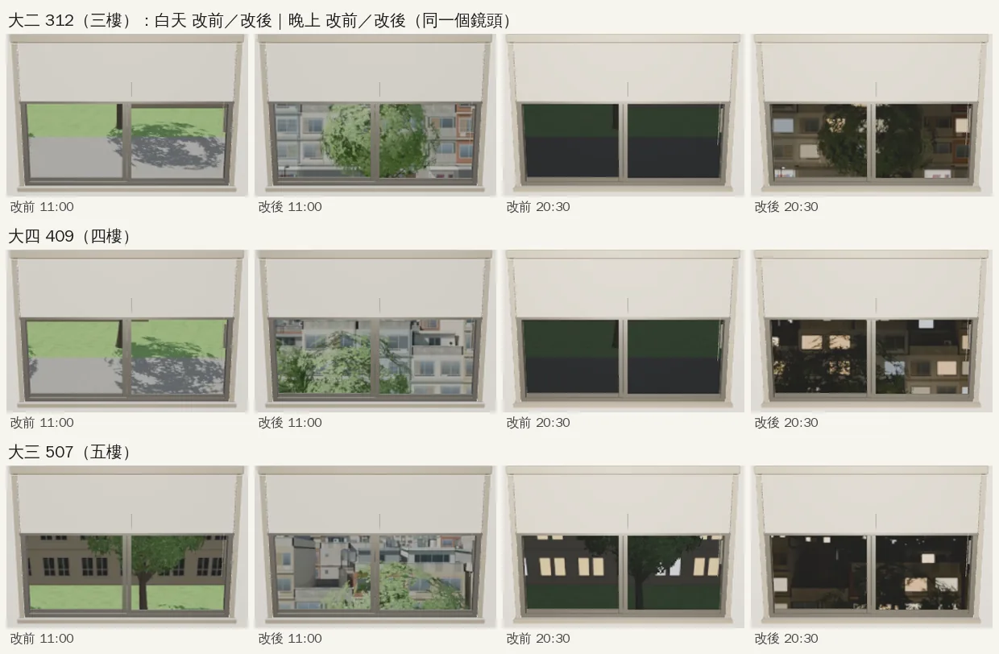
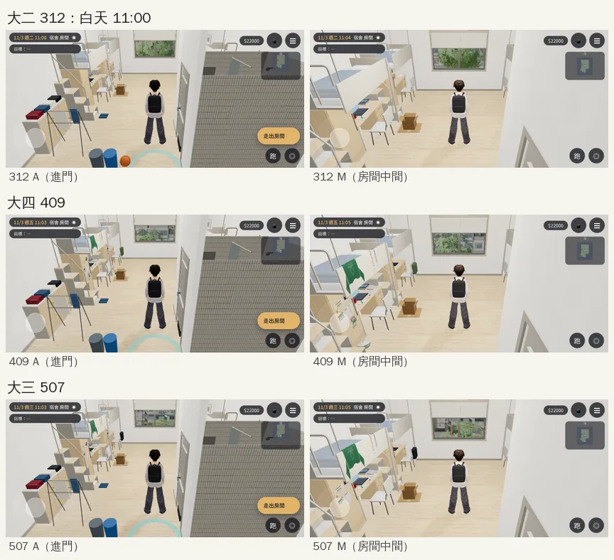
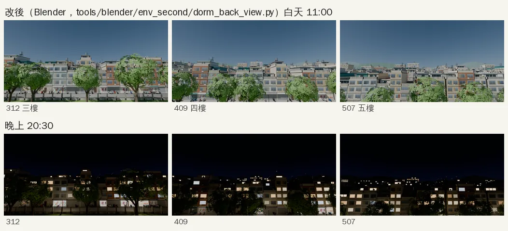
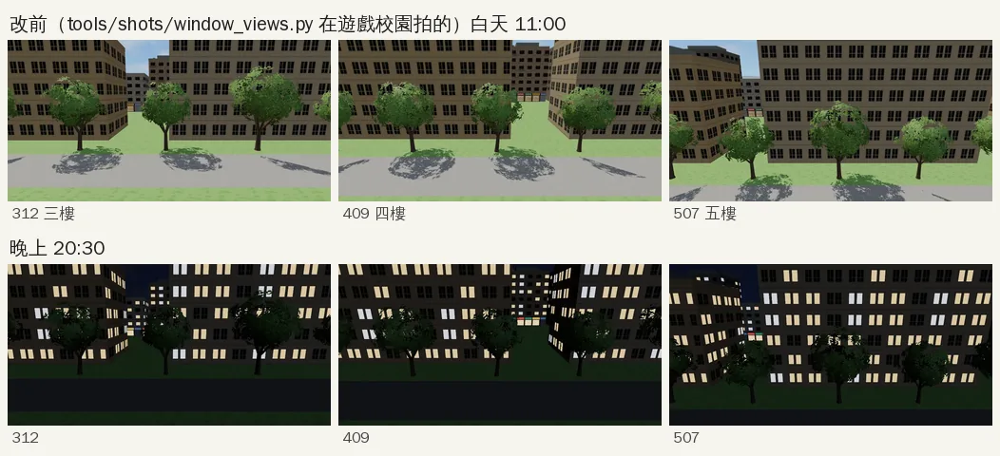
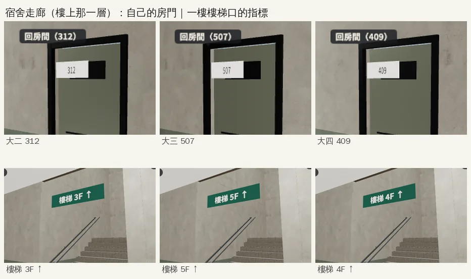
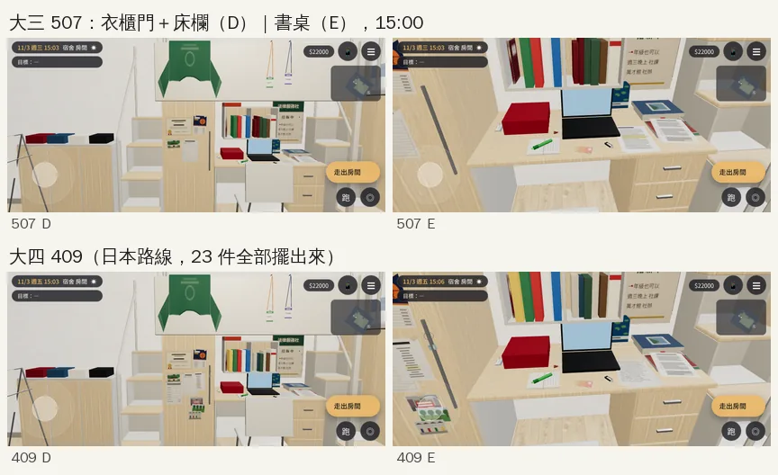

# 宿舍大三 507、大四 409：每一年看得出不同｜LAWWW-C 的美術子代理 2026-10-20～21｜READY_FOR_ART_REVIEW

任務 SCN-V4-01（大三，主線 5）、SCN-V5-01（大四，主線 10）。LAWWW-C 10-20 19:2x 審查截圖 10、11：507、409 和 312 同一組家具、看起來一樣。要：
1. 每一年看得出不同：**窗外 5F／4F 的景**、**門牌**；
2. 拆箱拿出來的東西有模型（`story3d.js` 的 `ROOM_Y3_TEXT`、`ROOM_Y4_TEXT`），照 `dorm_y2_items.glb` 的做法（`setY2Items`），交 prop id → 位置的 JSON。
- 依據：`AA_208` 第 7、8 節（312 三樓「看得到另一邊的樹」、507 五樓「樹梢和遠一點的屋頂」、409 四樓「介於中間」）。
- 不改台詞。房間模型（`dorm_room4.glb`）、室友的東西（`Y507_*`、`Y409_*`）是 LAWWW2-C 10-17 做的，這次沒動。

## 1. 窗外（`tools/blender/env_second/dorm_back_view.py` → `assets/models/env/views/dorm_room{312,409,507}_{day,night}.webp`）

**原本的問題**（改前的照片是 `tools/shots/window_views.py` 在遊戲校園拍的）：
- 校園邊界外的背景是一排一排比五樓還高的方盒公寓；三個樓層看出去都是「一棵樹＋一面牆」，五樓也看不到屋頂（LAWWW2-C 10-17 README 已經寫了）。
- 房間的窗（`W3.windowMat` 視差）只看得到照片中心往下 8°～25° 那一段（用校正圖在遊戲裡量的：進門 8°～14°、房間中間 11°～19°、窗前 16°～25°；房間的鏡頭永遠比窗高、窗的上半被捲簾蓋住）。
  原本的照片還往下壓了 10°～13°，所以 312、409 在窗裡只剩草地和柏油路，507 是一面牆。

**這次**：Blender 蓋男一舍背面的真 3D 場景、Cycles 從三個樓層的窗口高度算圖（白天、晚上各一張）：
- 樟樹一排（本作 `street_trees.glb`；507 窗前那一棵是 14.6 m 的老樟樹）→ 校園圍牆（矮牆＋鐵欄杆）→ 巷子（淺灰柏油 D30、紅線、人孔蓋、路燈、斜停的機車 `scooter.glb`）→
  對面一排三～五層的老公寓（一樓鐵捲門、小店、住家鐵門、鐵皮雨遮；樓上鐵窗、冷氣、陽台曬衣服）→ 再後面四排四～六層的公寓屋頂 → 八～二十層的大樓 → 遠山。
- **屋頂**：女兒牆、頂樓加蓋的鐵皮屋（藍、綠、灰、鏽紅的浪板屋頂；窗晚上有的亮）、不鏽鋼水塔（鋼架）、樓梯間、天線、太陽能熱水器、盆栽、曬衣架、冷氣。
- 鏡頭往上抬 9°：窗裡看到的大約是「站在窗前往外平視、稍微往下」那一段（為什麼、怎麼量的，見腳本檔頭；11° 試過，五樓在房間中間只剩屋頂、看不到樹梢）。
- 晚上：每一層樓的燈亮法不一樣（有的整層暗）、小店有的打烊、路燈照亮樹靠宿舍這一面。
- 店名、招牌：店面貼圖沒有字（D77）。

| 年 | 房間 | 窗裡看到的（房間中間往窗戶看） |
|---|---|---|
| 大二 | 312（三樓 8.4 m） | 在樹冠裡：一整片葉子，縫裡是對面公寓的二、三樓 |
| 大四 | 409（四樓 11.5 m） | 樹冠的上半＋對面公寓的三、四樓、頂樓 |
| 大三 | 507（五樓 14.6 m） | 下半是窗前那棵老樟樹的樹梢，上面是對面頂樓、一片屋頂和水塔 |

遊戲裡同一個鏡頭（窗戶；白天 11:00、晚上 20:30；左邊兩欄改前、右邊兩欄改後）：

房間裡（進門那個位置、房間中間；白天）：

照片本身（改後；上排白天、下排晚上；312、409、507）：

改前的照片（同樣排法）：

- `tools/shots/window_views.py` 拿掉這三組（留註解）：重跑那支不會蓋掉這六張。
- 不影響效能：只換窗景照片（每張 1024×512 webp，23～57 KB），draw call、三角形和改前一樣（`windows_info.json`）。

## 2. 門牌（宿舍走廊 `src/dorm3d.js`）

- 原本大三 `218`（二樓）、大四 `105`（一樓）——是作廢的 `AA_183` 房號，和字卡「五樓 507 號房」「四樓 409 號房」對不上。改成 **507**（二樓最西邊 201 那扇門）、**409**（202 那扇門）。
- 走廊模型只有兩層：樓上那一層當成自己住的那一樓——門牌整排照自己的房號排（507～514、408～415；和大二 312、經濟系 412 原本的做法一樣），一樓樓梯口的指標寫「樓梯 5F ↑」「樓梯 4F ↑」（大一照舊 2F、大二 3F）。
- 指路字幕「你的房間在二樓，507。」的樓層改成照房號（五樓、四樓、三樓）。

## 3. 拆箱拿出來的東西（`tools/blender/env_second/dorm_y3_items.py` → `assets/models/env/second_ai/dorm_y3_items.glb`）

`ROOM_Y3_TEXT` 十六件、`ROOM_Y4_TEXT` 七件，每一件一個節點 `ITEM_<key>`（key 和 `story3d.js` 一樣），遊戲照 `ROOM_Y3_ITEMS`／`ROOM_Y4_ITEMS` 顯示（扣掉 `ROOM_Y3_DISCARD`、`BOX_KEPT_Y4`）；
拆箱時拿一件出現一件、收拾時一件一件收（`story3d.js` 的 `unboxY3`、`unboxY4`、`packY4`；`zones3d.js` 的 `setY2Items` 一起管 `dorm_y2_items` 和這一組）。
位置（遊戲座標的外框、中心）在 `dorm_y3_items.json` 的 `pos`。

| 地方 | 大三（507 起） | 大四（409） |
|---|---|---|
| 書桌 | 大二的筆記三本（左前）、學姊研究計畫第二段（疊在筆記上，鉛筆字）、前緣那一疊：學姊給的文章＋東京講義（畫重點那一頁）、筆電前：「測試版」隨身碟（標籤沒有字）、首爾交通卡；右後：日語單字卡一圈；左後靠牆：交換說明會手冊（折一個角） | 前緣那一疊最上面：謄本影本（透明夾、十六列）、語彤田野筆記影本 |
| 層架 | 阿哲還回來的民法筆記（直立，兩張便利貼） | |
| 衣櫃門 | 加州結業證書（金色封印）、系籃節目單、京都茶室明信片、空白的筆錄紙（只寫了日期） | 志願表（日本、美國路線是蓋了系辦章的影本：`FORM_STAMP`，台灣路線空白）、發表會製作名單（一行螢光筆）、英國明信片三張；把手上：日本宿舍的鑰匙圈 |
| 床欄 | 服務隊隊服（倒掛：袖子往下垂、袖口的字淡掉；10-21 第二版）、小隊輔名牌、營隊名牌（掛繩） | |
| 地上 | | 便利商店的塑膠袋（裝了別的東西，沒有店名） |

- 印刷品（證書、節目單、明信片、表格、講義、名牌、交通卡、隊服的字）是本作程式畫的圖（PIL），**沒有任何文字、店名、商標**（D77）；貼圖集 `atlas_dorm_y3_print.webp`。
- 手機的量：整組 **1,333 個三角形**、**2 個材質**（`y3_print`、床欄上的 `seethru_y3_print`）、1 張 1024 webp、136 KB；一件一個網格＝一件多一次 draw call（全部 23 件＋章都拿出來時 +24）。
- 409 截圖用日本路線而且 23 件全部擺出來（為了驗收每一件；遊戲裡同一個人不會全部都有）。

物件特寫（衣櫃門＋床欄、書桌；大三 507／大四 409）：

每個鏡頭的改前（沒有這一組）／改後：`before_*`、`after_*`（A＝進門、B＝書桌和衣櫃、C＝床欄、D＝衣櫃門＋床欄、E＝書桌；15:00、21:00）；`y2only_*`＝只有大二那組。

## 測試
- `node tests/dorm_y3_items_unit.js`：ALL PASS（GLB 節點 ↔ `ROOM_Y3_TEXT`／`ROOM_Y4_TEXT`、只在 507／409 載入、顯示規則、舊存檔、拆箱與收拾的 3D、手機的量、不穿插）。
- `node tests/room_y3_unit.js`、`node tests/room_y4_unit.js`、`node tests/dorm_y2_items_unit.js`：ALL PASS。
- `node tests/nav_buildings_unit.js`：ALL PASS（新增：房號照 AA_208、樓層、507／409 整層門牌與樓梯指標；改前 FAIL）。
- 其他：`rooms_glb_unit`、`v3_room2_unit`、`kai_dorm_unit`、`zone_dispose_unit`、`x78_rooms_unit`、`schedule_roommove_unit`、`v0_dorm_props_unit`：ALL PASS。
- 截圖：`python3 tools/shots/dorm_y34_shots.py <網址?turbo> <資料夾> <標籤> 312,409,507 --views A,M,V --hours 11,20.5`（窗景）、`… 507,409 hall`（走廊門牌）、`… 507,409`（物件 A～E）。
  **[前置／捷徑]** 都是直接設旗標讀檔（`ROOM_Y3`、`ROOM_Y4`、拆出來的東西），沒有從劇情真的搬房間；拆箱、收拾的流程由上面的單元測試跑過。手機模擬（844×390、SwiftShader），沒有實機。

## 還沒做到的（照實）
- **男一舍在校園裡只有四層**（`zones3d.js`：`CK.hall` floors 4、`campus_male1.glb`「地上 4 層照住宿組資料」），但 `AA_208`、字卡都是「五樓 507」。窗景照五樓的高度算；從校園外面數樓層會對不上。要改樓高或房號由 AA／使用者決定，這次沒動。
- 窗景是另外蓋的場景，和校園區域裡男一舍背後的方盒背景不一樣（玩家走不到宿舍背後，背景本身在校園邊界外）。
- 走廊只有兩層模型：從一樓爬一段樓梯就到「5F」。
- 隊服還是一片布的做法（沒有真的布料模擬）；遠看是倒掛的 T 恤，近看偏平。
- 場景美術要使用者看過才標 `ART_APPROVED`。
