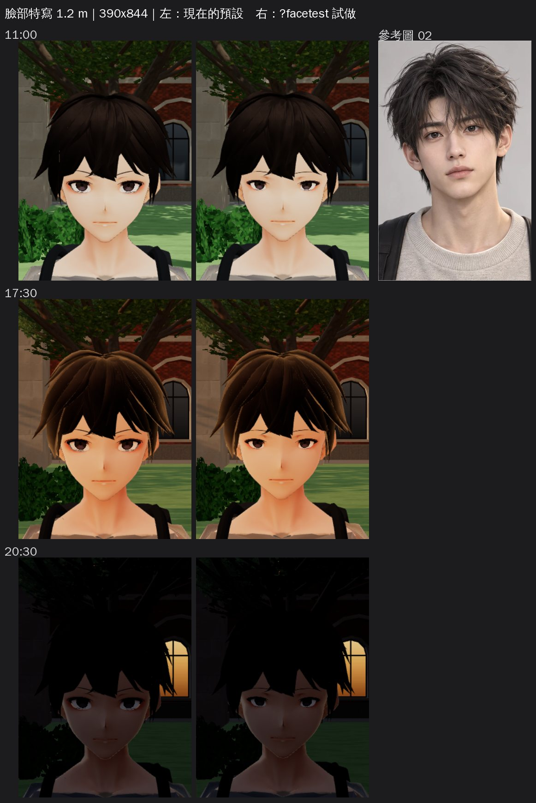
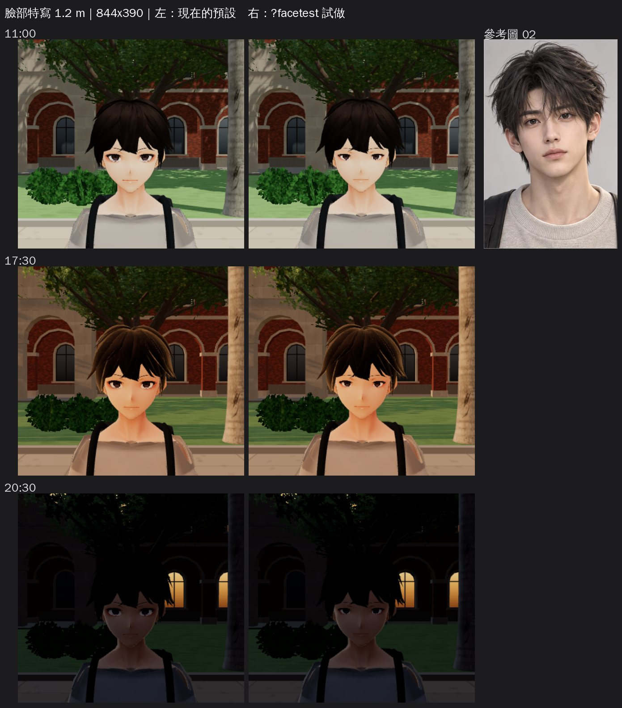
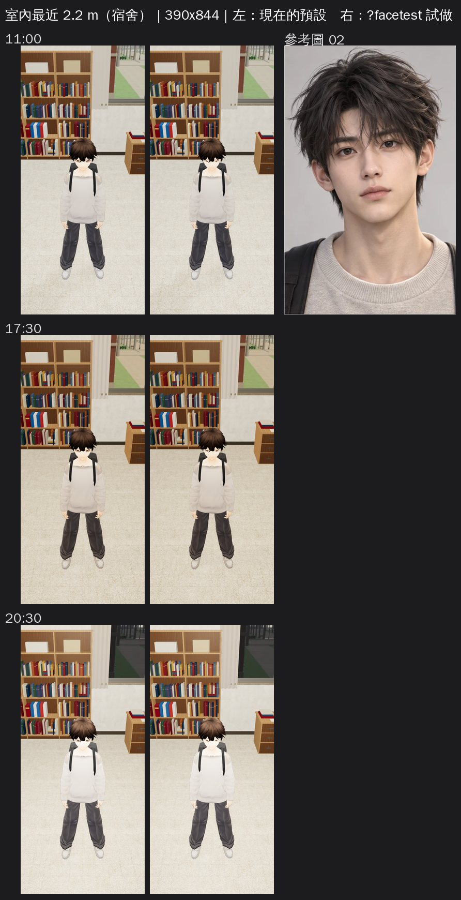
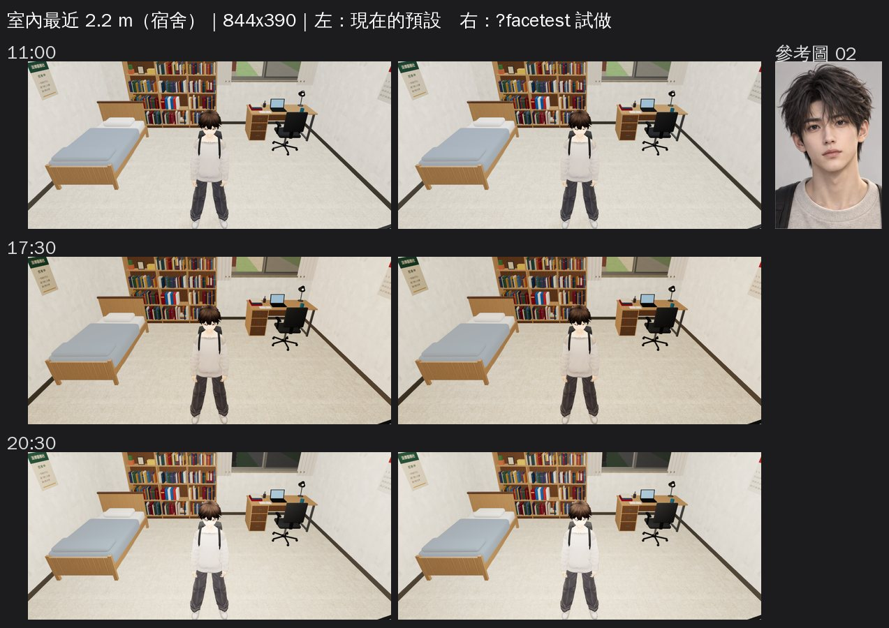
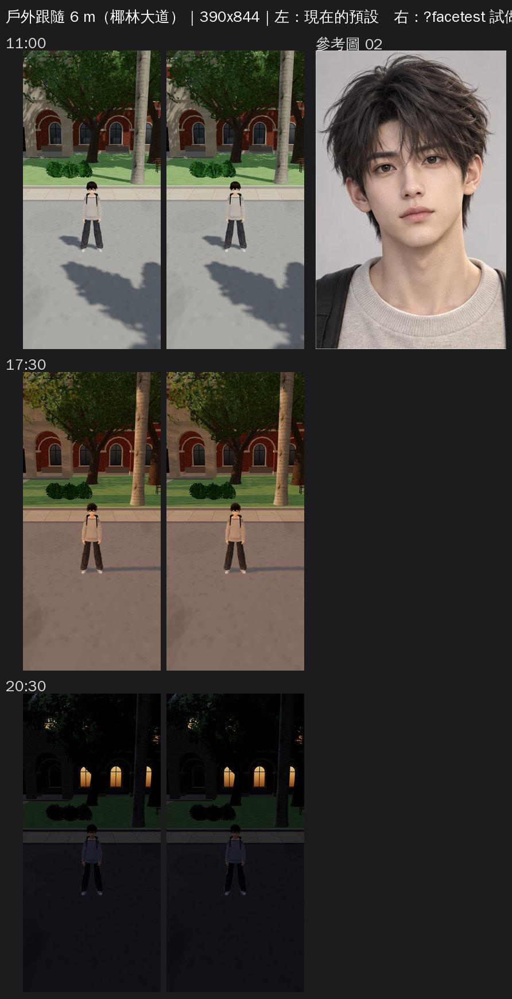
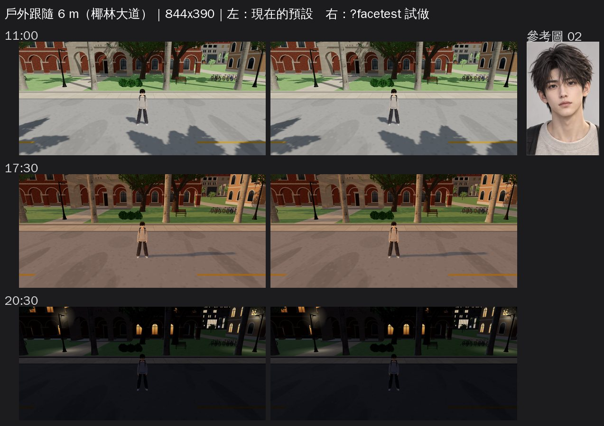
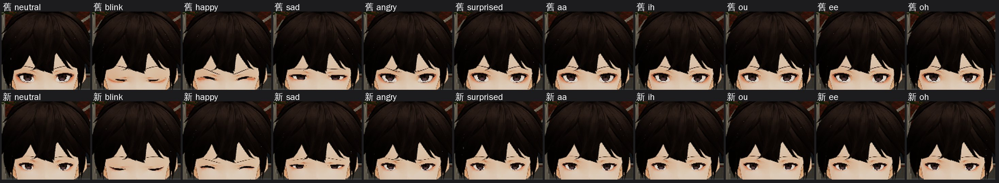

# 祐廷 3D 臉試做（BB_131 第 11 節；`?facetest`）

- **為什麼是試做**：BB-B 18:24 派工（AA-B 的建議）。3D 臉從 VRoid 的動畫臉往參考圖 02 靠，屬於 D59 的重大人物外觀變更，要由使用者決定。所以先做一個看得到的對照，使用者只要說「用」或「不用」。
- **不換預設**：
  - 另存 `assets/models/char/vroid_yuting_facetest.vrm`。
  - 只有網址加 `?facetest` 才載入，要套 `docs/art-rebuild/second_ai/patches/assets3d_facetest.patch`（assets3d.js 加兩行）。
  - 遊戲預設照舊是 `vroid_yuting.vrm`。使用者說「用」，才由 LAWWW-B 換成預設；說「不用」，就刪掉這一份。
- **怎麼做**：`python3 tools/char_polish.py vroid_yuting --facetest`。流程是 vroid_build 建好 → 精修第 1 批（polish_yuting）→ 試做（`facetest_yuting()`）。
  - 和預設模型比，只有臉的這幾個部位不同：眼白、虹膜、高光、眼線、睫毛、EyeExtra、眉毛、眼睛周圍的皮膚。身體、頭髮、衣服完全相同（已用頂點位置逐一比對）。

## 改了什麼（照 BB_131 第 11 節）
| # | 規格 | 做法 | 函式 |
|---|---|---|---|
| 1 | 眼睛縮小約 15%，以各自的眼睛中心縮放，上下左右同比例 | 眼白、虹膜、高光、眼線、睫毛一起縮 0.85，表情 morph 的位移也一起縮 | `vroid_build.scale_eyes(v, 0.85, 0.85)` |
| 1b | 眨眼要能完全閉上 | 皮膚貼圖上畫的眼窩（粉紅杏仁形、紅色暈影、雙眼皮線）是照 VRoid 原本的眼睛大小畫的，眼睛縮小後會露出一圈紅眼圈。所以眼睛周圍的**皮膚網格**也跟著往眼睛中心收：原本眼白半徑 1.15 倍以內整個收，1.15～1.8 倍漸漸變回原樣，鼻樑不動。眨眼時的眼皮位移照同一個變形換算 | `char_polish.eye_socket_pinch()` |
| 2 | 高光少一點 | 貼圖上每個亮點以自己的中心縮成一半（位置不動），橘色光暈改成偏暖的白 | `char_polish.highlight_small()` |
| 3 | 眉毛自然一點：細、平、深棕、眉尾不上挑 | 畫出來的那條眉線，原本從眉頭到眉尾一路往上 7.8 mm，改成：眉頭→眉峰（全長 68% 處）升 3.4 mm，眉峰→眉尾降 1.2 mm。眉毛網格上下壓成 0.72 倍（線變細）。前後貼著額頭皮膚移動。顏色從近黑改成深棕 `#7a5a45` | `char_polish.brow_natural()` |
| 4 | 臉型、下巴、鼻子、嘴、頭髮、衣服不動 | 沒有動 | — |

## 遊戲內截圖
- 測試工作樹：開發分支 a17e9b6b＋試做 VRM＋上面那個 patch。
- 截圖工具：`tools/shots/facetest_shots.py`。手機模擬，Playwright＋SwiftShader，不是真機。
- 每張對照表左邊是現在的預設，右邊是 `?facetest`，最右邊是參考圖 02。

**三種距離**（實際鏡頭到人物頭部的距離：特寫 1.2 m、室內 2.28 m、戶外 6.05 m）：

| 距離 | 390×844 | 844×390 |
|---|---|---|
| 臉部特寫 1.2 m（椰林大道） |  |  |
| 室內最近的跟隨鏡頭 2.2 m（宿舍；俯角 0.38＝遊戲室內預設；兩指縮放的下限） |  |  |
| 戶外平常的跟隨鏡頭 6 m（椰林大道；俯角 0.22） |  |  |

- 三種距離都是鏡頭在人物正前方、人物面向鏡頭。平常玩的時候鏡頭在背後，只有轉身、走向鏡頭時才看得到臉。
- 時段：11:00、17:30、20:30。

**表情**（臉部特寫 11:00；上排舊、下排新）：
neutral、blink（閉眼）、happy、sad、angry、surprised、aa、ih、ou、ee、oh。

## 看得到的差別（我自己先看的，交 BB-B 驗收）
- **臉部特寫**：
  - 眼睛小了一圈，比較接近參考圖成熟、細長的眼型；
  - 原本眼睛下面的紅色暈影不見了；
  - 高光變成一個小亮點；
  - 眉尾不再上挑，表情比較溫和，不像在皺眉。
- **閉眼**：眼睛完全閉上，沒有縫，也沒有紅線（舊版閉眼時眼睛下面有一條紅色弧線）。
- **其他表情**：笑、難過、生氣、驚訝、A～O 都沒有破。
- **室內 2.2 m、戶外 6 m**：差別很小。手機上平常玩的距離，臉只有幾十個像素，看得出來的主要是「眼睛沒那麼大」。這是使用者決定時要知道的：**這個改動主要影響特寫和 ADV 以外的 3D 近景**。
- **晚上 20:30 的戶外特寫兩邊都很暗**：是場景光的問題，不是這次的改動。

## 狀態
- `READY_FOR_ART_REVIEW`。
- BB-B 先驗收：有沒有更接近參考圖、有沒有變怪（恐怖谷）。過了交 AA-B，附在給使用者的回報裡。
- **ART_APPROVED 由使用者決定**，BB-B 不標。
