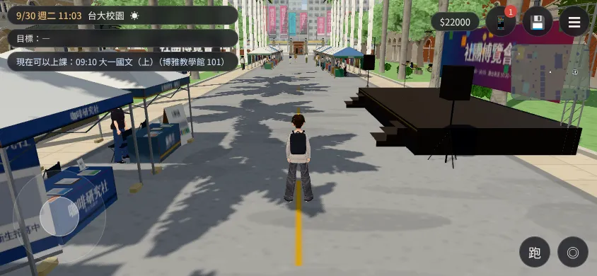
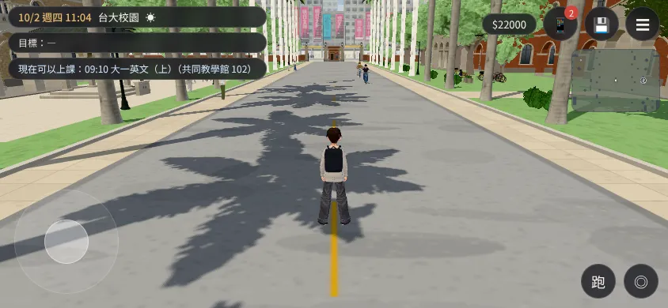

# FAIR-PERF-1027：社博那天校園的效能（LAWWW2-C 2026-10-27，LAWWW-C 21:45Z 第 3 點）

- **量的版本**：開發分支 `479e35f11`（社博 36 頂＋顧攤的人＋人流已整合）。
- **怎麼量**：`tools/shots/fair_perf.py`、`fair_perf_staff.py`（SwiftShader 手機橫向模擬；[捷徑] 讀檔、條件事件關閉、直接放玩家位置；**路人照遊戲自己放，不藏**）。11:00 晴天，兩個鏡頭：舞台前往北看（`stageN`）、大道中段往西看整排帳篷（`avenueW`）。
- **注意日子**：測試讀檔做出來的局是「舊局」（沒有開學改 9/1），社博在 **9/30、10/1**，不是 9/6（第一次量 9/6 量到的是平常日，作廢）。社博當天＝2025-09-30，平常日＝2025-10-02，同一個時刻、同一個位置。
- **fps 是 SwiftShader 的數字**（CPU 算圖，1～2 fps），只能拿來比前後，不是手機的 fps。**手機實機沒量**。

## 社博當天 vs 平常日（大道往西看）

| 畫質 | draw call | 三角形 | 畫面裡的人 | fps（SwiftShader） | 那天場上的人（顧攤／人流／全部） |
|---|---|---|---|---|---|
| 中（手機預設） | 382 → **503**（+32%） | 72 萬 → **106 萬**（+48%） | 10 → 32 | 1.78 → 1.26（−29%） | 31／8／68（平常 28） |
| 高 | 380 → **548**（+44%） | 68 萬 → **116 萬**（+69%） | 13 → 47 | 1.87 → 1.16（−38%） | 36／11／81（平常 33） |

- 舞台前往北看：兩天差不多（中：315／53 萬 vs 333／53 萬），畫面裡幾乎沒有人。
- 帳篷＋舞台是**一個網格一個材質**（一個 draw call、2.7 萬三角形）；**多出來的幾乎都是人**。

| 社博當天 大道往西（中） | 平常日 同一個位置 |
|---|---|
|  |  |

## 顧攤的人占多少（社博當天、中畫質、大道往西）

| 顧攤的人 | 畫面裡顧攤的人 | 三角形 | fps（SwiftShader） |
|---|---|---|---|
| 全部 | 15 | 99.5 萬 | 1.10 |
| **只留 35 m 以內** | 4 | 96.5 萬 | **1.40（+27%）** |
| 全部拿掉 | 0 | 88.5 萬 | 1.51 |

- 一個看得到的顧攤的人約 7 千個三角形（18 m 外已經換成遠距離版本）；主要的成本是**每個人每一格的骨架、動畫更新**（CPU），三角形反而是次要。
- draw call 這一輪在 435～458 之間跳（走路的人流一直進出畫面），拿掉顧攤的人看不出穩定的差，**不拿 draw call 下結論**。
- 35 m 以外的帳篷在手機畫面上只有幾個像素寬，顧攤的人藏起來看不出差別：`staff_avenueW_near35.webp` 和 `staff_avenueW_all.webp` 比。

## 判斷與建議（給 LAWWW-C）

- **專案沒有寫死的上限**，我用「同一個位置的平常日」當基準：中畫質三角形 +48%、模擬的 fps −29%。**我判斷超標**（手機上應該會比平常日明顯卡；實機沒量）。
- **建議（不減攤位上的人數、近的攤位照樣有人顧）**：顧攤的人照距離藏——中畫質 35 m 外不畫、高畫質 55 m 外不畫（低畫質照現在的 34 m）。這個鏡頭畫面裡的顧攤的人 15 → 4，模擬 fps +27%。做法：`engine3d.js` NPC 的距離 LOD（第 374 行附近 `const lim=…`）讓 `n.fairStaff` 用比較短的 `lim`，或 `clubfair3d.js` 放人時給一個 `n.lodLim`，引擎照它算。程式在你那邊，要我寫 patch 告訴我。
- 不建議再減背景攤的人數（使用者說「都沒人顧」）。

## 檔案

- 數據：`medium_2025-09-30.json`、`medium_2025-10-02.json`、`high_2025-09-30.json`、`high_2025-10-02.json`、`staff_medium.json`
- 工具：`tools/shots/fair_perf.py`、`tools/shots/fair_perf_staff.py`

## 改了以後（FAIR-STAFF-LOD-1027，LAWWW-C 22:24Z 照建議做）

- **patch**：`docs/art-rebuild/second_ai/patches/fair_staff_lod_1027.patch`（對 `155323e04`、`de75d3106` apply --check 過）
  - `src/engine3d.js`（NPC 距離 LOD 一行）：每個人可以帶 `n.lodLim={low,medium,high}`，取「畫質的距離」和它比較短的那個（只會縮短、不會加長；沒帶的人照舊 34／60／95 m）。
  - `src/clubfair3d.js`：顧攤的人帶 `CLUBFAIR.STAFF_LOD={low:34, medium:35, high:55}`；停在攤位前填表的人、走路的人流照一般路人。
  - 新 `tests/fair_staff_lod_unit.js`：**改前 FAILED 4、改後 ALL PASS（11 項）**。社博相關的 6 支、路人（anon、crowd）、導航 Node 測試 ALL PASS。
- **同一個鏡頭（社博 9/30、大道往西）重量**：

| 畫質 | draw call | 三角形 | 畫面裡的人（其中顧攤） | fps（SwiftShader） |
|---|---|---|---|---|
| 中 | 503 → **455** | 106 萬 → **96 萬** | 32 → **16（4）** | 1.26 → **1.45（+15%）** |
| 高 | 548 → **494** | 116 萬 → **103 萬** | 47 → **34（15）** | 1.16 → **1.34（+16%）** |

- 中畫質還是比平常日重（平常日 382／72 萬／1.78）：剩下的是走路的人流、停在攤位前的人、帳篷附近 35 m 內的顧攤的人——**這些是社博的樣子，我建議不再減**。
- 改了以後：`lod_medium_avenueW.webp`（近的攤位照樣有人顧）；數據 `lod_medium_2025-09-30.json`、`lod_high_2025-09-30.json`。沒有 JS 例外。手機實機沒量。
