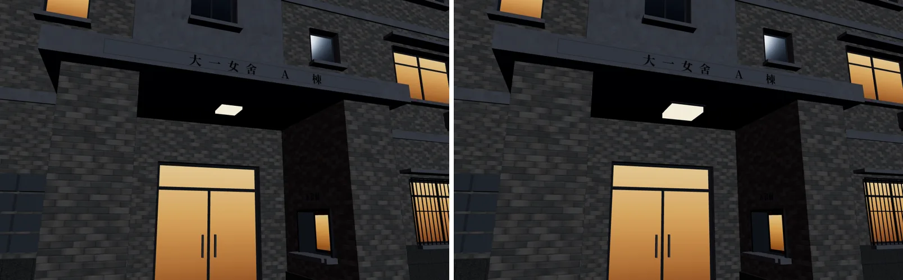
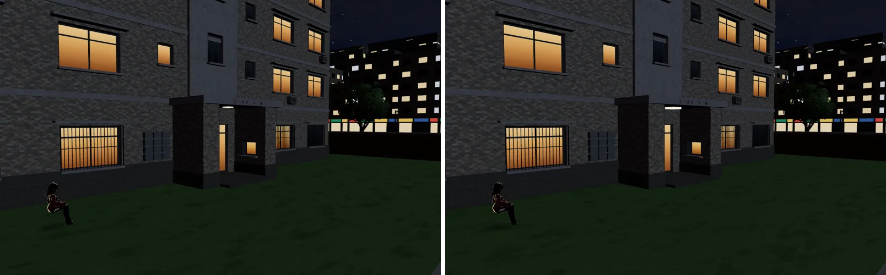

# 大一女舍門廊吸頂燈加大（LAWWW 2026-10-14 17:22Z 佇列②；READY_FOR_ART_REVIEW；LAWWW2-B 2026-10-15）

## 為什麼改

C13 晚上截圖 B（`../c13_night/README.md`）：女舍 A、B 棟門廊天花板的燈罩 `wz_lamp_lens` 只有 0.36 m、貼著天花板，晚上看不出在發光。

## 改了什麼（`tools/blender/env_second/campus_freshman.py`）

- 原本：0.36 m 方形燈罩，5 cm 厚。
- 改成：0.6 m 的金屬框（`ck_frame`，和門框同一個顏色），加上 0.54 m 的乳白燈罩，往下凸 9 cm，從側面也看得到亮。
- 材質名稱還是 `wz_lamp_lens`，晚上由遊戲的 `WZ_NIGHT` 讓它發光（`zones3d.js`：0xffe0a0、2.2）。程式不用改。
- 規格：15,970 → 15,990 個三角形（+20），材質數 12 不變，1.33 MB。
- 位置、導航、門口互動點都不變。**接法：只換 GLB。**
- 注意：`campus_freshman.glb` 目前只在開發分支，main 的 manifest 沒有這個 key，所以線上 v9.7 還看不到這兩棟樓（見 HANDOFF 的盤點）。

## 遊戲內截圖（實際遊戲畫面）

- 基準：LAWWW-B 開發分支 `6212adb`，本機 worktree 只換 GLB。
- 環境：桌機 1280×800，Playwright＋SwiftShader，**不是實機**。
- 時間：校園 20:40（晚上）。鏡頭固定，設定在 `shots_fd_lamp.json`。JS 例外 0。

| | 左：原本 0.36 m　右：這一版 |
|---|---|
| A 棟門廊近看 |  |
| 從長椅那邊看 A 棟 |  |

## 還不夠的地方（遊戲端，LAWWW 的檔案）

- **燈罩亮了，但地上沒有被照亮**：門口地坪、台階還是暗的。要有「門口有燈」的感覺，遊戲端要在門廊下加一盞點光源或地面光圈（和路燈一樣的做法），位置約在 A 棟 (−108, 2.9, 61)、B 棟 (−78, 2.9, 59)。座標由燈罩位置換算，接的時候請再確認。
- 長椅附近沒有燈、路人坐在空中：兩個都是上次就回報過的問題（`../c13_night/README.md` B-1、B-2），這次沒有改。
