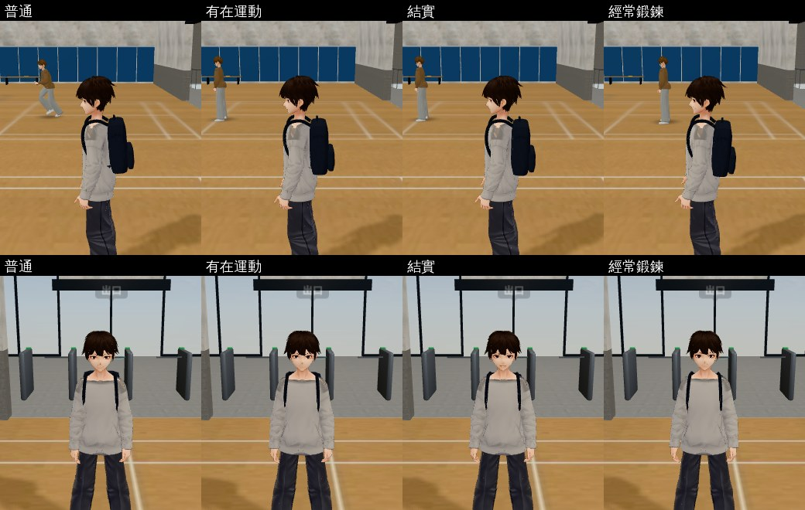

# FIT-3D-BODY-1027（USER_WANTS D40「健身與體態」）第一階段：體態＝姿勢（LAWWW2-C 2026-10-27）

- **現在**：體能四階（普通／有在運動／結實／經常鍛鍊）影響走路、騎車速度和朋友注意到的那一句；`fit3d.js` 開頭寫「3D 體態等 LAWWW2 評估」。評估：`docs/art-rebuild/second_ai/EVAL_J13_A21_D40_1027.md`。
- **這一階段只改姿勢、不改身體形狀**（身體形狀＝第二階段，會改主角外觀，要使用者決定）。
- **對**：開發分支 `de75d3106`（`git apply --check` 過）。

## 玩家會看到什麼

- 體能越高，祐廷**站著、走路、跑步、說話**的時候越挺：挺胸、肩膀往後打開、下巴微收。
- 量的（瀏覽器，體育館，同一個站姿、同一個動畫時間點；以屁股為準往前的距離）：

| | 肩膀往前 | 頭往前 | 兩肩距離 |
|---|---|---|---|
| 普通 | 4.6 cm | 1.8 cm | 27.0 cm |
| 有在運動 | 3.2 cm | 0.5 cm | 27.4 cm |
| 結實 | 2.0 cm | −0.6 cm | 27.6 cm |
| 經常鍛鍊 | **0.7 cm** | **−1.9 cm** | **27.8 cm** |

- **誠實**：遊戲平常的鏡頭距離（5 m 左右）**看得出來但很細**——普通的祐廷本來就有一點駝，經常鍛鍊是「站直了」，不是「變壯了」。要一眼看出「這個人有在練」，要第二階段的身體形狀。
- 坐著、騎車、讀書、吃飯、睡覺：不加。羽球短片、開門（疊加姿勢）在演的時候：不加。
- 只有祐廷（`E.player`）；女主角、朋友沒有體能數值。

## 做法（patch：`docs/art-rebuild/second_ai/patches/fit_posture_1027.patch`）

- `src/fit3d.js`：`FIT.POSTURE`（四階：普通沒有；胸 Spine1／Spine2 往後、脖子往前收、兩邊肩膀往後，越高階角度越大，×1／×1.8／×2.8）；`FIT.sync`（本來每個 tick 就會跑）把它放到 `E.player.obj.userData.posture`。
- `src/character3d.js`（`animateVRM`，在羽球加的疊加姿勢後面，3 行）：`u.posture` 小角度**乘在動作上**（不是蓋掉動作）；只在 idle／walk／run／talk、沒有疊加姿勢的時候。
  - **不會累加**：有的骨頭（肩膀）這一格動畫沒有寫，直接乘會一格一格越轉越多——每一格先看骨頭是不是還是上一格加完的樣子，是的話先撤掉再加。

## 測試

- 新 `tests/fit_posture_unit.js`（Node，**真的載入祐廷的 VRM**、跑動畫）：**改前 FAILED 1（FIT.POSTURE 不存在）、改後 ALL PASS（10 項）**——FIT.sync 照四階設；經常鍛鍊肩膀往後 3.9 cm、頭往後 3.6 cm、肩膀不變窄；有在運動介於中間；**播 300 格不會累加**；坐著、有疊加姿勢不加；拿掉以後回到原樣（沒有殘留）；接線。
- 會載入 `character3d.js` 的 Node 測試（走路方向、樓梯腳步、坐著的視線、裙子、騎車姿勢、路人…）全部 ALL PASS；`fit_unit` ALL PASS。
- **沒測**：手機實機；BB 的玩家流程（練到經常鍛鍊以後走一圈看）。

## 第二階段（要使用者決定）

給 `Body.baked` 和衣服加同一個形狀鍵「結實」（肩膀寬約 3%、胸口和上臂厚一點、腰不變），第二階 0.5、第三階 1.0；每一套衣服都要加。**會改主角外觀（D111），請 LAWWW-C 問使用者要不要、要多明顯**；我可以先做一張普通／結實並排的圖給使用者看。

## 檔案

- patch：`docs/art-rebuild/second_ai/patches/fit_posture_1027.patch`（`src/fit3d.js`、`src/character3d.js` 3 行、新 `tests/fit_posture_unit.js`）
- 工具：`tools/shots/fit_posture_shots.py`
- 美術狀態：`READY_FOR_ART_REVIEW`
