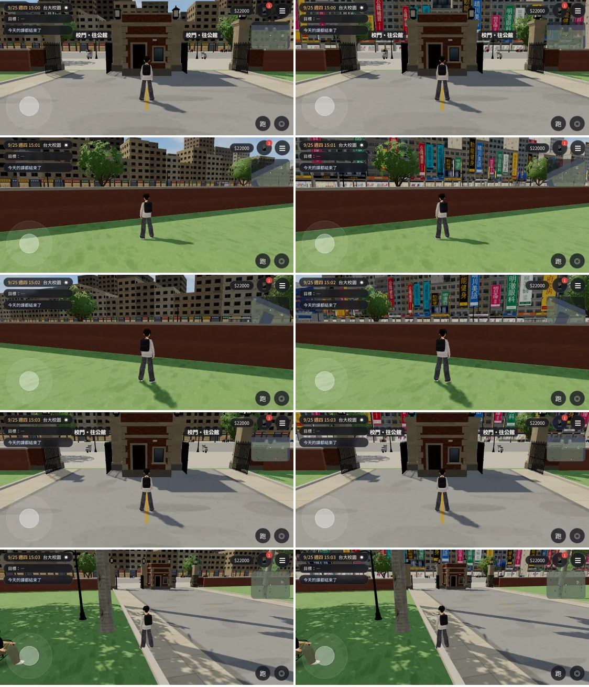
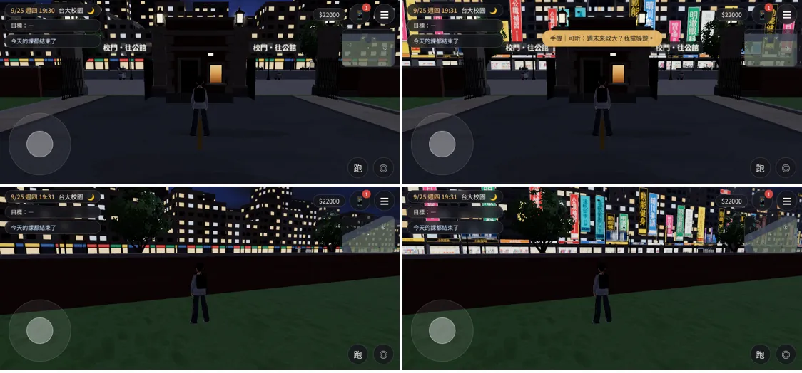
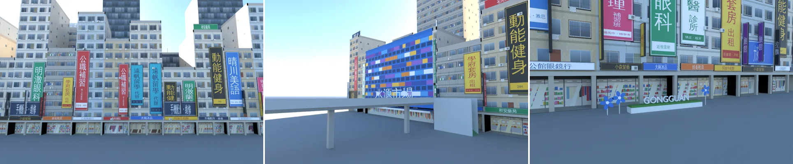

# GG-STREETVIEW-1020（X86）：從校園看出去的公館——羅斯福路兩排街廓

LAWWW2-C，2026-10-20。
- 使用者 10-20 直接說：「有一件事我覺得從學校去看公館或者外面的建筑都超級丑的完全沒有那種三d游戲的感覺公館的店面」，附 4 張照片：
  - 羅斯福路整面的直立大看板、二樓橫招牌；
  - 捷運出口前的「GONGGUAN」字樣和藍色小花；
  - 水源市場（藍色大樓、彩色橫條、一樓攤位、天橋樓梯）。
  - 照片只當參考，不進 repo。
- 範圍照 LAWWW-C 10-20 17:47：換掉校園背景 `campusBackdrop` 裡 `TK.bgCity` 的公館那兩排。
  - 公館區域裡面的店面（`gongguan_shops.glb`）、捷運出口、水源市場不在這一次（第二階段）。

## 狀態（分開標）
| 項目 | 狀態 |
|---|---|
| Blender 模型 | **MODEL_READY**（`assets/models/env/second_ai/campus_gongguan_bd.glb`） |
| 接進遊戲 | **INTEGRATED（只在我的測試工作樹）**：開發分支 `91fb70aa`＋本頁的 patch；patch 也套得上 `88a021ec` |
| 檢查 | 讀檔進校園、模型載入、截圖 16 張、沒有 JS 例外：**ALL PASS**（`shots_gg2`，Playwright 手機模擬橫向 844×390；不是 iPhone 實機） |
| 美術 | **READY_FOR_ART_REVIEW**（等使用者看） |

- 這是從校園看出去的背景，走不到、不碰撞。
  - 沒有改導航、碰撞、劇情、存檔。
  - 所以沒有跑走路流程測試。

## 修改前／後（同一個版本、同一個畫面）
- 做法：同一次讀檔、同一個鏡頭，把方盒和正式模型的 `visible` 對調，各拍一張。
  - 左：修改前（方盒）；右：修改後。
  - 9/25 週四 15:00；[捷徑] 人物放到位置、設鏡頭。
- 前三列是鏡頭往上抬（pitch 0.07，玩家拖得到的最低是 0.06）；後兩列是預設鏡頭（0.22）。

- 晚上 19:30：窗、店面、招牌會亮（`TK.addNight`）。

- Blender 算圖（Cycles，不是遊戲畫面）：校園西側往西看、水源市場與天橋、捷運出口前的 GONGGUAN 字樣與小花。

## 模型
| | |
|---|---|
| 檔案 | `campus_gongguan_bd.glb`，1.46 MB |
| 三角形 | 12,838 |
| 網格／材質 | 5／5（立面、店面、招牌、水源市場、頂點色零件；全部合併） |
| 貼圖 | 5 張 webp，最大 1024 px（原圖 `tools/blender/env_second/textures/gen/gg_bd_*.png`，程式畫的） |
| 雙面材質 | 沒有（全部單面） |
| 投影 | 不投影：遊戲載入時設 `castShadow=false` |
| 座標 | 校園座標，放在原點、不用轉 |
| 腳本 | `tools/blender/env_second/gg_backdrop.py`（會先跑 `gg_textures.py` 畫貼圖） |

- 第一排（x −189）26 棟：
  - 公館南側那 15 棟照原本的寬度，高度 6～14 層，高低錯落；
  - 一樓騎樓：柱子、店面、招牌帶；
  - 二樓一整排橫招牌；整面直立大看板；凸出牆面的直立燈箱；
  - 冷氣、水塔、屋頂看板；
  - 往溫州街的轉角公寓（z −88～−74）、巷子照舊留空；
  - 南段是水源市場（8 層、藍色立面彩色橫條、一樓攤位、遮雨棚）＋過馬路的天橋（綠色樓梯）；
  - 校門正對面捷運出口那一段：花台上的 GONGGUAN 字樣＋三朵藍色小花。
- 第二排（x −212）13 棟高樓：10～20 層，有縫、有天線、屋頂看板。
- 店名、補習班、診所全部虛構（D77），不寫電話：
  - 例：明日文理、晴川美語、晨光牙醫、明澈眼科、學府套房、動能健身、遠帆留學、老街鍋貼、大碗冰品、和安藥局、小森髮藝。
  - 我自己查到「小林髮廊」是真的連鎖店名，交付前已經換掉。
- 只有兩個真實地名：「水源市場」（使用者照片裡的地標）、「GONGGUAN」（捷運站名）。

## 效能（Playwright／SwiftShader，只能比相對值；同一次讀檔切換量）
| 位置 | 方盒：draw call／三角形 | 正式模型：draw call／三角形 | 沒有陰影那一輪的 draw call |
|---|---|---|---|
| 校門往西（鏡頭抬高） | 142／494,325 | 141／504,637 | 98 → 97 |
| 校門往西（預設鏡頭） | 144／496,263 | 143／506,575 | 100 → 99 |
| 西側圍牆往南 | 115／304,540 | 114／314,852 | 80 → 79 |
| 椰林大道往西 | 315／931,867 | 315／942,183 | 261 → 261 |

- draw call 少 1 個、三角形多約 1 萬個；陰影那一輪沒有增加（模型 0 個投影網格）。
- 我先前用兩個不同版本的開發分支比過一次，差距比較大。那是版本不同造成的，不是模型，所以改成同一次讀檔切換量。

## 換掉哪幾筆（patch 已經做好；LAWWW-C 要自己刪也可以）
- `src/zones3d.js` campusBackdrop 的 `city` 陣列，搬到新的 `cityRows`：
  1. 公館南側那一排：`x:-189`，z −68～77.6，15 筆；
  2. 轉角公寓：`x:-189, z:-81`；
  3. 第一排往南延長：`x:-189`，z 77.6～152；
  4. 第一排往北延長：`x:-189`，z −88～−142；
  5. 第二排：`x:-212`，z −140～154。
- 北邊馬路對面那兩排（`z:-171`、`z:-194`）、東邊、南邊照舊，沒有動。
- `cityRows` 照舊用 `TK.bgCity` 蓋成方盒。
  - 它是模型載入前、載入失敗時的備用；
  - 模型載入以後藏起來（`visible=false`）。
  - 它標了 `userData.dyn`，不參加整區靜態合併，才藏得起來。

## 交付
- 模型：`assets/models/env/second_ai/campus_gongguan_bd.glb`＋`.json`
- 腳本：
  - `tools/blender/env_second/gg_backdrop.py`；
  - `tools/blender/env_second/gg_textures.py`；
  - 貼圖原圖 `tools/blender/env_second/textures/gen/gg_bd_*.png`。
- 接線 patch：[`../../patches/gg_backdrop_wire.diff`](../../patches/gg_backdrop_wire.diff)，套在開發分支 `91fb70aa`，`88a021ec` 也套得上。
  - `src/assets3d.js`：manifest 一筆 `bldg.campus_gongguan_bd`（lazy）；
  - `src/zones3d.js`：`cityRows`＋載入：不投影、不收影子、`userData.dyn`；晚上的亮度 `TK.addNight`：
    - 窗 0.85；
    - 店面 1.0（白天 0.3）；
    - 招牌 1.0（白天 0.15）。

## 已知缺點、還沒做
- 立面只有 7 種、窗戶畫在貼圖上。
  - 鏡頭抬高、走近圍牆時看得出是平的；
  - 近處沒有真的陽台、鐵窗凸出。
- 天橋只有橋面、柱子、樓梯，沒有欄杆細節；從校園那一側大部分被圍牆擋住。
- 大看板只有 8 種、橫招牌 8 種、燈箱 16 種，一長排會看到重複。
- 第二排高樓的立面是同一套貼圖，比較單調。
- 第二階段（公館區域裡面）還沒做：
  - 店面樓上（`gongguan_shops.glb`）的高度、看板要和這一排一致；
  - 捷運出口前的 GONGGUAN 字樣和小花；
  - 水源市場、天橋放進公館區域。
- iPhone 實機沒有測過。
