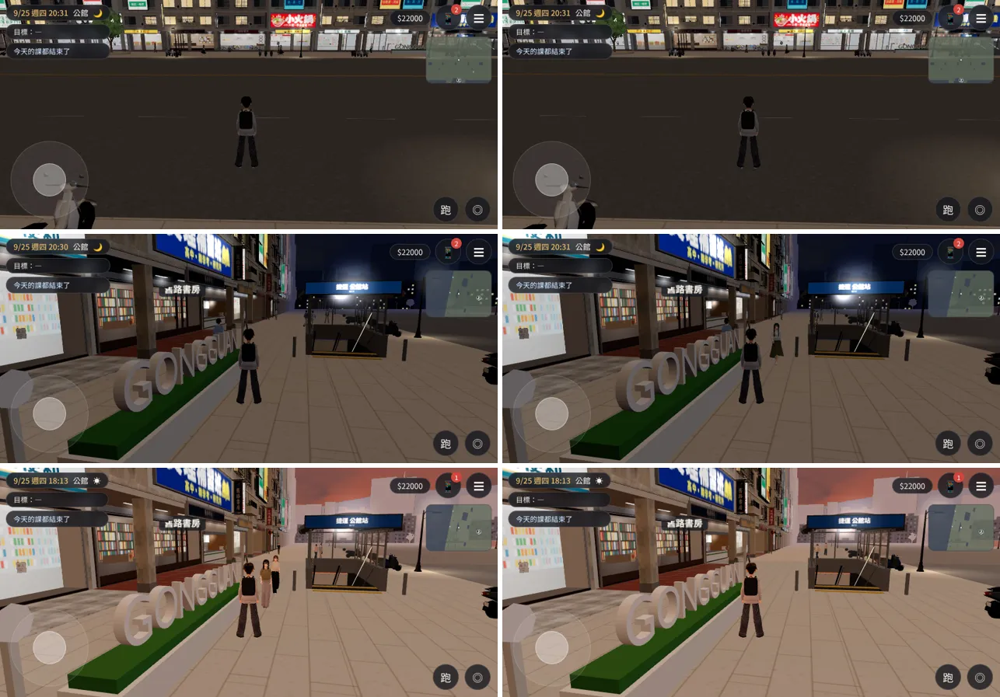
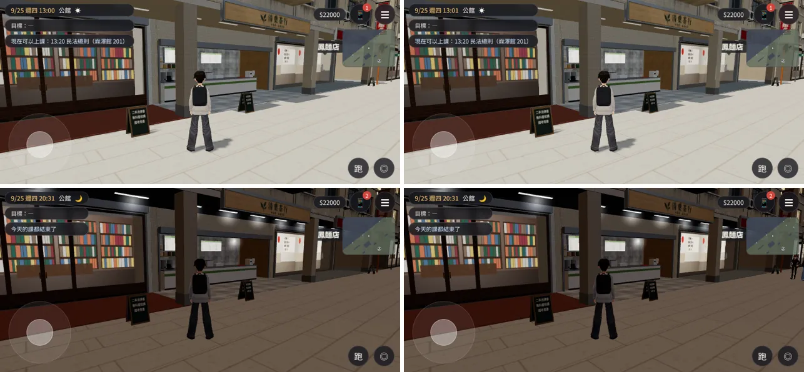
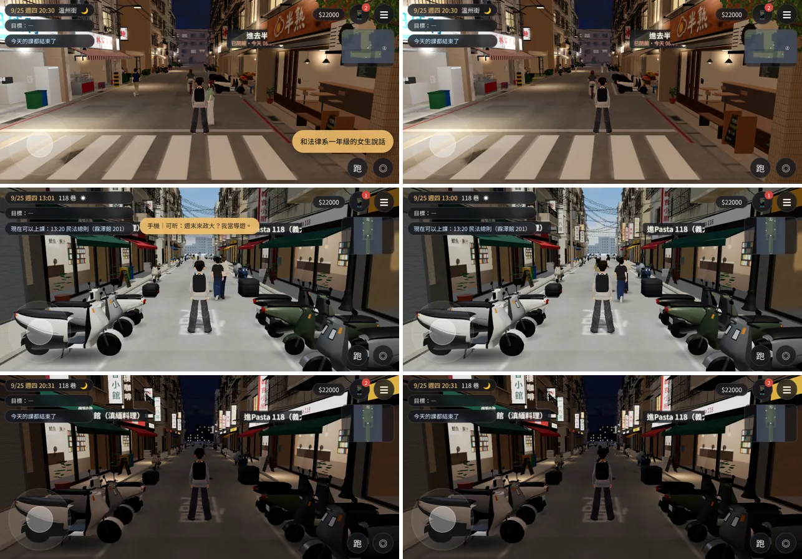

# GG-DRAWCALL-1021：公館校門口 draw call（店內景深卡 atlas、光暈合成一個網格、捷運出口合併材質）

LAWWW2-C，2026-10-21。
- 起因：LAWWW-C 10-20 決定「店面材質 atlas 那一輪要做」。
  - 校門口往南看的 draw call 是 `?nobldg` 的 1.53 倍，條件是 1.3 倍；
  - 使用者回報過那裡會卡。
- 量測：`tests/gongguan_glb_integration.py`。
  - Playwright 手機模擬（橫向）、SwiftShader，17:30，藏起路人，含陰影那一輪、含玩家；
  - 不是 iPhone 實機，數字只能互相比。

## 狀態
| 項目 | 狀態 |
|---|---|
| 捷運出口模型 | **MODEL_READY**（`gongguan_mrt_exit.glb` 重匯出） |
| 接進遊戲 | **INTEGRATED（只在我的測試工作樹）**：開發分支 `0e7a5efa`＋本頁的 patch |
| 測試 | `gongguan_glb_integration.py` **ALL PASS**（修改前 3 項 FAIL，見下面）；`wz_street_integration.py` ALL PASS；`map_canvas_leak.py` ALL PASS；`night_forget_unit.js` ALL PASS；傅鐘光暈（見下面）PASS |
| 美術 | 畫面應該和修改前一樣（同角度截圖、亮度量過）；**READY_FOR_ART_REVIEW** 照舊 |

## 找到的原因（17:30 校門口那個鏡頭，正式模型比 `?nobldg` 多的 draw call）
| 東西 | 修改前 | 修改後 |
|---|---|---|
| 光暈（騎樓燈、燈箱、直立招牌：一個 GLOW_ 一個 Sprite） | 店面 86＋捷運出口 4 個 Sprite，17:24 以後全部要畫（白天不畫） | 一個模型一個網格（2 次） |
| 店內景深卡（一面一張貼圖） | 15 次 | 1 次（一張 atlas） |
| 捷運出口 | 23 個網格 | 14 個 |

- 最大的是光暈：天快黑的時候突然多 90 次 draw call。
  - 原本以為是店面材質（LAWWW-C 給的方向），量了才知道主要是光暈；
  - 店面材質本身（牆、柱子、招牌、頂點色）已經合過，這次沒動。

## 結果（`gongguan_glb_integration.py`；左：`?nobldg` 程序化套件，右：正式模型）
| 鏡頭 | 修改前 | 修改後 |
|---|---|---|
| 人行道往西 | 214 → 276（1.29 倍） | 214 → 238（**1.11 倍**） |
| 校門口往南 | 178 → 272（**1.53 倍，FAIL**） | 178 → 184（**1.03 倍**） |
| 騎樓裡往西 | 221 → 278（1.26 倍） | 218 → 236（**1.08 倍**） |
| 往溫州街的巷口 | — | 123 → 135（1.10 倍） |

- 三角形沒變（25～36 萬，條件 42 萬以下）。
- 同一個測試在修改前（`1475d312`）跑：
  - 新加的兩項（景深卡 atlas、光暈一個網格）FAIL；
  - 效能 FAIL（1.53 倍）。
- 修改後 ALL PASS（D34：修改前失敗、修改後通過）。

## 改了什麼
| 檔案 | 誰的 | 改了什麼 |
|---|---|---|
| `assets/models/env/second_ai/gongguan_mrt_exit.glb`（＋`.json`） | LAWWW2 | `gg_mrt_exit.py`： - 純色、不透明的零件（鐵件、鋁件、深色花崗石、導盲磚、黑色）改成兩個頂點色材質； - 同材質合成一個網格；地面以下的 `PIT_*` 另外合（名字照舊 `PIT_` 開頭，遊戲靠它設 renderOrder）。 - 燈、玻璃、發光的地板牆、站名燈箱、遮罩不動。 - 23 → 14 個網格，三角形一樣（2,842）。 |
| `src/zones3d.js` | **LAWWW-C**（patch） | 見下面 |
| `tests/gongguan_glb_integration.py`、`tests/campus_glb_integration.py`、`tests/wz_street_integration.py` | **LAWWW-C**（patch） | 見下面 |

## 接線 patch：[`../../patches/gg_drawcall_atlas_glow.diff`](../../patches/gg_drawcall_atlas_glow.diff)（套在開發分支 `0e7a5efa`）
- `zones3d.js` 的 `attachWenzhouModel`：
  1. **光暈**：`wzGlowBatch` 把一個模型的 GLOW_ 合成一個網格。
     - 每個光暈是面向鏡頭的四邊形（和 Sprite 同樣的算法）；
     - 貼圖是白色的放射漸層 × 頂點色（和原本「這個顏色淡到透明」的漸層一樣）；
     - 亮度＝白天、晚上的值照夜間程度內插：材質登記在 `TK` 的夜間清單（白天 0、晚上 1），shader 讀它；
     - 太暗（≤ 0.02）的不畫，和 Sprite 一樣；全部都太暗時整個網格不畫（白天不多一次 draw call）；
     - 加法混合、不寫深度、不投影；畫在半透明玻璃之後（光暈都在玻璃外面）；
     - 一開始照路燈開了沒（`E.lampsOn`），和原本一樣（校園的夜間只在路燈開關時切換）。
     - 所有接正式模型的地方都用這個：公館店面 86、溫州街 56、小公園 4、日式宿舍 1、捷運出口 4、校門 4、傅鐘 2、社科院 3。
     - Café 的光暈（另一段程式）沒動。
  2. **店內景深卡**：和招牌、門牌一樣用 `wzAtlasFaces` 合成一張 atlas（`wz_interior_atlas`）。
     - 同一種店（cafe、books…）共用一格；
     - 原本靠貼圖重複兩次的板面（公館 G00、G02、G03、G15）切成兩塊（`wzSplitQuadU`），每一塊貼一整張；
     - 夜間亮度照舊（白天 0.6、晚上 1.15）。
     - 公館：15 面 → 10 格、1024×2048；118 巷：13 面 → 7 格、1024×1024。
  3. `wzAtlasFaces` 排 atlas 時也試寬一倍（一列放兩格），面積比較小、或一樣大但長邊比較短就用寬的。
     - 公館的景深卡窄的排法是 512×4096；
     - 現有的招牌、門牌 atlas 量過**大小都沒變**（溫州街、118 巷、公館、校園）。
- 測試：
  - `gongguan_glb_integration.py`：景深卡改查 atlas（15 面、原本的板面拿掉、三角形 2×(15+4)）；加光暈一項（86 個、11:00 不畫、20:30 畫、沒有個別 Sprite）。
  - `campus_glb_integration.py` 的傅鐘光暈：改讀合成的網格（`campus_bell_glb_glows`）。
  - `wz_street_integration.py`：備註多列合成的光暈。

## 畫面（左：開發分支 `1475d312`；右：加上這一次；9/25 週四）
- [捷徑] 讀檔、把人物放到位置、設鏡頭。
- 公館：
  1. 校門口往南 20:30；
  2. 人行道 20:30；
  3. 人行道 18:13（光暈剛開始亮）。

- 店門口（景深卡）13:00、20:30：

- 溫州街 20:30；118 巷 13:00、20:30：

- 亮度（灰階平均，0～255）：

| 區塊 | 修改前 | 修改後 |
|---|---|---|
| 溫州街店門口的吊燈 | 105.6 | 106.0 |
| 公館騎樓上方 | 59.5 | 59.4 |
| 公館人行道往西（招牌、騎樓燈） | 67.5 | 67.4 |

- 路人、手機通知每次不同，畫面其他地方的差別是這個。

## 傅鐘光暈（`campus_glb_integration.py` 這一輪跑不完）
- `campus_glb_integration.py` 在修改前（`1475d312`）和修改後**一樣**：
  - 「soc 的正式模型接上（campus_modern_glb）」等 3 項 FAIL；
  - 接著在 `campus_modern_glb` 那一段 `TypeError` 停掉，傅鐘那一段跑不到。
  - 這個測試本身過時了（社科院現在是 `campus_socsci_glb`；「先不放正式模型」的清單也舊了），**不是這次造成的**。
- 傅鐘光暈改用同一段檢查（`BELL_NIGHT`）另外跑：
  - 11:00 兩個都不亮；
  - 20:30 兩個都亮；
  - 晚上才進校園也是亮的。
  - PASS，沒有 JS 錯誤。

## 記憶體（誠實寫）
- 公館的景深卡：
  - 原本 10 種店各一張 512×256（同一種店共用）；
  - 現在一張 1024×2048；
  - 貼圖記憶體多約 3 MB。
- 118 巷：1024×1024，和原本 7 張差不多。
- 要省的話，atlas 每格縮成 0.75 倍，公館可以到 1024×1024；店內景深卡隔著玻璃，看得出一點模糊。由 LAWWW-C 決定，這次沒縮。

## 已知、還沒做
- iPhone 實機沒有測過（使用者回報的「卡」要實機才知道有沒有改善）。
- `campus_glb_integration.py` 過時，要更新（不是我的檔案；LAWWW-C 決定誰改）。
- 光暈合成一個網格以後，透明物件之間的前後排序是整個網格一起；光暈都在玻璃外面，所以畫在玻璃之後。玻璃後面的光暈（目前沒有）會不被玻璃蓋暗。
