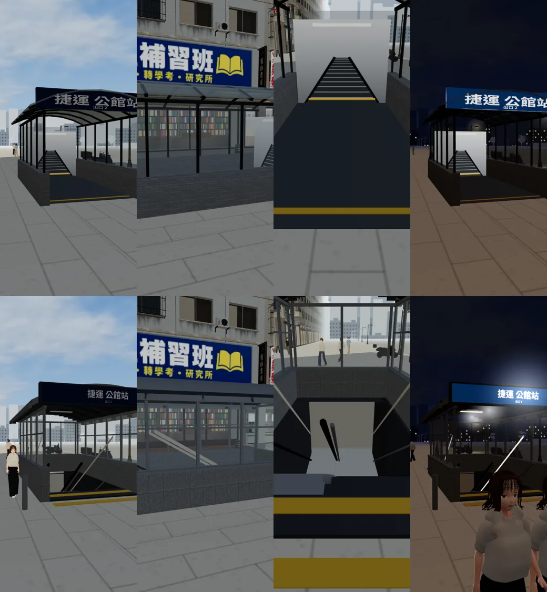

# ART-EXT-MRT：捷運公館站出口（玻璃亭）

LAWWW2-C，2026-10-18。
- 誰派的：使用者 10-18 03:3x「四座全部改」，LAWWW-C 03:08 派。
- 狀態：`MODEL_READY`。場景美術 **READY_FOR_ART_REVIEW**，使用者看過才算。

## 和原本的差別（玩家會看到）
- **原本**（套件 `TK.mrtExit`）：
  - 花崗石矮牆、玻璃、半透明的弧形屋頂；
  - 裡面的電扶梯是貼在後牆上的一張圖。
- **現在**（Blender `tools/blender/env_second/gg_mrt_exit.py`）：
  - 花崗石牆座，上面不鏽鋼壓頂；細鋁框玻璃（每 1.3 m 一根直框、一道橫框）。
  - 銀色鋁板弧形屋頂：前面挑出 0.6 m、有封簷板、兩側排水溝，中間一條玻璃天窗。
  - 站名燈箱掛在屋頂前緣：「捷運 公館站／出口 2」，遊戲畫的字，深藍底白字，**沒有捷運標誌**（D77）。晚上會亮。
  - 入口有黃色導盲磚和兩根不鏽鋼擋車柱。
  - **裡面真的往下**：
    - 左邊電扶梯（玻璃欄板、黑色扶手帶），右邊樓梯（不鏽鋼扶手）；
    - 30° 往下約 3 m，盡頭是亮的平台和後牆；
    - 地面以下看得到，**不用改區域的地面**：
      - 遊戲端先畫 `PIT_*`（renderOrder −2），再畫洞口的深度遮罩 `PITMASK`（只寫深度、不寫顏色，−1）；
      - 之後畫的人行道，在洞口那一塊比遮罩遠，畫不上去。
  - 屋頂下兩盞燈，晚上亮。
- 位置、方向、導航阻擋、鏡頭碰撞、互動點「捷運公館站入口」都照原本。

## 遊戲內前後截圖
Playwright、iPhone 直向 390×844 模擬，LAWWW-C 分支 `ba6e9aa4`。
- 上排：改之前。
- 下排：改之後。
- 左到右：從東邊看入口、從馬路那一側看、從入口往裡面往下看、晚上 20:30。

## 交付
- GLB：`assets/models/env/second_ai/gongguan_mrt_exit.glb`（2,842 個三角形、0.27 MB）。
- 腳本：`tools/blender/env_second/gg_mrt_exit.py`。
- patch：`docs/art-rebuild/second_ai/patches/gongguan_mrt.diff`（對 `ba6e9aa4`）：
  - `src/assets3d.js`：加 `bldg.gongguan_mrt`；
  - `src/zones3d.js`：公館的捷運出口——有正式模型時套件標 `ggMrt`、`dyn`；載入後同位置、同方向接上（`attachWenzhouModel`），設定 `PIT_*`、`PITMASK` 的 renderOrder。

## 測試
- 遊戲內 4 個鏡頭沒有 JS 錯誤。
- 沒測：
  - iPhone 實機；
  - `gongguan_layout_nav`、`zone_transitions`（導航和出入口都沒動，沒跑）；
  - 洞口遮罩在其他角度、很低的鏡頭有沒有破綻（只看了這 4 個鏡頭）。

## 還沒做到的
- **校園背景**那一座（校門外 (−181, −36.6)）還是套件。走不到、很遠，沒換。
- 沒有照片：
  - 公館站出口真正的造型（屋頂形狀、顏色、燈箱位置）是照台北捷運出口的一般樣子推測的；
  - 「出口 2」的編號照原本的。
- 電扶梯不會動。往下的井道裡面偏暗，看得出來往下，但看不清楚一階一階。
