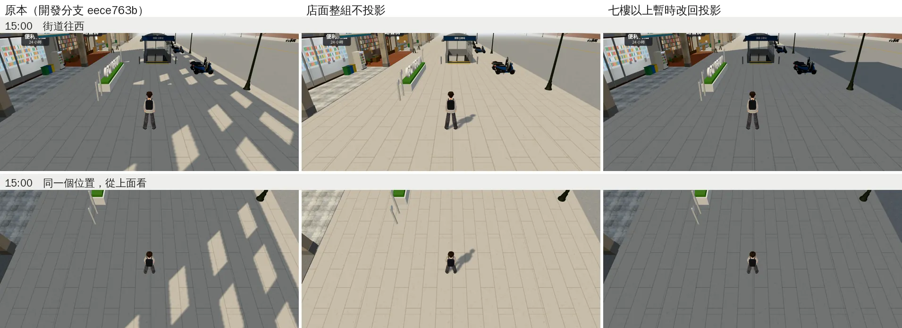
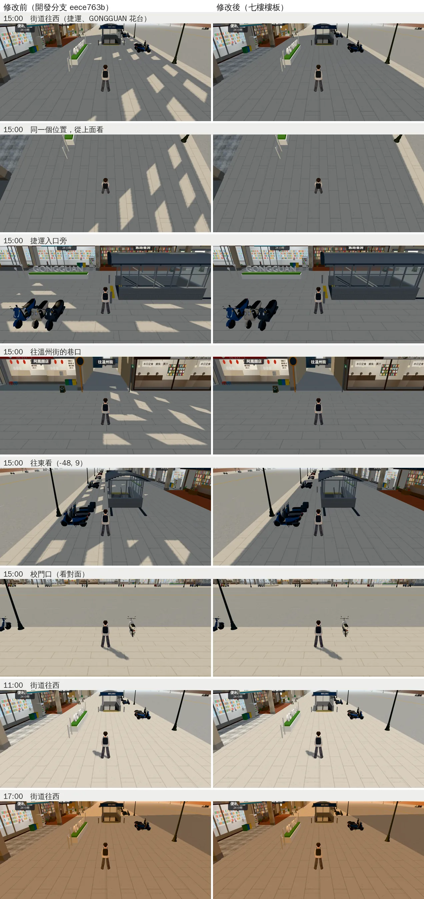

# 公館：下午人行道上不再有一排亮條（七樓樓板）

帳號 A 的 LAWWW2，2026-10-22 11:0x～11:3x UTC。巡場景第 4 區公館（`ART_DIRECTOR_PATROL.md` 第 4 節）找到的。

- **狀態**：交件；`READY_FOR_ART_REVIEW`（場景美術由使用者驗收）。
  - `assets/models/env/second_ai/gongguan_shops.glb`（＋`.json`）同檔名替換，遊戲的程式不用改。
  - 腳本：`tools/blender/env_second/wz_street.py`（一行）。

## 看到的

- 15:00 公館的人行道上，有一排等距、斜的亮條，像陽光從一格一格的縫照下來。
- 街道往西、騎樓、捷運入口旁、往溫州街的巷口、往東看都有（巡場景 j51、j54）。

## 原因

- 10-20 為了不讓高樓的影子在馬路上畫出切齊的直線，公館店面七樓以上的牆、樓板線、屋頂改成不投影（`NOSHADOW_`，LAWWW2-C；`1475d312` 已接）。
- 店面是一個空心的盒子：一到六樓有四面牆，裡面沒有樓板。
- 七樓以上不投影以後，在陰影計算裡**整棟樓等於沒有屋頂**：
  - 下午太陽在店面後方，光從頂上照進空心的樓；
  - 再從二到六樓正面的窗洞照出來，落在 6～10 m 外的人行道上；
  - 每扇窗一條，所以是一排等距的亮條。
- 探測（j52、j55、j58，開發分支 `eece763b`；15:00 街道往西，和同一個位置從上面看）：
  - 店面整組不投影：亮條和影子都不見。所以亮條來自店面這一組。
  - 七樓以上暫時改回投影：亮條全部消失。但右上的馬路又出現切齊的長影子，就是 10-20 拿掉的問題，所以不能這樣改。



## 改法

- 每棟七樓以上的店面（14 棟），在七樓樓板的位置加一塊會投影的樓板：
  - 20 cm 厚，比外牆內縮 20～25 cm，在樓裡面，從外面看不到；
  - 用那棟樓自己的牆材質，和牆合在同一個網格，不多 draw call。
- 陰影計算裡，一到六樓變成有頂的盒子，太陽照不進去；七樓以上照舊不投影，馬路上不會出現長影子。
- 六樓以下的店面本來就有會投影的屋頂，不用改。

### `tools/blender/env_second/wz_street.py`

```python
    if HI: xf.box(wall, -W / 2 + 0.2, W / 2 - 0.2, HI - 0.2, HI, -D + 0.2, -0.25)   # 七樓樓板（在樓裡面，看不到）
```

- `HI`＝公館七樓以上不投影的那個高度（`GH + 5 × FH`），只有公館、而且七樓以上的店面有；溫州街、118 巷不受影響。

### GLB（和原本比）

- 先確認：用同一支腳本、不加樓板重做，和 repo 裡原本的 GLB 每個材質的世界座標三角形相同，只有一個網格的索引順序不同（Blender 合併的順序）。
- 加樓板以後：
  - 只有三種牆材質多了三角形：`wz_wall_mosaic` +48、`wz_wall_plaster` +36、`wz_wall_tile` +84，共 14 塊、+168 個三角形。
  - 其他 28 個材質的三角形完全相同。
  - 4,916,792 → 4,930,208 bytes；物件、材質、網格數不變。
  - `gongguan_shops.props.json`（地上雜物的腳印）不變。

## 遊戲內前後（j56）

- Playwright＋SwiftShader，844×390（手機橫向）、像素比 2，**不是 iPhone**。
- 修改前＝開發分支 `eece763b`；修改後＝只換這一份 GLB。路人藏起來，玩家跟隨鏡頭（6.5 m、俯角 0.38）。



- 15:00 五張：亮條都不見了，人行道是一整片店面的影子（下午騎樓前面本來就在影子裡）；陽光照在馬路上，影子的邊界和原本一樣。
- 校門口（看對面）、11:00、17:00：和原本一樣，馬路上沒有多出長影子。
- draw call：八張都和修改前相同；三角形每張多 300～336 個。
- 同一份：`node tests/nav_buildings_unit.js` ALL PASS（導航不讀 GLB，只是確認）。

## 整合測試 `tests/gongguan_glb_integration.py`（j57，瀏覽器）

- 開發分支 `eece763b`：修改前跑一次，換這份 GLB（＋`.json`）再跑一次。

| | 結果 |
|---|---|
| 修改前（`eece763b` 原本的 GLB） | 34 項 PASS、**1 項 FAIL**：「導航格：正式模型和程序化版完全相同」 |
| 修改後（只換 GLB） | 一樣：34 項 PASS、同一項 FAIL，導航格的數字完全相同 |

- **這一項不是這次造成的**，開發分支本來就不過，而且是照設計：
  - 量到的是 `[[320, 220, 2911422483, 29688], [320, 220, 603822518, 29593]]`（欄、列、雜湊、擋住的格數）：正式模型那一份多擋 95 格。
  - 這 95 格是地上雜物的腳印：`zones3d.js` 正式模型接上以後才 `propBlocks(nav, GG_PROP_BLOCKS)`（ART-WZ0 `wz0_prop_nav`，LAWWW `2a67b144` 10-22 06:39 整合），`?nobldg` 的套件沒有這些雜物，所以不擋。
  - 對得上：同一份開發分支跑 `node tests/street_props_nav_unit.js`，「gongguan：雜物的阻擋是模型接上以後才加　可走的格子 40807 → 40712」，正好少 95 格（ALL PASS）。
  - 所以要改的是這支整合測試的期待（正式模型＝`?nobldg`＋雜物腳印），不是模型。測試是 LAWWW 的，我沒有改。
- 效能那一項（每個鏡頭 draw call ≤ `?nobldg` 的 1.3 倍、三角形 ≤ 42 萬）前後都 PASS：

| 鏡頭 | 修改前 draw call／三角形 | 修改後 |
|---|---|---|
| street_west | 238／364,556 | 233／364,840 |
| from_gate | 185／261,833 | 185／262,169 |
| arcade | 239／366,394 | 236／364,874 |
| lane | 134／226,453 | 134／226,753 |

- 三角形多 284～336（樓板＋陰影那一輪）；street_west、arcade 前後的 draw call 差幾個、arcade 少了 1,520 個三角形，是同一支測試兩次跑的路人、機車分組不一樣（樓板只在店面那一組，不會少）。

## 接法（LAWWW）

1. 換 `assets/models/env/second_ai/gongguan_shops.glb`、`gongguan_shops.json`（同檔名）。程式不用改。
2. 腳本 `tools/blender/env_second/wz_street.py`：我的分支比開發分支多了 ART-WZ0 的地上雜物腳印（`prop_fp`，10-21），這次只加一行。要整支拿的話，那一段也會一起進去（不影響公館的模型：腳印檔不變）。
3. 跑 `tests/gongguan_glb_integration.py`（瀏覽器）：「導航格完全相同」那一項在開發分支本來就 FAIL（雜物腳印，見上面），其他和原本一樣。

## 還不到的地方（誠實寫）

- 只看了公館。溫州街、118 巷的公寓最高六樓，屋頂會投影，沒有這個問題。
- 遠景（`gongguan_far`、校園看出去那排）沒有查。
- 真機沒看過。
