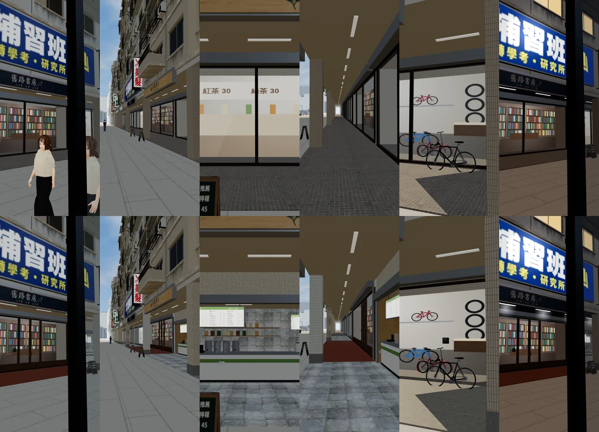
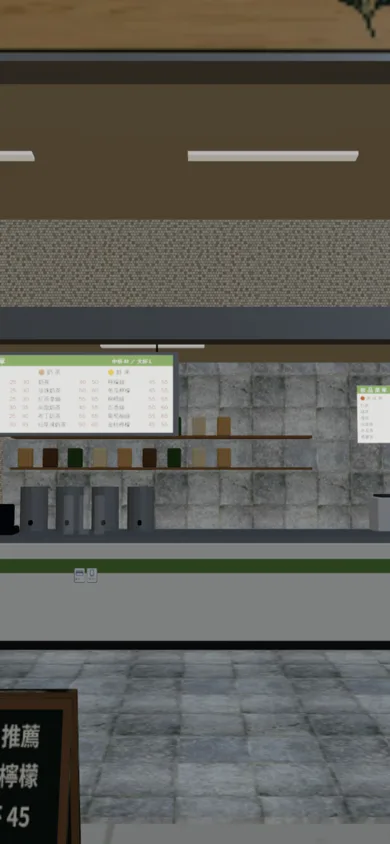
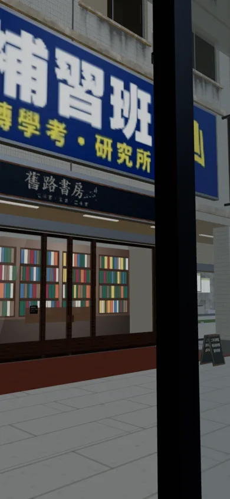
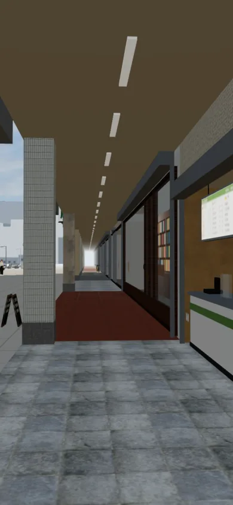
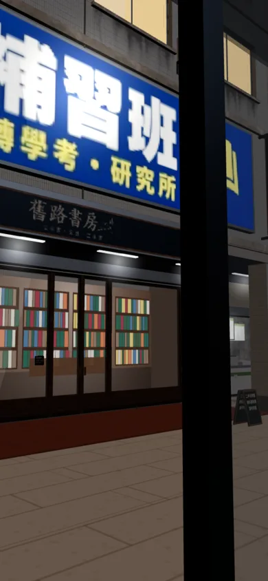

# ART-GG-SHOPS-1018：公館南側騎樓店面（第一輪）

LAWWW2-C，2026-10-18。
- 誰派的：LAWWW-C 05:46（使用者 05:5x 玩 v9.10：「公館的店面從外面看都好醜，希望修改」）。
- 狀態：`MODEL_READY`。場景美術 **READY_FOR_ART_REVIEW**，使用者看過才算。

## 原本的問題
- 十五間騎樓店面都是同一個做法：一整片玻璃＋四根直框＋玻璃後 1.2 m 一張店內貼圖。
- 騎樓地板整條同一種，柱子同一種磁磚，晚上騎樓沒有燈光。
- 從騎樓、從對街看，每一間都一樣、很平。

## 這一輪改了什麼（玩家會看到）
用的是溫州街的店面組件（`wz_shopkit.py`，7b 店面設計準則），新寫騎樓版的 `arcade_front_v2`。
- **每家的門不一樣**：
  - 鋁門＋長把手：藥局、洗衣、影印、文具；
  - 木框玻璃門：書店、咖啡、唱片、早午餐；
  - 自動門：便利商店；
  - 整面拉開、摺門收兩側：麵店、滷味、單車、水果；
  - 木格拉門＋暖簾：定食。
  - 都有鐵捲門箱和兩側導軌，便利商店除外。
- **茶行**：臨騎樓的立體點餐櫃台，有菜單燈箱、茶桶、搖茶機、層架上的茶葉罐。
- **騎樓地磚每一棟不同**：馬賽克、紅磚色缸磚、白磁磚、花崗石、磨石子、花磚、水泥。台北的騎樓本來就是一棟一種。
- **柱子**包這一棟的外牆，柱腳有石材護角。店與店之間的壁柱也是。
- **玻璃上的紙條**：營業時間、徵人、支付貼紙、影印價目表、走失的貓…，全部虛構、沒有品牌（D77）。
- **晚上**：騎樓日光燈有光暈。
- 招牌照舊，是之前的設計稿。
- 樓上的公寓沒改。

## 試做、沒用上的
- 每間店玻璃後面做成立體的淺店內（麵店的煮麵台、書牆、貨架、洗衣機…，溫州街那一套）。
  - 在 3 m 深的騎樓後面，白天太暗：書店一片黑，單車行只剩灰牆，比原本的店內貼圖差。
  - 只有茶行用立體的（臨騎樓）。其他照舊用店內貼圖，遊戲畫的，比較亮。

## 遊戲內前後截圖
Playwright、iPhone 直向 390×844 模擬，週三 15:00（最右邊一張 20:30）。
- 上排：改之前，LAWWW-C 分支 `ba6e9aa4`。
- 下排：改之後，換了 GLB。
- 左到右：對街看書店、沿著店面街、茶行、騎樓裡、單車行、晚上。

改之後的單張：

| 茶行 | 書店 | 騎樓 | 晚上 |
|---|---|---|---|
|  |  |  |  |

## 交付
- GLB：`assets/models/env/second_ai/gongguan_shops.glb`。
  - 3.0 萬三角形 → 3.5 萬；3.1 MB → 4.0 MB；材質數一樣（111）。
- 腳本：
  - `tools/blender/env_second/wz_street.py -- --set gongguan`；
  - 店面組件 `wz_shopkit.py`：新增 `arcade_front_v2`、`SF_GG` 表；門、玻璃那一段抽成 `_door_glass()`，溫州街和公館共用。
- **程式不用改**：換 GLB 就好。導航、店門互動點、碰撞都沒動（騎樓裡沒有放雜物）。

## 測試
- 從校門往店面街看的鏡頭：三角形 24.3 萬 → 25.1 萬（+3%），draw call 156 → 156。上限是 42 萬。
- 溫州街用同一套組件重算：三角形、材質、物件數和原本完全一樣（`_door_glass` 抽出來沒有改到溫州街）。
- 遊戲內 12 個鏡頭沒有 JS 錯誤。
- 沒測：iPhone 實機；`gongguan_layout_nav`（導航沒動，沒跑）。

## 還沒做到的（誠實列出）
- 店內大多還是一張貼圖。近看玻璃後面是平的。
- 樓上的公寓、對面的馬路、公車亭沒改。如果「醜」是指整條街的樣子，還要再一輪。
- 紅色缸磚的騎樓地（書店、早午餐）顏色比較搶眼。
