# ART-GG-SIGNS：公館六家店的招牌換成設計稿

- **做的人**：LAWWW2-B。
- **狀態**：`READY_FOR_ART_REVIEW`。場景美術的 `ART_APPROVED` 由使用者決定。
- **招牌圖的來源**：使用者生成、BB-B 驗收通過的設計稿。
  - BB-B 分支 `docs/story_planning/signs_approved/`，最後一張（S6 日日定食）在 `447b911e` 通過。
  - 每家一張橫招牌、一張直立招牌，用 `_fit` 版本（已經切成招牌的比例）。
- **檔案**：`assets/models/env/second_ai/gongguan_shops.glb`（＋`.json`），2.75 MB。
- **遊戲程式不用改**。整合測試要改幾個檢查，patch 在 `docs/art-rebuild/second_ai/patches/gg_signs_test.patch`（下面第 3 節）。

## 1. 換了哪幾塊
| 店 | 建築 | 橫招牌 | 直立招牌 |
|---|---|---|---|
| 阿鳳麵店 | G00 | 紅底、碗的圖示 | 紅底白字 |
| 舊路書房 | G02 | 設計稿 | 設計稿 |
| 公館藥局 | G04 | 白色燈箱、綠字、藥罐圖示 | 白底綠字「藥局」 |
| 輪轉單車 | G06 | 設計稿 | 設計稿 |
| 影印・輸出 | G10 | 深藍底、印表機圖示 | 深色「影印」 |
| 日日定食 | G11 | 木紋招牌 | 設計稿 |

- 日日便利（G03）照舊用溫州街那張 `riri_mart_h`。
- 其他店（清葉茶行、自助洗衣、桌遊・撞球、二樓補習班…）還是遊戲用 canvas 寫字的招牌（S5～S18 等使用者生成、BB-B 驗收後再換）。
- 招牌圖合成一張貼圖集：`tools/blender/env_second/textures/gen/gg_signs_atlas.jpg`（`sign_atlas.py --set gongguan`）。

## 2. 遊戲內修改前後（同一個鏡頭、11:00；左修改前、右修改後）
- 修改前：開發分支原本的 `gongguan_shops.glb`（窗原型直接改過的那一版，3eb86bfb）。
- 修改後：這次的 GLB。
- Playwright 手機模擬，**不是真機**。

西段（阿鳳麵店的橫、直招牌）：
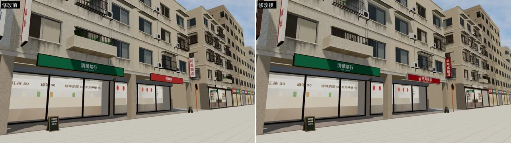

中段（公館藥局的白色燈箱、直立「藥局」）：
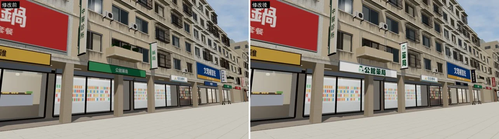

東段（影印・輸出、直立「影印」）：
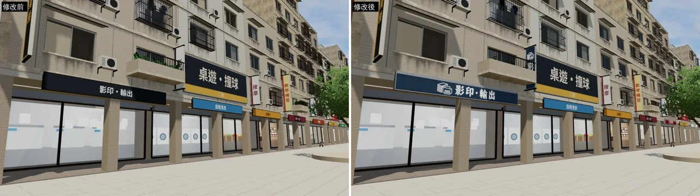

## 3. GLB 結構變了（要整合測試的 patch）
- 公館這次是用現在的 `wz_street.py` 重建的。溫州街效能那幾輪改過共用的程式（合併小零件、貼圖集），所以公館也一起變成效能版：

| | 原本 | 這次 |
|---|---|---|
| 物件 | 815 | 436 |
| 畫出來的三角形 | 83,061 | 53,679 |
| 材質 | 97 | 111 |
| 檔案 | 2.20 MB | 2.75 MB（多了招牌貼圖集） |

- 疊面第三輪的修正（窗內房間內縮、窗下的牆停在窗台裡）重建時就包含在內，不用再跑 `patch_window_protos.py`。
- `tests/gongguan_glb_integration.py` 要改三個地方（patch 對開發分支 `3d477ddb`）：
  1. 設計稿招牌從 G03 一家變成七家（G00、G02、G03、G04、G06、G10、G11）。合併以後 `sk_sign_<店>` 的名字不在了，改成檢查「沒有 canvas 字的 `SIGN_FACE`、`VSIGN_FACE`，而且畫面上有 `wz_signs`／`wz_signs_lit` 材質的網格、三角形數夠」。
  2. 店的直立招牌（canvas 字）從 6 塊變成 0 塊；樓上住戶的 8 塊照舊是 canvas 字。
  3. 窗的檢查改成和 `tests/wz_street_integration.py` 一樣（亮燈的窗內房間合併以後也算數）。
- 結果：測試工作樹＝開發分支 `3d477ddb`＋這個 GLB＋patch，**ALL PASS（40 項）**。
  - 效能：四個鏡頭 draw call 是 `?nobldg` 的 1.05～1.09 倍，三角形 21～26 萬（上限 1.3 倍、42 萬）。
  - 互動點 7 個位置、半徑、名稱完全相同。

## 4. 還沒到的地方
1. **陽台盆栽從街上幾乎看不到**（比較圖的二樓陽台：修改前有綠葉，修改後只剩欄杆）。
   - 原因不是招牌：溫州街效能第六輪把大葉盆栽換成「模型葉子」的版本（葉片卡的大葉子遠看像折紙），比舊的矮 11 cm、顏色比較暗；陽台的牆有 56 cm，從街上往上看只露出一點點。
   - 位置、數量都沒變（15 盆，座標相同）。
   - 溫州街也一樣。下一輪兩條街一起改（盆栽放到花架上，或陽台換大一點的植物），已登記在交接檔的待辦。
2. 其他店的招牌（S5～S18）還是 canvas 字，等設計稿。
3. 晚上的招牌（燈箱亮起來）沒有另外截圖驗收。
4. 真機沒驗證。

---

# ART-GG-SIGNS-2：公館其餘招牌全部換成設計稿（第二批；交件 `b75e50a5`；狀態 READY_FOR_ART_REVIEW）

- **做的人**：LAWWW2-B 做模型（`01984198` 腳本＋34 張 `_fit`＋貼圖集、`b75e50a5` GLB＋patch）；LAWWW2-C 拍前後截圖、夜間目視、寫這一節（2026-10-17）。
- **招牌圖的來源**：使用者生成、BB-B 驗收通過的 S1～S17（BB-B `2f5d4a3d`／`bc9e0f58`；交付紀錄 DL-BB-GG-SIGNS-S17）。沒有真實店名、商標（D77）。
- **換了哪些**：1F 橫招牌 16 家、店的直立招牌 6 塊、樓上住戶直立 8 塊、二樓大招牌 5 塊、屋頂看板 1 塊——全部改用貼圖集 `gg_signs_atlas.jpg`（2048×4096、36 張）＋夜間發光貼圖 `gg_signs_atlas_emit.jpg`（燈箱整面亮、霓虹只亮線條、不亮的部分黑）。GLB 裡不再有 canvas 字的 `SIGN_FACE`／`VSIGN_FACE`。
- **檔案**：`assets/models/env/second_ai/gongguan_shops.glb`（3.13 MB、405 物件）＋`.json`；整合測試 patch `docs/art-rebuild/second_ai/patches/gg_signs2_test.patch`（只改 `tests/gongguan_glb_integration.py`；**遊戲程式不用改**）。
- **重建**：`python3 tools/blender/env_second/sign_atlas.py --set gongguan` → `/opt/blenv/bin/python tools/blender/env_second/wz_street.py --set gongguan`。

## 遊戲內修改前後（同鏡頭；左＝第一批 `40b73c64`（＝開發分支 adoring-meitner 目前的 GLB）、右＝`b75e50a5`）
- 1280×720、藏起玩家與路人；11:00、21:00。測試工作樹＝`claude/adoring-meitner-mqzst8` `a39a6812`，只換 GLB＋json。Playwright＋SwiftShader，**不是真機**。

西段：
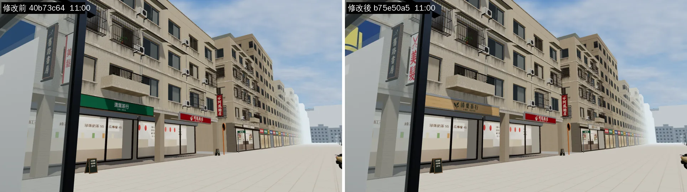
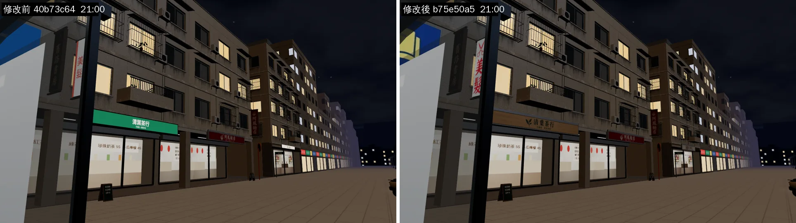

中段（小火鍋二樓燈箱、滷味橫招牌、中醫、藥局直立）：
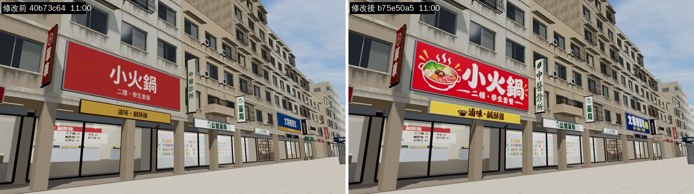
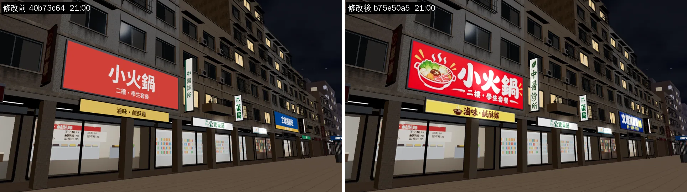

G07 一帶（補習、民宿直立、咖啡輕食）：
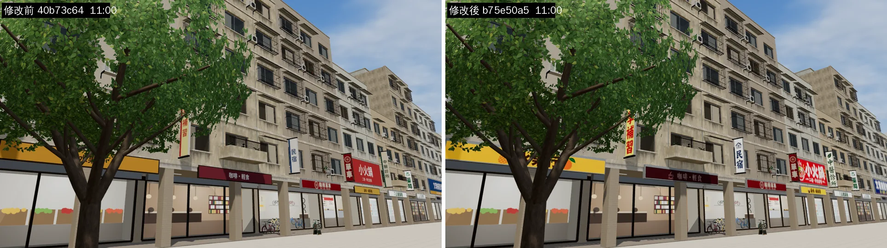
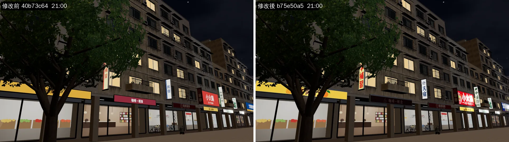

東段（英語會話、牙醫、鋼琴教室、二手唱片霓虹）：
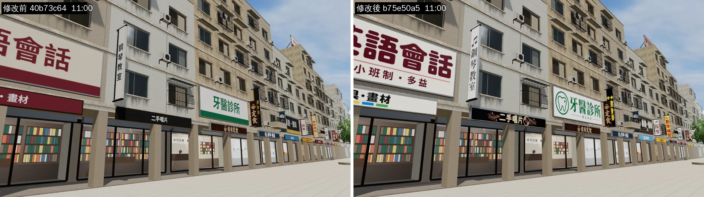
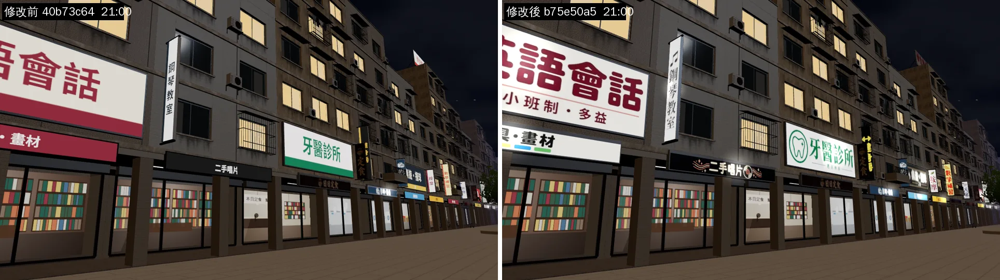

校門往南看整條街：
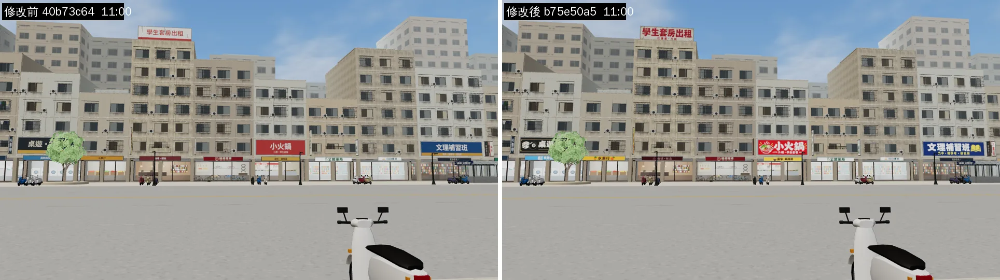
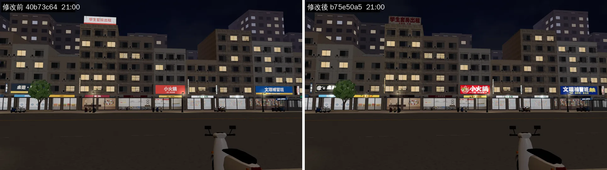

## 夜間目視（LAWWW2-C，21:00 那五張）
- 燈箱（小火鍋、英語會話、牙醫）整面均勻亮，字和圖案清楚，沒有過曝成白塊。
- 二手唱片的霓虹：只有線條和字亮、底板是暗的（遮罩正確）。
- 直立招牌（中醫、藥局、鋼琴、民宿）晚上看得出來、不刺眼。
- 遠處（校門那一鏡）的招牌變成一排小亮塊，沒有閃爍。
- 沒看到的：雨天、17:30 黃昏；手機直向（390×844）這批沒拍。

## 測試（LAWWW2-B 交班時）
- 開發分支 `3d477ddb`＋第一批 patch＋這次 patch＋新 GLB：`tests/gongguan_glb_integration.py` **ALL PASS 34 項**（第一批 40 項，拿掉 7 項 canvas 招牌貼圖集、加 1 項「沒有 SIGN_FACE／VSIGN_FACE」）。
- 效能：draw call 是 `?nobldg` 的 1.08～1.15 倍（上限 1.3）；三角形 21～26 萬（上限 42 萬）。
- LAWWW2-C 這次沒有重跑測試，只拍截圖（20 張都沒有頁面錯誤）。

## 八項（ART_SOP 3-2）
| 項目 | 結果 |
|---|---|
| 輪廓與倒角 | 招牌板沿用第一批的倒角板（`wz_shopkit.py`），沒改 |
| 材質 | 印刷品貼圖集＋發光貼圖（ART_SOP 2-3：印刷品用程式合成的貼圖集） |
| AO | 沒改（招牌板下緣的暗靠遊戲陰影） |
| 磨損 | 沒做：設計稿是乾淨的新招牌；舊招牌的褪色、鏽水要另外做（不在這件的範圍） |
| 生活痕跡 | 不適用 |
| 比例 | 尺寸照第一批的招牌板，沒改 |
| 效能 | 見上（draw call ≤1.15 倍、GLB 3.13 MB） |
| 遊戲截圖 | 上面 10 組 |
