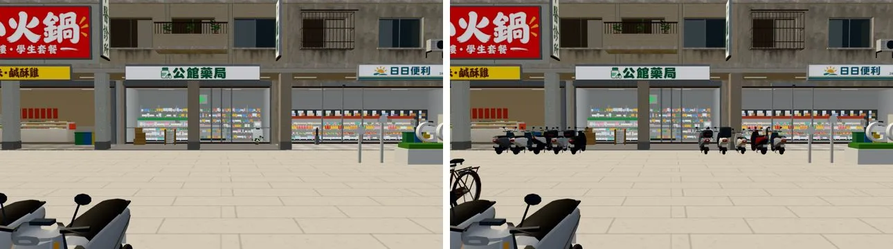
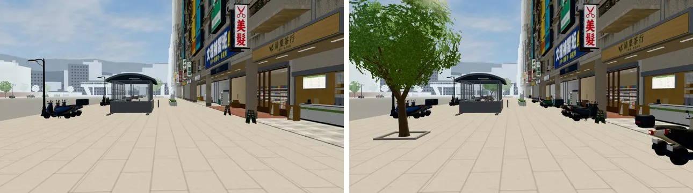
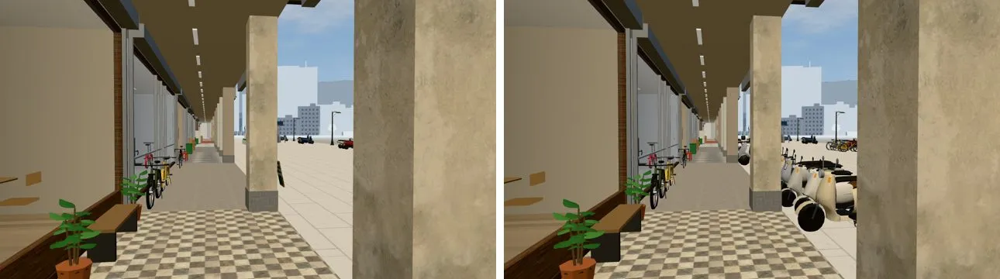
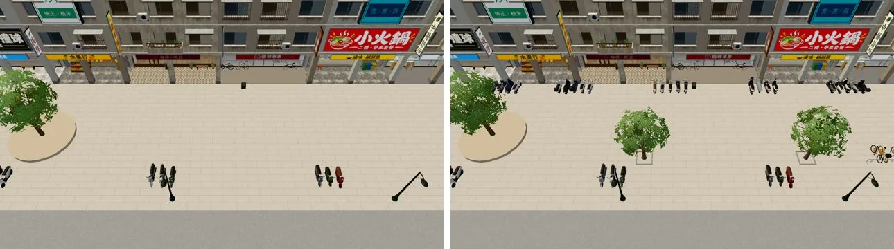
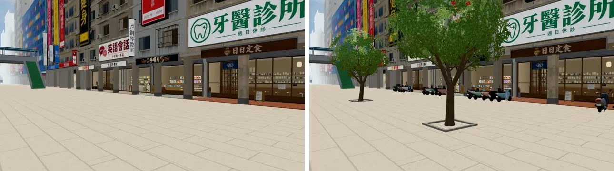
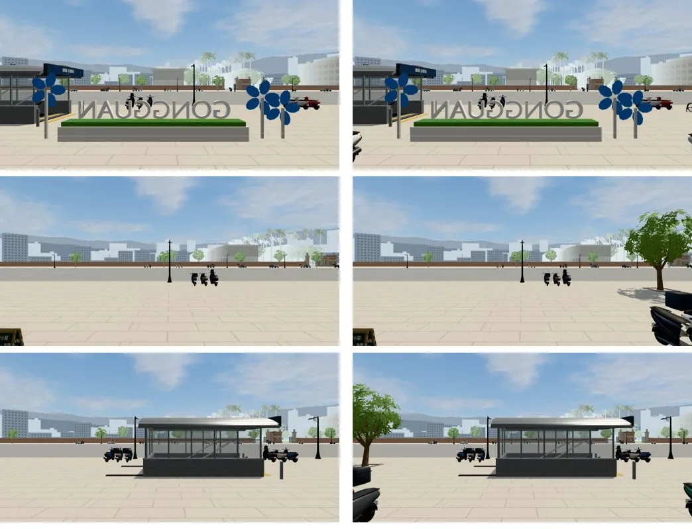

# ART-GG-STREETLIFE-1023：公館騎樓外的生活感（機車、腳踏車停車架、行道樹）

- **誰要的**：
  - 使用者 10-23：「店面外看出去的景也都很假」。
  - 店內窗景第一批（`ecfe5a6a`）交件時發現：從公館的店裡、騎樓往外看，是一大片空的鋪面廣場。
  - LAWWW-B 10-23 12:33 同意做，任務 ID `ART-GG-STREETLIFE-1023`。
- **做的人**：LAWWW2-B。公館的場景程式照 D108 由 LAWWW2 改。
- **狀態**：`READY_FOR_ART_REVIEW`。場景美術的 `ART_APPROVED` 只有使用者能標。

## 做了什麼（`patches/gg_streetlife_1023.patch`，只改 `src/zones3d.js`，對開發 `fb75d67ea`）

1. **騎樓柱子外一排機車**：14 段、每段 4～5 台，共 69 台。
   - 位置：z 17.35～18.95，車頭朝騎樓。臺北的騎樓前就是一整排機車。
   - 不擋的地方：
     - 路人沿 z 16.5 走（`story3d.js` 的 `walkRoutes`）。
     - 有互動的店門口（麵店、茶行、書店、便利商店、輪轉單車）前後各留 2.6 m。
     - 往溫州街的巷口不停車。
   - 一段跨在一根騎樓柱子前面，下一根柱子前面空著＝從廣場走進騎樓的缺口。柱子兩側各 2 m 多。
   - 用現有的機車接法（`scRow`＋`attachWzScooters`，正式模型 `scooter.glb`），沒有新模型。
   - 一段一組：近／遠模型照「鏡頭到這一段中心」的距離切換。這一排 40 m 外不畫：一台 600 個三角形，那麼遠只是一個小點。
2. **兩個腳踏車停車架**：和校園同一套 `W3.bikeRack`，整排合成一塊。
   - 捷運出口東邊 (−14.5, 9.2) 7 格。
   - 圓環東邊 (34, 9.2) 8 格。
3. **五棵行道樹＋樹穴**：
   - 位置：(−53, 9.4)、(−7, 9.0)、(7.5, 9.0)、(46, 9.6)、(58, 9.6)。
   - 樹是 `TK.tree`，和溫州街同一套。樹穴是黑土＋一圈矮緣石。
   - 避開路人的斜線 (−40,14.5)→(0,10)→(40,14)，和路邊那排機車。
4. **三家店的窗景重拍**（`tools/shots/shop_views_layers.py`）：
   - 便利商店、麵店、書店，白天、晚上，加去背近景，共 12 張。
   - 景深更新：`patches/gg_streetlife_views_1023.patch` 改 `world3d.js` 的 `VIEW_LAYERS`。

     | 店 | 遠景景深 | 近景景深 |
     |---|---|---|
     | 麵店 | 22.4 → 13.31 | 3.33 → 4.01 |
     | 書店 | 13.31 → 12.48 | 照舊 |
     | 便利商店 | 照舊 | 照舊 |

- 導航阻擋在套件階段就加：機車、車架、樹本來就是套件畫的，正式模型只換機車的外觀。

## 遊戲內修改前後（同一個鏡頭；14:00；藏起路人和玩家）

- 測試環境：Playwright＋SwiftShader，1280×720，**不是 iPhone**。
- 【捷徑】自訂鏡頭。
- 每張：左＝修改前（開發 `fb75d67ea`），右＝修改後。

從馬路邊看藥局、便利商店（a）：

從廣場西端往東看（b）：

騎樓裡往西看（c）：

俯瞰（d）：

東段，定食、二手唱片那一帶（e）：

店裡往外看的窗景照片（左＝原本，右＝重拍；遠景＋近景合成；由上到下：便利商店、麵店、書店）：

## 效能（同一個鏡頭的 draw call／三角形）

| 鏡頭 | 修改前 | 修改後 |
|---|---|---|
| a | 103／241,903 | 122／301,539 |
| b | 147／271,752 | 167／333,450 |
| c | 143／248,106 | 163／301,164 |
| d | 118／250,591 | 130／300,716 |
| e | 101／221,171 | 119／260,584 |

- 最重的鏡頭 b 是 33.3 萬三角形。溫州街的標準是 42 萬。
- 怎麼省下來的（鏡頭 b）：
  - 第一版機車整排五大組，近的那一組 20 台都用近模型：36.4 萬。
  - 改成一段一組、40 m 外不畫：33.3 萬。
  - 停車架約 1,400 個三角形。
- 多的三角形扣掉機車、停車架以後，大約還有 3 萬，推測是行道樹的葉片、樹和車的陰影。行道樹被整區合併了，沒辦法單獨量。

## 測試（開發 `fb75d67ea`＋這個 patch，用開發分支的測試腳本）

| 測試 | 結果 |
|---|---|
| `tests/gongguan_layout_nav.py` | 51 PASS，0 FAIL |
| `tests/reachability_all.py --zones gongguan` | ALL PASS（8 個互動點、6 個出入口到達點） |
| `node tests/street_props_nav_unit.js` | ALL PASS |
| `node tests/nav_buildings_unit.js` | ALL PASS |

- 我自己加的 Node 檢查（不用瀏覽器）：
  - 騎樓的 5 個互動點都走得到。
  - 騎樓 z 20.5 每一個站得住的點都走得到。
  - 從廣場每 5 m 取一點走進騎樓，路線都不超過 14 m（不用繞遠）。
- 路人路線上有 26 個點站不住，都在圓環 (19～22, 12) 那一段：路線本來就穿過圓環，修改前一樣是 26 點，**不是這次造成的**。
- 更正：中途一次用了我分支上比較舊的 `gongguan_layout_nav.py`，校門有 4 項 FAIL（修改前後都一樣）。改用開發分支的版本：0 FAIL。

## 還沒做到、要注意的

1. **路人**：
   - 街上走動的路人是 `story3d.js` 的 `walkRoutes`，不是場景程式。LAWWW 決定要不要加。
   - 我先量好兩條加了以後也站得住的路線（半徑 0.33 每 0.25 m 取樣，都 PASS）：
     - 騎樓裡：`[[-66,20.4],[-30,20.4],[10,20.4],[76,20.4]]`
     - 廣場上繞過圓環：`[[-20,12.5],[12,13.6],[22,15.6],[34,13.6],[52,12.0],[70,12.5]]`
2. **店裡往外看，正前方還是廣場**：
   - 三家店的門口照規則留了 2.6 m 不停車，所以從店裡往外看，機車、樹在窗的兩邊，正中間還是空的鋪面。
   - 要更滿，要在廣場中段加東西（公車站、花台座椅、書報攤），會動到路人的斜線，要另外討論。
3. 機車的顏色、款式照現有機車的比例隨機（`scooter.glb`）。
4. 晚上沒有另外拍；機車和樹沒有自己的燈。
5. iPhone 實機沒看過。
