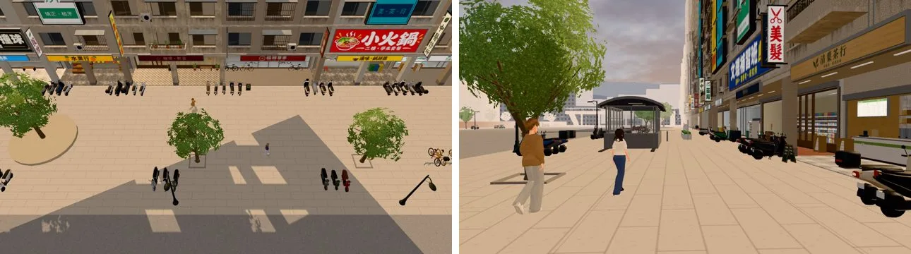

# GG-WALKERS-1023：公館南側的路人路線

- **誰要的**：
  - ART-GG-STREETLIFE-1023（`5fed31e9`）交件時提了兩條路線。
  - LAWWW-B 10-23 13:50 同意，要求先於 118 巷窗景第二批交。
- **做的人**：LAWWW2-B。
- **檔案**：`patches/gg_walkers_1023.patch`，只改 `src/story3d.js` 的 `walkRoutes.gongguan`，對開發 `fb75d67ea`＋街景 patch。

## 改了什麼

1. **新增一條廣場上的路線**：
   - 路點 (−20,12.5)→(12,13.6)→(22,16)→(34,13.6)→(52,12)→(70,12.5)，再走回來。
   - 從捷運出口東邊開始，繞過圓環北側，經過兩個停車架和東段的行道樹之間。
2. **原本 z 16.5 那一條改成 z 16，x −30 那一點改成 x −22**。原因：
   - 路人的每個路點會隨機偏 ±1 m（`extras`：`p[0]+(rnd()-0.5)*2`）。
   - 原本偏到 z 17.5 會擦過騎樓外那排機車的車尾（街景 patch 加的，z 17.35 起）。
   - x −30 那一點偏到 z 15.5 會進捷運出口旁的 GONGGUAN 花台（花台這一項本來就有，不是街景 patch 造成的）。
3. **騎樓裡的路線沒有加**：騎樓只有 2.4 m 深（柱子 z 19.6 到店面玻璃 z 22），放不下 ±1 m 的偏移，路點會偏進柱子、店門口的腳踏車。
   - 要加的話，`extras` 要能讓某一條路線的偏移小一點（`story3d.js`，你的程式）。
4. **路人數量沒有改**：白天 8 個，晚上 4 個，乘上人潮倍數和畫質倍數。
   - 輪流分到現在五條路線。
   - 南側四條（原本那條、廣場新的、斜線、西端）合起來分到的人數和原本一樣，只是分散到廣場上。

## 測試（開發 `fb75d67ea`＋街景 patch＋這個 patch，開發分支的測試腳本）

| 測試 | 結果 |
|---|---|
| `tests/gongguan_layout_nav.py` | 51 PASS，0 FAIL |
| `tests/reachability_all.py --zones gongguan` | ALL PASS |
| `node tests/street_props_nav_unit.js` | ALL PASS |

另外我自己加的 Node 檢查（不用瀏覽器；腳本在 LAWWW2-B 的工作區）：
- 南側四條路線，每個路點 ±1 m 方框裡每 0.25 m 取樣，人物半徑 0.33 都站得住：ALL PASS。
  - 改前原本那一條在花台旁有 36 點站不住。
- 每條路線取 40 組隨機偏移，用和遊戲一樣的找路（`nav.path`）一段一段走：每一段都找得到路，終點離目標 0.5 m 內（共 960 段）。

## 遊戲內畫面

- 測試環境：Playwright＋SwiftShader，**不是 iPhone**。
- 16:00 不藏路人。

- 這一刻公館有 12 個路人（人潮倍數）。各條路線的人數：
  - 北側 4。
  - 原本南側那條 3。
  - 斜線 2。
  - 西端 1。
  - 廣場新的 2。
- 左：俯瞰（廣場上、行道樹之間有人走）。右：廣場西端往東看。

## 要注意的

- 路人只是沿路線來回走，不會停下來看店、不會騎機車離開（現有的路人系統）。
- iPhone 實機沒看過。
