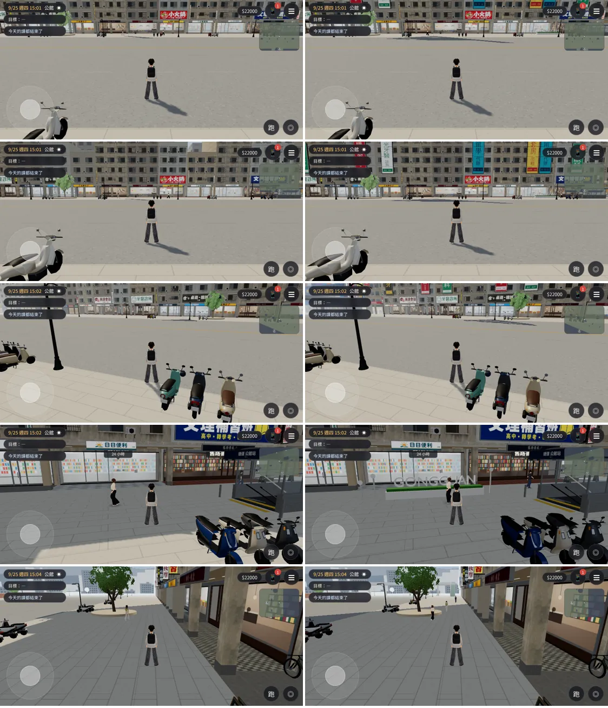
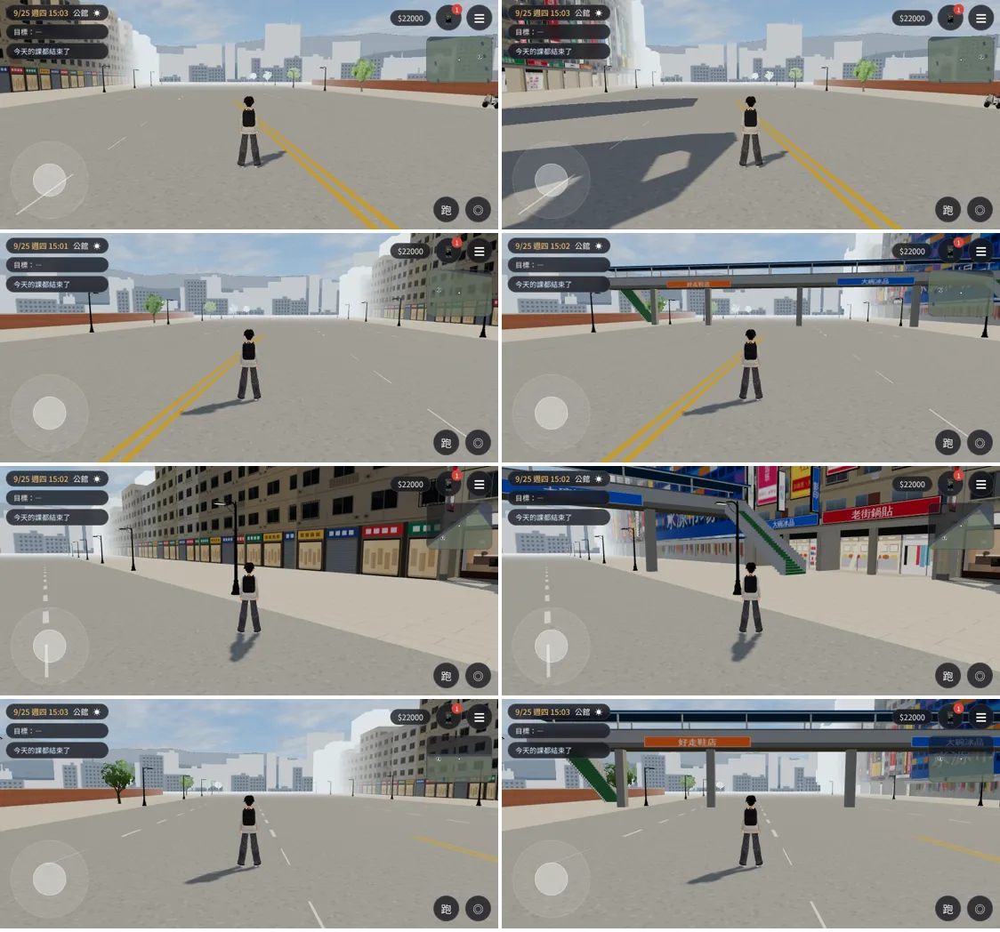
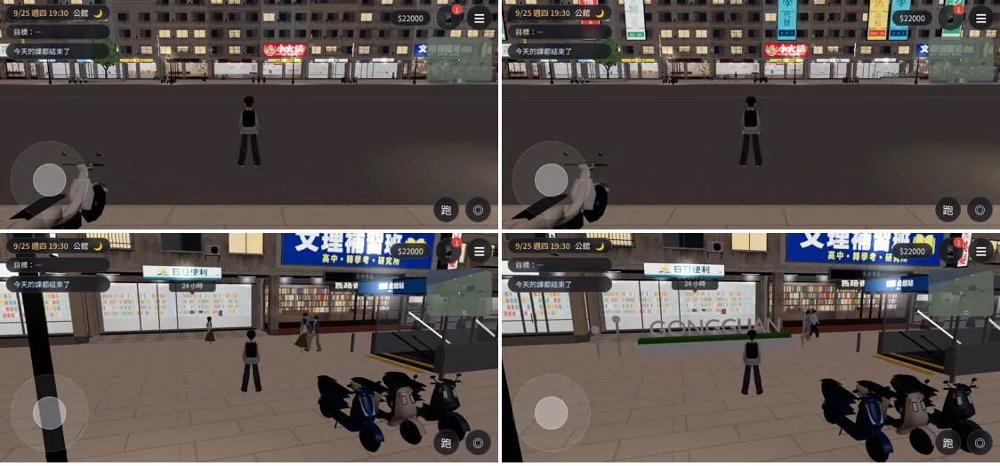
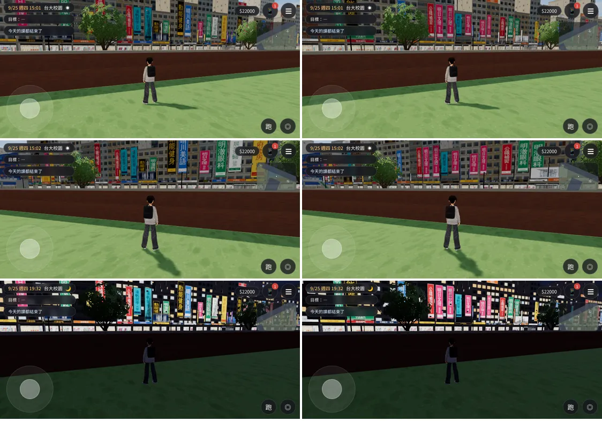
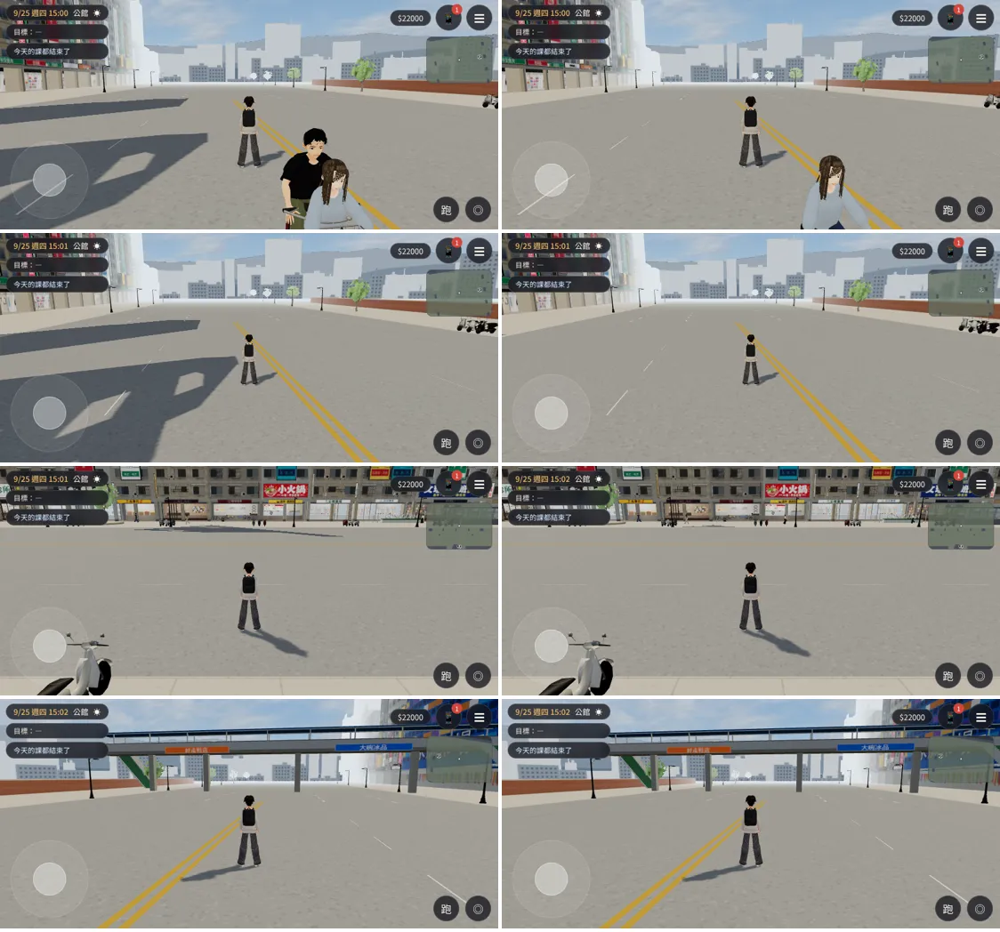

# GG-STREETVIEW-1020（X86）第二階段：公館區域裡面

LAWWW2-C，2026-10-20。
- 使用者 10-20：「從學校去看公館或者外面的建筑都超級丑的完全沒有那種三d游戲的感覺公館的店面」，附羅斯福路、捷運出口、水源市場的照片（照片不進 repo）。
- 第一階段（從校園看出去的羅斯福路）：[`../gg_backdrop_1020/README.md`](../gg_backdrop_1020/README.md)，LAWWW-C 已接（`e7b96f70`）。
- 這一階段：走到公館區域裡面看到的街景。
  - 店面街加高，和從校園看出去的那一排一樣高；
  - 樓上加大看板；
  - 羅斯福路兩端延伸出去的街廓、後排高樓；
  - 水源市場、天橋；
  - 捷運出口旁的 GONGGUAN 字樣和藍色小花。

## 狀態（分開標）
| 項目 | 狀態 |
|---|---|
| 模型 | **MODEL_READY** |
| 接進遊戲 | **INTEGRATED（只在我的測試工作樹）**：開發分支 `5fc69491`＋本頁的 patch |
| 測試（Playwright 手機模擬，不是 iPhone 實機） | `gongguan_layout_nav.py` **ALL PASS**、`reachability_all.py --zones gongguan` **ALL PASS**、截圖 ALL PASS、沒有 JS 例外；`gongguan_glb_integration.py` 見下面 |
| 美術 | **READY_FOR_ART_REVIEW**（等使用者看） |

## 修改前／後（左：開發分支 `5fc69491`；右：加上這一階段）
- 9/25 週四 15:00；[捷徑] 讀檔、把人物放到位置、設鏡頭。
- 每列依序：
  1. 校門口往南；
  2. 同一個位置、鏡頭往上抬；
  3. 斜對面；
  4. 捷運出口旁的 GONGGUAN；
  5. 騎樓。

- 羅斯福路往西、往東、東端看水源市場、天橋：

- 晚上 19:30：樓上的大看板、窗會亮。

- 校園那一側（第一階段的模型照這一階段重建，看板重新排、天橋多了屋頂、GONGGUAN 的花台換到新位置）。左：第一階段；右：這一階段。

## 改了什麼
| 檔案 | 誰的 | 改了什麼 |
|---|---|---|
| `assets/models/env/second_ai/gongguan_shops.glb`（＋`.json`） | LAWWW2 | 15 棟店面加高到 6～14 層，和校園看出去的那一排一樣（`gg_backdrop.py` 的 `HEIGHTS_SHOPS`）。 - 一到六樓和原本完全一樣（店面、招牌、使用者給的招牌設計稿都沒動）； - 七樓以上用遠景的做法：沒有冷氣、雨遮，鐵窗少。 |
| `assets/models/env/second_ai/gongguan_far.glb`（＋`.json`，新） | LAWWW2 | 公館區域的遠景（區域座標、放在原點）： - 羅斯福路兩端延伸的店面街（x 77.6～230、−88～−230）； - 後排高樓； - 水源市場（藍色立面、彩色橫條、一樓攤位）； - 天橋（藍色屋頂、扶手、樓梯、橋身招牌）； - 捷運出口旁的 GONGGUAN 字樣＋三朵藍色小花； - 區域裡 15 棟店面的大看板（7 層以上、沒有陽台的那幾棟，從三樓開始，兩端留給直立招牌）。 |
| `assets/models/env/second_ai/campus_gongguan_bd.glb`（＋`.json`） | LAWWW2 | 照同一支腳本重建：每一棟用位置當亂數種子，校園、公館兩個版本同一棟長得一樣；天橋、GONGGUAN 的花台同上 |
| `src/zones3d.js`、`src/assets3d.js` | **LAWWW-C**（patch） | 見下面 |
| `tools/blender/env_second/gg_backdrop.py`、`wz_street.py` | LAWWW2 | `gg_backdrop.py -- --zone gongguan`＝公館區域的遠景；`wz_street.py --set gongguan` 的樓層數 |

## 接線 patch：[`../../patches/gg_zone_far_wire.diff`](../../patches/gg_zone_far_wire.diff)（套在 `5fc69491`）
1. `assets3d.js`：manifest 一筆 `bldg.gongguan_far`（lazy）。
2. `zones3d.js` 公館區域的背景：
   - 原本的 `city`（`TK.bgCity`）照舊蓋，放進 `gongguanFarFallback`（`userData.dyn`）；
   - 正式模型載入後藏起來；
   - 正式模型不投影、不收影子；晚上 `TK.addNight` 和校園那一側相同。
3. GONGGUAN 的花台：
   - 導航擋起來：`nav.blockRect(-30,15.1,7.2,1.0)`＋三朵小花 `blockCircle` 0.25；
   - 備用的方盒裡也有一個白色花台，模型載入前不會是看不見的牆。
   - 位置：捷運出口東邊 x −33.5～−26.5、z 14.7～15.5。
   - 夾在路人的兩條路線中間（`story3d.js` 的 `walkRoutes.gongguan`：z 16.5 那一條、(−40,14.5)→(0,10) 那一條），各留約 1 m。
- 店面加高只換 `gongguan_shops.glb`。
  - `zones3d.js` 的套件店面（載入前、`?nobldg`、載入失敗）照舊 4～7 層；
  - 鏡頭碰撞照套件的高度算（七樓以上沒有鏡頭碰撞；在街上、騎樓裡鏡頭到不了那麼高）。

## 測試（`5fc69491`＋patch，不用 turbo）
| 測試 | 結果 |
|---|---|
| `tests/gongguan_layout_nav.py` | **ALL PASS**（店門口、騎樓、捷運出口、圓環、舊存檔、進出麵店、往溫州街） |
| `tests/reachability_all.py --zones gongguan` | **ALL PASS**（8 個互動點） |
| `tests/gongguan_glb_integration.py` | 4 項 **FAIL**，`5fc69491` 沒有套 patch 也是同樣 4 項 FAIL（本來就有，不是這次造成的）： - 店內景深卡貼圖； - 騎樓柱子的樹幹透視； - 「沒有標記的群組沒有多藏」：多了 1 個群組＝`gongguanFarFallback`，載入後本來就要藏； - 校門口鏡頭 draw call 是 `?nobldg` 的 1.47 倍（上限 1.3） |
| 截圖（本頁） | ALL PASS，沒有 JS 例外 |

## 效能（`gongguan_glb_integration.py` 的四個鏡頭，有正式模型時；含陰影那一輪、含玩家）
| 鏡頭 | draw call 修改前 → 後 | 三角形 修改前 → 後 |
|---|---|---|
| 店面街往西 | 263 → 261 | 320,460 → 362,910 |
| 校門口 | 259 → 262 | 216,831 → 259,333 |
| 騎樓 | 265 → 272 | 320,450 → 365,500 |
| 往溫州街的巷口 | 129 → 133 | 183,555 → 228,297 |

- 三角形每個鏡頭多約 4.2～4.5 萬，最多 36.6 萬（上限 42 萬）；draw call 差不多。
- 模型本身：
  - `gongguan_shops` 畫出來的三角形 61,093 → 84,221；
  - `gongguan_far` 16,336（取代的方盒約 4,000）；
  - 校園背景 12,838 → 15,194。
- 另外用自己的腳本在同一個位置量（`perf_gg.py`）：路人走進走出畫面，每次差到 10 萬以上，只能看上面那張表。

## 模型規格
| | `gongguan_far.glb` | `campus_gongguan_bd.glb` | `gongguan_shops.glb` |
|---|---|---|---|
| 大小 | 1.67 MB | 1.64 MB | 4.32 MB |
| 三角形 | 16,336 | 15,194 | 41,045（instancing 畫出來 84,221） |
| 網格／材質 | 5／5 | 5／5 | 44 種／111 |
| 貼圖 | 5 張，最大 1024 px（`textures/gen/gg_bd_*.png`） | 同左 | 不變 |

## 已知缺點
- 下午店面街往西看時，加高的樓投在馬路上的影子邊緣有一條直線：那是陰影範圍的邊界，不是模型。
  - 要的話可以讓七樓以上不投影（`wzCastsShadow`），由 LAWWW-C 決定。
- 大看板只有 8 種，一長排看得到重複；字都是虛構的店名。
- 天橋、水源市場在區域外面，走不到；天橋的樓梯只看得到。
- GONGGUAN 的字是白色頂點色，背光的時候偏灰；晚上不會亮。
- 七樓以上的窗沒有冷氣、雨遮，從騎樓抬頭看比一到六樓簡單。
- iPhone 實機沒有測過。

## 更新：七樓以上不投影（10-20 21:xx，LAWWW-C 20:08 決定）
- 原因：下午往西看時，加高的樓投在馬路上的影子邊緣有一條直線（陰影範圍的邊界）。
- 改了什麼：
  - `wz_street.py --set gongguan`：七樓以上的牆、樓板線、女兒牆、屋頂、頂樓加蓋另外放進物件 `NOSHADOW_*`（合併時和低樓層分開）；
  - 遊戲：`wzCastsShadow` 看到名字開頭 `NOSHADOW_` 就不投影。
  - 一到六樓照舊投影，影子的長度和加高以前（4～7 層）差不多。
- patch：[`../../patches/gg_upper_noshadow.diff`](../../patches/gg_upper_noshadow.diff)（`zones3d.js` 兩行，套在 `fd861eec`）＋換 `gongguan_shops.glb`／`.json`。
- 模型：
  - 三角形 41,045 → 41,731（牆在七樓切開）；
  - 網格多 5 個（`NOSHADOW_wz_wall_tile`、`_mosaic`、`_plaster`、`NOSHADOW_wz_cafe_band`、`_roof_slab`、`_corrugated`）：一般那一輪 +5 draw call、陰影那一輪少畫七樓以上那些面。
- 同一次另外修：**騎樓柱子的樹幹透視**（`gongguan_glb_integration.py` 那 4 項舊 FAIL 之一，是真的問題）。
  - 原因：10-18 我把柱子改成包這一棟的外牆，柱子和外牆變成同一個材質，遊戲認不得柱子（照材質名 `wz_pillar_tile` 找）；
  - 柱子擋住玩家時不會網點透空。
  - 改法：
    - 柱子自己一個材質 `wz_pillar_<牆>`（同一張貼圖、頂點色，看起來不變）；
    - 遊戲改成 `/^wz_pillar_/`。
  - 測試：這一項修改前 FAIL、修改後 PASS。
- 測試：`gongguan_glb_integration.py` 剩 3 項 FAIL（都是舊的；判斷見下面）。效能（有正式模型時；含陰影那一輪；七樓不投影＋柱子材質一起）：

| 鏡頭 | draw call 前 → 後 | 三角形 前 → 後 |
|---|---|---|
| 店面街往西 | 261 → 276 | 362,910 → 356,696 |
| 校門口 | 262 → 272 | 259,333 → 253,067 |
| 騎樓 | 272 → 278 | 365,500 → 356,686 |
| 往溫州街的巷口 | 133 → 141 | 228,297 → 220,145 |

- draw call：七樓切開 +5、柱子三個材質 +3（含陰影那一輪）；三角形少 6 千～9 千。

- 修改前／後（左：`fd861eec`；右：加上這一次；9/25 15:00）：
  1. 店面街西段往西；
  2. 同一個位置、鏡頭拉遠；
  3. 校門口往南；
  4. 往東看天橋。

## gongguan_glb_integration.py 的舊 FAIL：哪些是測試過時、哪些是真的問題（LAWWW-C 20:08 問）
| 項目 | 判斷 | 說明 |
|---|---|---|
| 16 棟的店內景深卡都有貼圖 | **測試過時** | G01 清葉茶行 10-18 改成臨騎樓的立體櫃台（開口看得到裡面），本來就沒有景深卡；另外 15 張都在。測試的 IDS 扣掉 G01 就好 |
| 騎樓柱子有樹幹透視 | **真的問題 → 已修** | 見上面 |
| 沒有標記的群組沒有多藏 | **測試過時** | 一般網址多藏的 3 個是被正式模型取代的套件：校門（`ckTag`）、捷運出口（`ggMrt`）、`gongguanFarFallback`。其他空的群組（路燈光、樹幹代理、`bikeKind`）兩邊一樣。測試要略過這兩個標記和名字結尾 `Fallback` 的 |
| 校門口 draw call ≤ `?nobldg` 的 1.3 倍 | **真的超出預算**（三角形在上限內） | 272 對 178＝1.53 倍（第二階段以前 1.47）。主要是公館店面 GLB 的材質 113 個、網格 52 種。要降得把店面的材質再合併（貼圖 atlas）；可以排一輪效能 |

## 更新：gongguan_glb_integration.py 過時的兩項改掉（LAWWW-C 10-20 21:00 決定；10-21）
- patch：同一份 [`../../patches/l118_perf_and_test_fixes.diff`](../../patches/l118_perf_and_test_fixes.diff)（`tests/gongguan_glb_integration.py`）。
  1. 景深卡：查 15 棟（`INT_IDS`＝扣掉 G01；G01 清葉茶行是臨騎樓的立體櫃台）。
  2. 群組多藏：
     - 略過 `ckTag`（校門）、`ggMrt`（捷運出口）、名字結尾 `Fallback` 的群組（被正式模型取代的套件）；
     - 只比「藏起來的群組數」。正式模型自己會多出群組（例：公館遠景），群組總數本來就不一樣。
- 結果（開發分支 `1475d312`）：

| 項目 | 修改前 | 修改後 |
|---|---|---|
| 店內景深卡 | FAIL（要 16 張，G01 沒有） | **PASS**（15 張都有貼圖） |
| 沒有多藏群組 | FAIL（44／33 對 43／30） | **PASS**（藏起來的都是 30 個） |
| 校門口 draw call ≤ 1.3 倍 | FAIL | FAIL（真的超出：下一輪店面材質合併） |
