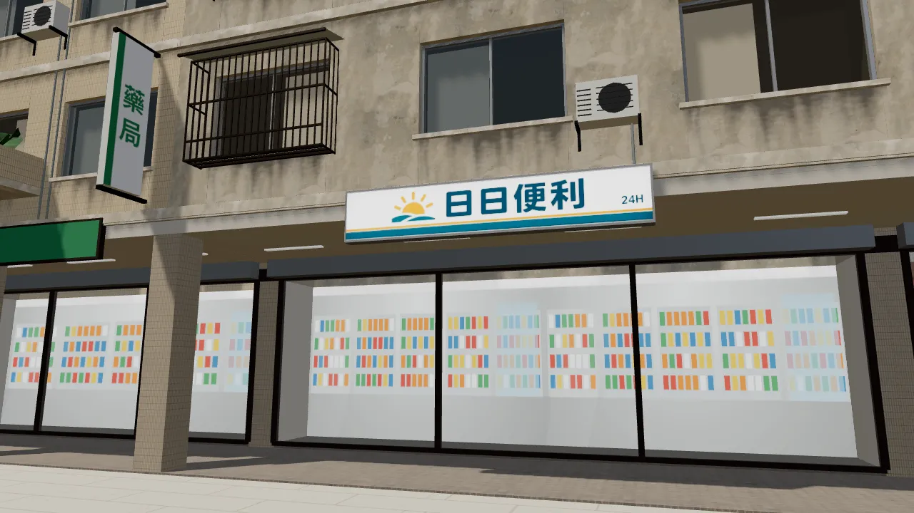
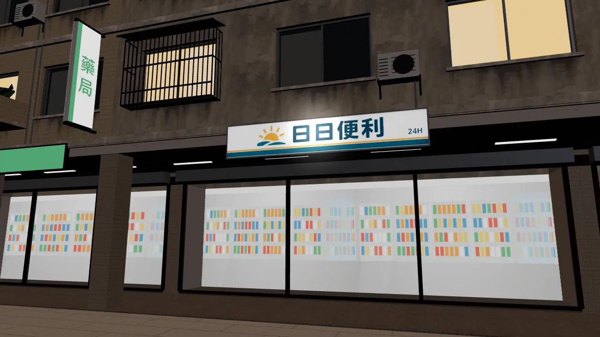
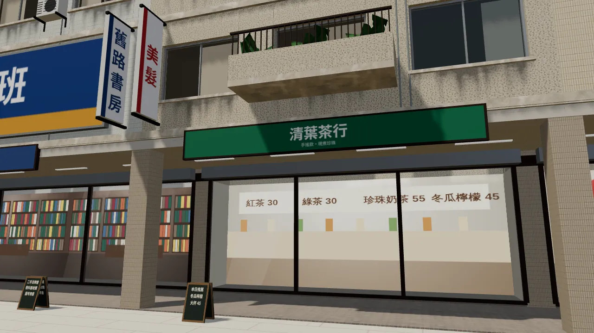

# 公館店面：清葉茶行、日日便利（LAWWW2-B 2026-10-16）

- **清葉茶行**（原「青葉茶行」；LAWWW-B 轉達的改名）：還是程式字招牌，等使用者生成的設計稿（BB_149 3-0）。
- **日日便利**（原「全日便利商店」）：
  - 和溫州街同一家連鎖，招牌用同一張設計稿 `riri_mart_h`（`wz_signs_atlas`）。
  - 這一棟的 `SIGN_FACE_G03` 拿掉了，遊戲不會再用 canvas 字蓋過去。
- `zones3d.js` 的店名、`story3d.js` 的櫃台文字由 LAWWW-B 改。

| 日日便利（白天） | 日日便利（晚上，燈箱亮） | 清葉茶行 |
|---|---|---|
|  |  |  |
