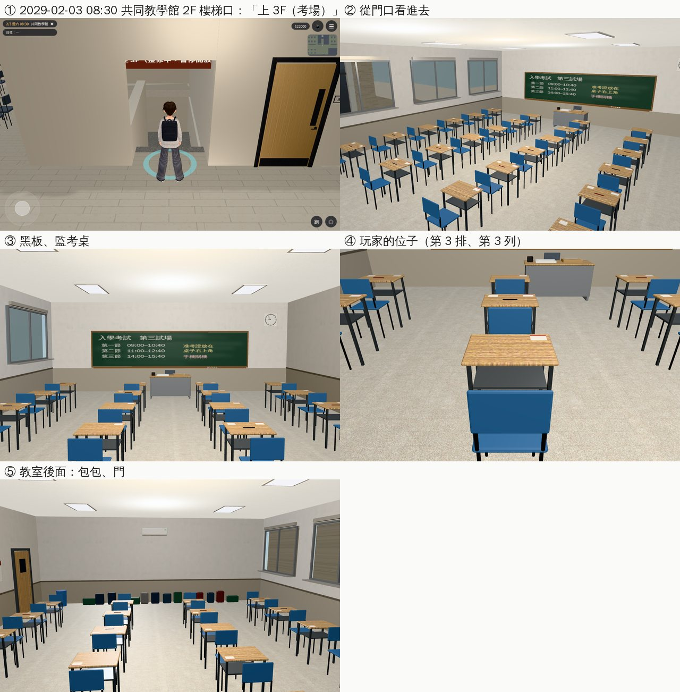

# 共同教學館 3F 考場（AA_399 第 9 節；任務 #82 第三間）

- **企劃**：AA_399 第 9 節（AA-B，企劃線 `5d09bb725`）。
  - 只有考試那天開：2029-02-03（`ev_grad_exam`）、2030-02-16（延畢版，AA_327）。
  - 玩家走到 3F 的教室，找到自己的座位；以安那句「你在三樓。我在二樓。」從此有了地方。考試本身照現在的旁白（黑底）。
  - 其他時間：2F 樓梯口的鍊子「整修中」照舊。學姊 08:30 的便條在共同教學館門口（劇情）。國考照 2D，不搬。
- **派工**：LAWWW-B 10-24 03:53（P2），任務 #82 第三間。
- **做的人**：LAWWW2-B。
- **狀態**：`READY_FOR_ART_REVIEW`。場景美術的 `ART_APPROVED` 只有使用者能標。
- **Patch**：`docs/art-rebuild/second_ai/patches/rooms_ab3_1024.patch`（研討室 B、系辦、考場同一份；對開發 `907cdc2f9`、`738cc7ffc` 都 `git apply --check` 過）。模型在我的分支。

## 做了什麼

- **模型**（Blender bpy，`tools/blender/env_second/gongtong_3f.py` → `assets/models/env/second_ai/gongtong_3f.{glb,json,layout.json}`）：
  - 1.28 MB、14,010 個三角形；教室 12 × 9 m，門在樓梯間那一側靠東，南面四扇窗（窗景借 `boya_2f_south`）。地板淺色磨石子。
  - 西牆黑板（綠色、粉筆字：試場、三節考試的時間、「准考證放在桌子右上角」「手機關機」；都是一般用語，沒有考試名稱、校名）、粉筆槽、時鐘。
  - 監考桌：牛皮紙「試卷／彌封」袋、一疊答案卷、桌鐘；監考老師的椅子。
  - 24 套單人課桌椅（6 排 × 4 列，列和列之間 1.4 m 的走道）；每張桌子右上角一張座位號碼條（只有號碼）。16 張桌上已經有准考證大小的卡和筆（考生的東西先放好了），玩家的位子是空的。
  - 教室後面（東邊）：靠牆一排包包、手提袋；垃圾桶；冷氣。門邊「應考須知」。
- **配置**（`room_glb_layouts.js` 的 `gongtong_3f`）：
  - `open`：`{days:['2029-02-03','2030-02-16'], daysOnly:true}`（只有那兩天，整天）。
  - `spots`：`me`（玩家的位子：第 3 排、第 3 列，座號 15）、`proctor`（監考老師坐在監考桌後面）、`proctor_walk`×3（在前面走動、發考卷）、`examinees`（有東西的那 16 個位子）。
  - `back_spawn`：「下樓（回 2F）」回到共同教學館 2F 樓梯口（lv 1）。
- **程式**：
  - `teach3d.js`：共同教學館 2F 樓梯口，考試那天多一個「上 3F（考場）」，原本的「往 3F」（鍊子、整修中）那天藏起來；其他日子照舊。
  - `rooms_glb3d.js`：`open.daysOnly`（只有指定的日子開）、`back_spawn`（不是 doors 裡的門時，回去的落點）。
  - 樓梯口的「往 3F（整修中，暫停開放）」牌子考試那天照舊掛著（牌子是 teach3d.js 畫的，沒有改）。

## 給劇情接線（LAWWW-B）

- 2029-02-03（和 2030-02-16）：玩家從 2F 走上來，坐 `spots.me`（「坐下（自己的位子）」）；考試的旁白照現在的黑底。
- 監考老師、其他考生放 `proctor`、`examinees`（坐姿）。
- 學姊 08:30 的便條在共同教學館門口：劇情，沒有改。

## 截圖（遊戲內，Playwright＋SwiftShader；不是 iPhone 實機）

開發 `738cc7ffc`＋ART-WZ6 patch＋這次的 patch，2029-02-03 08:30。

- 「平常的日子只有『往 3F』」那一張沒有拍成：截圖工具同一個區域只在第一張設日期，第二張還是考試那天（`post` 寫 open true），畫面也和考試那天一樣（差在按鈕）。這一項由單元測試第 3 項確認。

## 測試

- `tests/gongtong_3f_unit.js`（新，11 項；改之前第 1 項就失敗）：
  - 區域、正式模型登記了；
  - 只有 2029-02-03、2030-02-16 開（07:30、10:00、16:00），前一天、後一天、平常的日子關；
  - 2F 樓梯口：考試那天只有「上 3F（考場）」、其他日子只有「往 3F」（鍊子）；
  - 進去的落點＝spawn；回 2F 的落點（lv 1）站得住、「下樓（回 2F）」用的就是它；
  - 引擎的 `simWalk`：24 個座位的走近點、黑板、應考須知、放書包的地方、出口都從門口走得到；玩家的位子是其中一個座位；監考老師的位置站得住。
- 用到 `teach3d`／`rooms_glb3d`／`room_glb_layouts`／`building3d`／`closed2_3d` 的 59 個單元測試都 ALL PASS。

## 還沒做／已知

- 監考老師、考生沒有放（LAWWW-B）。
- 2F 樓梯口那塊「整修中」的牌子考試那天照舊掛著。
- 3F 只有這一間教室（走廊、其他教室沒有做）：從樓梯直接進教室。
- 「看」的字等 AA 寫（現在顯示名稱）。
- 手機效能沒實測。
