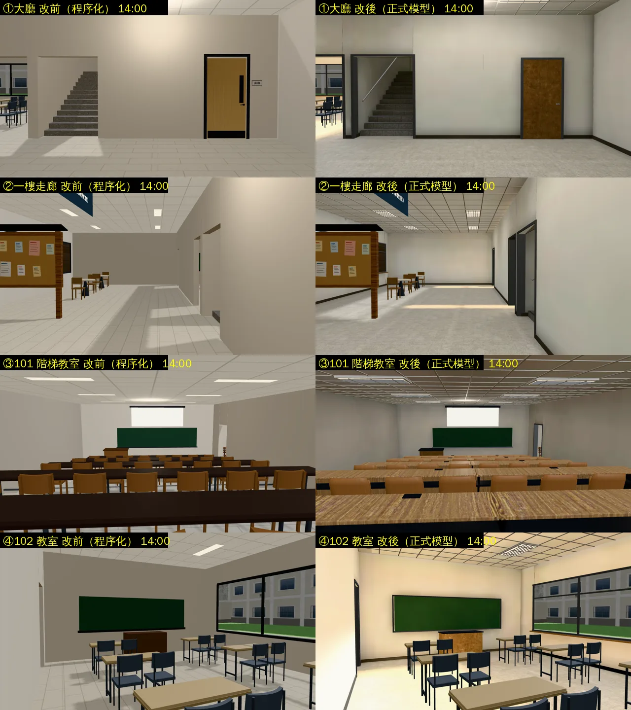
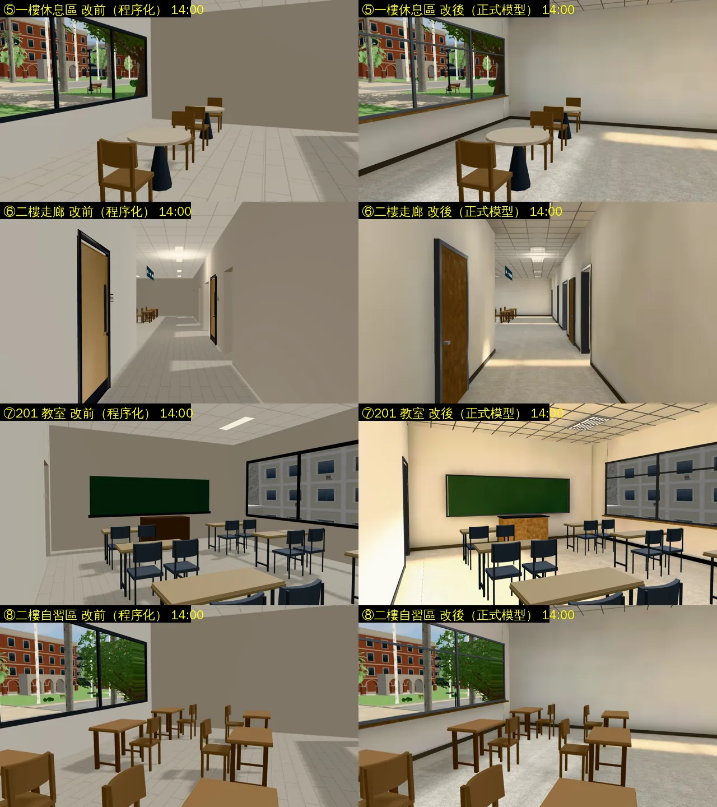
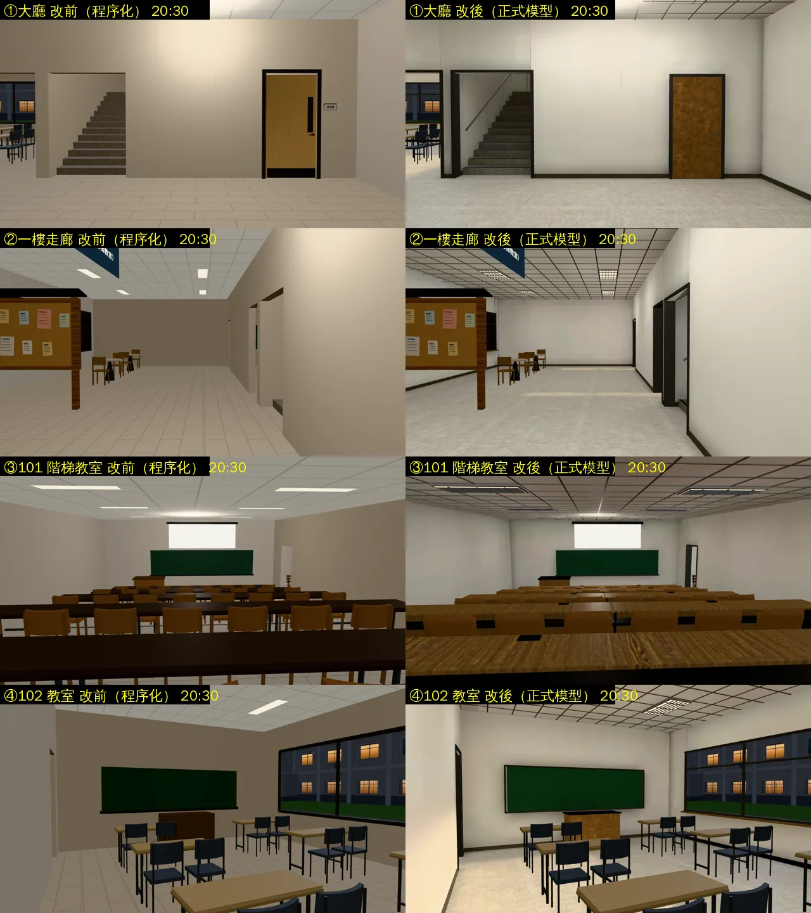
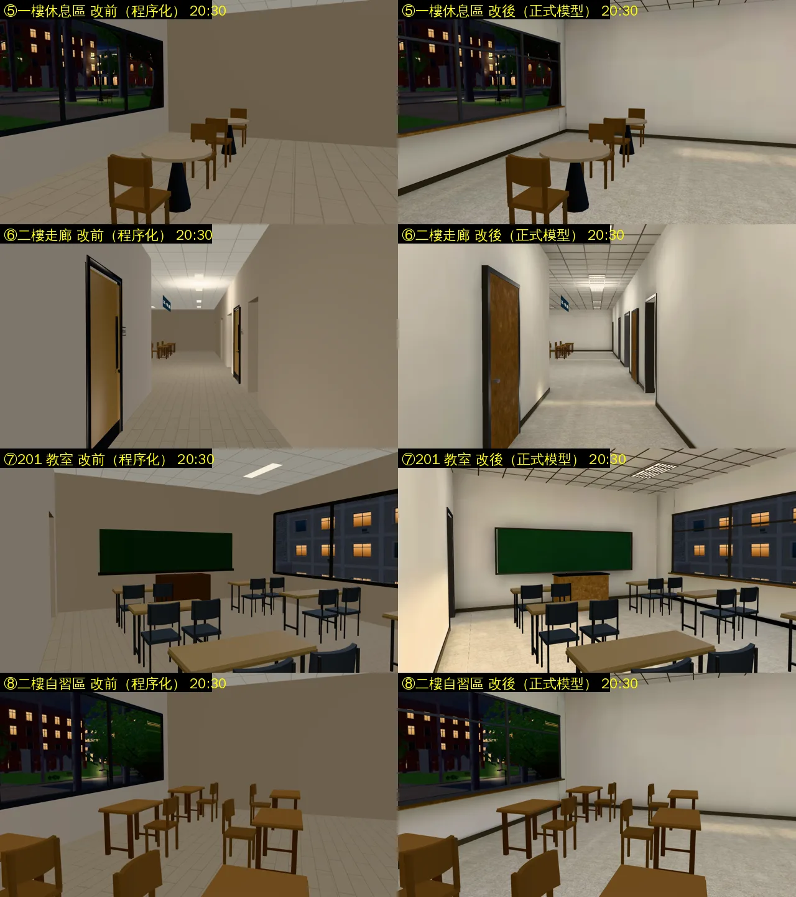

# 共同教學館室內正式模型（ART-ECON-3D-GAP-1021 A；LAWWW2-B 2026-10-31）

- **起因**：ART-ECON-3D-GAP-1021 現況清單（`docs/art-rebuild/second_ai/ECON_3D_GAP_STATUS_1030.md`）的 A。
  - 經濟系那一年在共同教學館上課，室內一直是 `teach3d.js` 的程序化備用畫面。
  - `assets3d.js` 沒有 `bldg.gongtong_interior`，`teach_interior.py` 只有普通、博雅。
  - D38：近景不能用程序化當正式美術。
- **LAWWW-B 10-30 23:2x**：清單裡判斷不用問的直接開工。配置、座位、導航都不動。
- **狀態**：`READY_FOR_ART_REVIEW`。建築、場景只有使用者能標 `ART_APPROVED`。
  - 截圖是 Playwright＋SwiftShader（電腦 1280×720），不是實機。
  - 讀檔放位置、藏玩家和 NPC 是 [捷徑]。

## 怎麼套（給 LAWWW-B）

1. **檔案（新的）**：
   - `assets/models/env/second_ai/gongtong_interior.glb`（＋`.json` 統計）；
   - `gongtong_interior_lm_day.webp`、`gongtong_interior_lm_night.webp`。
2. **patch**：`docs/art-rebuild/second_ai/patches/gongtong_interior_1030.patch`（對開發 `44337adcb`）。
   - `src/assets3d.js` 加一行 `bldg.gongtong_interior`。`teach3d.js` 本來就照 `'bldg.'+id+'_interior'` 自己接：B3.attachFormal、光照貼圖、看到 SEATPANS 藏起備用的方塊桌椅、翻椅。**遊戲程式不用改**。
   - 新測試 `tests/gongtong_interior_glb_unit.js`（照博思的那一支）：節點、40 個翻椅每個都分得到椅面、長桌高度、光照貼圖兩張、manifest。
   - `tests/room_ceiling_unit.js` 的清單加 `gongtong_interior`。
3. **工具（我的分支，遊戲不讀）**：
   - `tools/blender/env_second/teach_interior.py`：加 `--set gongtong`。
   - `tools/blender/env_second/lightbake/bake_gongtong.sh`：新的烘焙腳本。
   - **開發分支的 `lightbake/bake_room.py` 是舊版**（沒有 10-30 的 collapse_black 整面取樣修正），要重烘的話用我分支的。

## 模型

- 和博思同一支腳本：
  - 兩層的殼：磨石子地板、樓板、外牆、隔間、窗框、窗台、踢腳板；
  - 輕鋼架天花板＋T5 格柵燈具；
  - 樓梯（花崗石踏面、止滑條、扶手、二樓樓梯井的玻璃欄杆）；
  - 102、201、202 的黑板、講桌；
  - 101 階梯教室：平台、走道台階、黑板、投影幕捲軸盒、講桌、長桌、40 張翻椅（SEATPANS）；
  - 關著的房間（洗手間、203）的門。
- 配置沒寫燈位（`lightPanels`）：用 `teach3d.js` 備用模型的預設燈位（`DEFAULT_LP`，兩邊一致）。
- 69 個物件、28,990 個三角形、31 個材質；GLB 2.29 MB，光照貼圖 1024² 兩張（白天 64 KB、晚上 58 KB）。
- **休息區的圓桌、自習區的桌椅、教室的單人桌椅照舊是遊戲畫的**（配置的 `lounge`／`study` 是舊寫法，`furniture_study.glb` 的模組尺寸對不上），這一包沒動。普通教學館的教室也一樣。

## 光照烘焙（`bake_gongtong.sh`）

- 第一次用開發分支的 `bake_room.py` 烘：一樓地板一半（168 m²）、北牆的光照座標被壓扁。原因是舊版 collapse_black 只看面的中心，中心剛好在 101 平台底下。
  - 用我分支修好的版本重烘：朝室內被壓扁 286 → 22 m²（`lm_squash_scan.py`）。
  - 剩下的是樓梯踏步北面（被前一階擋住，只露出踢面那一條）；博思同一支腳本也有。
- **白天不能照博思的參數**：
  - 博思的參數（天光 0.5、白平衡 0.92,0.88,0.8、白天燈 0.9）在這裡，教室牆面 (248,220,176)，紅色爆掉、整間偏橘黃。
  - 原因：教室小、窗大（博思的階梯教室沒有窗）；遊戲裡白天還有即時的太陽（×0.3）和跟著玩家的三盞燈。
  - 遊戲內試了三版，改成天光 0.18、白平衡 1.0,0.98,0.95、白天燈 0.6：教室牆面白天 (214,191,158)、晚上 (168,159,139)。

## 改前改後（同角度；左＝改前程序化，右＝改後正式模型）

- 鏡頭：`tools/blender/env_second/shots/gongtong_int_shots.py`。
- 改前＝開發 `44337adcb` 原樣，改後＝加這一包。

### 看得到的差別

- **殼**：
  - 地板：一格一格的淺色方塊 → 磨石子。
  - 牆：加了踢腳板；門、窗有框，窗下有窗台。
  - 天花板：輕鋼架格子＋T5 格柵燈具（原本是平的白板＋一條條發光板）。
- **光**：
  - 有光照貼圖：牆角、樓梯下、桌子下面有陰影，窗邊比較亮。
  - 晚上只有燈：中性的白光，不偏黃。
- **101 階梯教室**：深色長板桌、方塊椅 → 木紋長桌（擋板、懸臂桌腳、電源盒）＋翻椅（沒人坐的椅面掀起來）。
- **樓梯**：花崗石踏面、止滑條、扶手。

### 還不夠的（照實寫）

- 102、201 教室白天比晚上亮約 27%、稍微偏暖（牆面 (214,191,158)），窗邊那一側最明顯。
- 教室的單人桌椅、休息區的圓桌、自習區的桌椅還是遊戲畫的方塊（上一節）。下一步可以做成正式模組，三棟教學館一起換。
- 門牌（下一節）。

## 效能（同角度、藏路人；`renderer.info`，一次 render 含陰影）

| 鏡頭 | draw call | 三角形 |
|---|---|---|
| 大廳 | 93 → 94 | 36,006 → 44,798 |
| 101 階梯教室 | 101 → 94 | 34,014 → 42,660 |
| 201 教室 | 78 → 73 | 34,624 → 30,238 |

- draw call 差不多；三角形最多多 8,800 個（翻椅、長桌、燈具）。
- 手機實機沒量。

## 和改前不一樣、要你知道的

- **關著的房間的門牌不見了**：
  - 改前：洗手間、203 是 `furniture_study.glb` 的門＋門牌（ART-02，放在備用模型群組裡）。
  - 改後：正式模型載入後，那些門跟著備用群組藏起來，換成模型自己的門（木門、門框、門把），沒有門牌。
  - 博思、普通本來就是這樣。要留門牌的話是 `teach3d.js` 的事（把 doorsGLB 放到備用群組外面、模型不做關著的門），你決定。

## 測試

（量測中）
