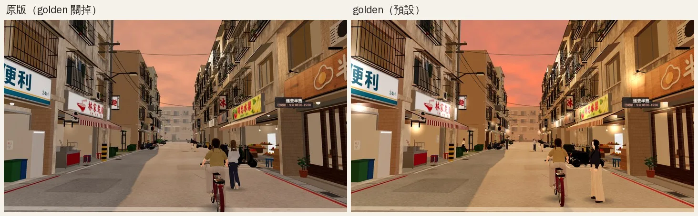
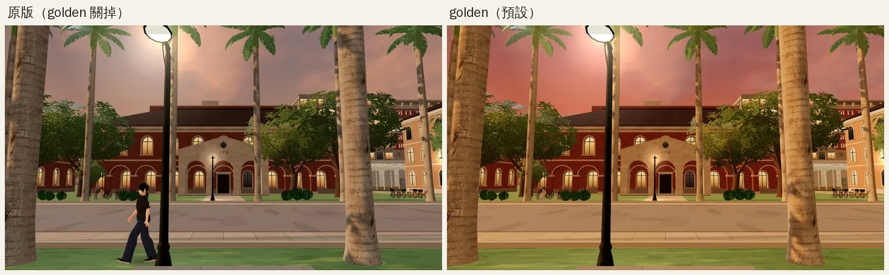
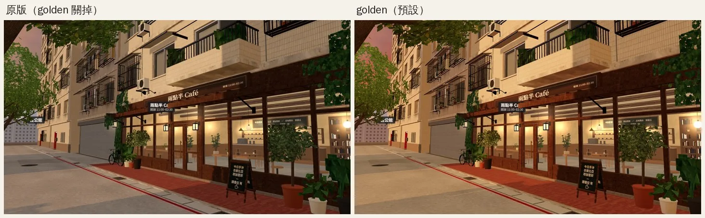
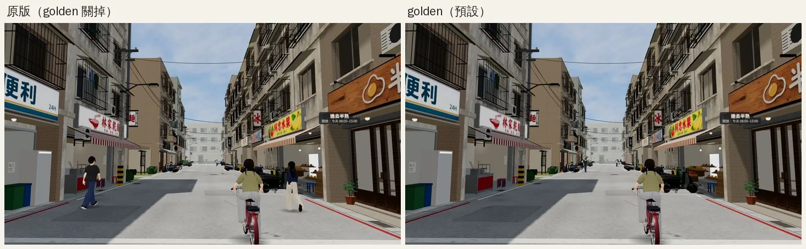
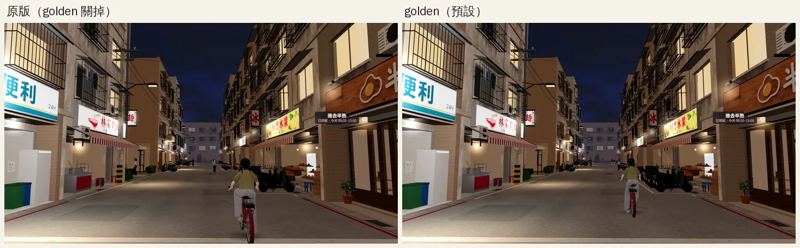
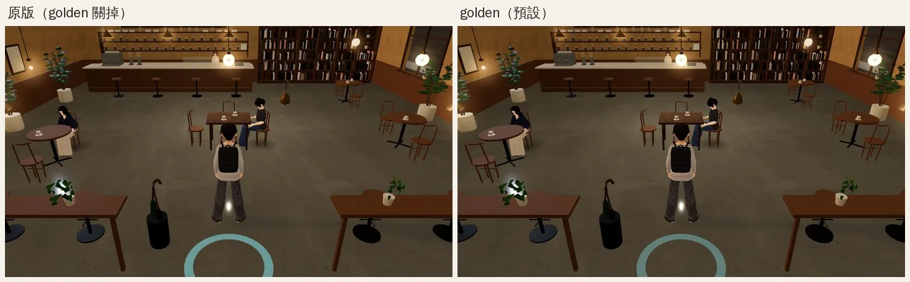

# 黃昏調色預設就開（GRADE-GOLDEN-DEFAULT）＋黃昏收尾（ART-VSLICE）——已交件

帳號 A 的 LAWWW2，2026-10-21 18:1x UTC。

狀態：
- GRADE-GOLDEN-DEFAULT：**已交件**，交 LAWWW 整合。
- ART-VSLICE：**收尾**，不再擴大。後製模組不接，原因見下面。
- 黃昏的樣子：READY_FOR_ART_REVIEW（不標 ART_APPROVED）。

## 使用者的決定

- 使用者 2026-10-18 選「預設就開」：USER_WANTS X32，取代 I02 的「等使用者決定」。
- 之前 golden 只有網址加 `?grade=golden` 才開。

## 改法：`docs/art-rebuild/second_ai/patches/grade_golden_default.diff`

對開發分支 `15f3c677` git apply 乾淨。改兩個檔：

1. `src/engine3d.js`：
   - `E.grade` 預設改成 `'golden'`。
   - 網址加 `?grade=off`（或任何不是 golden 的值）回到原本的黃昏，比較用。
   - `KEY_GOLDEN` 的內容沒動：只換 17:00–18:00 那一段的光線。
   - 那一段的效果：
     - 暖金色的陽光；
     - 陰影裡偏暖（環境光從冷灰改成暖杏色）；
     - 街道盡頭有一層暖橘色的霧；
     - 天空下緣金黃。
   - 註解「使用者還沒決定，預設不開」改成使用者的決定。
2. `tools/shots/golden_compare.sh`：
   - 原版改用 `?grade=off` 拍；不改的話，預設變 golden 以後兩邊都是 golden。
   - 比對標籤不能有「=」：`compare.py` 用第一個 `=` 分開標籤和檔名，寫 `?grade=off` 會找不到檔案。這次實際踩到才改。

## 測試

- `node tests/nav_levels_unit.js`、`node tests/nav_buildings_unit.js`：在 `15f3c677`＋patch 上 ALL PASS。
- 程式裡沒有其他地方讀 `E.grade`：`git grep "E\.grade\|grade="` 只有 `engine3d.js` 和 `golden_compare.sh`。
- `golden_compare.sh` 套 patch 後 `bash -n` 通過。

## 遊戲內對照（VISUAL_REVIEW 第 10 節的六個鏡頭重拍）

拍攝條件：
- `tools/shots/scene_shot.py`，1280×720。Playwright＋SwiftShader，**不是 iPhone**。
- 基準：開發分支 `b804db03`＋這個 patch。和 `15f3c677` 之間只差測試檔。
- 左「原版（golden 關掉）」＝`?grade=off`；右「golden（預設）」。
- 同一個存檔、同一個時間、同一個鏡頭。

| 鏡頭 | 有差別的像素 | 看到的差別 |
|---|---|---|
| 溫州街巷口 12:00 | 1.4% | 一樣（只有路人不同）＝golden 不動白天 |
| 溫州街巷口 17:30 | 62.0% | 天空下緣變金紅、牆面暖金、陰影偏暖 |
| 溫州街巷口 20:00 | 2.2% | 一樣（只有路人、機車不同）＝不動夜晚 |
| Café 室內 17:30 | 1.0% | 一樣＝不動室內 |
| 校園椰林大道 17:30 | 70.4% | 天空從粉紫變暖紅、椰子樹幹和紅磚被夕陽照暖 |
| Café 門口 17:30 | 37.9% | 店面和人行道暖了，原版偏灰 |

白天、夜晚、室內（確認 golden 沒有動到）：

### 店門口的燈：17:30 那一張一亮一不亮

- 現象：溫州街巷口 17:30，golden 那一張店門口的壁燈亮了，原版沒亮。
- 不是 golden 改了開燈時間：
  - 兩張表在 17:30 的「燈」都是 0.5。原版 17:00＝0、18:00＝1，中間是 0.5；golden 17:30 那一列直接寫 0.5。
  - 開燈條件是 `> 0.5`（`engine3d.js` applyTime）。17:30 正好卡在邊界，時鐘差一點點就一亮一不亮。
- 這是推斷，沒有量兩次拍攝的實際時間。
- 這個邊界原版本來就有，沒有改。

## ART-VSLICE 收尾：後製模組 `src/post3d.js` 不接

- 來源：B 的 WIP `28deae9e`。內容：光暈＋ACES＋依時段調色＋暗角，三個全螢幕 pass。

**查到的問題**：
- `post3d.js` 從來沒有在遊戲裡掛上去過。
- 原因：它用 `window.GAME` 判斷遊戲啟動了沒，但 `game3d.js` 的 `GAME` 是 `const` 宣告，不在 `window` 上，所以一直是空的。
- 這次試著掛，量到 `POST.installed=false`。
- 已在這個分支修好（改成 `typeof GAME!=='undefined'`），只是為了以後要評估時能用。**沒有交件，沒有接進 index.html。**

**決定不接**（美術總監判斷，「黃昏收尾」＝收尾、不擴大）：
1. **效能**：每一幀多畫一張全解析度的半浮點畫面（含 4 倍 MSAA）、8 個模糊 pass、1 個全解析度合成。手機上是頻寬大戶，而使用者剛回報校園卡（PERF-CAMPUS-SHADOW-1020，P1）。真機沒量過之前不加。
2. **會改到人物的樣子**：光暈、調色、暗角作用在整個畫面，人物光影也跟著變；使用者凍結人物。
3. **黃昏的暖色 golden 已經給了**：使用者選的是 golden，不是後製。

以後要評估的話：檔案在這個分支的 `src/post3d.js`，網址加 `?nopost` 可以關。

### 黃昏收尾其他項

| 項目 | 狀態 |
|---|---|
| 路面（精修第 3 批） | 早就整合了 |
| 人物光影 | 不做（使用者凍結人物） |
| 街道 AO | 不新開（收尾不擴大） |

## 順便看到的（不在這次範圍）

- **Café 室內的白點**：吊燈燈泡的光暈從高鏡頭往下看，剛好疊在玩家兩腿中間、左邊長桌的盆栽上，像飄在地上的白點。
  - 原版、golden 都有，和調色無關。
  - 這是我的 Café 模型（吊燈 glow），排進巡場景（P3）。
- `CLAUDE.md` 的「等使用者決定：黃昏調色提案…使用者沒選之前不要改預設」那一句，整合後要改掉。CLAUDE.md 是 LAWWW 的檔。

## 接法（LAWWW）

1. `git apply docs/art-rebuild/second_ai/patches/grade_golden_default.diff`。改 `engine3d.js` 兩行、`golden_compare.sh` 四行；engine3d.js 這兩行 16:4x 已事先告訴 LAWWW。
2. 改 `CLAUDE.md`「等使用者決定」那一句；USER_WANTS X32、tasks.json。
3. 要重拍 VISUAL_REVIEW 第 10 節：`bash tools/shots/golden_compare.sh <網址>`。
