# 新體育館（綜合體育館）第一階段：大廳＋1F 多功能球場——交付說明

LAWWW2-B，2026-10-16。需求：BB_151（使用者直接指示，BB-B 轉達）：「新體育館……很有代表性，很多演講演唱會都在那，應該要建立室內3D」「一定要有健身房、羽球場，演講、演唱會時改成場地」。

- **配置（遊戲＋Blender 共用）**：`src/data/gym_layout.js`（version 2）。包含：
  - 區域尺寸、出生點；
  - 出口：回校園的體育館門口；`enterAt` 取代 classes3d 原本「體育館：體育課在這裡上」的門口互動；
  - 球場、物件清單、導航阻擋 `blocks`、座位、互動點；
  - 第二會場 `sets.second_hall`。
- **模型**：`tools/blender/env_second/gym_interior.py` → `assets/models/env/second_ai/gym_interior.glb`
  - 2.4 MB、31,120 三角形（畫出來 76,568：第二會場 300 張折疊椅用 GPU instancing）、貼圖 512。
  - 貼圖：`tools/blender/env_second/gym_tex.py`。
- **工具**：Blender 5.2（bpy）。倒角方塊 `lib2.rbox_bm`、旋轉體（燈罩、網柱底座、獎盃）、圓管（桁架、欄杆、籃架吊桿）。
- **材質**：
  - Poly Haven CC0：`white_plaster_02`（牆）、`granite_tile`（大廳地板、石材牆裙）、`walnut_veneer`（木作）；
  - 本作程式畫：球場地板與球場線、開館時間、記分板、指標、樓層指引、公告欄；
  - 不寫校名、館名，沒有校徽、品牌（D77）。
- **狀態**：`MODEL_READY`（還沒有遊戲區域，所以沒有遊戲內截圖）。區域程式由 LAWWW-B 建。

## Blender 預覽（Cycles 16 spp，第二會場平常藏起來）

| 大廳（往西北） | 大廳（往北：閘門） |
|---|---|
|  |  |
| **1F 球場（往北：看台、記分板）** | **1F 球場（東南角）** |
|  |  |

第二會場（`SET_SECONDHALL` 打開：西牆大螢幕＋300 張折疊椅，面向西）：

## 給 LAWWW-B 的節點說明

| 節點 | 用途 |
|---|---|
| `WALL_front_*`、`WALL_back_*`、`WALL_left_*`、`WALL_right_*` | 會淡出的牆，`dir` 屬性照 `attachRoomGLB` 的慣例 |
| `SET_SECONDHALL`（子節點：`_screen`、`_frame`、300 張椅子的 instancing） | 平常 `visible=false`；畢業典禮那天打開。打開時導航加 `sets.second_hall.blocks`，座位照 `seats` 的說明產生 |
| `PLATE_FACE_gym_stairs_up`、`PLATE_FACE_gym_stairs_down` | 樓梯口 A 字架的告示（`plate:'notice'`）：「3F 主球場／今日不開放」「B1 游泳池・健身中心／今日不開放」 |
| `GLOW_highbay_*`、`GLOW_downlight_*`、`GLOW_skylight_*`、`GLOW_vending_*` | `CL.glow` 光暈（day／night 強度在屬性裡） |
| 材質 `gym_window_sky` | 東西兩面高窗：外面沒有東西，所以用發光的天空色。**建議入夜時調暗**（像柏油的 `userData.asphalt`），不然晚上窗戶還是亮的 |

## v2（這一版）改了什麼

v1 的預覽有三個問題：
- 牆是清水混凝土，水漬太髒，像停車場；
- 高窗的玻璃透出後面的牆；
- 大廳只有一面空牆。

| 項目 | v1 | v2 |
|---|---|---|
| 牆 | 清水混凝土 | 白色粉刷牆 `white_plaster_02` |
| 高窗 | 透明玻璃 | 發光的天空色 |
| 大廳那一面 | 一面空牆 | 開口上方三塊指標（← 3F 主球場／↑ 1F 多功能球場／→ B1 健身中心・游泳池）、兩段木格柵牆、軟木公告欄、樓層指引 |

配置 v2 也跟著改：
- 加了兩個互動點：`gym_notice`（看公告欄）、`gym_directory`（看樓層指引）；
- 加了兩個貼牆的導航阻擋（凸出 0.1 m）。

## 還沒做、已知問題

- **下一階段**：3F 主球場（典禮、演講、演唱會）、B1 健身中心與游泳池。BB-B 支援 B1 健身器材（ART-GYM-P1，交我驗收）。
- 公告欄、樓層指引的文字是氣氛用的一般公告，沒有日期，不牽涉劇情。要放劇情公告（例如期末成發）時再加一張貼紙。
- 羽球網是半透明平面（`gym_net`），近看沒有網格。
- 實機手機效能沒有量過：三角形 31k／畫出來 77k，和萬才館室內同一級。

---

# 第二階段：3F 主球場（`gym_arena` 區域）——交付說明（LAWWW2-B 2026-10-16）

- **配置**：`src/data/gym_layout.js` 的 `arena` 段（version 3），給遊戲和 Blender 共用。內容有：
  - 場地、球場；
  - 三面下層看台：12 排，排高 0.42、排深 0.85；
  - 走道（樓梯）、入口通道、上層看台；
  - 出生點 (0, 23.6)，面向北；
  - 出口：回 1F 大廳西側樓梯口 (−18, 17.6)；
  - 四組布置。
- **模型**：`tools/blender/env_second/gym_arena.py` → `assets/models/env/second_ai/gym_arena.glb`
  - 3.4 MB、52k 三角形。
  - 平常（布置都藏起來）畫出約 13 萬個三角形：下層看台 2,256 張座位，GPU instancing，每張 36 個三角形。
  - 典禮那天：再加 1,250 張折疊椅，每張 48 個三角形。
- **貼圖**：
  - `gym_tex.py` 程式畫：`arena_floor.jpg`（44×39 m：籃球＋排球的線、深色外圍色帶、藍色禁區）、`arena_screen.png`（大螢幕待機畫面）、`arena_banner.png`（典禮的米色長布，金邊，沒有字、沒有校徽）。
  - Poly Haven CC0：`concrete_floor_painted`、`white_plaster_02`、`dark_planks`、`walnut_veneer`。
- **狀態**：`MODEL_READY`，只有 Blender 預覽，還沒有遊戲區域。

| 從入口通道走出來（往北：大螢幕、布旗、吸音板） | 看台（東、南兩面；上層是 4、5F） |
|---|---|
|  |  |
| **畢業典禮（SET_STAGE＋SET_CEREMONY）** | **演唱會（SET_STAGE＋SET_CONCERT）** |
|  |  |

演講（SET_STAGE＋SET_LECTURE）：

## 給 LAWWW-B 的節點說明

| 節點 | 用途 |
|---|---|
| `SET_STAGE` | 舞台、兩側上台的樓梯、深藍布幕。典禮、演講、演唱會都要先打開這一組 |
| `SET_CEREMONY` | 講台、花、盆栽、來賓桌椅、背板上的米色長布；場地上 1,250 張折疊椅（instancing），面向舞台 |
| `SET_LECTURE` | 講台、投影幕、308 張椅子 |
| `SET_CONCERT` | 兩座燈架塔＋上方桁架、20 盞搖頭燈（光暈 `GLOW_movinghead_*`）、吊掛喇叭、地上喇叭、鐵馬（z −12.6）、控台帳篷 |
| `arena_seats_lower` | 下層看台的座位（instancing）。座位點照 `standRows` 的說明算（第 r 排：平台頂 y＝0.6＋0.42r，座位在離前緣 0.5 m 的地方） |
| `GLOW_led_*`、`GLOW_screen_*`、`GLOW_vomitory_*` | 燈的光暈 |

- **導航建議**：
  - 場地整片可以走。
  - 看台只開走道。東、西各 3 條，南 2 條，寬 1.2 m。
    - 斜面從場地 y 0 到最上排 5.22（`addSurf` 的 `{axis, ya, yb}`）。
    - 畫面上是每排兩階（踏面 0.425、級高 0.21），最前面多一階 0.3。
  - 座位從走道進去。
  - 入口通道 x −2～2、z 17～24.5 是平地。
- 1F 大廳的「往 3F 的樓梯（今天不開放）」改成上樓：走到樓梯平台（2.1 m）就換區域，到 `gym_arena` 的出生點。
- **已知、還沒做**：
  - 看台後面的走廊：走道頂端的門關著。
  - 上層看台走不到：只有畫面，座位是貼圖畫的座位帶，近看是平的。
  - 東西看台和南看台之間的四個角落是兩面白牆圍起來的空間（看不到裡面）。
  - 籃架吊在大螢幕上面（收起來的樣子）。

## v3／v5（LAWWW2-B 2026-10-16 09:4x UTC）：BB-B 規格核對提的三點

1. **1F 羽球網**：網和網柱自己一組 `SET_NETS`（平常顯示）。第二會場 `SET_SECONDHALL` 打開時把它藏起來；網柱的導航阻擋（`blocks` 最後 12 個）一起拿掉。
2. **3F 大牆**：粉刷牆的貼圖降對比、放大一倍。v4 從場地看得出一塊一塊的斑。
3. **3F 入口通道**：
   - 側牆照看台的斜度收邊，改成素面灰漆，加一圈深藍牆裙。v4 是比座位高一大截的白牆，從場地看像隔板。
   - 通道口上方加綠色出口燈（圖形，不寫字）。

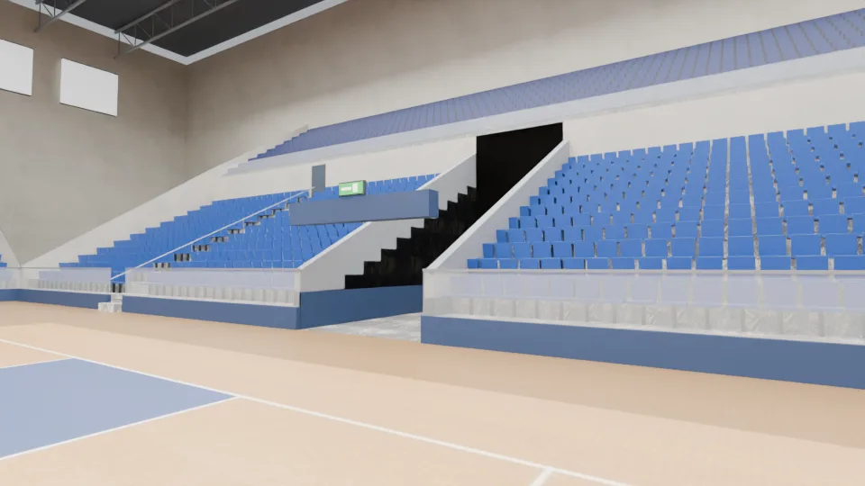

---

# 第三階段：B1（`gym_b1` 區域）——交付說明（LAWWW2-B 2026-10-16 09:5x UTC）

- **配置**：`src/data/gym_layout.js` 的 `b1` 段（version 4），內容有：
  - 大廳：東南角是從 1F 下來的樓梯，樓梯底在 z 8，往 +z 上去；
  - 閘門：x 12，三道；
  - 服務櫃台：(21, 0.95)，客人站在 z 1.9；
  - 走廊：z −0.2～3.0；
  - 健身中心：z 3～14，南牆整面鏡子；
  - 游泳池：25 m × 7 水道，只到池邊；
  - 關著的門：更衣室×2、壁球室・桌球室；
  - 器材擺放、池邊長椅、互動點；
  - 出生點 (18, 7.0, π)；出口回 1F 大廳 (18, 18.2)。
- **模型**：`tools/blender/env_second/gym_b1.py` → `assets/models/env/second_ai/gym_b1.glb`
  - 3.1 MB、43k 三角形，畫出來 63k。
  - 健身器材 22 件：BB-B 的 `bb_support/gym_b1_props.glb`，GPU instancing。
- **貼圖**：
  - `gym_tex.py`：`b1_rubber.jpg`（橡膠地墊）、`pool_floor.jpg`（池底馬賽克＋水道線）；開館時間、公告欄沿用 1F。
  - Poly Haven CC0：`granite_tile`、`rounded_square_tiled_wall`、`long_white_tiles`、`white_plaster_02`、`walnut_veneer`。
- **狀態**：`MODEL_READY`，只有 Blender 預覽。

| 大廳（樓梯、深藍牆裙） | 走廊（左邊健身中心的玻璃牆、右邊泳池那一側） |
|---|---|
| 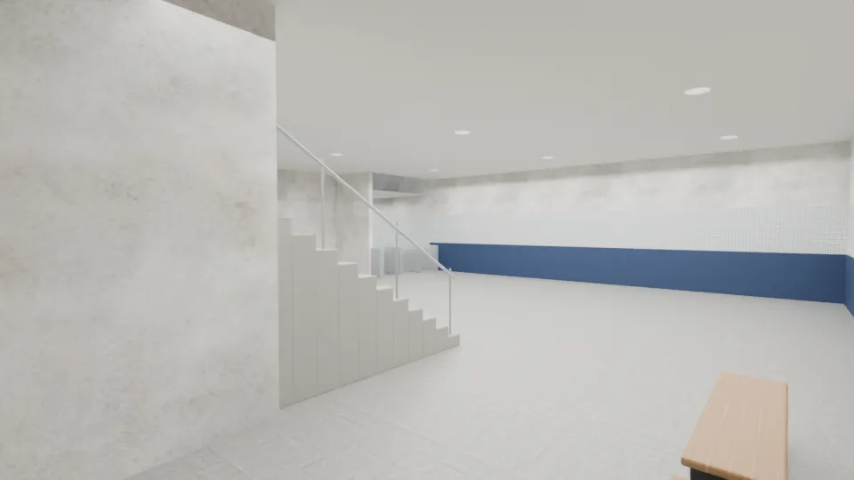 | 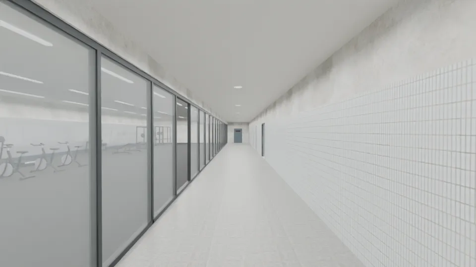 |
| **健身中心（有氧區，面向鏡牆）** | **健身中心（自由重量區）** |
| 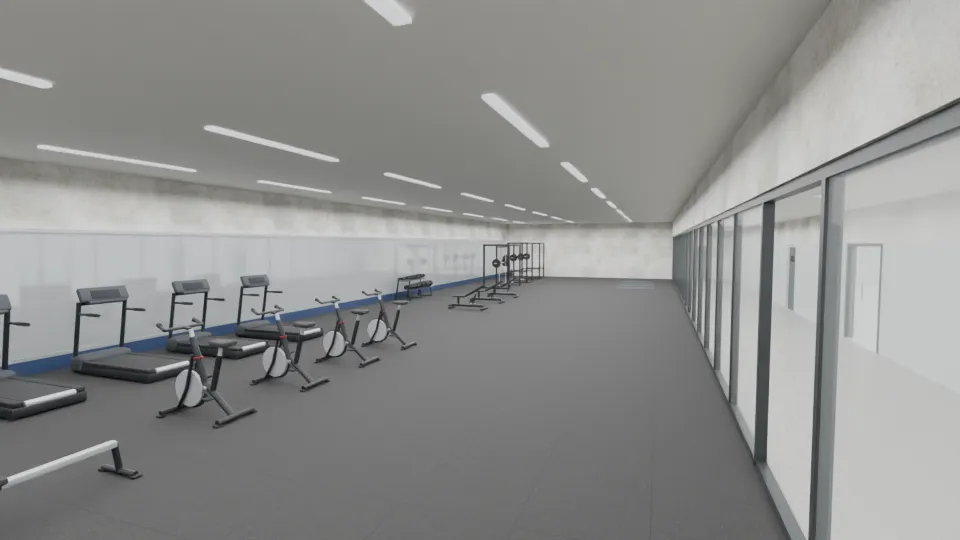 | 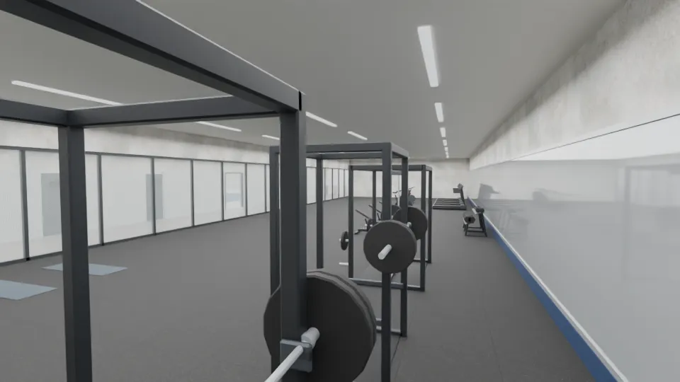 |

游泳池（7 水道、水道繩、仰泳旗、出發台、扶梯、北牆大時鐘）：

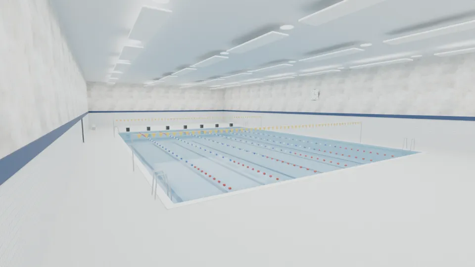

## 給 LAWWW-B

- **導航**：
  - 池子整個擋住；池邊、走廊、大廳、健身中心可以走。
  - 器材照 `equipment` 的位置擋：footprint 用器材的 bbox，`gym_b1_props.json` 有每件的大小。
  - 閘門是三道 0.9 m 的通道。
- 1F 大廳「往 B1 的樓梯（今天不開放）」改成下樓。
- **還沒有的**：
  - 服務櫃台、置物櫃、飲水機、救生員椅：BB-B 的 GYM-P2／P3a 交件、我驗收後擺進來。這一版櫃台的位置是空的。
  - 更衣室、壁球室、桌球室：門關著，門牌是 `PLATE_FACE_door_b1_*`（`plate:'door'`）。
- 劇情、體育課（`pe_y1s1` 游泳）怎麼用，由 LAWWW-B 和 AA-B／BB-B 決定。

## 第三階段 v5（B1：BB-B 的櫃台、置物櫃擺進來；LAWWW2-B 2026-10-16）

- **BB-B 的 GYM-P2／P3a**（`bb_support/gym_b1_entry.glb`；第一版 c6fba340、改版 c561cbfe，都驗收通過）照 `gym_layout.js` v5 的 `b1.entryProps` 擺進 `gym_b1.glb`（GPU instancing，和健身器材同一個 `b1_equipment` 節點）：
  - `GYM2_COUNTER` 服務櫃台：大廳 (21, 0.95)，客人站南邊；`desk` 改成 2.4 × 0.75（原本留的 4.0 × 0.7 是佔位）。
  - `GYM2_LOCKERS` 置物櫃兩組：健身中心東牆 (9.755, 4.4)、(9.755, 6.3)，面向西邊。
  - `GYM2_SCALE` 體重計：置物櫃旁 (9.7, 7.85)；`GYM2_TOWEL_BIN` 毛巾回收籃：健身中心門口內側 (5.6, 3.45)。
  - `GYM2_WATER` 飲水機：走廊北牆 (6.0, 0.01)，健身中心門口斜對面。
  - `GYM2_LIFEGUARD` 救生員高椅：池子東邊池畔 (14.2, −12.0)，面向池子。
  - `GYM2_KICKBOARD_RACK` 浮板架：泳池門口西側、靠走廊牆 (−6.0, −0.52)。
  - `GYM2_MIRROR`、`GYM2_FLOOR` 沒用（南牆已經是整面鏡子、地墊是整片橡膠），留給以後。
- 服務台後面：靠北牆的矮櫃（抽屜）＋牆上「服務台／學生證進場・會員申辦／失物招領・置物櫃鑰匙」牌子（`gym_tex.py` 的 `b1_desk()`）。
- **修正**：兩台划船機 v4 擺在同一條線上、頭尾重疊 0.8 m → 改並排 (7.4, 8.5)、(7.4, 9.9)。
- `equipment`、`entryProps` 每件加 `size: [x 寬, z 長]`（旋轉前），遊戲端擋導航照 `ry` 轉；平放的運動墊 `walk: true` 不擋。
- 1F 指標（`gym_wayfind.png`）拿掉「（整修中）」：3F、B1 都已經有模型；開不開放由遊戲的互動點決定（`closed_3f` 照 LAWWW-B 的建議改到 (−16.0, 17.4)）。`gym_interior.glb` 重新匯出，只換了這張貼圖。
- `gym_b1.glb`：3.6 MB、51k 三角形，畫出來 73k（v4 63k）。
- **狀態**：`MODEL_READY`，只有 Blender 預覽。

| 服務台（櫃台＝BB-B 的 GYM2_COUNTER） | 大廳（從樓梯下來） |
|---|---|
| 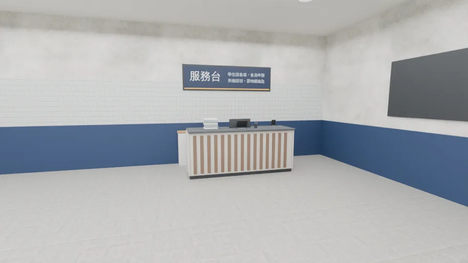 | 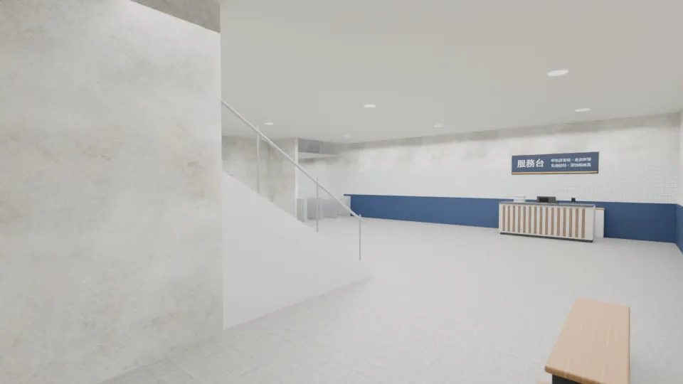 |

健身中心東邊（置物櫃、體重計、毛巾回收籃；划船機改並排）：

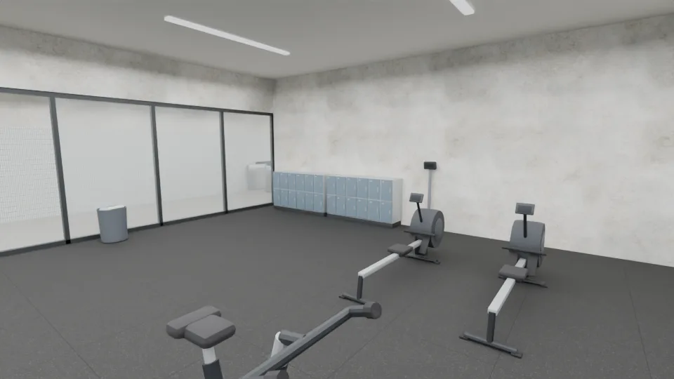

| 池畔的救生員椅 | 走廊的飲水機（右邊是健身中心的玻璃牆） |
|---|---|
| 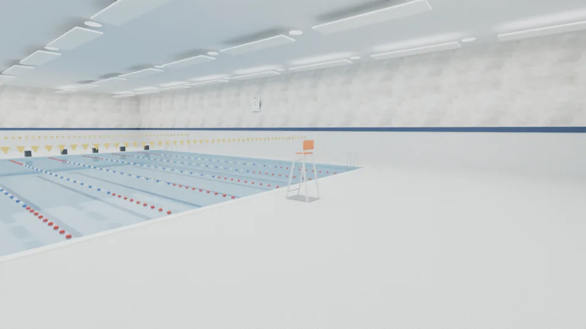 | 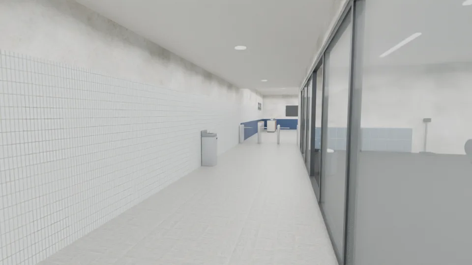 |

泳池門口的浮板架：

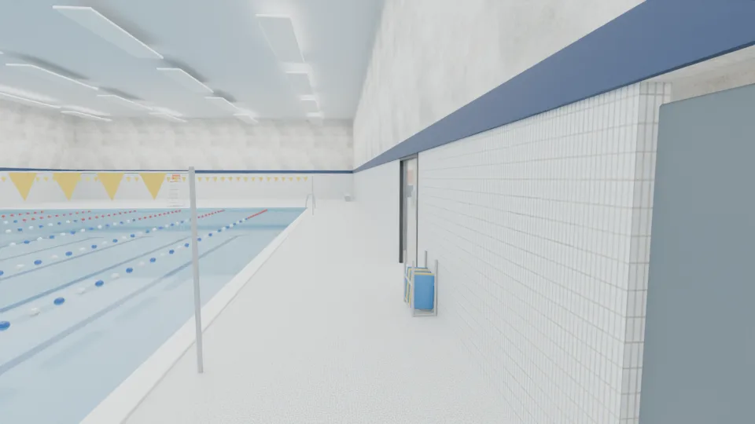

## B1 天花板的單面方向（2026-10-16 遊戲內實測，LAWWW-B cab58d64）

LAWWW-B 回報「天花板正面朝上」，在 `gym3d.js` 把 `b1_ceiling*` 改成 BackSide。實測（同一個鏡頭、只切材質的 side）：

| BackSide，鏡頭在天花板上面：整片白（擋住） | BackSide，鏡頭在天花板下面：天花板不見、看到天空 |
|---|---|
| **FrontSide（GLB 原本），上面：看得穿** | **FrontSide，下面：看得到天花板** |

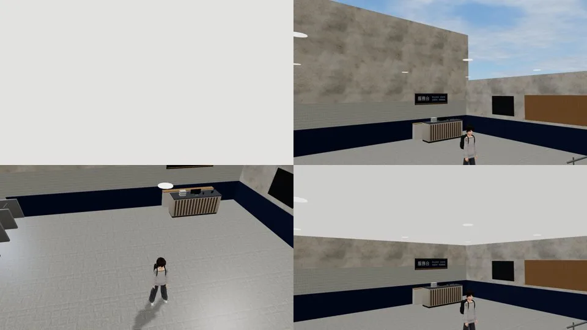

GLB 的三角形繞向法線朝下（glTF −y）、單面：和一盞 v2 一樣，不用改；遊戲端的 BackSide 繞過要拿掉。
