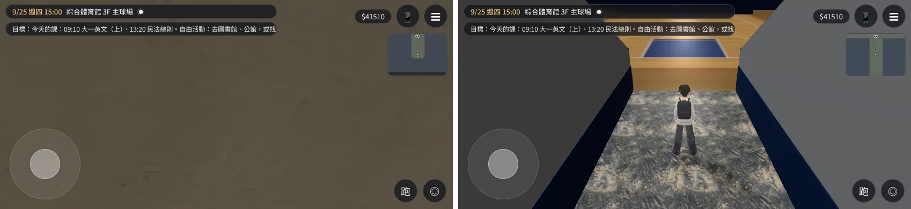
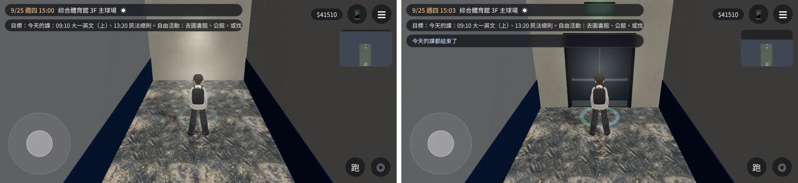
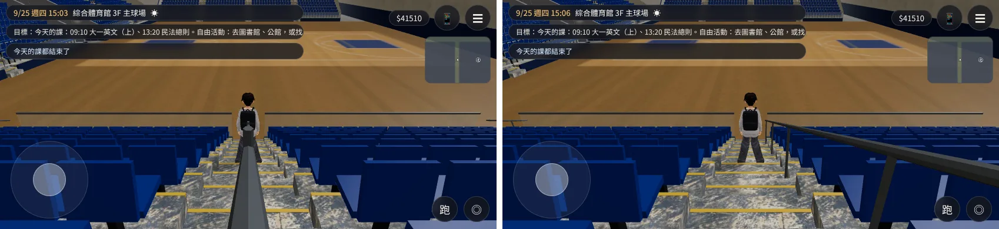
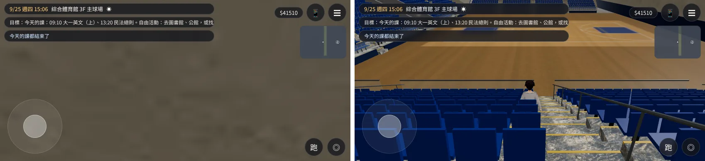
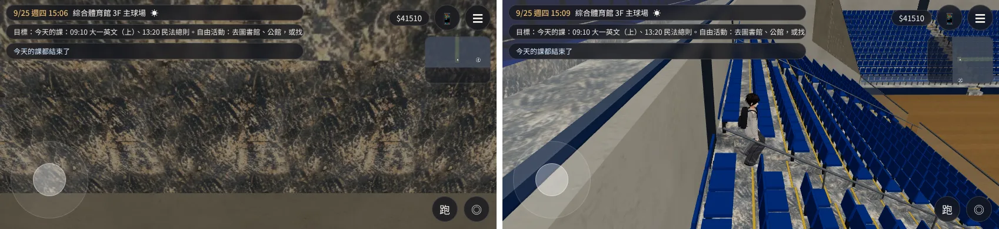
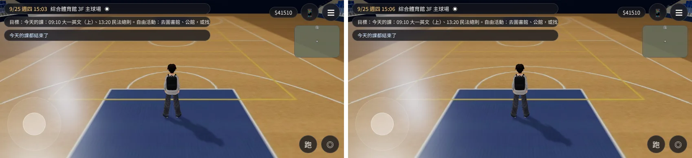
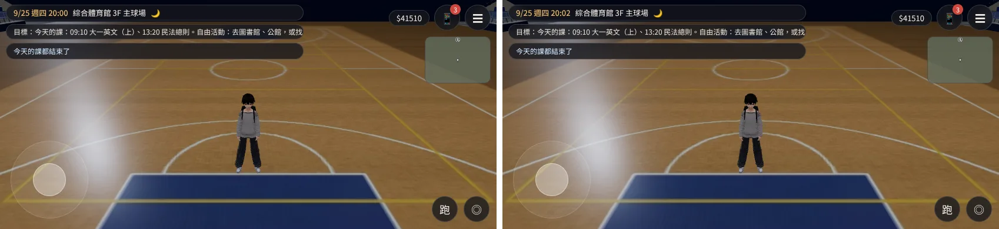

# 新體育館 3F 主球場接成可以走的區域（ART-GYM2-INT）——已交件

帳號 A 的 LAWWW2，2026-10-21 19:0x UTC。狀態：**已交件**，交 LAWWW 整合。READY_FOR_ART_REVIEW（不標 ART_APPROVED）。

## 這次做了什麼

主球場的模型（`gym_arena.glb`，LAWWW2-B `3effc0e0`、`f1e732f8`、`f1d23fd4`）原本只有模型，進不去。這次接成 `gym_arena` 區域：

- 1F 大廳西側樓梯口：「往 3F 的樓梯（今天不開放）」改成「上樓到 3F 主球場」；樓梯口的紅龍拿掉（3F、B1 都開了）；A 字架告示改成「3F 主球場」。
- 3F 上來的位置在南看台中間的入口通道，面向場地；通道盡頭的門是「下樓回大廳」。
- 場地整片可以走。
- 東、西、南三面看台各有走道（樓梯）可以走上去：
  - 碰撞、找路用連續斜面；
  - 畫面上一階一階，和模型的台階同一組數字。
- 每條走道第 3、7 排旁邊各有一個位子可以坐（共 16 個），面向場地。
- 舞台，以及典禮、演講、演唱會的布置平常藏著，劇情要用時再打開。

## 第二輪：第一版在遊戲裡拍到的四個問題

第一版（`bee24087`）的 Node 測試全部通過，遊戲內的 6 項檢查也全部通過。但是看截圖時發現下面四個問題，所以重做了一輪。

| # | 問題 | 原因 |
|---|---|---|
| 1 | **一進場整個畫面是一片牆**（`cmp_spawn` 左）；坐在看台第 7 排以上時，鏡頭退進看台後牆（`cmp_seated_row7` 左、`cmp_aisle_top` 左） | 鏡頭碰撞只有看台每一排，沒有後牆、上層看台、入口通道的牆 |
| 2 | 走道中間的扶手從人身上穿過去（`cmp_aisle_rail` 左） | 扶手在走道正中間，人也走在中間（導航只有中間那一格站得住） |
| 3 | 入口通道走到一半被看不見的牆擋住（`cmp_trench_end` 左） | 畫面上的通道到 z 27.2，可以走的只到 z 24.5，盡頭是一面素牆 |
| 4 | 演唱會的燈架藏著，它的 10 個光暈還在 | 全場的光暈合成一批時，把藏著的布置也算進去 |

## 改法

### 模型：`tools/blender/env_second/gym_arena.py` v6

- **扶手**：移到走道邊、不能坐的那一側，離中線 0.55 m，貼著那一排的端面。坐下時不會穿過扶手。立柱站在台階上（原本浮在空中 21 cm）。
- **入口通道盡頭**：
  - 南看台後牆開一個門洞（2.1×2.45 m），裝雙開門：門框、深色門片、推桿、踢腳板；
  - 門上加綠色出口燈，和入口那一盞一樣；
  - 原本在這裡另外疊的一塊牆，和後牆在同一個面上，拿掉。
- 第一次重建時，門片被後牆包在裡面看不到（只看得到門框和推桿）。後牆開了門洞以後才看得到門片。測試第 14 項因此加了「看得到門片」。

### 程式：`docs/art-rebuild/second_ai/patches/gym_arena_int.diff`（v3）

對開發分支 `a9da472a`（v9.10.3 發布後）和 `15f3c677` 都 git apply 乾淨。

| 檔案 | 改了什麼 |
|---|---|
| `src/gym3d.js` | `gym_arena` 區域；1F 上樓；鏡頭碰撞（下面說明）；入口通道整條可以走；光暈只合成看得到的，布置的光暈自己合成一批、掛在布置底下（布置藏著就不畫） |
| `src/data/gym_layout.js` | 入口通道 z1 改 27.2；出生點 z 21（在通道裡、面向場地）；「下樓回大廳」在門前 z 26.6 |
| `src/assets3d.js` | 加一行 manifest：`bldg.gym_arena` |
| `tests/gym_arena_unit.js` | 新測試，15 項 |
| `tests/gym_unit.js` | 第 5 項跟著改：3F 樓梯變成出口 |

鏡頭碰撞從 48 個盒子加到 106 個：
- 看台每一排（48）；
- 看台後牆＋上層看台每一排（30）；
- 入口通道兩側的牆，照斜度每排一段（24）；
- 入口上方的橫樑和出口燈（1）；
- 東南、西南角兩面看台端牆中間的空間（2）；
- 北牆（1）。

## 測試

### Node 單元測試 `tests/gym_arena_unit.js`

第 11～15 項會自己讀 `gym_arena.glb`（Node 沒有 fetch），用正式模型的網格檢查：

| 項目 | 修改前 | 修改後 |
|---|---|---|
| 12. 鏡頭看得到人：52 個位置（出生點、通道、16 個座位、8 條走道的中段和最上面、場地邊）×8 個方向，鏡頭照遊戲的 `E.followCam` 算，鏡頭到頭之間沒有看台、牆、門擋住 | FAIL，50 次被擋 | PASS，0 次 |
| 13. 走道中線 ±0.35 m、身體的高度（台階上 0.15～1.7 m）沒有扶手 | FAIL，1,392 個頂點 | PASS，0 |
| 14. 入口通道走得到門前 0.75 m 以內；從通道看盡頭，第一個打到的是門片；「下樓回大廳」在門前 | FAIL（走到 z 24.1 就停、沒有門） | PASS |
| 15. 全場光暈批 62 個（不含藏著的布置）；演唱會的 10 個另外一批、掛在布置底下 | FAIL（全場批 71 個） | PASS |

- 第 14 項的「看得到門片」在門片被包在牆裡那一版也 FAIL（打到的是牆）。
- 1～10 項（樓梯口、出生點、場地、走道走得上去、台階高度、座位）修改前後都 PASS。
- 在 `a9da472a` 上：`gym_arena_unit`、`gym_unit`、`group_events_unit`、`v0_c2_unit` 都 ALL PASS。

### 遊戲內前後對照（`arena_check2.py`）

- 環境：Playwright 手機橫向 844×390、`?turbo`。**不是 iPhone。**
- 修改前：開發分支 `15f3c677`＋第一版 patch＋原本的 `gym_arena.glb`。
- 修改後：同一個基準＋v3 patch＋新的 GLB。
- [前置／捷徑]：讀使用者 9/25 存檔；`GAME.enter('gym_arena')`；搬玩家、設鏡頭方向，之後不碰，讓遊戲自己跟、自己拉近；坐下用 `GAME.sitAt`。
- 兩次都 ALL PASS（進得去、正式模型、走道上的高度、坐下的高度），JS 例外 0。
- 每張圖左邊是修改前、右邊是修改後。

**進場（預設鏡頭）**：原本整個畫面是牆；現在人站在入口通道裡，前面就是場地。

**入口通道盡頭**：原本走到一半就停、前面是素牆；現在走得到門前，雙開門、推桿、上面的綠色出口燈。

**東看台走道**：原本扶手從人身上穿過去；現在扶手在走道右邊。

**坐在東看台第 7 排**：原本整個畫面是後牆；現在鏡頭停在後牆前面，看得到人和場地。

**東看台走道最上面**：原本鏡頭在看台後牆裡面；現在被牆擋住時，鏡頭自己轉到側面。

**場地白天、晚上**：兩版一樣，確認沒有改壞。晚上那張用第一輪重拍的截圖：第二輪重拍時手機訊息自動跳出來蓋住畫面；這個角度看不到通道盡頭，門的修改不影響。

- 演唱會的 10 個光暈在這兩張的角度看不到，靠數字確認：全場光暈批 71 → 62 個。

## 規格

| 檔案 | 數值 |
|---|---|
| `assets/models/env/second_ai/gym_arena.glb` | 三角形 51,678 → 51,926（扶手、門）；畫面上的三角形 245,714；3,380,072 bytes；材質數不變 |
| `assets/models/env/second_ai/gym_interior.glb` | 1F 樓梯口拿掉紅龍；2,382,188 bytes |

- 修改前的腳本重建，和遊戲裡的 `gym_arena.glb` 比對：只有藏著的典禮花，三角形的順序不一樣（同一組三角形、同一個繞向），其他逐位元組相同。

## 還不到的地方（誠實寫）

- 「看主球場」「大螢幕」兩個互動點還沒有字（要 AA／BB），這一版沒開。
- 上層看台（4、5F）只有畫面，走不上去。
- 布置（典禮、演講、演唱會）打開時，導航要加椅子區的阻擋，這是劇情用到時的下一步（`gym_layout.js` 的 `arena.sets`）。
- 東北、西北角（看台北端外面那條空地）沒有加鏡頭碰撞：鏡頭到那裡看得到空地，不會被擋住。
- 真機沒看過。

## 接法（LAWWW）

1. `git apply docs/art-rebuild/second_ai/patches/gym_arena_int.diff`（5 個檔）。
2. 換兩個 GLB＋json：`assets/models/env/second_ai/gym_arena.glb`、`gym_interior.glb`（`dec70791`、`5d6c715f`）。
3. 跑 `node tests/gym_arena_unit.js`、`node tests/gym_unit.js`、`node tests/group_events_unit.js`、`node tests/v0_c2_unit.js`。
4. 遊戲內重拍：`python3 docs/art-rebuild/second_ai/test_shots/gym_arena_1021/arena_check2.py <工作樹> <URL?turbo> <輸出>`。
