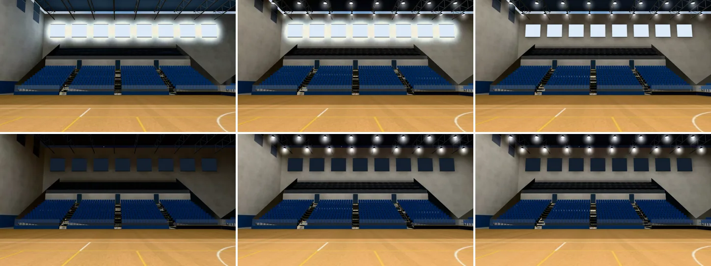
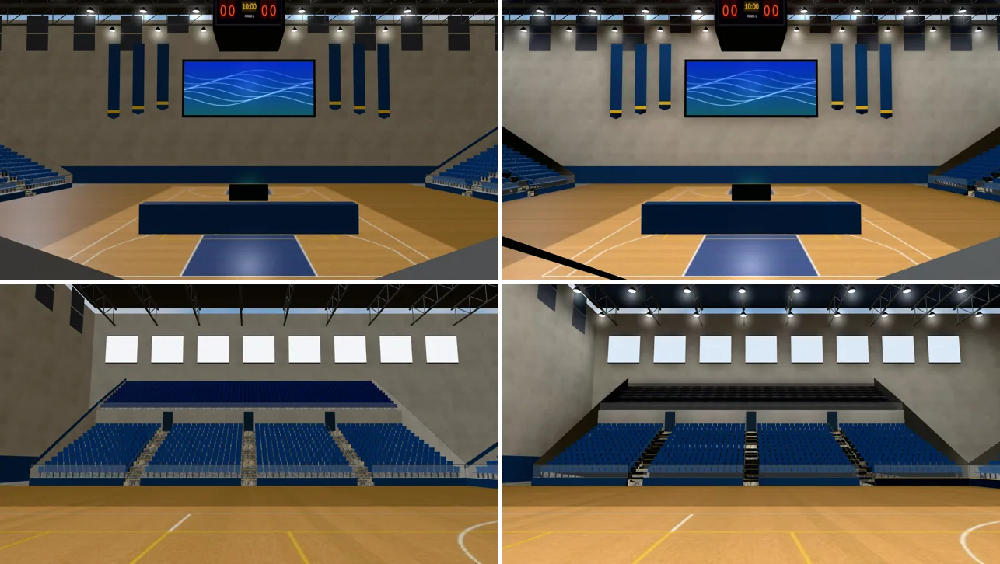
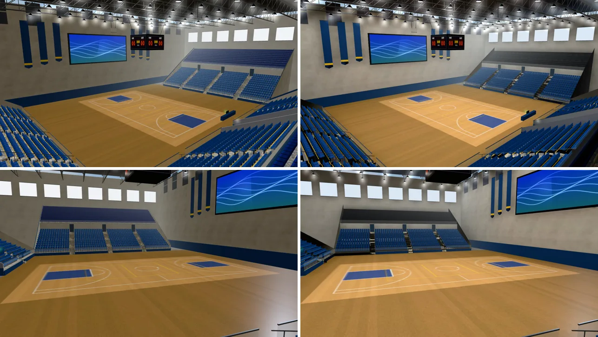
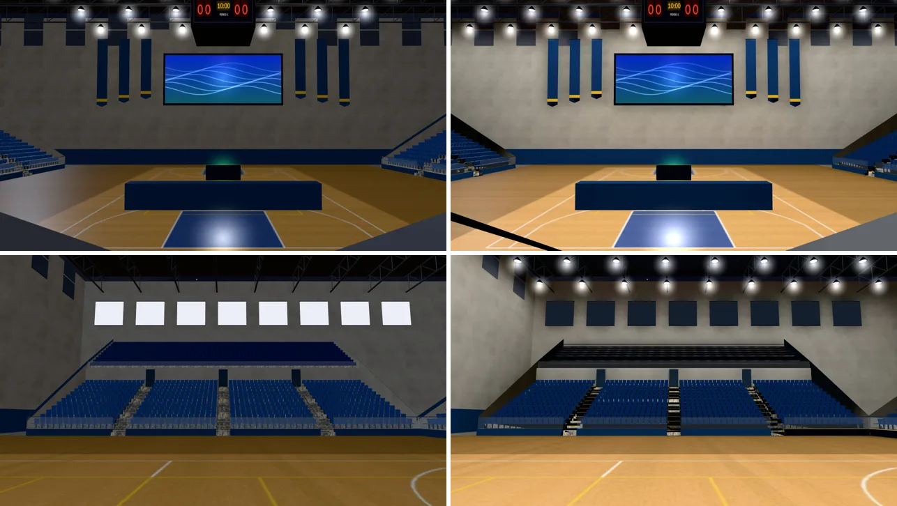
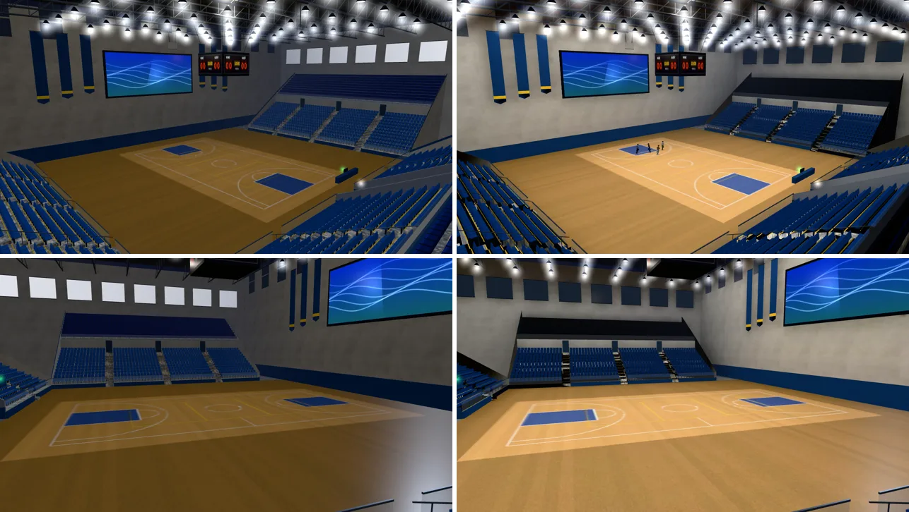

# 新體育館 3F 主球場（gym_arena 區域）室內光照烘焙（INTERIOR-AAA-REVIEW-1028；LAWWW2-B 2026-10-31）

- **起因**：INTERIOR-AAA-REVIEW-1028 第 5 節 P1（光照）。體育館三個區域裡的第二個（1F 見 `test_shots/gym_lm_1031/`；B1 接著做）。
- **狀態**：`READY_FOR_ART_REVIEW`。建築、場景只有使用者能標 `ART_APPROVED`。
  - 截圖是 Playwright＋SwiftShader（電腦 1280×720），不是實機。
  - 讀檔放位置、藏玩家和 NPC 是 [捷徑]。
- 這一包除了光照，**模型改了兩處**（`gym_arena.py` v8）：
  - 看台上方加 LED；
  - 高窗分出自己的材質。
  - 理由見第二節。

## 一、怎麼套（給 LAWWW-B）

1. **換二進位**（從我的分支 `claude/funny-albattani-iawshm` 拿）：
   - `assets/models/env/second_ai/gym_arena.glb`、`gym_arena.json`（統計變了：多 61 盞 LED、高窗不補反面）；
   - 新的 `gym_arena_lm_day.webp`、`gym_arena_lm_night.webp`。
2. **不用改程式**：
   - `gym3d.js` 的 gym_arena 區域走 `Z3.attachRoomGLB`，看到 GLB 的 `extras.lightmap` 就接。
   - GLB 的 `extras.lightmap.dayEmit`＝`["arena_window_sky"]`：`Z3.roomLightmap` 晚上把高窗調暗。
   - 原本高窗和 LED 共用發光材質，整晚是白的。
   - 布置（`SET_*`）照舊由區域照名字開關，`setGlowBatch` 不受影響。
3. **patch**：`docs/art-rebuild/second_ai/patches/gym_lm_v5_arena_1031.patch`（只有測試，和 1F 第五版同一包）：
   - 新 `tests/gym_arena_lm_unit.js`：**開發分支原樣 FAIL 6，改後 ALL PASS**。
   - `tests/singleside_gym_unit.js`：「主球場 看台踢面」從第 2 項移到 2b。烘焙前拿掉反面，和 1F 大廳的石牆同一做法。
   - `tests/gym_lm_unit.js`：加第 6 項，1F 高窗只有一面。
4. 工具（只在我的分支）：
   - `bake_gym.sh arena`；
   - 鏡頭 `shots/gym_arena_lm_shots.py`；
   - `bake_room.py` 新選項 `--emit-oneside`；
   - 烘焙紀錄 `gym_arena_lm.json`。

## 二、做法與參數（試了三版）

- 貼圖 1024²、256 取樣；烘一次約 12 分鐘（場地大，但要烘的物件只有 13 個）。
- **燈**：屋頂桁架下的 LED，往下照的面光源，0.7 m 見方，冷白。
  - 場地上方 220 W，看台上方 140 W：比賽時場地最亮。
  - 白天燈也開著，0.8 倍。
- **天光**：烘焙時整間包黑殼（`--shell NONE`），天光只從東西兩排高窗進來。
  - 白天那一張高窗發光；晚上不亮。
- **不烘的**（照舊即時光）：
  - 下層看台的座位：GPU instancing，一個網格給 2,256 個座位用，第二套 UV 沒辦法每個座位不同；
  - 鋼件、LED、高窗、大螢幕、記分板、出口燈、布旗。
- **布置**（舞台、典禮、演講、演唱會）烘焙時當作不存在：照條件出現，影子不能烘進地板。
  - 布置的折疊椅匯入 Blender 以後叫 `arena_chair_proto.NNN`，要另外列；第一次沒列，3,834 個物件要烘，停掉重來。
- **第一版**（只有場地上方 56 盞）：
  - 東西南看台、上層看台幾乎全黑：光只從 20 m 高的場地燈斜照過去。
  - 白天高窗四周一圈白光暈：牆的光照貼圖 2.0，到了上限。
- **第二版**：
  - 模型看台上方加 LED（x ±24～±36、南看台 z 29；共 117 盞），看台亮了。
  - 光暈還在：`--emit-oneside` 沒用，因為高窗的發光面在 PERF-SINGLESIDE 時補了反面。反過來那一片朝著牆，照樣照爆。
- **定案（第三版）**：高窗不補反面（`single_side(..., nodup=r'window_sky')`），加上 `--emit-oneside`。
  - 窗和窗之間的牆：白天 2.0 → 0.30，晚上 0.39。
  - 場地中間：白天 1.08，晚上 1.35。

## 三、改前改後（同角度；左＝開發分支原樣，右＝第三版）

- 鏡頭：`gym_arena_lm_shots.py`。
  - ①南邊入口往北（場地、北牆大螢幕）
  - ②場地中間往東看台
  - ③西南角高處斜看（屋頂 LED、高窗、上層看台）
  - ④東看台上往場地
- 那天北邊有舞台（布置照遊戲的日期開著），改前改後一樣。

### 看得到的差別

- 白天和晚上不一樣了：
  - 改前白天、晚上幾乎同一張（即時光）；高窗整晚是白色方塊。
  - 現在白天高窗是天空色，晚上是暗的。
- 場地中間亮、往看台漸暗；牆有明暗（靠高窗、靠 LED 的地方亮），改前整片一樣亮。
- 晚上看台上方的 LED 亮著，看台不再是灰撲撲一片。

### 還不夠的（照實寫）

- **上層看台那一段（高窗下面）看起來偏暗**：座位帶本身是深色（貼圖畫的深藍椅子），加上屋頂邊緣的影子。後牆光照貼圖 0.33／0.40，不是沒烘到。
- **布置打開的日子**（舞台、典禮的 1,250 張椅子）：地板上沒有它們的影子（照條件出現的東西不烘），椅子本身照舊即時光。
- 白天的高窗只有天光，沒有太陽直射（高窗不是真的開口，照 1F 的做法）。

## 四、測試

- `tests/gym_arena_lm_unit.js`：開發分支原樣 FAIL 6，改後 ALL PASS。
  - 光照貼圖兩張、dayEmit 是高窗；
  - 場地、牆、看台、上層座位帶、吸音板、屋頂板、門有第二套 UV；
  - 鋼件、LED、高窗、大螢幕、記分板、出口燈照舊即時光；
  - 下層座位照舊 GPU instancing；布置四組都在、沒烘；
  - 高窗只有一面；看台上方有 LED；
  - 區域照舊用 attachRoomGLB。
  - 第二版的 GLB：第 5 項（高窗只有一面）FAIL。
- `tests/singleside_gym_unit.js`：ALL PASS（2b：大廳石牆、主球場看台踢面都有光照貼圖、沒有反面）。
- **效能**（`interior_perf.py`，藏路人，14:00，手機橫向模擬；draw call／三角形）：

| 位置、方向 | 改前 | 改後 |
|---|---|---|
| 入口 (0,21) 前 | 61／190,998 | 62／196,144 |
| 入口 左 | 58／189,958 | 59／195,184 |
| 入口 右 | 58／189,958 | 59／195,184 |
| 入口 後 | 61／190,120 | 62／195,346 |
| 場地中間 前 | 56／190,702 | 57／195,984 |
| 場地中間 左 | 58／190,862 | 59／196,064 |
| 場地中間 右 | 58／190,862 | 59／196,064 |
| 場地中間 後 | 59／190,838 | 60／196,064 |

  - draw call 多 1：高窗分出自己的材質。
  - 三角形多約 5,200：多 61 盞 LED 燈罩，看台踢面少了反面。
  - 多兩張 1024² 的 WebP（白天 30 KB、晚上 32 KB）。
- 沒跑：手機實機、導航（模型的導航沒改：看台、場地照舊）。
