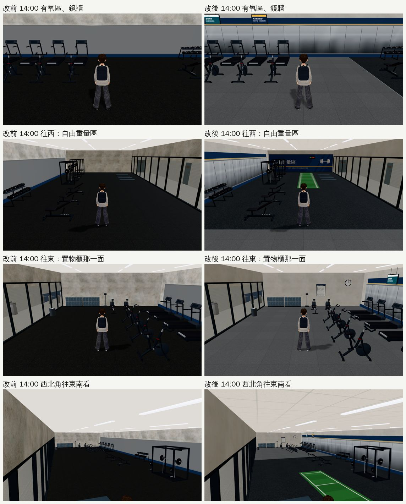
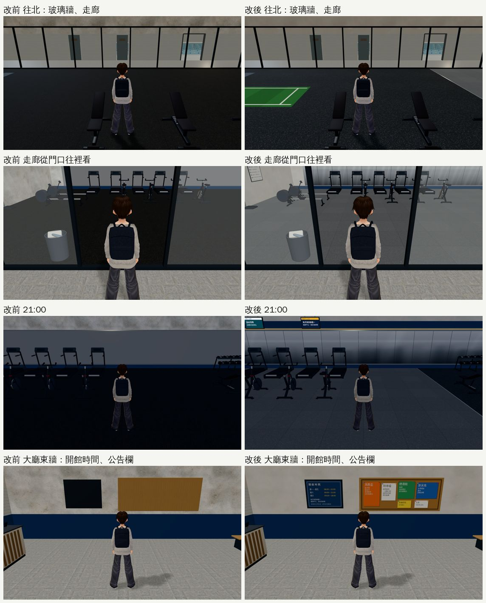
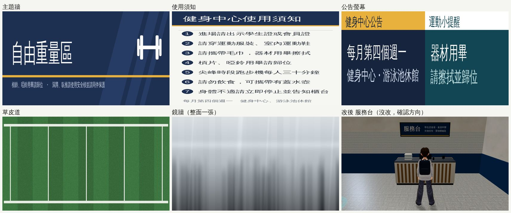

# GYM-B1-FITNESS-1024：B1 健身中心不再單調（2026-10-25，LAWWW2-B）

- **派工**：LAWWW-B 10-24 23:20「下一項 B1 健身房，可以。」巡查表第 0 節 P3：「白天花板、灰牆、黑地板，牆上沒有東西」。
- **對**：開發 `5bcdd7e8e`（測試樹 `$SP/dv8`，只換 `gym_b1.glb`；這段時間開發推到 `35debd75c`，都沒動到 B1）。
- **環境**：Playwright＋SwiftShader 手機模擬（1280×720），不是 iPhone 實機。
- **狀態**：`READY_FOR_ART_REVIEW`。場景的 `ART_APPROVED` 只有使用者能標。
- **只動 Blender 那一邊**：
  - 版面（`gym_layout.js` v5）、導航、器材位置、程式都沒動。
  - 遊戲端不用改程式，換 GLB 就好。

## 交件

| 檔案 | 內容 |
|---|---|
| `assets/models/env/second_ai/gym_b1.glb`（＋`.json`） | 重新匯出：3.63 MB → 4.17 MB，三角形 51,196 → 52,208，材質 83 → 93 |
| `tools/blender/env_second/gym_b1.py` | v7：牆面、鏡子、地板、天花板，加上大廳兩塊牌子的修正（見下面） |
| `tools/blender/env_second/gym_tex.py` | 新增 `b1` 參數：`python3 tools/blender/env_second/gym_tex.py b1` 只重做 B1 健身中心的 9 張貼圖 |
| `tools/blender/env_second/textures/gen/b1_*.{jpg,png}` | 9 張貼圖：`b1_rubber`（重做）、`b1_rubber_grey`、`b1_turf`、`b1_wall_free`、`b1_rules`、`b1_tv`、`b1_timer`、`b1_ceiling`、`b1_mirror` |
| `tests/gym_b1_fitness_unit.js` | 新測試（讀 GLB，不需要瀏覽器） |

- 開發分支的 `gym_tex.py` 比我這份舊：還是 10-16 那一版，指標上寫「整修中」，也沒有 `b1_desk`、3F 主球場。
  - 我這份包含開發那一份的全部內容。
  - 只跑 `b1` 不會動到其他貼圖。

## 玩家看到的

1. **牆不再像髒水泥**：
   - B1 牆面的灰泥貼圖，對比從 1.0 降到 0.3。
   - 原本的斑駁在遊戲裡看起來像一面髒的水泥牆，B1 大廳、泳池上半部、健身中心都一樣。
2. **牆上有東西了**：
   - **西牆（自由重量區）**：一整面深藍主題牆，上面有「自由重量區」、啞鈴圖示、黃線和安全提醒，另外掛一台間歇計時器。
   - **南牆鏡子上方**：深藍色帶＋黃線（和泳池、大廳同一套顏色）。有氧區上方吊兩台公告螢幕：「每月第四個週一 健身中心・游泳池休館」（照 BB_151）、「器材用畢 請擦拭並歸位」。
   - **東牆（置物櫃北邊）**：一塊「健身中心使用須知」，七條；還有一個時鐘。
   - 所有字都是繁中，沒有館名、品牌（D77）。
3. **鏡子看得出是鏡子**：
   - 原本是一整片灰：遊戲沒有環境貼圖，金屬度上限 0.45，看起來就是灰牆。
   - 現在分成 27 片鏡片，片和片之間有 8 mm 的接縫。
   - 整面用同一張貼圖：上亮下暗、中間一條亮帶，下半部有很淡的模糊倒影。
   - 第一版每片用同一張圖，看起來像不鏽鋼浪板，所以改成整面一張。
   - 這是畫上去的反射感，**不是真的鏡面反射**：照不到玩家自己。
4. **地板分區**：
   - 自由重量區：黑色橡膠墊，有灰、藍灰的顆粒。原本幾乎是全黑的。
   - 有氧區：中灰的運動地墊。兩區之間有一條鋁壓條。
   - 自由重量區中間：一條 11 m × 2 m 的人工草皮道，給推雪橇用。
5. **天花板**：
   - 原本是一整片平的白。
   - 現在健身中心換成 60 cm 的輕鋼架礦纖板。
   - 照舊是單面、法線朝下：鏡頭在天花板上面時看得穿。
6. **大廳東牆的兩塊牌子（原本就壞了，這次一起修）**：
   - 開館時間牌、公告欄的圖原本貼在框和木板的**後面**，遊戲裡只看到一塊黑板、一塊空木板。
   - 頂點順序也反了，就算看得到，字也會左右相反。
   - 改成貼在框前面 3 mm，字的方向正確。

## 牆淡出

- 貼在牆上的東西都放進那一面牆的 `WALL_` 群組，牆淡出時會一起淡出，不會浮在空中：
  - 主題牆、計時器 → `WALL_left`；
  - 使用須知、時鐘 → `WALL_fitE`（partition 1）；
  - 色帶、黃線 → `WALL_front`。
- 吊在天花板下的兩台螢幕不是牆，和鏡子一樣不淡出。

## 測試

- **新測試 `node tests/gym_b1_fitness_unit.js`**：對改前的 GLB 是 FAIL 11，對改後是 ALL PASS。檢查項目：
  1. 牆上的東西在對的 `WALL_` 群組；
  2. 鏡子有貼圖、分成 27 片；
  3. 地板三種材質；
  4. 天花板單面、法線朝下；
  5. 器材 22 件、入口道具 8 件照舊；
  6. 兩塊牌子在框的前面、字的方向正確。
- **疊面**（`check_coplanar.py`）：

  | | 一定會閃 | 遠處才閃 | 背對背 |
  |---|---|---|---|
  | 改前 | 0 | 4 | 191 |
  | 改後 | 0 | 4 | 192 |

  - 新增的背對背都看不到：牆頂和天花板、時鐘框和鐘面。
- **遊戲內截圖**：9 個鏡頭，見下面。
- **沒測**：
  - 手機實機；
  - 整套回歸；
  - 手機上的效能。
- **量到的 draw call**（SwiftShader，同一個鏡頭，改前 → 改後）：

  | 鏡頭 | 改前 | 改後 |
  |---|---|---|
  | 有氧區 | 75 | 82 |
  | 往西 | 83 | 96 |
  | 往東 | 107 | 120 |
  | 西北角 | 130 | 148 |
  | 21:00 | 59 | 66 |
  | 大廳東牆 | 65 | 65 |

  - 三角形多 500～1,500 個；GLB 大 0.54 MB（B1 是進去才載入）。

## 改前、改後（同一個鏡頭）

- 往西、往東、往北、門口這四張，改後是用第一版鏡子拍的（每片一樣的圖）。
  - 定版的鏡子看第一張「有氧區」和「西北角」。
  - 兩版只差鏡子的貼圖。
- **21:00**：
  - 改前整片黑，改後亮很多，因為地板變灰。
  - 但地下室晚上還是偏藍、偏暗，這是引擎的室內夜間光線，不在 GLB 裡。B1 沒有窗，照理晚上和白天一樣亮，要不要改由 LAWWW-B 決定（P3）。
- **大廳東牆**：改前是一塊黑板＋空木板，改後看得到開館時間和公告。

## 還沒到參考品質的地方

- 鏡子沒有真的反射：要用即時反射（例如 three.js `Reflector`），每一格會多畫一次整個場景，手機上太貴，這次沒做。
- 草皮道、主題牆是程式畫的貼圖，近看比照片素材平。
- 器材（BB-B 的 GYM-P1）本身沒動。
