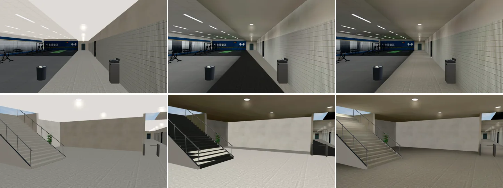
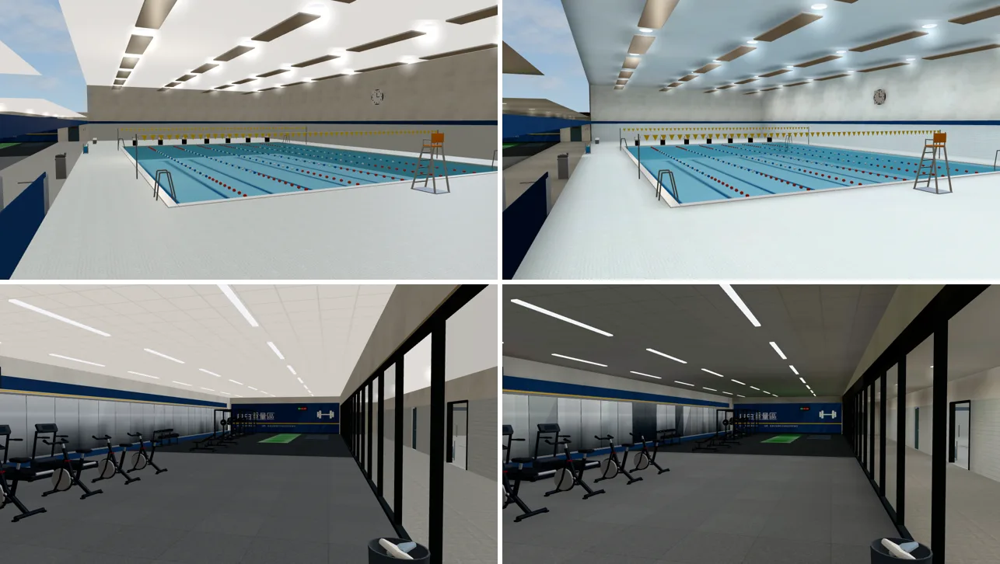
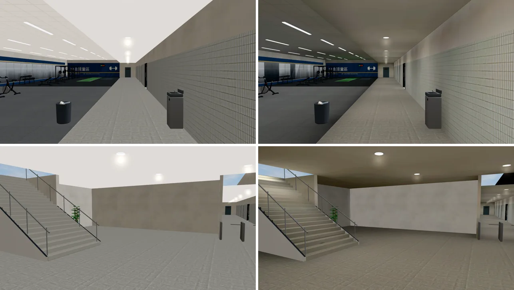
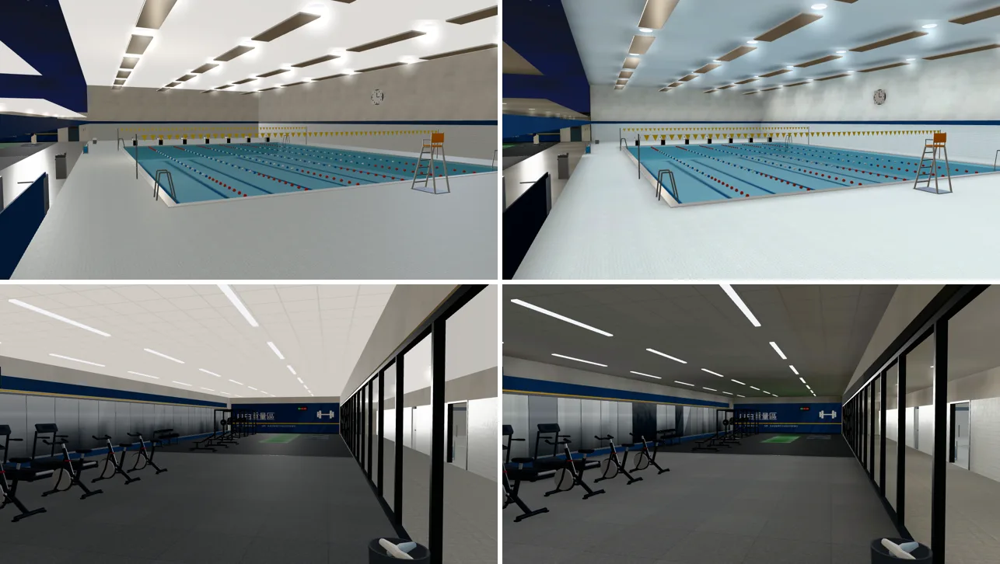
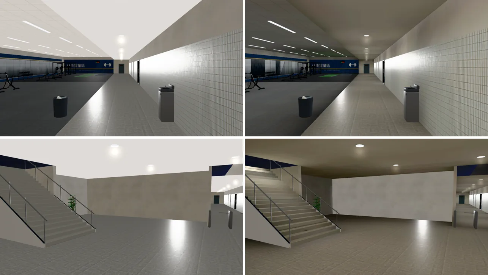

# 新體育館 B1（gym_b1 區域：游泳池、走廊、健身中心、大廳）室內光照烘焙（INTERIOR-AAA-REVIEW-1028；LAWWW2-B 2026-10-31）

- **起因**：INTERIOR-AAA-REVIEW-1028 第 5 節 P1（光照）。體育館三個區域的最後一個：1F 見 `test_shots/gym_lm_1031/`，3F 見 `test_shots/gym_arena_lm_1031/`。
- **狀態**：`READY_FOR_ART_REVIEW`。建築、場景只有使用者能標 `ART_APPROVED`。
  - 截圖是 Playwright＋SwiftShader（電腦 1280×720），不是實機。
  - 讀檔放位置、藏玩家和 NPC 是 [捷徑]。
- 模型沒有改，只多光照 UV 和 `extras.lightmap`。花崗石網格少了一套沒用到的貼圖 UV，見第二節。

## 一、怎麼套（給 LAWWW-B）

1. **換二進位**（從我的分支 `claude/funny-albattani-iawshm` 拿）：
   - `assets/models/env/second_ai/gym_b1.glb`；
   - 新的 `gym_b1_lm_day.webp`、`gym_b1_lm_night.webp`。
   - `gym_b1.json` 不用換：統計只差 16 bytes。
2. **不用改程式**：`gym3d.js` 的 gym_b1 區域走 `Z3.attachRoomGLB`，看到 GLB 的 `extras.lightmap` 就接。
   - 地下室沒有窗，白天、晚上兩張一樣亮。
   - `Z3.roomLightmap` 照常換。
3. **patch**：`docs/art-rebuild/second_ai/patches/gym_b1_lm_1031.patch`（只有測試；對最新開發 `apply --check` 過）。
   - 新 `tests/gym_b1_lm_unit.js`：**開發分支原樣 FAIL 3，改後 ALL PASS**。
     - 光照貼圖兩張、沒有 dayEmit；
     - 天花板、池底、池邊、馬賽克、地墊、草皮、花崗石、牆、門、木頭有第二套 UV；
     - 燈面、水面、鋼件、水道繩、電視、牌子、旗子、門牌照舊即時光；
     - 器材、置物櫃照舊 GPU instancing、不烘，櫃台道具不烘；
     - 區域照舊用 attachRoomGLB。
   - `tests/wz_park_people_unit.js` 第 4 項的說明文字更新（LAWWW-B 19:42 要的）。
     - 原本寫「入口 B 現在走不進主園區」，PARK-ENTRY-B-1027 以後已經過時。只改字，判定不變。
4. **工具**（只在我的分支）：
   - `bake_gym.sh b1`；
   - 鏡頭 `shots/gym_b1_lm_shots.py`；
   - `bake_room.py` 修正（見第二節）；
   - 烘焙紀錄 `gym_b1_lm.json`。

## 二、做法與參數（試了兩版）

- 地下室沒有窗：烘焙時整間包黑殼（`--shell NONE`），天光 0，白天、晚上同一套燈。
- **燈**：照模型的燈具位置，都是往下照的面光源。
  - 泳池：32 盞圓燈（6.7 m，冷白）。
  - 健身中心：24 條線型燈（3.56 m，中性白）。
  - 走廊：7 盞嵌燈（3.0 m，暖白）。
  - 大廳：6 盞嵌燈（3.6 m，暖白）。
  - 樓梯井頂：3 盞（往 1F 的開口，代表 1F 大廳下來的光）。
  - 走廊、大廳嵌燈正下方各一顆柔和的補光，讓天花板不要太暗。照 1F 大廳的做法。
- **不烘的**（照舊即時光）：
  - 器材、置物櫃：GPU instancing；
  - 櫃台道具、鋼件、水道繩、電視、計時器、牌子、旗子、白色小東西、植物、門牌。
  - 器材的影子會烘進地板。
- **玻璃、燈面、水面**：烘焙時當作不存在。水面是半透明，光要照到池底的馬賽克。
- 貼圖 1024²、256 取樣；烘一次約 8 分鐘。
- **第一版**：泳池 150 W、健身 60 W、大廳 25 W。
  - 池邊、健身房地墊過曝：光照貼圖 1.8、1.3；黑色地墊變成淺灰。
  - **走廊地板、樓梯整片黑**（0.000）。
- **第一版黑掉的原因（工具的問題，已修）**：
  - B1 的花崗石網格是幾個零件合併的，本來就帶兩套貼圖 UV。
  - `bake_room.py` 加光照 UV 時，光照 UV 變成第三套（TEXCOORD_2）。
  - 遊戲照 TEXCOORD_1 取光照貼圖，取到的是第二套貼圖 UV（數值 −11～16），走廊、樓梯都對到貼圖外面的黑。
  - 修法：`bake_room.py` 烘焙的物件只留第一套 UV。材質都只用 TEXCOORD_0，烘焙前檢查過。
  - **掃過之前所有有光照貼圖的 GLB（22 個），都沒有第三套 UV，只有 B1 這次。**
- **定案（第二版）**：
  - 泳池 80 W、健身 35 W、大廳 18 W；
  - 樓梯井頂三盞；
  - 走廊、大廳天花板補光。

| 光照貼圖（`lm_probe.py`） | 第一版 | 第二版 |
|---|---|---|
| 走廊地板 | 0.000 | 0.566 |
| 樓梯第一階 | 0.000 | 0.425 |
| 健身中心地墊 | 1.275 | 0.749 |
| 泳池池邊 | 1.816 | 0.970 |
| 大廳地板 | 1.252 | 0.403 |
| 大廳天花板 | 0.126 | 0.167 |

## 三、改前改後（同角度；左＝開發分支原樣，右＝第二版）

- 鏡頭：`gym_b1_lm_shots.py`。
  - ①泳池（從池邊東南角往西北）
  - ②健身中心（從門口往西）
  - ③走廊（從閘門往西）
  - ④大廳（往櫃台、樓梯）

### 看得到的差別

- 改前整個 B1 一樣亮：牆、天花板整片白，像攝影棚。
- 現在燈底下亮、牆角和天花板暗一點：
  - 健身中心的黑色地墊照舊是黑的；
  - 走廊有一盞一盞嵌燈的亮圈。
- 地下室沒有窗：白天、晚上一樣，和改前一樣。

### 還不夠的（照實寫）

- **大廳、走廊的天花板偏暗**，暖燈下看起來偏咖啡色。
  - 天花板 0.167，比第一版 0.126 亮一些，但沒回到改前的白。和 1F 大廳一樣，嵌燈天花板本來就只吃反彈光。
  - 要更亮：`bake_gym.sh` 的 `LFILLW`、`CFILLW`（補光）可以再加，重烘 8 分鐘。
- **泳池池邊照舊很白**：池邊是淺色磁磚。比第一版暗一半，但比健身中心、走廊亮很多。
- 樓梯井頂的三盞燈模型裡沒有燈具，代表 1F 大廳下來的光。從樓梯往上看，看到的是開口，不是燈。

## 四、測試

- `tests/gym_b1_lm_unit.js`：開發分支原樣 FAIL 3，改後 ALL PASS。
- `tests/singleside_gym_unit.js`：ALL PASS。B1 的葉片卡照舊有反面，器材照舊在。
- `tests/wz_park_people_unit.js`：ALL PASS（只改說明文字）。
- **效能**（`interior_perf.py`，藏路人，14:00，手機橫向模擬；draw call／三角形）：

| 位置、方向 | 改前 | 改後 |
|---|---|---|
| 大廳 (18,6) 前 | 82／113,640 | 82／113,436 |
| 大廳 左 | 121／150,546 | 121／150,270 |
| 大廳 右 | 70／97,892 | 70／97,698 |
| 大廳 後 | 71／102,642 | 71／102,412 |
| 泳池池邊 (0,−1.5) 前 | 104／143,884 | 104／143,610 |
| 泳池 左 | 100／122,694 | 100／122,430 |
| 泳池 右 | 95／116,306 | 95／116,030 |
| 泳池 後 | 74／103,128 | 74／102,864 |

  - draw call 一樣；三角形少約 200。
  - 多兩張 1024² 的 WebP，各約 35 KB。
- 沒跑：手機實機、導航（模型沒改）。
