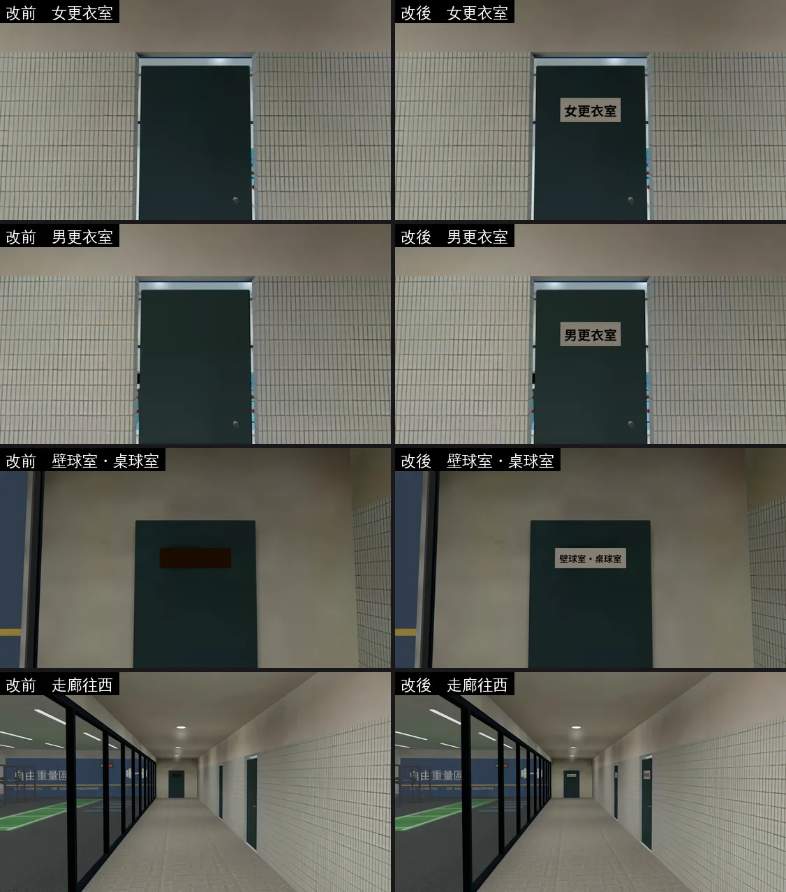

# 體育館 B1 的門牌沒有字（GYM-B1-PLATES-1101；LAWWW2-B 2026-11-01）

- **起因**：照片比對（ART-PHOTO-CMP-1021）時掃全部名牌找到的；LAWWW-B 11-01 02:04 派工（D108：場景程式歸 LAWWW2-B）。
- **狀態**：已修，交 patch。截圖是 Playwright＋SwiftShader（電腦 1280×720），不是實機；讀檔放位置、藏玩家和路人是 [捷徑]。

## 一、遊戲內確認（改前）

- 體育館 B1 走廊的三扇關著的門：女更衣室、男更衣室（游泳池那一側）、壁球室・桌球室（走廊西端）。
- **壁球室・桌球室**：門上一塊深咖啡色的空白牌子，沒有字。
- **兩個更衣室**：門上連牌子都看不到。
- 原因有兩個：
  1. `gym3d.js` 的 gym_b1 區域用 `Z3.attachRoomGLB` 接 `gym_b1.glb`，它不畫 `PLATE_FACE_*`（樓梯口兩塊告示是 gym3d.js 自己畫的，B1 的門牌沒有人畫）。
  2. 兩個更衣室的門牌在 GLB 裡**正面朝門板**（`gym_b1.py` 頂點順序倒了，`[::-1]`），材質是單面（PERF-SINGLESIDE），從走廊看是背面 → 整塊不見。

## 二、修法

- **`src/gym3d.js`**（只動 gym_b1 這一段，`attachRoomGLB`、`engine3d.js`、`game3d.js` 都沒改）：
  - 新函式 `b1Plates(root, B)`：接完正式模型以後，找 `PLATE_FACE_door_b1_*`，用 GLB 節點的 `text` 對到配置 `closedDoors` 的 `label`。
  - 照 `closedDoors` 的 `face`（門朝哪邊：south＝+z、east＝+x…）決定人站哪一邊，UV 照板面重算（u 往看的人右手邊、v 往下），canvas 畫字（米白底、深灰字；字太長就縮小）。
  - 材質改雙面：兩個更衣室的門牌正面朝門板也看得到；UV 是照看的人那一邊算的，字是正的。
  - 不靠 GLB 的 UV 和法線：之後重匯 GLB（門牌正面改朝走廊）也照樣對。
- **`tools/blender/env_second/gym_b1.py`**：更衣室門牌拿掉 `[::-1]`（正面朝走廊）。**GLB 沒有重匯**（gym_b1 有光照烘焙，門牌本身不烘；下次重匯才生效，遊戲端已經不需要）。

## 三、改前改後（同角度；左＝開發分支原樣，右＝改後）

## 四、怎麼套（給 LAWWW-B）

- patch：`docs/art-rebuild/second_ai/patches/gym_b1_plates_1101.patch`（對開發 `ef17f19d6`，`git apply --check` 過）：
  - `src/gym3d.js`：`b1Plates`／`paintDoorPlate`／`doorPlateTex`；gym_b1 接正式模型的那一行加 `b1Plates(root,B)`；`GY3` 多匯出 `b1Plates`。
  - 新 `tests/gym_b1_plates_unit.js`（Node，不需要瀏覽器；用 GLB 裡門牌真正的頂點建網格）：**開發分支原樣 FAIL 4，改後 ALL PASS**。
- 不用換 GLB。

## 五、測試

- `tests/gym_b1_plates_unit.js`：開發原樣 FAIL 4、改後 ALL PASS（①接正式模型以後呼叫 ②三塊都對得到 closedDoors ③都畫上字、字就是 label ④從門朝的那一邊看字是正的 ⑤雙面）。
- **全部 Node（新的 gym3d.js＋新測試，加上照片比對那三個 GLB 放進測試樹）：799 支、0 失敗**。
- 沒跑：手機實機。
