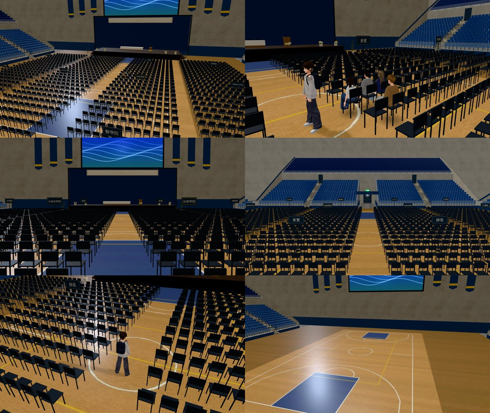

# SET-CEREMONY-1023：體育館 3F 主球場的典禮布置（開學典禮、畢業典禮）

- **企劃**：AA_399 第 4 節（AA-B）；任務 A16。
  - 2025-08-31 14:00 開學典禮：玩家坐法律系那一區；宿營認識的人坐在附近（以安、阿哲、Alison 照宿營有沒有說過話，台詞不加）。
  - 2029-06-02 09:00 畢業典禮：法律系那一區；家人在看台。
  - 兩場現在都是 2D（`ntu_gym_ceremony`）；換成 3D 由 LAWWW-B 做（AA_399 第 13 節）。
- **派工**：LAWWW-B 10-23 18:4x 佇列第 ④ 項。`gym3d.js` 註解寫「SET_CEREMONY 打開（加導航阻擋）是 LAWWW2 的下一步」。
- **做的人**：LAWWW2-B。
- **狀態**：`READY_FOR_ART_REVIEW`。場景美術的 `ART_APPROVED` 只有使用者能標。

## 做了什麼

- **模型**（Blender bpy，`tools/blender/env_second/gym_arena.py`，重建 `gym_arena.glb`）：
  - 典禮的布置 `SET_CEREMONY`（舞台上的講台、花、米色長布、場地上 1,250 張折疊椅）原本就有。
  - 這次只加**十二支學院的牌子**（`SET_CEREMONY_signs`、`SET_CEREMONY_signposts`）：
    - 每一區最後一排後面一支，雙面。
    - 南面給從入口進來找位子的人看，北面給前一區回頭看。
  - 字畫成 `textures/gen/arena_sections.png`：

    

  - 分區（四塊 × 前中後三段）：

    | | 西 | 中西 | 中東 | 東 |
    |---|---|---|---|---|
    | 前段 | 文學院 | 師長 | 來賓 | 理學院 |
    | 中段 | 工學院 | 社會科學院 | **法律學院** | 電機資訊學院 |
    | 後段 | 管理學院 | 生物資源暨農學院 | 醫學院 | 生命科學院 |

    - 分區是遊戲化的安排，不是真實典禮的座位表。法律學院在社會科學院旁邊。
  - 先確認沒改的腳本重建出來和現在的 `gym_arena.glb` 一模一樣（JSON、大小都相同）。
  - 這次重建只多那兩個節點：+1,056 三角形、+84 KB。
- **配置**（`src/data/gym_layout.js` 的 `arena.sets.ceremony`）：
  - `days`：`{'2025-08-31':'open','2029-06-02':'grad'}`，那一整天打開。
  - `sections`：十二區的範圍和名字（法律學院 `law:true`）。
  - `lawSeats`：法律學院靠中間走道的八個座位（x 1.2，走近點在走道 x 0.45）。
  - `spots`：
    - `me`（玩家：法律學院、走道邊，兩場都是這個位子）。
    - `an`（右手邊）、`zhe`（再過去一個）、`alison`（後面一排）。
    - `family`×3（南看台第 4 排，y＝平台頂 1.86 m）。
    - `entry`（入口通道走進場地）、`aisle`（中間走道、玩家那一排旁邊）。
- **程式**（`src/gym3d.js`）：
  - `GY3.ceremonyDay(G)`：典禮那天回傳 `'open'`／`'grad'`，平常是 `null`。
  - 典禮那天：
    - `z.ceremonyOn` 設好（「看主球場」「大螢幕」自動換成典禮的那一句，AA_371 已經寫好的字）。
    - 正式模型的 `SET_STAGE`＋`SET_CEREMONY` 打開；演講、演唱會照舊藏著。
    - 導航（`GY3.ceremonyNav`）：舞台（含兩側上台的樓梯）、四塊椅子區整片擋住；中間、兩側三條走道和場地四周照舊走得到。
    - 法律學院走道邊的八個座位可以坐（「坐下（法律學院）」）。
    - `z.cerSpots`＝配置的 spots。
  - 平常的日子照舊：空球場，什麼都沒變。

## 給劇情接線（LAWWW-B）

- 2D 換 3D：兩場典禮那天進 `gym_arena`，照 `GYM_LAYOUT.arena.sets.ceremony.spots` 放人（坐姿）。
  - 玩家坐 `me`（seats 裡同一個位子，kind `ceremony`）。
  - 以安、阿哲、Alison 照宿營有沒有說過話，放 `an`、`zhe`、`alison`。
  - 畢業典禮家人放 `family`。
- 「旁白照現在的 2D 版」「散場以後接 11:00 法律學院」都是劇情，我沒改。

## 截圖（遊戲內，Playwright＋SwiftShader；不是 iPhone 實機）

- 左上：開學典禮 14:00，從南看台上方看整片（舞台、講台、折疊椅、學院的牌子）。
- 右上：中間走道、法律學院那一區。
  - 坐著的三個是**路人代替**，只是標出以安、阿哲、Alison 的位置，不是他們的模型。
  - 「來賓」牌子在前面那一區後面。
- 左中：從入口往舞台看，學院牌子的南面（社會科學院、法律學院…）。
- 右中：畢業典禮 09:00，從舞台往南看：牌子的北面、南看台第 4 排的家人（路人代替）。
- 左下：畢業典禮，一般鏡頭（玩家在中間走道）。
- 右下：平常的日子（2025-10-15），同一個鏡頭：空球場、沒有布置（另外開一個頁面拍）。

## 效能（同一張截圖）

| 鏡頭 | calls | 三角形 |
|---|---|---|
| 典禮：從南看台上方看整片（四個路人） | 163 | 48.6 萬 |
| 典禮：法律學院那一區（玩家＋三個路人） | 152 | 48.5 萬 |
| 典禮：從入口往舞台 | 50 | 21.2 萬 |
| 畢業典禮：一般鏡頭（玩家） | 78 | 28.6 萬 |
| 平常的日子：同一個整片的鏡頭 | 61 | 18.6 萬 |

- 典禮那天多的主要是 1,250 張折疊椅（GPU instancing，原本的布置）和路人；這次加的牌子很少。
- 典禮只有兩天；如果手機上太重，可以只畫一半的椅子（後段），再說。

## 測試

| 測試 | 測試樹 | 結果 |
|---|---|---|
| `node tests/gym_ceremony_unit.js`（新，14 項：兩場各 4 項＋共用 6 項） | 開發 `6f0db4672`＋patch＋新 GLB；`f85417a0e`＋patch | ALL PASS |
| `node tests/gym_arena_unit.js`、`node tests/gym_unit.js` | 同上 | ALL PASS |
| `tests/reachability_all.py --zones gym,gym_arena`（平常的日子） | `f85417a0e`＋patch | ALL PASS（42 個互動點、4 個出入口到達點） |
| 遊戲內截圖 6 張 | 同上 | 沒有 JS 例外 |

- `gym_ceremony_unit` 用修改前的開發分支跑：第 1 項 FAIL（沒有 days／sections），後面不跑。
- 典禮那天的走路：用單元測試的引擎模擬走（`E.simWalk`），每個座位、三條走道、入口、場地四周都走得到；椅子區、舞台走不進去。**瀏覽器沒有用典禮那天跑 reachability**（`reachability_all` 用預設的日子）。

## 檔案

- `assets/models/env/second_ai/gym_arena.{glb,json}`（重建）、`tools/blender/env_second/gym_arena.py`、`textures/gen/arena_sections.png`。
- 我的分支的 `src/data/gym_layout.js`：先同步開發分支的版本（ART-GYM2-INT v3 已整合的數字，我的分支原本是舊的），再加典禮的資料。
- patch `docs/art-rebuild/second_ai/patches/gym_ceremony_1023.patch`（對開發 `6f0db4672` `git apply --check` 過）：`src/data/gym_layout.js`、`src/gym3d.js`、`tests/gym_ceremony_unit.js`（新）。

## 還沒做到的

- 兩場典禮換成 3D、放人：LAWWW-B。
- 第二會場（1F 的 `SET_SECONDHALL`，畢業典禮那天）照舊藏著，這次沒動。
- 上層看台（4、5F）只有畫面；家人放在下層南看台（走得到，散場可以走過去說話）。
- iPhone 沒看過；典禮那天在手機上的效能沒有實測。
