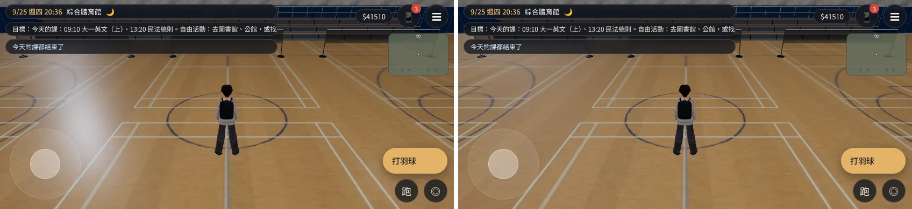
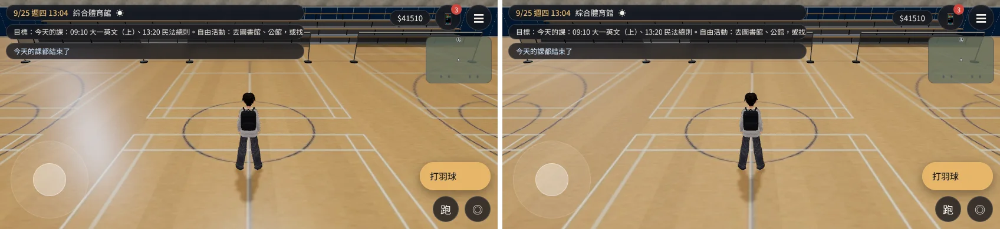
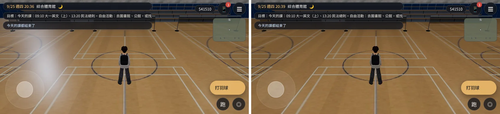

# 體育館 1F 球場的白色光柱（BB_218「待查」那一項）——已交件

帳號 A 的 LAWWW2，2026-10-21 17:2x UTC。狀態：**已交件**，交給 LAWWW 整合；請 BB 用 artrev 同角度重拍。READY_FOR_ART_REVIEW。

## 問題（BB_218 artrev2／3／4／5）

- 玩家在球場中間、鏡頭在南：畫面左邊有一道從上到地板的白霧。
- 白霧在螢幕上的位置不跟著鏡頭平移，只跟著鏡頭轉。
- 20:30 每次都有；13:00 有時有、有時沒有。
- BB 已經排除：不是網頁元素、不是光暈網格、射線只打到球場地板。BB 推測是平行光在亮面地板（粗糙度 0.32）上的高光。

## 查明（`gym_check.py`，前後兩輪紀錄在 `before.log`、`after.log`）

方法：
- 量畫面左邊光柱那一塊和右邊對稱那一塊的平均亮度差（844×390，x 110～260 對 584～734，y 60～260）。
- 場景裡的燈一盞一盞關掉，看光柱跟著哪一盞消失。
- 第一次跑無效：20:30 進館時手機自己跳出來（家人群組的訊息），蓋住整個畫面。腳本加了「像玩家一樣收起手機」，並檢查鏡頭真的跟到球場中間。

結果（修改前，20:30）：

| 關掉的燈 | 左右亮度差 |
|---|---|
| 不關 | **25.5** |
| 太陽（平行光，室內晚上本來就是 0） | 25.5 |
| **補光 `E.fill`（固定方向的平行光 0.35，從西北上方照）** | **−7.9（光柱不見）** |
| 房間頂燈、球場五盞點光源（一盞一盞關） | 23.8～29.0（都不變） |

**原因**：引擎的補光 `E.fill`（`engine3d.js` 67 行，室內室外都有）在亮面球場地板上的鏡面高光。
- 平行光的高光位置只跟鏡頭的方向有關，和 BB 看到的一樣：不跟著平移，跟著轉。
- 13:00 太陽也照著地板，整片地板變亮，光柱比較不明顯（左右差 9.2；關掉補光變 −12.4）。這就是「有時有、有時沒有」。

## 改法

`tools/blender/env_second/gym_interior.py`：球場地板（`gym_court_floor`）粗糙度 0.32 → **0.6**。

| 粗糙度（20:30） | 左右亮度差 |
|---|---|
| 0.32（原本） | 25.5 |
| 0.5 | 10.2（還剩四成，看得到一片淡淡的亮） |
| **0.6** | **1.7（看不出來）** |

- 球場的光澤還在：頂燈的點光源在地板上的反光照舊。
- 換新 GLB 之後重新量：20:30 是 1.7、13:00 是 −7.1，光柱都沒有了。
- `diag_rough05_06_2030.webp`：左 0.5、右 0.6。

## 接法（LAWWW）

- **只換 `assets/models/env/second_ai/gym_interior.glb`**，不用改程式。
- 和開發分支的 GLB 只差 14 個位元組：只有 `gym_court_floor` 那個材質的粗糙度變了。物件、網格、材質數都一樣。
- `.json` 不用換：內容和原本相同。

## 遊戲內前後對照

- 環境：Playwright 手機橫向 844×390、`?turbo`。**不是 iPhone。**
- [前置／捷徑]：讀使用者 9/25 存檔；進體育館；玩家放到球場中間 (0, −2)；鏡頭在南、預設距離和俯角。
- 基準：開發分支 `5845667e`，只在本機 worktree 換 GLB。
- JS 例外 0。
- 每張左邊是修改前、右邊是修改後。

20:30：

13:00：

診斷：左是原本，右是同一個畫面只關掉 `E.fill`（光柱不見）。

## 還沒處理、交給 LAWWW 決定的

- **別的亮面地板也可能有同樣的光柱**。`E.fill` 每個區域都有，固定方向、會產生鏡面高光，例如體育館大廳的花崗石（粗糙度 0.35）、其他館的拋光地板。
  - 根本的解法在引擎，例如補光不要有鏡面高光，或室內降低補光。
  - 這會改到所有室內的光線，是 LAWWW 的事。這次只改了體育館球場的地板。
- `after.log` 只跑完 20:30 和 13:00 兩組：第三組（13:00，從宿舍進來）跑到一半，背景工作被時間上限停掉。修改前那一輪三組都有跑完，第三組的結果和第二組一樣。
