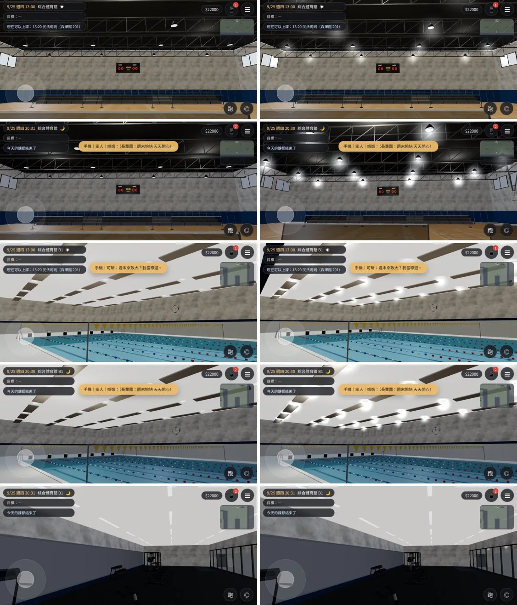

# GYM-GLOW-COPLANAR-1021：體育館 1F／B1 的燈光暈＋疊面（清查 A1、A2）

LAWWW2-C，2026-10-21。
- 起因：清查 `BACKLOG_SWEEP_1021.md`：
  - A1：`gym_interior.glb` 有 50 個、`gym_b1.glb` 有 69 個 GLOW_ 節點，`gym3d.js` 沒接，晚上的燈沒有光暈；
  - A2：疊面。
- 環境：Playwright 手機模擬（橫向 844×390）、SwiftShader。**不是 iPhone 實機**。
- 測試的工作樹：開發分支 `7baa4587`＋這次的 patch＋換 GLB。
  - patch 動的兩個檔，到 `382236a5` 都沒有再改過，可以直接套。

## 狀態
| 項目 | 狀態 |
|---|---|
| `gym_interior.glb`、`gym_b1.glb` | **MODEL_READY**（重匯出） |
| 接進遊戲 | **INTEGRATED（只在我的測試工作樹）**：patch [`../../patches/gym_glow_batch.diff`](../../patches/gym_glow_batch.diff)，動 `src/gym3d.js`、`src/zones3d.js` |
| 測試（Playwright 手機模擬） | `gym_unit.js` ALL PASS；`reachability_all.py --zones gym,gym_b1` **ALL PASS**（30 個互動點、3 個出入口）；截圖 8 張沒有 JS 例外 |
| 美術 | **READY_FOR_ART_REVIEW**；BB-C 畫面驗收待做 |

## 改了什麼
### 1. 光暈接線（patch）
- `zones3d.js`：
  - 回傳值多 `glowBatch:wzGlowBatch`；
  - `wzGlowBatch` 多一個參數 `nearFade`（公尺）：光暈離鏡頭比這個近就淡掉；
  - 預設 0＝不淡出：**溫州街、公館的光暈完全不變**（shader 多一個乘數，值是 1）。
- `gym3d.js`：
  - 1F、B1 的正式模型載好以後，GLOW_ 節點合成一個網格（和溫州街、公館同一套，一次 draw call）；
  - 室內沒有 `TK.setNight`，所以跟著 `z.onLamps` 切白天／晚上的亮度；
  - `nearFade` 3 m。

### 2. 光暈的大小、亮度（Blender 腳本裡改，不在程式裡補）
- 接上以後看遊戲畫面：
  - 1F 球場（天花板 9 m）：照原本的值剛好。
  - B1 健身房（天花板 3.6 m）：每條線型燈一個 2.2 m 的圓光暈，白天花板上一團一團過曝。
  - B1 泳池（天花板 7 m）：光暈 3.0 m 偏亮。
- 改法：

| 燈 | 原本（大小／白天／晚上） | 這次 |
|---|---|---|
| B1 健身房線型燈（24 條） | 2.2 m／0.4／0.9 | **不放光暈**：圓的光暈和一條燈管不搭；燈管本身會發光，看起來就是健身房的燈條 |
| B1 泳池（32 個） | 3.0／0.5／1.0 | 2.4／0.35／0.8 |
| B1 走廊筒燈（7 個，天花板 3.0 m） | 1.4／0.3／0.9 | 0.8／0.2／0.6 |
| B1 大廳筒燈（6 個） | 1.4／0.3／0.9 | 0.9／0.2／0.6 |
| 1F 大廳筒燈（10 個） | 1.4／0.3／0.9 | 1.0／0.22／0.65 |
| 1F 天井燈、天窗、販賣機 | — | 不變 |

- B1 的光暈從 69 個變成 45 個。

### 3. 疊面（Blender 腳本）
- 量法：`check_coplanar.py`。
  - 只算「同一面朝外、相差 < 0.5 mm」＝**一定會閃**的；
  - 背對背的（藏在牆裡、箱子後面）另外列。

| | 修改前 | 這次 |
|---|---|---|
| 1F 一定會閃的面積 | 5.41 m²（127 對） | **0.95 m²**（23 對；全部在朝外的牆面：正面外牆、護牆軟墊背面，室內看不到） |
| B1 一定會閃的面積 | 2.23 m²（11 對） | **0**（0 對） |

- 改的地方：
  - 籃板玻璃比白框小 5 mm（上下左右的面原本和框疊在一起；**球場正中間看得到**）；
  - 天井燈的燈罩底下只留一圈（原本整片圓蓋住發光面，24 盞）；
  - 往 B1 的樓梯井底板縮 5 mm（側面和石牆、頂面和最下面一階疊在一起）；
  - 正門上方的混凝土往外退 5 mm（和兩側的窗框疊在一起）；
  - 看台最後一排停在護牆軟墊前面（原本穿進軟墊）；
  - B1：
    - 東側牆裙離牆 4 mm；
    - 池壁的馬賽克上緣停在池緣磚下面 2 cm（原本和池緣磚的內側疊在一起，水面上看得到）；
    - 健身房東牆從北牆後面開始（兩道牆原本重疊，牆角的面疊在一起）。
- 清查 A2 寫的「56 m²」是連背對背一起算的；這種面藏在箱子、牆後面，看不到，這次沒改。
  - 背對背的總面積：1F 157.7 → 137.6、B1 113.8 → 102.5 m²。

## 截圖（左：開發分支 `7baa4587`；右：這次；9/25 週四；[捷徑] 讀檔、電影鏡頭指定位置）
1. 1F 球場 13:00；
2. 1F 球場 20:30；
3. B1 泳池 13:00；
4. B1 泳池 20:30；
5. B1 健身房 20:30（這次不放光暈，和原本一樣）。

## 效能（同一個鏡頭，`renderer.info`）
| 鏡頭 | draw call 前 → 後 | 三角形 前 → 後 |
|---|---|---|
| 1F 大廳 13:00 | 99 → 100 | 116,652 → 117,376 |
| 1F 球場 13:00 | 98 → 99 | 116,650 → 117,374 |
| 1F 大廳 20:30 | 83 → 84 | 79,956 → 80,680 |
| 1F 球場 20:30 | 82 → 83 | 79,954 → 80,678 |
| B1 泳池 13:00 | 70 → 71 | 101,288 → 101,378 |
| B1 健身房 13:00 | 85 → 86 | 117,458 → 117,548 |
| B1 泳池 20:30 | 54 → 55 | 64,592 → 64,682 |
| B1 健身房 20:30 | 69 → 70 | 80,762 → 80,852 |

- 每個鏡頭 +1 draw call（光暈批次）。
- 1F 三角形 +724：光暈 100＋燈罩改成一圈 624。

## GLB
| 檔案 | 修改前 | 這次 |
|---|---|---|
| `gym_interior.glb` | 2.39 MB、31,120 三角形 | 2.41 MB、31,744 三角形 |
| `gym_b1.glb` | 3.63 MB、51,196 三角形 | 3.63 MB、51,196 三角形（少 24 個空節點） |

- 導航、座位、互動點都沒變（`gym_layout.js` 沒改）。

## 交付（focused-cray，見 commit）
- GLB：
  - `assets/models/env/second_ai/gym_interior.glb`、`.json`；
  - `gym_b1.glb`、`.json`。
- 腳本：`tools/blender/env_second/gym_interior.py`、`gym_b1.py`。
- patch：`docs/art-rebuild/second_ai/patches/gym_glow_batch.diff`（`git apply` 套在開發分支）。

## 已知、還沒做
- B1 健身房整體偏單調：
  - 白天花板、灰牆、黑地板，牆上沒有東西；
  - 之後巡場景時處理（鏡子以外的牆面、器材的顏色）。
- iPhone 實機沒有測過。
