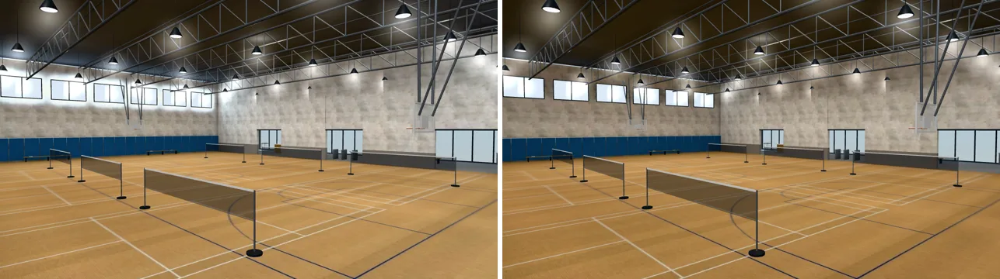
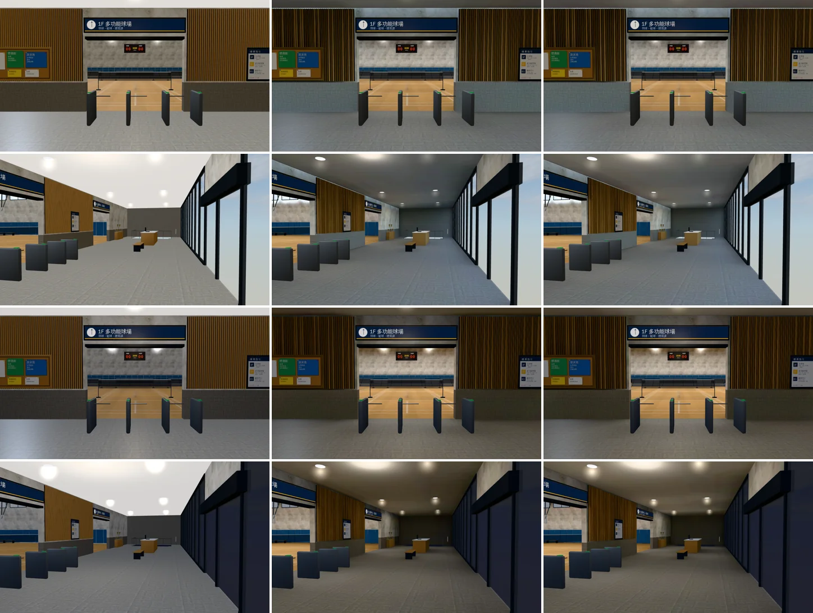
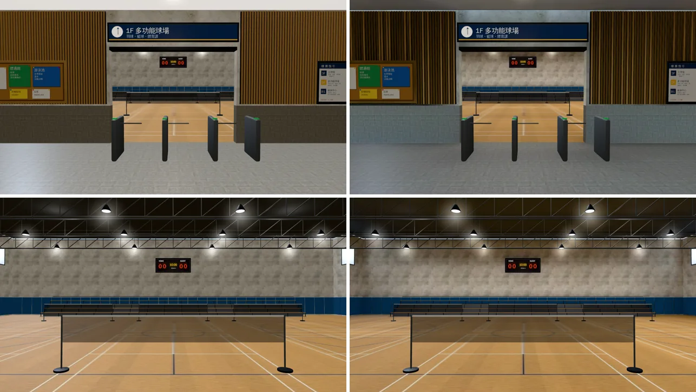
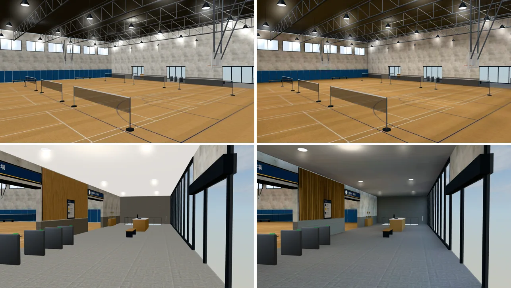
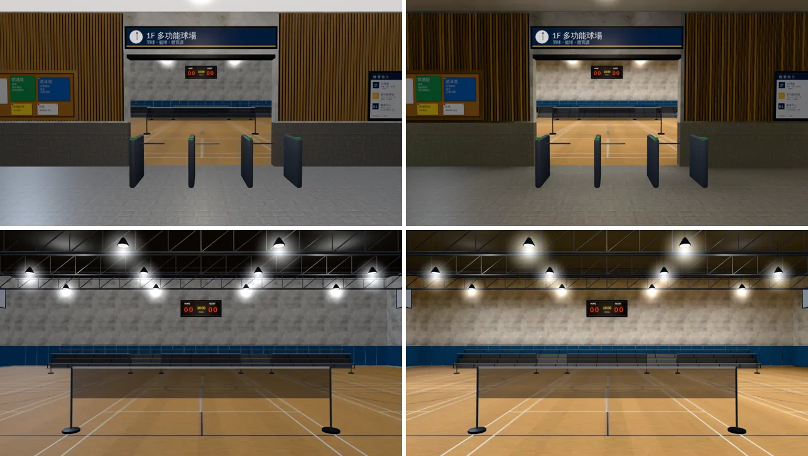
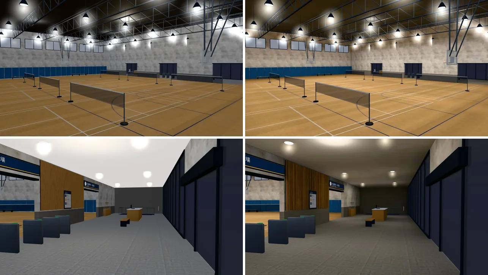
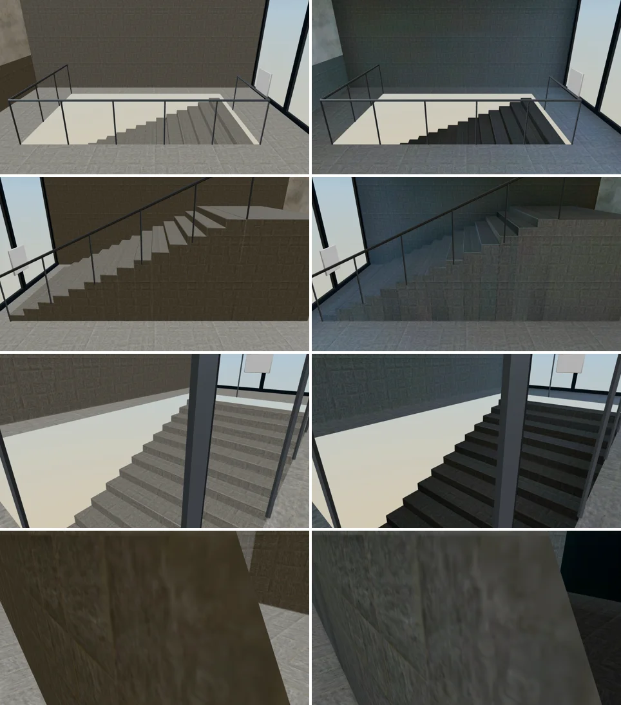

# 新體育館 大廳＋1F 球場（gym 區域）室內光照烘焙（INTERIOR-AAA-REVIEW-1028；LAWWW2-B 2026-10-31）

> **第五版（19:3x，更正）**：第四版（`3094e123b`，LAWWW-B 已整合 `baec2acc2`）白天**高窗四周的牆一圈白光暈**，我交件時沒看出來。
> - 光照貼圖：窗和窗之間的牆 1.97～2.0（上限），窗下面 0.27。
> - 原因：高窗的發光面（`gym_window_sky`）在 PERF-SINGLESIDE 時補了反面；反過來那一片朝著牆、離牆 4 cm，烘焙時把旁邊的牆照爆。Cycles 的發光面本來也是兩面都發光。
> - 修法：`gym_interior.py` 的高窗不補反面（`single_side(..., nodup=r'window_sky')`）＋`bake_room.py --emit-oneside`（發光材質只有正面發光；獨立小場景驗過：背面那一側的牆 0.2456 → 0）。
> - 第五版：窗和窗之間的牆 0.124／0.136（窗下面 0.218）。其他和第四版一樣（大廳天花板、地板、晚上都同一套參數）。
> - 下面的改前改後都換成第五版；第四版和第五版的高窗比較：
>
> 

- **起因**：INTERIOR-AAA-REVIEW-1028 第 5 節 P1（光照）。照「玩家多常去」的順序：便利商店 → 書店 → 溫州街三家（都已整合）→ 體育館。
  - LAWWW-B 15:37 排的順序：體育館光照 → BB n33 兩件 → CAM-BELL。
  - 體育館分三個區域：這一包是 1F（`gym`，`gym_interior.glb`）；3F 主球場（`gym_arena`）、B1（`gym_b1`）接著做。
- **狀態**：`READY_FOR_ART_REVIEW`。建築、場景只有使用者能標 `ART_APPROVED`。
  - 截圖是 Playwright＋SwiftShader（電腦 1280×720），不是實機。
  - 讀檔放位置、藏玩家和 NPC 是 [捷徑]。
- **這一包只做光照（P1）**，擺設沒動。

## 一、怎麼套（給 LAWWW-B）

1. **換二進位**（從我的分支 `claude/funny-albattani-iawshm` 拿）：
   - `assets/models/env/second_ai/gym_interior.glb`；
   - 新的 `gym_interior_lm_day.webp`、`gym_interior_lm_night.webp`。
   - 模型和開發分支同一份腳本重匯，只多光照 UV（TEXCOORD_1）和 `extras.lightmap`。
     - 節點、材質一樣；三角形少一些（有光照貼圖的物件烘焙前拿掉反面，見第四節；第五版高窗也不補反面）。
     - **第五版要一起換 `gym_interior.json`**（高窗不補反面，三角形數變了）。
2. **不用改程式**：`gym3d.js` 的 gym 區域走 `Z3.attachRoomGLB`，看到 GLB 的 `extras.lightmap` 就接（和 Café、書店、溫州街三家一樣）。
   - 高窗的亮度照舊由 gym 區域自己照時段調（`skyLevel`）：GLB 裡沒有 `dayEmit`，`Z3.roomLightmap` 不會再調一次。
3. **patch**：`docs/art-rebuild/second_ai/patches/gym_lm_1031.patch`（只有測試；對開發 `f275a620f`、最新 `d93d6fc4d` 都 `git apply --check` 通過）。
   - 新測試 `tests/gym_lm_unit.js`：
     - 光照貼圖兩張都在、沒有 dayEmit；
     - 地板、球場、天花板、屋頂、牆、軟墊、石材、木格柵有第二套 UV；
     - 桁架鋼管、燈面、高窗發光面照舊即時光；
     - 羽球網（`SET_NETS`）不烘；第二會場的折疊椅（`SET_SECONDHALL`）照舊是 GPU instancing、第二套 UV 都在貼圖裡；
     - gym 區域照舊用 `attachRoomGLB`。
     - **開發分支原樣 FAIL 4，改後 ALL PASS。**
   - 改 `tests/singleside_gym_unit.js`：大廳的石牆從「開口的零件有反面」拿出來，改成 2b「都有光照貼圖、沒有反面」。
     - 和便利商店的牆面、社科圖的天井同一個做法（`singleside_interiors_unit.js` 2b、2c）。
     - 改前的模型 2b FAIL，改後 ALL PASS。
4. 工具（只在我的分支）：
   - 烘焙 `tools/blender/env_second/lightbake/bake_gym.sh interior`；
   - 鏡頭 `tools/blender/env_second/shots/gym_lm_shots.py`；
   - 新的後處理 `tools/blender/env_second/lightbake/glb_restore_sides.py`（見第四節）；
   - 烘焙紀錄 `gym_interior_lm.json`。

## 二、做法

- 燈照模型的燈具位置：
  - **球場**：屋頂桁架下 40 盞高天井燈，往下照的面光源，冷白。
  - **大廳**：天花板 10 盞嵌燈，往下照的面光源，暖白。另外每盞嵌燈正下方 2.3 m 一顆柔和的補光（第四版，見下面）。
  - 白天燈也開著（亮度 0.7 倍）。
- **天光**：
  - 大廳入口那一面（+z）的大片玻璃，天光從這裡進來；其他幾面在烘焙時包黑殼（門縫、牆角不漏天光）。
  - 東西兩面的高窗外面沒有東西，是自發光的天空色：白天那一張讓它發光，天光從高窗進來；晚上不亮。
- **不烘的**（照舊即時光）：
  - 桁架鋼管、燈罩、黃銅、小零件、籃框、膠帶；
  - 牌子：記分板、指標、公告、開館時間、樓層指引；
  - 高窗發光面、窗框。
- **照條件出現的東西**：第二會場（畢業典禮那天才打開）、羽球網（第二會場打開的日子收起來）在烘焙時當作不存在，影子不會烘進地板。
- 貼圖 1024²、256 取樣、平滑 2；烘一次 21 分鐘。

### 參數（試了四版）

- **第一版**：大廳白天整片偏藍灰（入口玻璃進來的天光）。白平衡 1.0,0.98,0.95 → 1.0,0.93,0.84、天光 0.5 → 0.4。
- **第二版**：還是藍——石牆從改前的深咖啡 (61,54,41) 變成 (98,110,110)。
  - 原因：烘焙的天空（Nishita）照太陽方位上色。太陽在東邊時，入口（南）看出去是背對太陽、偏藍的那一片天。
  - 改成太陽方位 180°（入口那一側；強度照樣 0，高窗不是真的開口）、天光 0.3、白平衡 1.0,0.96,0.9。
- **第三版**：
  - 球場白天、晚上都比改前自然。
  - 大廳的石材、地板是中性灰：石材本身就是灰色花崗石（`gym_interior.py` 的 #8e8b85），改前偏咖啡是暖色的即時環境光。
  - 但大廳天花板只吃得到地板反彈的光：嵌燈只往下照，白天 0.126，畫面上深灰，比改前的白天花板暗很多。
- **定案（第四版）**：大廳加天花板補光（嵌燈正下方 2.3 m 十顆柔和的點光源，8 W），嵌燈 25 → 20 W（地板不要跟著變太亮）。

| 光照貼圖（`lm_probe.py`） | 第三版 白天／晚上 | 第四版 白天／晚上 |
|---|---|---|
| 大廳天花板（中間） | 0.126／0.116 | 0.145／0.152 |
| 大廳天花板（東側） | 0.133／0.109 | 0.148／0.130 |
| 大廳地板 | 0.377／0.258 | 0.378／0.255 |
| 球場地板 | 0.703／0.902 | 0.713／0.887 |

- 第五版（高窗光暈修正）：大廳天花板 0.145／0.152、大廳地板 0.370／0.258、球場地板 0.662／0.909——球場白天少一點，是高窗反面照爆的光沒了。

## 三、改前改後（同角度；左＝開發分支原樣，右＝光照烘焙第四版）

- 鏡頭：`gym_lm_shots.py`。①大廳（從入口往裡看）②球場（從中間的開口往看台、記分板）③球場角落斜看（高天井燈、高窗、護牆軟墊）④大廳往樓梯、服務台。

（第五版）

### 看得到的差別

- **球場**：
  - 高天井燈底下亮、四個角落和護牆軟墊上緣暗一點；改前整間一樣亮。
  - 屋頂板吃得到地板反彈的光：改前晚上屋頂整片黑，現在看得到桁架後面的屋頂。
  - 白天的石牆比改前白、少了一層咖啡色（改前的暖色是即時環境光）。
- **大廳**：
  - 嵌燈底下的地板亮一圈，天花板靠嵌燈的地方亮、中間暗；晚上是暖色的燈。
  - 改前天花板整片白、沒有明暗，像攝影棚。

### 還不夠的（照實寫）

- **大廳天花板比改前暗**：白天天花板取樣 (215,211,205) → (94,91,86)，往服務台那一張 (235,230,224) → (114,111,103)。
  - 原因：真的嵌燈天花板本來就只吃得到反彈光。第四版加了補光，比第三版亮 15～30%，但沒有回到改前的白。
  - 要更亮：`bake_gym.sh` 的 `FILLW`（補光，現在 8 W）可以再加，重烘 21 分鐘。請 BB／使用者看了再說。
- **大廳靠玻璃的石材、地板偏冷**：
  - 石牆白天 (86,97,99)，改前 (61,54,41)。入口大片玻璃進來的是天光，本來就偏藍；石材本身是灰色。
  - 要暖一點可以改白天的白平衡 `DAYWB`（現在 1.0,0.96,0.9）。
- **往 B1 的樓梯下半段很暗**（見下面樓梯那張的第一、三列）：樓梯井只有大廳的光照得到，最下面幾階幾乎是黑的。
  - 實際玩：從大廳走下去時，畫面會先暗、到 B1 再亮。要改可以在樓梯井加一盞燈（模型裡也要加燈具）。

## 四、單面材質（PERF-SINGLESIDE-GLB-1025）的兩件事

1. **大廳的石牆（樓梯）沒有反面了**：
   - 原本石材的樓梯是「開口的零件」，單面化時補了反面（2,548／2,620 個三角形有反過來的分身）。
   - `bake_room.py` 烘焙前把有光照貼圖的物件的反面拿掉：反面的光照貼圖是黑的。便利商店、社科圖也一樣。
   - 留下來的是原本的那一面。同角度截圖（左＝改前，右＝改後）：上下樓梯一階一階、扶手牆都看得到，沒有破洞。

   

2. **樓梯口指標的字面 `cafe_sign_face` 被 Blender 重匯成雙面**（白模是單面）：
   - `singleside_gym_unit.js` 第 1 項抓到。
   - 新工具 `glb_restore_sides.py`：烘好以後照白模把每個材質的單面／雙面還原（只改 `materials[].doubleSided`），`bake_gym.sh` 最後一步自動跑。
   - 之前交的其他房間沒有查過有沒有同樣的事；之後烘焙的都會跑。

## 五、測試

- `tests/gym_lm_unit.js`：開發分支原樣 FAIL 4，改後 ALL PASS。
- `tests/singleside_gym_unit.js`：改前的模型 2b FAIL，改後 ALL PASS。
- 會建出體育館的 Node（`gym_unit`、`gym_arena_unit`、`gym_crowd_unit`、`gym_hear_unit`、`bball_rain_unit`、`door_open_unit`、`group_events_unit`、`crowd_depts_unit`、`aa386_sis_batch4_unit`、`aa417_sport_invite_unit`、`badclip_wire_unit`、`v0_c2_unit`）全部 ALL PASS。
- 全部 Node：見交件訊息（和總圖核心鏡頭第二輪一起跑）。
- **效能**（`interior_perf.py`，藏路人，14:00，手機橫向模擬；draw call／三角形）：

| 位置、方向 | 改前 | 改後 |
|---|---|---|
| 大廳 前 | 79／108,156 | 79／106,656 |
| 大廳 左 | 76／101,662 | 76／100,294 |
| 大廳 右 | 78／102,182 | 78／100,814 |
| 大廳 後 | 60／96,204 | 60／94,836 |
| 球場 前 | 79／108,562 | 79／107,062 |
| 球場 左 | 80／108,132 | 80／106,632 |
| 球場 右 | 82／108,652 | 82／107,152 |
| 球場 後 | 88／108,402 | 88／106,902 |

  - draw call 一樣；三角形少 1,4xx（石牆的反面）。多兩張 1024² 的 WebP（白天 56 KB、晚上 49 KB）。
- 第二會場的折疊椅（畢業典禮那天）：光照貼圖取到的亮度白天平均 0.44、最暗的 10% 0.316；晚上 0.448、0.361（球場地板 0.7～0.9），不會整排黑椅子。遊戲內沒有拍（要開第二會場的日子）。
- 沒跑：手機實機、`tools/dev_scratch/nav_islands.py`（導航沒改）。
