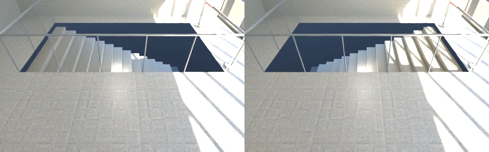

# BUG-GYM-STAIRS-1020：體育館 1F 往 B1 的樓梯井台階畫反

LAWWW2-C，2026-10-20。
- 誰派的：LAWWW-C 14:13（插隊）。
- 來源：使用者 13:0x 試玩回報 X64；BB-C `52acaadc` 找到原因。

## 原因
- `tools/blender/env_second/gym_interior.py` 的 `stairs_down`：原本 `zz = z0 + j·run`。
  - 第一階（和地板一樣高的那一階）在北端 z0，越往南（z1）越深。
  - 欄杆的開口、紅龍、「下樓到 B1」的告示都在 z1；B1 那一跑也是往 +z 上來。
  - 結果是從開口走過去就踩空，台階的方向反了。
- 改成 `zz = z1 - (j + 1)·run`：從 z1 的開口往 −z 一階一階下去。

## 前後（Blender 算圖：從樓梯井西邊往東看，右邊是開口 z1）
左：改之前（開口那一頭最深）；右：改之後（開口那一頭和地板同高，往北下去）。

## 交付
- `assets/models/env/second_ai/gym_interior.glb`、`.json`（同檔名）。
  - 物件 352、三角形 31,120、材質 78 都和原本一樣，只有台階的位置變了。
- 導航、互動點不用動（`src/data/gym_layout.js` 沒改）。

## 沒測
- 遊戲內沒有走一遍（B1 還沒開放，樓梯口是紅龍）。
- iPhone 實機。
