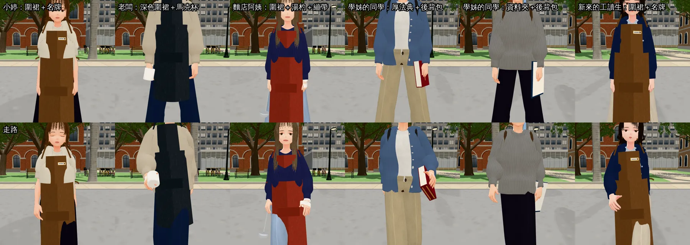
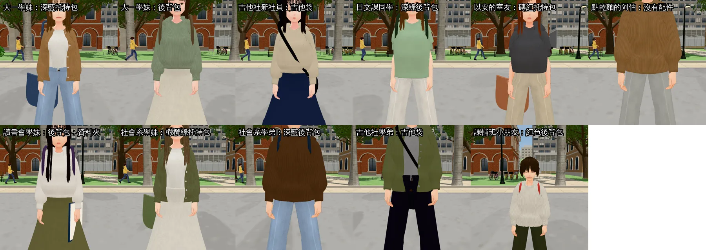

# 女主角圈子的標籤同伴：固定路人底模＋配件（HEROINE-LIFE-NPC3D-1028；LAWWW2-C 2026-10-28）

- **任務**：LAWWW-C 06:21Z 定案。
  - D99 照舊：不做新的人物模型。
  - 17 位標籤同伴在現在分到的路人底模上加「看得出身分的配件」，底模不換（不然會和二十位同學撞）。
- **怎麼套**：疊在 NPC-POOL-ART-1028 後面。
  1. `git apply docs/art-rebuild/second_ai/patches/npc_pool_art_1028.patch`
  2. `git apply docs/art-rebuild/second_ai/patches/hlife_props_1028.patch`
  3. 二進位檔：`assets/models/char/second_ai/name_pin.glb`、`mug.glb`、`lawbook.glb`。
  - 在開發分支 `44e8ff8b7` 上一起套過。
- **狀態**：`READY_FOR_ART_REVIEW`（人物身上的配件由 BB 驗收，D59）。
- 截圖是遊戲內，Playwright＋SwiftShader 模擬，不是 iPhone 實機。工具：`tools/shots/pool_lineup.py`，`hc_*` 用遊戲的 `HCIRCLE.specOf`，所以配件是照遊戲的路徑傳進去的。

## 畫面

大一上就會遇到的六位（上排站、下排走路）：

其他十一位：

## 誰拿什麼

| 同伴 | 底模（不換） | 配件 |
|---|---|---|
| 小婷（Café 同事） | npc_nf6 | 咖啡色圍裙（和芷若同一款）＋名牌（別在圍裙胸口；白底金框、杯子圖示，沒有店名） |
| 新來的工讀生（Café） | npc_nf11 | 同上 |
| 老闆（Café） | npc_nm6 | 深灰圍裙＋白色馬克杯（右手握杯耳；坐下時藏） |
| 麵店阿姨 | npc_nf3 | 磚紅圍裙＋湯杓（右手）＋左手繃帶（AA_505：「手上包著繃帶」；照這個底模的手量過） |
| 學姊的同學（兩位） | npc_nm16、npc_nm2 | 一位：厚法典＋黑色後背包。另一位：判決資料夾（現成的 folder）＋咖啡色後背包 |
| 大一的學妹（兩位） | npc_nf13、npc_nf14 | 深藍托特包／米褐後背包 |
| 晨希社團的新社員、吉他社的學弟 | npc_nf20、npc_nm12 | 吉他袋 |
| 日文課的同學 | npc_nf1 | 深綠後背包 |
| 以安的室友 | npc_nf4 | 磚紅托特包 |
| 讀書會的學妹 | npc_nf12 | 紫灰後背包＋資料夾 |
| 社會系的學弟妹 | npc_nf19、npc_nm15 | 橄欖綠托特包／深藍後背包 |
| 課輔班的小朋友 | npc_nm20（1.25 m） | 紅色後背包（跟著身高縮小） |
| 點乾麵的阿伯 | npc_nm3 | 沒有配件（稿沒有寫，硬加反而怪） |

- 托特包、後背包都換了顏色：以安的米白托特包、祐廷的深灰後背包是她們的識別物，不要撞。

## 程式（`patches/hlife_props_1028.patch`）

- `src/data/heroine_circle.js`：PEOPLE[] 十六位加 `props`。LAWWW-C 說過要動 PEOPLE[] 先講：只加 props，label、sex、model、note 都沒動。
- `src/hcircle3d.js`：`S.specOf` 把 `props` 傳進 spec，一行。
- `src/props3d.js`：`name_pin`、`mug`、`lawbook` 三個 DEF。
  - 名牌掛 spine，位置照 `apron()` 的胸片算（y 0.26、往左轉 0.3 rad，貼在胸片表面）。
- `src/assets3d.js`：三個 `prop.*`（lazy）。
- `src/character3d.js`：`C.CARRY` 加 mug、lawbook。
- `LICENSES.md`：一列。

## 測試

- 開發分支 `44e8ff8b7`＋兩份 patch（Node）：
  - `badclip_bag_unit`、`anon_pool_unit`：ALL PASS。
  - `heroine_circle3d_unit`：4 項 FAIL，全是「讀稿」（六份稿讀不到）。**拿掉這份 patch 輸出逐行一樣**。
- 瀏覽器：十七位都用 `HCIRCLE.specOf` 建出來拍。
  - 站著、走路（前六位）。
  - 底模都是 heroine_circle.js 指定的那個。
  - 沒有 JS 錯誤。

## 缺點、還沒做

- 圍裙是程式產生的硬圍裙（現成的 apron）：走路時大腿會從側面露出來，芷若用的也一樣。要改是另外一件事：改的是現成配件，排之前先問 LAWWW-C。
- 後背包背帶用預設路徑（照祐廷的身材）。十七位近看沒看到穿模，但沒有逐一量身體。
- 新做的三個模型：名牌 144、馬克杯 482、法典 504 個三角形；GLB 12／20／41 KB。
