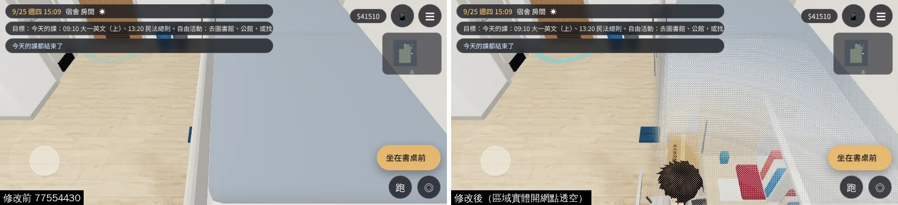
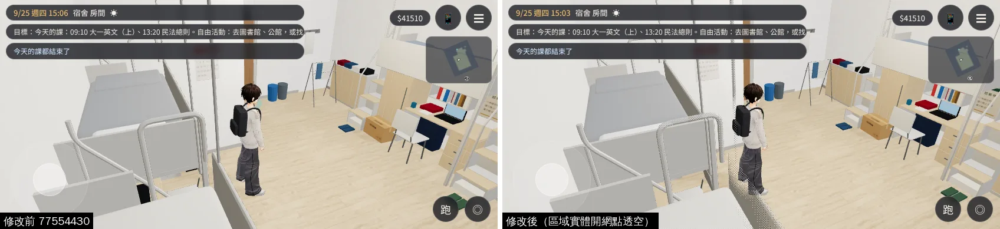
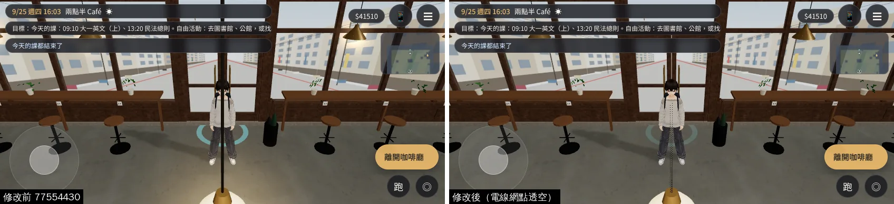
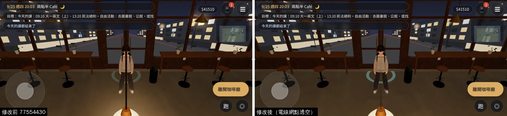
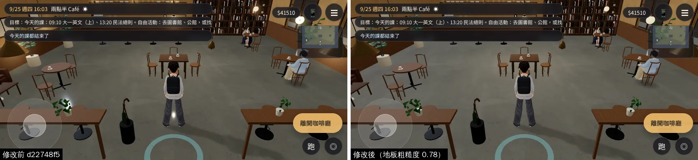
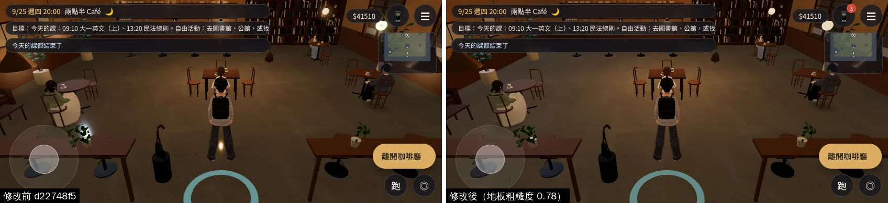

# 室內網點透空從來沒開過（宿舍上舖、Café 吊燈電線）＋Café 地板鏡面

帳號 A 的 LAWWW2，2026-10-22 01:1x～01:4x UTC。狀態：**READY_FOR_ART_REVIEW**（交件；和宿舍 412 洗手間 `../dorm412_1021/` 一起交）。

任務：ART-ECON-3D-GAP-1021（經濟系那年的宿舍、Café）、BUG-CAFE-FLOOR-MIRROR-1021；連帶修好 BUG-CAM-203-R2-1021 留下的「坐在書桌前、鏡頭在北看不到人」。

## 問題

| # | 看到的 | 原因 |
|---|---|---|
| 1 | 大一 203 坐在自己書桌前，鏡頭轉到北邊：整個畫面是上舖床墊，看不到人（BUG-CAM-203-R2 交件時就寫在「還不到」） | 見下面「真正的原因」 |
| 2 | 兩點半 Café：鏡頭從吊燈上方經過時，吊燈電線是一條黑色直條，從人身上切過去 | 同上 |
| 3 | Café 店內自流坪地板像鏡子：吊燈下面反光成一個白點（人的腳邊） | 地板的粗糙度貼圖匯出成 0.004 |

**真正的原因（#1、#2）**：網點透空（擋住玩家的東西變成網點）在室內只有區域開了 `seeThru` 才用。`engine3d.js` 的 `updateSeeThrough` 看的是**區域實體** `E.zone.seeThru`（`build()` 回傳的那個物件）：

- 法律學院圖書館、教學館：`seeThru` 寫在 `build()` 回傳的物件上——有作用。
- 宿舍（`zones3d.js` 的 `dorm`）、美國公寓（`us3d.js` 的 `aptZone`）、這次的 Café patch：只寫在**區域定義**上（`{ id:'dorm', ..., seeThru:true, build(E){...} }`）——引擎看不到，**室內透空從來沒開過**。
- 材質那一邊（標記、patch shader）是對的；Node 單元測試只查了材質和定義，所以沒抓到。

美國公寓沒有標透空的材質，開不開畫面都一樣，這次沒動。

## 改法（都只在我的檔 `src/zones3d.js`）

- `patches/dorm_seethru.diff` **第三版**：宿舍 `build()` 裡 `z.seeThru=true`（第二版的洗手間補光、seethru_ 材質 patch 照舊）。
- `patches/cafe_seethru.diff` **第二版**：Café `build()` 裡 `z.seeThru=true`（第一版的電線材質、吊燈光暈照舊）。
- 兩支單元測試的第 1 項改成查實體（`z.seeThru`）：
  - `tests/dorm_seethru_unit.js`：拿掉那一行 1 FAIL、加上 ALL PASS。
  - `tests/cafe_seethru_unit.js`：同上。
- `assets/models/env/second_ai/cafe_interior.glb`＋`.json`（`2a682738`）：電線用 `seethru_cafe_cord` 材質；地板粗糙度 0.004 → 0.78。
- 最新開發分支 `77554430`：兩份 patch 都乾淨；和 `zone_prewarm.diff`、`wz0_prop_nav.diff` 四份一起套，兩種順序（宿舍→Café→預熱→雜物導航、反過來）都套得上。
  - `dorm_seethru_unit`、`dorm_cam_unit`、`dorm_moved_out_unit`、`dorm_y2_items_unit`、`dorm_y3_items_unit`、`cafe_seethru_unit`、`cafe_kit_glow_unit`、`nav_buildings_unit` ALL PASS。

引擎那一邊（給 LAWWW 參考，**不在 patch 裡**）：`updateSeeThrough` 改成 `E.zone.seeThru||(E.zone.def&&E.zone.def.seeThru)` 的話，以後寫在定義上也有用。`indoor` 就是從定義讀的（`E.indoor=!!zoneDef.indoor`），兩種寫法都有人用。

## 遊戲內前後對照

- 環境：Playwright＋SwiftShader，手機模擬 844×390 橫向、`?turbo`，**不是 iPhone**。
- 宿舍：`dorm_check.py`（BUG-CAM-203-R2 那一支）——讀使用者 9/25 存檔、大一 203、15:00。
- Café：`cafe_check.py`——16:00、20:00。
- 修改前＝開發分支 `77554430`；修改後＝同一個版本套 `dorm_seethru.diff` 第三版＋`cafe_seethru.diff` 第二版＋新的 `cafe_interior.glb`（佇列 j21，01:33～01:41）。

**大一 203 坐在書桌前、鏡頭在北**：原本整個畫面是上舖床墊；現在床墊、床架在人的周圍變成網點，看得到人、書桌。

**R2 書桌旁、鏡頭在東（6 秒後）**：擋在人前面的床架下緣變成網點。

**Café 吊燈電線（16:00、20:00，鏡頭在吊燈上方）**：原本一條黑色直條從人身上切過；現在經過人身上的那一段是很淡的點線。

**Café 地板（16:00、20:00；j13，修改前＝`d22748f5`）**：人腳邊吊燈的白色反光點沒了。左邊盆栽上的白色光暈是 Café 正面套件的光暈（BUG-CAFE-KIT-GLOW，已在開發分支 `80af0168`），修改後的版本有套。

## 還不到的地方（誠實寫）

- 網點透空的範圍是引擎定的（人在畫面上的大小乘一個比例）：上舖整片網點時，畫面右半邊都是點點，有點吵。要改是 `engine3d.js` 的範圍（`uSeeR`），這次不動。
- Café 電線變成點線以後還看得到一點；完全不擋要把電線拿掉，這一版不做。
- 真機沒看過。

## 接法（LAWWW）

- `git apply docs/art-rebuild/second_ai/patches/dorm_seethru.diff`（第三版）、`cafe_seethru.diff`（第二版）；兩份都對 `77554430` 乾淨。
- 換 `assets/models/env/second_ai/cafe_interior.glb`＋`.json`（我的分支）。
- 宿舍 412 洗手間的說明在 `../dorm412_1021/README.md`（同一份 `dorm_seethru.diff`）。
