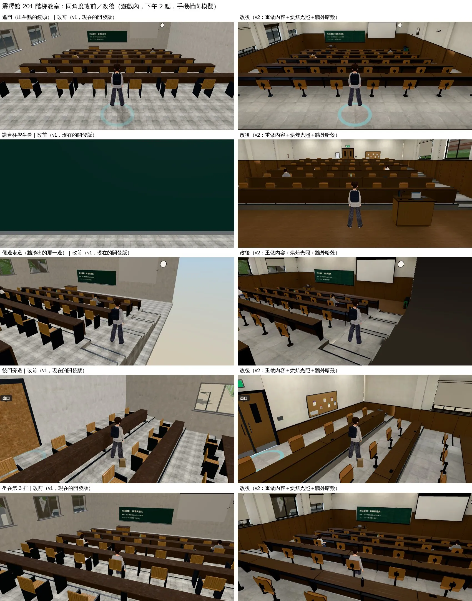
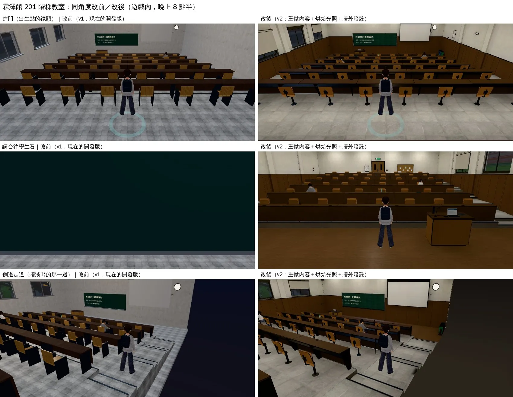
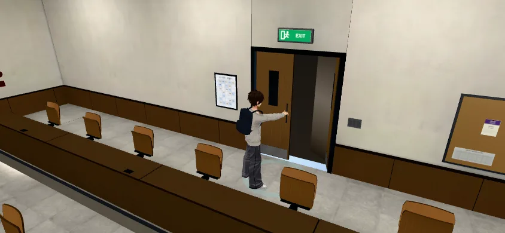

# 霖澤館 201 階梯教室 v2：室內美術示範（INTERIOR-AAA-REVIEW-1028；LAWWW2-C 2026-10-28）

- **起因**：使用者 10-28「校內建築 空間內配置 有很大的美術提升空間 現在是一個廉價手遊感 請你去參閱3A大作好好檢討」。
- **檢討報告**：`docs/art-rebuild/second_ai/INTERIOR_AAA_REVIEW_1028.md`。這一間是報告第 5、6 節的示範：同一套做法先在 201 做完，使用者看過再推到其他室內。
- **狀態**：`READY_FOR_ART_REVIEW`。建築、場景只有使用者能標 `ART_APPROVED`。

## 同角度改前／改後（遊戲內、玩家鏡頭）

- 環境：手機橫向 844×390、Playwright＋SwiftShader 模擬，不是 iPhone 實機。
- 改前：現在的開發版 v1（`562a5ead9`）。改後：v2，套在 `05740674b` 上。

推門時，門板連同小窗、門把一起轉開，後面是暗的走廊：

## 玩家會看到什麼不同

| 檢討報告的問題 | v1 | v2 |
|---|---|---|
| 光是平的 | 室內一盞方向光＋半球光：每個地方一樣亮，東西像貼在地上 | 用 Cycles 把光烘焙成光照貼圖（白天：窗外天光＋太陽＋日光燈；晚上：只有日光燈）。桌子底下、牆角、椅子下面是暗的，燈下面比較亮 |
| 鏡頭在牆外時看到天空 | 側邊走道往前看，牆淡出的那一邊是整片淺藍色天空，教室像飄在天上 | 房間外 7 m 有一圈暗色的殼（鏡頭最多在牆外 4.4 m，殼一直在後面），看起來像剖面圖 |
| 東西是方塊拼的 | 12 m 一整塊的長桌、木板拼的椅子 | 真的翻椅：中柱、模壓夾板椅背、椅面前緣往下彎。長桌分段（看得到接縫）、圓角、正面擋板、鋼製懸臂桌腳、桌下置物架、桌上電源盒 |
| 一模一樣的東西整齊排列 | 48 張椅子全部放下 | 沒有人坐的椅面掀起來；有人坐（玩家、同學、遠處的替身）就放下 |
| 材質 | 單色牆、整片 20 cm 的小灰磚 | 60 cm 灰地磚、講台區木地板、四面 2.4 m 的木腰牆（每 1.2 m 一條分割縫）、收邊、側牆的柱子 |
| 細部 | 窗、門都是平板 | 鋁窗框、兩扇推拉窗、石材窗台、捲簾拉到不同高度。後門是兩扇（推門會轉開其中一扇）、門上小窗、門把、踢腳板、出口燈 |
| 天花板 | 白格子＋燈條 | 輕鋼架 0.6 m 格子、T5 格柵燈具（對齊格子）、吸頂冷氣、投影機（對準投影幕）、吸頂喇叭、偵煙器 |
| 「有人用過」 | 沒有 | 粉筆、板擦、粉筆灰。講桌上的筆電（投影片）、鵝頸麥克風、點名板、保溫瓶、粉筆盒。窗台上沒喝完的手搖杯、桌尾一疊講義、掛在桌邊的雨傘、桌上的水和手搖杯。公告欄的傳單（虛構，D77）、課表、教室使用規則、垃圾分類桶、滅火器 |
| 講台往學生看 | 黑板不會跟著前牆淡出：鏡頭在前牆外時，整個畫面被黑板擋住 | 黑板、投影幕、喇叭都跟著前牆淡出 |

## 沒有動的（玩法、存檔）

- 配置照舊讀 `src/data/classroom_layout.js`：
  - 平台高度、48 個座位的位置、導航格、互動點都沒改。
  - 黑板上的字（遊戲畫）、時鐘、窗景照舊。黑板正面在 z −8.545，字在 −8.53。
- 存檔格式沒有改。

## 檔案

- **模型**：`tools/blender/classroom_201.py`（v2，覆蓋 v1）。
  - 一鍵重做：`bash tools/blender/env_second/lightbake/bake_classroom_201.sh`（建模 → 烘焙 → WebP，CPU 約 8 分鐘）。
  - 產出：`assets/models/env/classroom_201.glb`（4.4 MB，v1 1.6 MB）、`classroom_201_lm_day.webp`（65 KB）、`classroom_201_lm_night.webp`（60 KB）。
  - 烘焙參數：`tools/blender/env_second/lightbake/classroom_201_lm.json`。
- **烘焙工具**：`tools/blender/env_second/lightbake/bake_room.py`，別的房間也能用。
  - 輸入 GLB，輸出加了第二套 UV 的 GLB 和日、夜兩張光照貼圖。
  - 燈具的位置放面光源。看不到的面少分像素。物件的 `lm` 屬性決定分到多少解析度。最後做遮罩平滑。
- **遊戲端**：`docs/art-rebuild/second_ai/patches/interior_201_v2_1028.patch`，基準 `05740674b`。
  - `src/zones3d.js`：
    - `roomLightmap`：GLB 的 extras.lightmap 有的話，材質接 lightMap（uv1）、照時段混合日夜兩張；這些材質不吃半球光，方向光只留 30%。
    - `seatFold`：翻椅。
    - `roomBackdrop`：牆外暗色的殼；只給窗戶都有窗景板的房間用，因為 10-11 試過整個室內改深灰背景，玻璃的縫會變深灰。
    - classroom 區域接上 `roomBackdrop`。`attachRoomGLB` 接上前兩個；沒有光照貼圖、沒有 SEATPANS 的房間什麼都不變。
  - `src/assets3d.js`：說明文字。
  - `LICENSES.md`：201 那一列。
  - `tests/seat_fold_unit.js`：新的測試。
- **GLB、WebP 是二進位檔**：在 commit 裡的實際路徑（見交件訊息的 SHA）。用 `git checkout <SHA> -- assets/models/env/classroom_201.glb assets/models/env/classroom_201_lm_day.webp assets/models/env/classroom_201_lm_night.webp` 拿。

## 測試

| 測試 | 結果 |
|---|---|
| `node tests/seat_fold_unit.js`（新） | ALL PASS（8 項：沒人掀起、坐下同一格放下、站起 0.5 秒後掀回、同學走過來、替身、快取幾何不動、正式 GLB 48 張分組）。修改前①⑧ FAIL |
| `node tests/nav_buildings_unit.js` | ALL PASS |
| `node tests/door_open_unit.js` | ALL PASS |
| `tests/reachability_all.py --zones classroom`（瀏覽器） | ALL PASS（49 個互動點、坐下走得到、劇情自動走路 3 個目的地） |
| 推門（遊戲內） | 找到 `WALL_S_door_L`，門板＋小窗＋門把一起轉，另一扇不動 |
| `tests/flow_class_real.py`（真實玩家流程，不用 turbo） | 見交件訊息（跑完才寫） |

## 效能（同一個出生點鏡頭，整個畫面含人物）

| | draw call | 三角形 |
|---|---|---|
| v1 進門 | 105 | 99,452 |
| v2 進門 | 145 | 160,771 |
| v1／v2 左 | 91／133 | 92,503／152,329 |
| v1／v2 右 | 70／123 | 92,655／149,648 |
| v1／v2 後 | 69／114 | 86,116／142,338 |

- 房間本身 6.2 萬個三角形；v1 約 0.9 萬。
- 光照貼圖是兩張 1024 的貼圖，執行時幾乎不增加計算。
- draw call 多了約 40：每面牆的零件分成好幾個材質，例如腰牆、收邊、鋁、黑色零件、印刷品。
  - 下一步可以把同一面牆的純色零件合成一個頂點色材質，估計少 20 個左右。
- **手機實機的 fps 沒有量**（SwiftShader 的 fps 沒有意義）。

## 還沒做到、缺點（誠實列）

- 人物沒有吃到烘焙的光：人物照舊是半球光＋方向光，和房間的光不完全一致。檢討報告 P1 的「人物照同一間的光」還沒做。
- 天花板在玩家平常的鏡頭幾乎看不到：燈具、冷氣的細部主要在講台往學生看、坐下時才看得到。
- 牆外的暗殼是 201 自己開的。其他房間要逐間確認窗戶都有窗景板才能用。
- 白天的光照貼圖是固定的下午光（太陽從西邊窗戶進來）。早上那張也一樣，太陽的方向不對。
- 吊扇沒有放：會擋到跟隨鏡頭。
- 只做了 201。照這套做法推到其他室內（霖澤館大廳、萬才館、總圖、宿舍、教學館、體育館），每間 1～3 小時，看複雜度。
