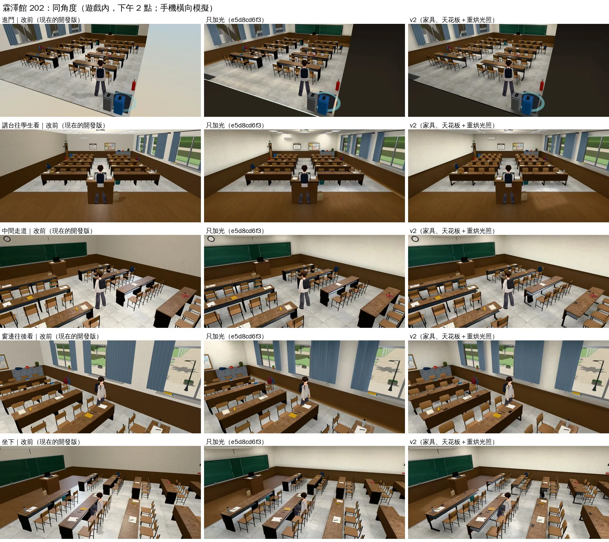

# 霖澤館 202 v2：家具、天花板照 201 v2 重做＋光照貼圖重烘（INTERIOR-AAA-REVIEW-1028；LAWWW2-C 2026-10-28）

- **起因**：使用者 10-28「校內建築 空間內配置 有很大的美術提升空間 現在是一個廉價手遊感」。202 和 201 在同一棟，要一樣的水準。
- **上一包**（`e5d8cd6f3`，`test_shots/interior_rooms_lm_1028/`）只加了光，結論是「光很重要，但只有光不夠」：桌椅還是細細的方塊。這一包換家具和天花板。
- **做的時候查到烘焙工具的錯**（LIGHTBAKE-UV-FIX-1028，201 v2、上一包都有），一起修好、重烘。詳見下面「光照貼圖」。
- **狀態**：`READY_FOR_ART_REVIEW`。建築、場景只有使用者能標 `ART_APPROVED`。

## 同角度對照（遊戲內、玩家鏡頭）

- 環境：手機橫向 844×390、Playwright＋SwiftShader 模擬，不是 iPhone 實機。下午 2 點。
- 三欄：改前（現在的開發版）／只加光（`e5d8cd6f3`）／v2（這一包）。

## 玩家會看到什麼不同

| 檢討報告的問題 | v1 | v2 |
|---|---|---|
| 東西是方塊拼的：椅子 | 椅面、椅背是兩塊平板 | 模壓夾板：椅面中間微凹、前緣往下彎，椅背弧形、往後仰；鐵管椅腳、橡膠腳套、椅背後面托住的橫管 |
| 東西是方塊拼的：長桌 | 兩端和中間是整片 4 cm 的鐵板（看起來像三塊黑色方塊） | C 形鋼腳（前擋板那一側的立柱、往學生那一側伸出的腳座、桌面下的托架）、腳墊、桌下置物網、桌上的電源盒（兩個位子共用一個，和 201 一樣） |
| 天花板 | 白一片＋幾條燈 | 0.6 m 輕鋼架格子、T5 格柵燈具（對齊格子、凸出天花板 4 cm、格柵的金屬片）；投影機、冷氣照舊 |
| 光是平的 | 一盞方向光＋半球光 | 烘焙光照（日、夜兩張）：窗外的陽光在地上照出一條一條的亮塊，桌下、牆角比較暗 |
| 窗簾 | — | 上一包的光照貼圖解析度太低，窗簾的褶子變成一條一條的暗紋；重烘以後沒有了 |
| 鏡頭在牆外看到天空 | 整片淺藍色 | 暗色的殼（上一包就有） |
| 講台區的木地板 | 深色（平均 122,92,67） | 淺色（205,181,148）。使用者 10-23 的永久規則「整個遊戲不要深色木地板」（UA-LAWWW2-1023-03）；202 之前的掃描漏了這一塊 |

## 光照貼圖（LIGHTBAKE-UV-FIX-1028）

- **查到的錯**（`tools/blender/env_second/lightbake/bake_room.py`）：
  1. 排版的間隔照 UV 的大小放大（Blender 預設 SCALED）：島只佔整張貼圖的 6～9%。
  2. 幾千個小零件（鐵腳、書包、收邊條）每個都要自己的一小塊加間隔，把大面積的地板、牆、窗簾擠到每公尺 8～11 個像素。
  3. 沒有貼圖座標的頂點色零件，光照座標放到 TEXCOORD_0：遊戲（uv1）根本沒吃到光照貼圖，還佔位置。
  4. 烘焙時房間外面就是天空：門縫漏光，門板底下、門前的地板亮到 1.4（平常的地板 0.4～0.6）。牆淡出時看得到一條亮邊。
- **改法**：
  - 間隔固定 4 個像素（FRACTION）。看不到的面不參加排版。
  - 小島很多、看起來差不多的零件（椅子和桌子的鐵腳、桌上的小東西、天花板的輕鋼架和格柵）放進 `--nolm`：不烘、照舊吃即時光。
    - 牆上看得到的收邊、窗框照舊烘。第一次重烘連它們也拿掉，照即時光反而變淡、和牆不一致（201 的公告欄框從深色變淺灰），所以改回來。
    - 同一個材質一半烘一半不烘時，工具自動複製一份（`_rt`）給不烘的物件（遊戲的 roomLightmap 是照材質接的；不同物件本來就各畫一次，draw call 不變）。
  - `--shell S`：烘焙時把房間除了窗那一面都包起來（黑色、不輸出）。
- **結果**（`tools/blender/env_second/lightbake/uv_fill.py` 量）：

| | 填滿率 | 地板、牆、窗簾每公尺像素 | 門前的地板 |
|---|---|---|---|
| 上一包（`e5d8cd6f3`） | 9.3% | 10～14 | 1.35（亮邊） |
| 這一包 | 50% | 21～29（收邊、窗框 23～27） | 0.17 |

## 沒有動的（玩法、存檔）

- 配置 JSON（`linze_202.layout.json`）和原本**一模一樣**（逐欄比對）：40 個座位、走近點、碰撞框、互動點、門、出生點都沒改。
- 椅面上緣照舊 0.455 m（坐姿高度不變）；椅腳、桌腳的位置都在原本的碰撞框裡。
- 遊戲程式沒有新的改動：上一包的 `patches/interior_rooms_lm_1028.patch`（疊在 201 v2 patch 後面）照用。
- 存檔格式沒有改。

## 檔案

- **模型**：`tools/blender/env_second/flat_classroom.py`（`ply_shell`、`wood_chair`、`long_table`、天花板那一段）。
- **一鍵重做**：`bash tools/blender/env_second/lightbake/bake_flat_rooms.sh`（202、多功能教室；建模＋烘焙＋WebP）。烘焙參數：`tools/blender/env_second/lightbake/linze_202_lm.json`。
- **二進位檔**（在交件 commit 裡的實際路徑）：`assets/models/env/second_ai/linze_202.glb`、`linze_202_lm_day.webp`、`linze_202_lm_night.webp`、`linze_202.json`（統計）。

## 測試

（待補）

## 效能

（待補）

## 還沒做到、缺點（誠實列）

（待補）
