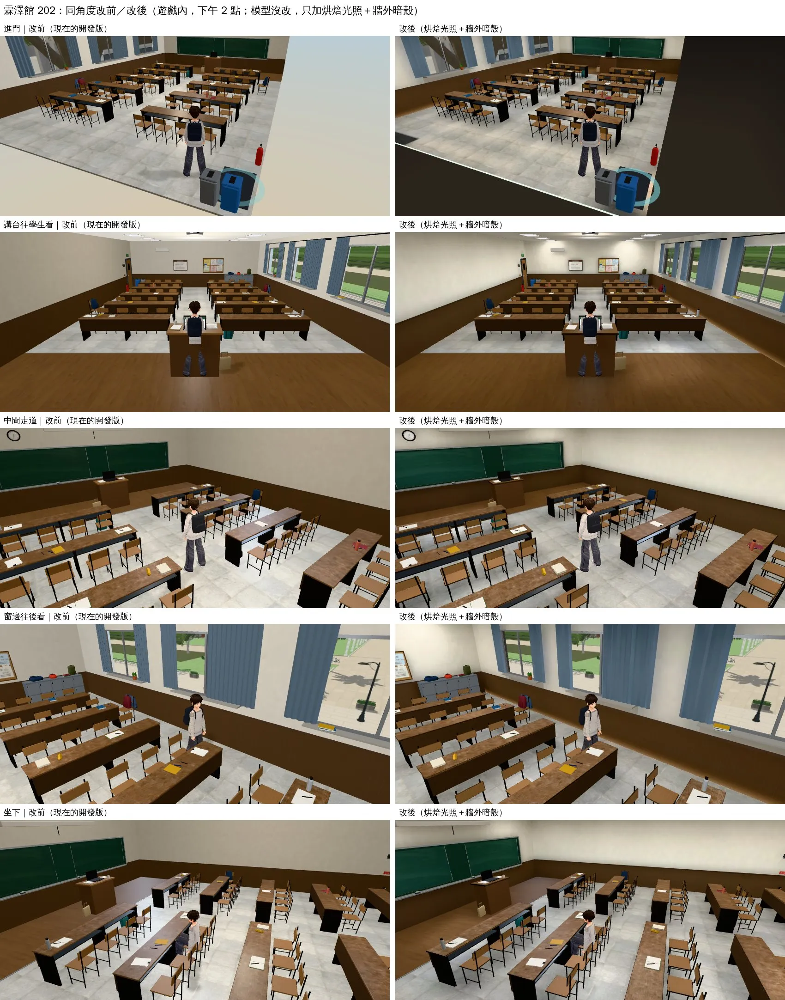
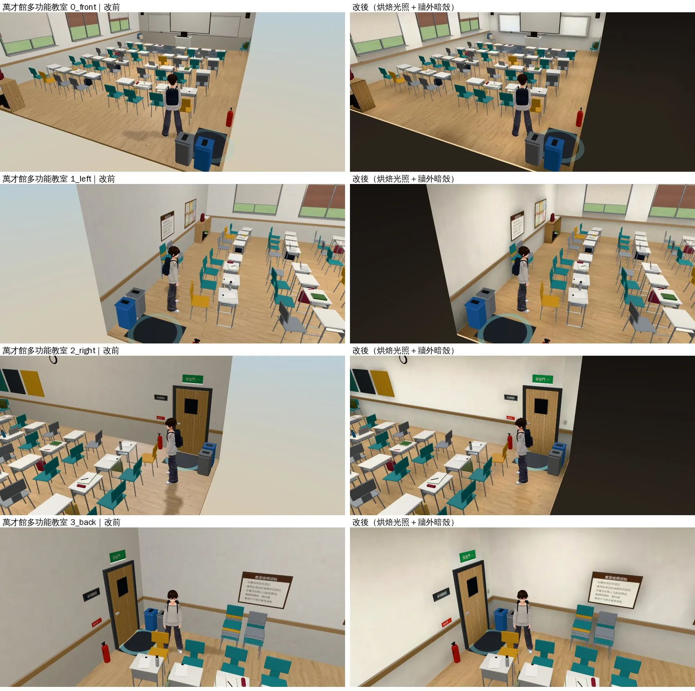
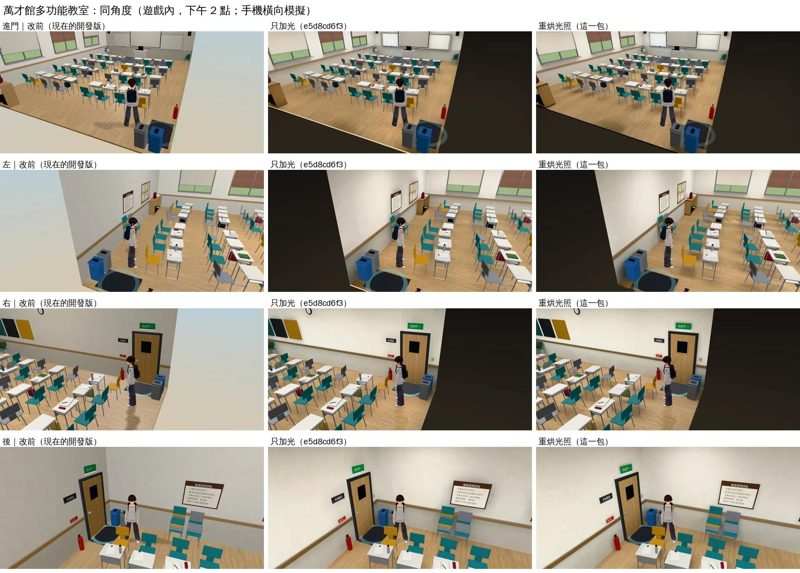

# 霖澤館 202、萬才館多功能教室：只加烘焙光照＋牆外暗殼（INTERIOR-AAA-REVIEW-1028；LAWWW2-C 2026-10-28）

- **這一包做的**：201 v2 的兩個做法套到這兩間，模型、配置、座位、導航都沒改。
  1. 光照貼圖（`tools/blender/env_second/lightbake/bake_room.py`）。
  2. 牆外暗色的殼：這兩間的窗都有窗景板，逐間確認過。
- **要先套**：`patches/interior_201_v2_1028.patch`（`roomLightmap`、`roomBackdrop` 在那裡）。
  - 再套 `patches/interior_rooms_lm_1028.patch`：
    - `zones3d.js`：`roomBackdrop` 加房間中心參數。
    - `rooms_glb3d.js`：`BACKDROP` 兩間開暗殼。
    - `LICENSES.md`：202 那一列。
  - 二進位檔在 commit 裡的實際路徑：`assets/models/env/second_ai/linze_202.glb`、`wancai_multi.glb`、`linze_202_lm_day/night.webp`、`wancai_multi_lm_day/night.webp`。
- **重做**：`bash tools/blender/env_second/lightbake/bake_flat_rooms.sh`；參數在 `lightbake/linze_202_lm.json`、`wancai_multi_lm.json`。
- **狀態**：`READY_FOR_ART_REVIEW`。

## 同角度改前／改後

- 遊戲內，下午 2 點。手機橫向模擬，不是 iPhone。

## 結果和還不夠的地方

- **改善**：
  - 鏡頭在牆外時，原本整片淺藍色天空，現在是暗色。
  - 桌子底下、牆角比較暗，燈下面比較亮。
- **還不夠**：
  - 只加光，桌椅還是原本細細的樣子，整間看起來還是比 201 v2 簡單。這正好是檢討報告第 0 節的結論：光很重要，但只有光不夠。
  - 下一步是家具和細部照 201 v2 做（`flat_classroom.py`），等使用者看過 201 的方向再做。
  - 白牆有點偏亮，可以再調。
- **測試**（05740674b＋201 patch＋這個 patch）：
  - Node：rooms_glb_unit、windowless_night_unit、x78_rooms_unit、room_ceiling_unit、class_teacher_unit、boya_203_unit、dorm_205_unit、door_open_unit、seat_fold_unit 全部 ALL PASS。
  - reachability_all --zones linze_202,wancai_multi（瀏覽器）ALL PASS：202 43 個互動點、多功能教室 35 個。
- **烘焙前後的 GLB**：材質（雙面、透明、自發光、顏色）、節點、頂點屬性都一樣，只多第二套 UV。

## 效能

- 光照貼圖：每間兩張 1024 的 WebP（約 80 KB）。
- draw call、三角形幾乎不變（多一個暗殼）：202 窗邊鏡頭 86 → 87 calls。

## 10-28 04:4x 更新：多功能教室重烘、202 換成 v2

- **202**：家具、天花板照 201 v2 重做，見 `test_shots/interior_202_v2_1028/README.md`。
- **多功能教室**：模型、配置都沒動（三角形 19,176，和上一版一樣），只用修好的烘焙工具重烘（LIGHTBAKE-UV-FIX-1028）：
  - 上一版的光照貼圖只用了整張的 5.7%，每公尺 12 個像素；頂點色的零件（收邊、鐵腳、書包）沒有吃到光照貼圖。
  - 重烘：填滿率 79%，每公尺 46 個像素；細小零件不烘、照舊即時光；`--shell S` 擋住門縫漏光。

- 同角度（三欄：改前／只加光／重烘）：

- 看得出來的差別不大：這間的牆、地板本來就亮，主要是修正（頂點色的零件不再佔貼圖、門縫不漏光），光的細節比較清楚。白牆偏亮照舊，還沒調。
