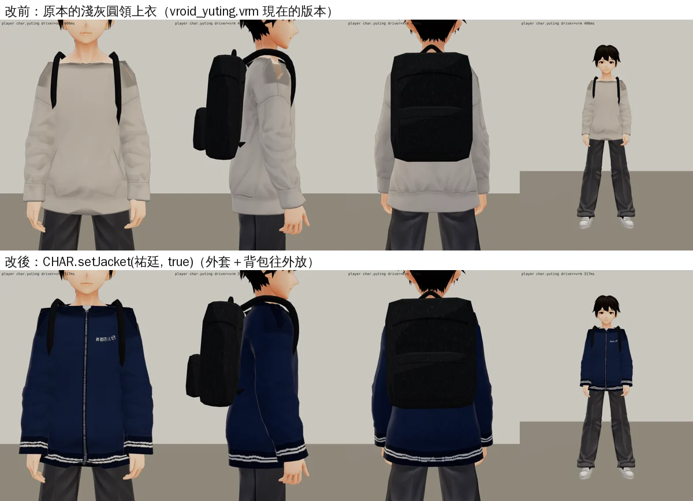
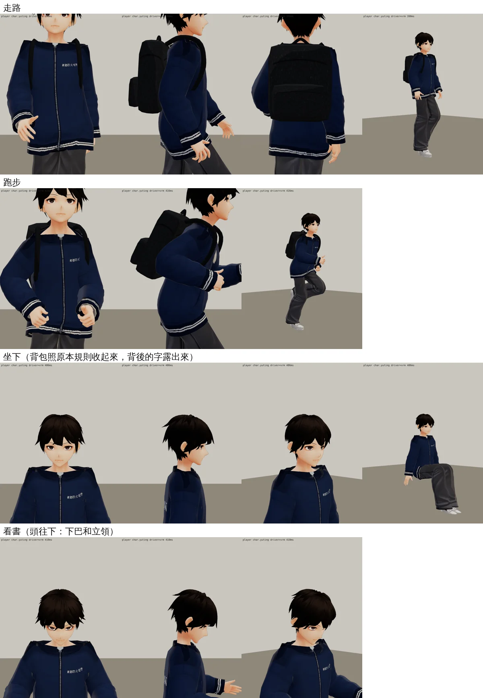
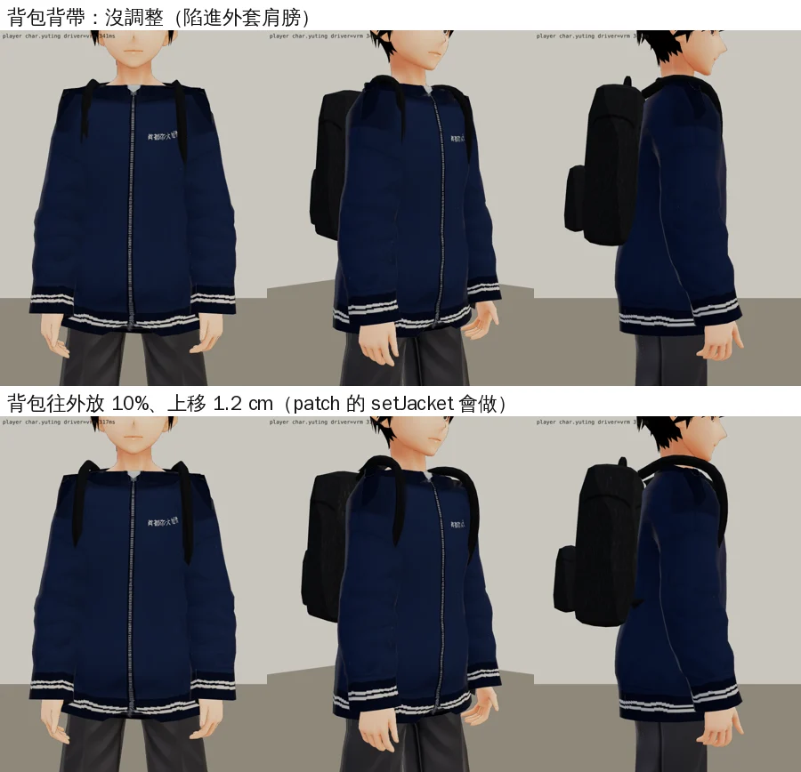
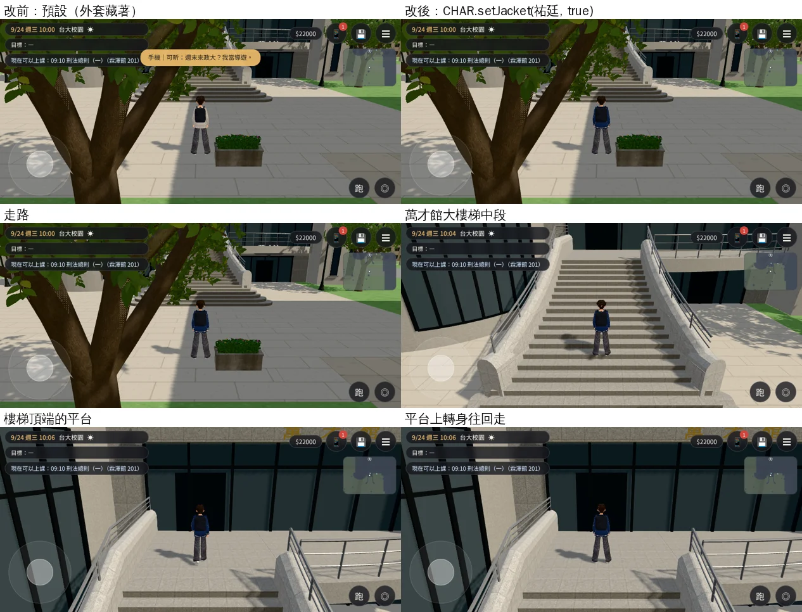
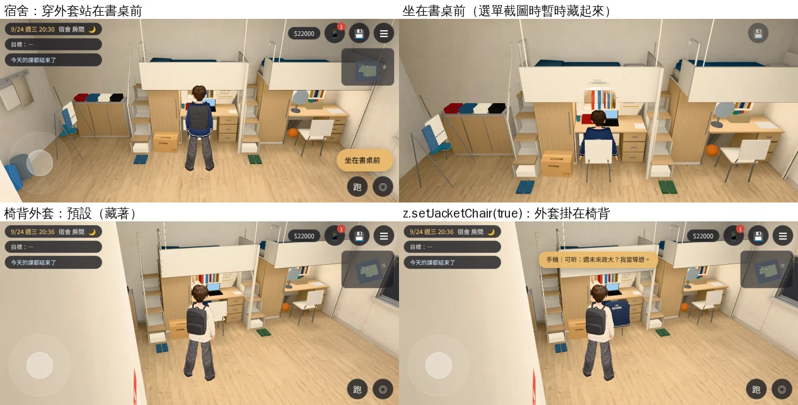
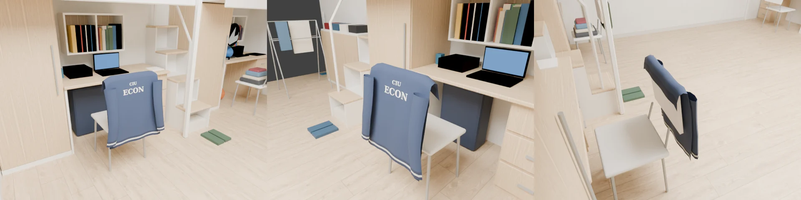
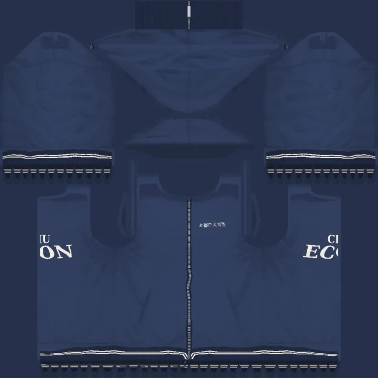

# X140 經濟系系外套（SK02-LINE-JACKET-1030；LAWWW2-B 2026-10-30）

- **起因**：使用者 10-30「我選了穿去霖澤上課 結果我的衣服在遊戲裡面也沒換」。LAWWW-B 派工：
  - 祐廷的 VRM 加一件外套網格 `JACKET_ECON`（同一個 VRM、同一副骨架），預設藏起來，給切換函式。
  - 宿舍 203（dorm_room4，祐廷 L2 的書桌椅）椅背上的外套 `JACKET_CHAIR`，預設藏起來，位置寫進 `dorm_room4.layout.json`。
  - 字：胸前小字「首都帝大 經濟」、背後「CIU ECON」（`docs/WORLD_NAMING.md` 3-2）；不能有臺大、NTU、真實校徽。
  - 什麼時候穿、什麼時候掛椅背：LAWWW-B 接（AA 定的規則：`ev_sk02_spy` 那天必穿、大一最高溫 ≤20°C 的上課日出門穿、回宿舍掛椅背、大二起一直掛椅背）。
- **驗收狀態**：`READY_FOR_ART_REVIEW`。角色外觀由 BB-B 驗收（D59）。
- **截圖條件**：Playwright＋SwiftShader 模擬，**不是 iPhone 實機**。人物檢視頁（`test_charlook.html`）是開發用的；遊戲內的圖在第三節。

## 一、交付的檔案

| 檔案 | 內容 |
|---|---|
| `assets/models/char/vroid_yuting.vrm` | 多一個節點／網格 `JACKET_ECON`（2,586 三角形、1 張 1024 JPEG 貼圖、材質 `J00_Tops_JacketEcon_CLOTH`）。3.45 → 3.66 MB。其他部分和原本一樣（腳本是在原本的檔案上加，不重建人物） |
| `tools/jacket_econ.py` | 做外套的腳本。重跑會先拿掉舊的外套（結果和從沒有外套的檔案做一模一樣：已比對） |
| `assets/models/env/second_ai/dorm_room4.glb` | 多一個節點 `JACKET_CHAIR`（底下 `JACKET_CHAIR_cloth`，材質 `dorm_jacket_chair`，雙面；1.60 → 1.62 MB）。烘焙時不算（`--hide ^JACKET_`），照即時光，和每一年的小東西一樣。重烘出來的三張光照貼圖和 DORM203 那一包**一個位元組都沒變**（不用換） |
| `assets/models/env/second_ai/dorm_room4.layout.json` | 多 `jacket_chair`：節點名稱、L2、中心位置。其他欄位沒變（已比對） |
| `tools/blender/env_second/dorm_room4.py` | `make_jacket_tex()`、`jacket_chair()`；L2 那張椅子加外套 |
| `tools/blender/env_second/textures/gen/dorm_jacket_chair.png` | 椅背外套的貼圖（腳本產生） |
| `docs/art-rebuild/second_ai/patches/jacket_econ_1030.patch` | 遊戲端：`src/assets3d.js`、`src/character3d.js`、`src/zones3d.js`（見第二節）＋新測試 `tests/jacket_econ_unit.js` |
| `tools/blender/env_second/shots/jacket_ingame.py` | 遊戲內截圖＋檢查（第三節） |

## 二、遊戲端（patch）

- `src/assets3d.js`：`char.yuting` 加 `hide:['JACKET_ECON']`——每次建人物模型時先藏起來（用現成的 `hide` 機制）。
- `src/character3d.js`：`CHAR.setJacket(人物, true/false)`。
  - 找到 `JACKET_ECON` 打開／關掉，回傳 `true`；不是 VRM、或模型裡沒有外套，回傳 `false`。
  - 穿上時後背包往外放 10%、往上 1.2 cm（第三張圖：外套比上衣厚 1.3 cm，背帶原本的位置會陷進肩膀）。脫掉時恢復。
  - **每次重建人物模型以後要再叫一次**（`buildVRM` 會照 `hide` 重新藏起來）。穿不穿的狀態請存在存檔裡（例如 flag），建好人物以後套上。
- `src/zones3d.js`（宿舍）：`z.setJacketChair(true/false)`。
  - 預設 `false`。模型還沒載完就叫也可以，載完會套上。
  - 換年份（`z.dormSet`）以後照樣保持。
- `tests/jacket_econ_unit.js`（Node）：VRM 的 `JACKET_ECON`（同一個 skin、材質名稱、在場景裡）、manifest 的 `hide`、`setJacket`、宿舍 GLB 的 `JACKET_CHAIR`（沒有第二套 UV）、layout 的位置、`setJacketChair`。換上這一包 ALL PASS；還沒換 GLB 時「dorm_room4.glb 有 JACKET_CHAIR」那一項 FAIL。
- 測試樹（開發 4df154b26＋DORM203 patch＋這一包＋cine_seethru patch）全部 Node **737 支 0 失敗**（含新的 `jacket_econ_unit`）。
- 換上後跑：`node tests/jacket_econ_unit.js`、`node tests/dorm_lightmap_unit.js`、`python3 tools/gen_dorm_room_layout.py`（layout 多一個欄位）。
- patch 以遠端的 `postrel-1030`（3808792fe）為基準，在開發分支 `modest-rubin`（647dc5c6d）上 `git apply --check` 也過；和 DORM203-LM-1030 的 patch 改的是不同行。

## 三、圖

### 3.1 人物檢視頁：改前／改後（站著）

- 深藍外套：前面拉鍊、立領、下襬和袖口是羅紋加兩條米白細線。
- 胸前（祐廷的左胸）「首都帝大 經濟」。
- 背後「CIU」「ECON」在肩胛骨中間；背著後背包時被背包蓋住（第 3.2 節坐下時背包收起來就看得到）。

### 3.2 四種姿勢（看穿模）

- 外套和上衣用同一組骨頭權重，每個點往外推 1.3 cm：彎手肘、坐下、轉身時兩件一起變形，上衣不會從外套裡穿出來。
- 袖口、下襬比上衣長 1.4 cm（第二版下面露一圈灰色上衣，改掉了）。
- 看書（頭往下）：下巴最低 1.496 m，立領前面上緣 1.46 m，沒有碰到。

### 3.3 後背包背帶

### 3.4 遊戲內（手機橫向 844×390 模擬）

`tools/blender/env_second/shots/jacket_ingame.py`（測試樹＝開發 4df154b26＋DORM203 patch＋這一包），**ALL PASS**：

- 外套預設藏著（manifest 的 `hide`）；`CHAR.setJacket(玩家, true)` 顯示、`false` 藏起來。
- 推搖桿從法學院廣場走上萬才館大樓梯：樓梯中段、平台都拍了。
- 宿舍：`JACKET_CHAIR` 有載入、預設藏著；穿外套按「坐在書桌前」坐下；`z.setJacketChair(true)` 顯示。
- 沒有 JS 例外。
- [前置／捷徑]：讀檔放位置；坐下那張截圖時暫時把選單（讀書／整理筆記／起身）藏起來，因為選單蓋住坐著的人。

- 跟隨鏡頭的距離下看得出是深藍外套、下襬的白線；背後的字被後背包蓋住。
- 椅背那張：祐廷換回灰色上衣，外套掛在 L2 的椅背、「ECON」朝走道。

### 3.5 宿舍椅背外套

- 衣領跨過椅背上緣往座位那邊摺下 7 cm，背面（「CIU ECON」）朝走道垂到椅背下面，兩隻袖子垂在兩側。
- 椅背是往座位那邊斜的（上緣比下緣靠書桌 4 cm）：第一次做的時候以為往走道斜，椅背從外套中間穿出來，照匯出的椅子量過重做。

## 四、貼圖

- 字用 3D 位置投影畫上去：上衣的 UV 背後中線是接縫，「ECON」跨過接縫也接得起來。
- 皺褶明暗沿用原本上衣貼圖的。

## 五、還沒做到、要注意的

- 背著後背包時，背後的「CIU ECON」幾乎全被包蓋住。字放在背包下面（腰）會很怪，所以照真的系外套放肩胛骨中間。
- 立領前面比較低，看得到裡面的灰色圓領上衣（像外套裡穿 T 恤）。
- 胸前的字在遊戲的跟隨鏡頭距離下只看得到一小塊白色，近拍才讀得出來。
- 椅背外套是一片布加兩隻袖子：遠看像掛著的外套，近看沒有布的厚度。
- 人物、外套都沒有在 iPhone 實機上看過。
