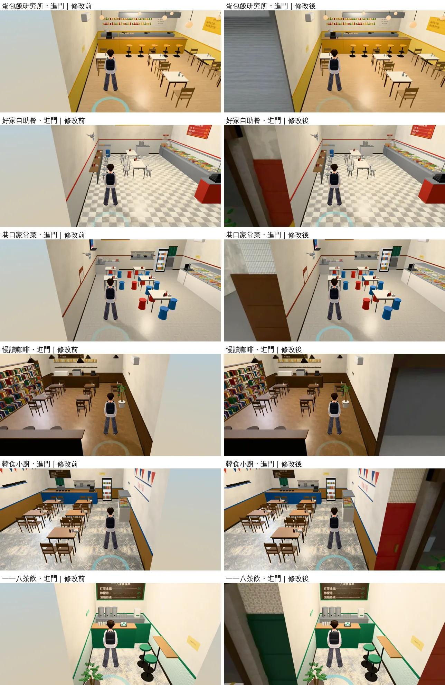
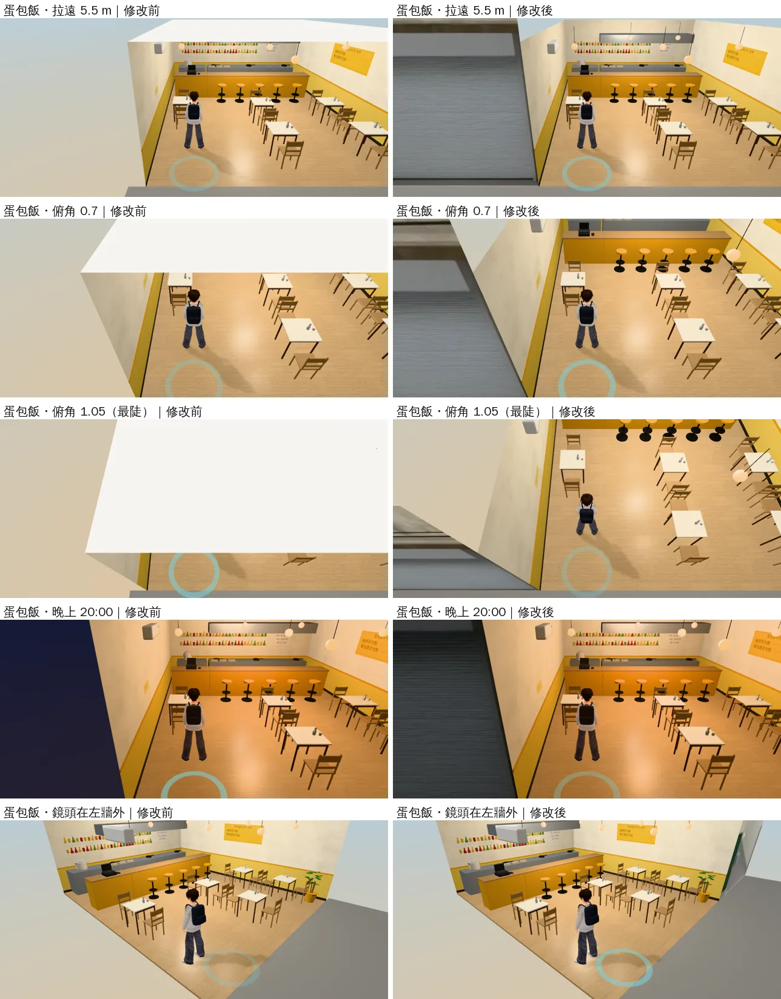

# 118 巷九間店、六個房間：天花板單面朝下；店門外兩側補上鄰居店面

帳號 A 的 LAWWW2，2026-10-22 06:3x～07:5x UTC。

- **狀態**：WIP（遊戲內前後拍完、README 寫完才交件）；交件後是 `READY_FOR_ART_REVIEW`（場景美術由使用者驗收）。
- **起因**：
  - 06:3x 拍 j32、j34（118 巷天花板）：預設鏡頭沒事，但室內雙指可以拉到 6 m、往上拖到俯角 1.05（`engine3d.js`），一拉遠、一往上拖，畫面上半就是一大片白。
  - 同一張截圖還看到：進門的時候，鏡頭在店門外的騎樓（店面外 2 m 多）。門靠側牆的店，畫面一側是店外什麼都沒有的地方（天空的下半），最多佔三分之一。

## 看到什麼、為什麼

### 天花板

- 118 巷九間店的天花板是**雙面、朝上**的一片（`lane118_shops.py`）。
  - 預設鏡頭（4.2 m、俯角 0.38）在 3.21 m，天花板在 3.2 m：鏡頭只比天花板高 1 cm，剛好落在近裁切面裡，所以預設看不到。
  - 拉遠、往上拖，鏡頭在天花板上面，看到的是天花板的上面＝一大片白。
- 有廚房的四間（滇香、家常菜、韓食、六張犁），廚房的天花板在頂點色網格裡，也是雙面。
- 其他店家室內（溫州街五家、便利商店、Café、麵店、書店、宿舍）和遊戲的 `room()` 都是**單面、朝下**：從下面看得到；鏡頭在上面時看得穿，房間像剖面一樣。
- 盤點同一個寫法：還有六個房間也是雙面朝上。

| 房間 | 天花板 | 預設鏡頭 | 說明 |
|---|---|---|---|
| 日本宿舍房間 `jp_room` | 2.5 m | 2.84 m（3.2 m） | **預設鏡頭就在天花板上面** |
| 萬才館研討室 A `wancai_sema` | 3.2 m | 3.21 m（4.2 m） | 和 118 巷一樣，只高 1 cm |
| 霖澤館 202、3F、4F，萬才館多功能教室 | 3.4 m | 3.28 m（4.4 m） | 拉遠就到天花板上面 |

### 店門外的空白

- 店的室內模型只有店裡和門口一小段騎樓地（往兩側只多 0.4 m）。
- 鏡頭在騎樓往店裡看時，左右牆再過去什麼都沒有。
- 門靠側牆的店，出生點離側牆只有 1.1 m，那一側整片都是空白：
  - 蛋包飯研究所、好家自助餐、巷口家常菜、慢讀咖啡、韓食小廚、Pasta 118。

## 改了什麼

### 正式模型

- **天花板**（`lane118_shops.py`、`jp_dorm.py`、`flat_classroom.py`、`linze_upper.py`、`wancai_seminar.py`）：
  - 材質單面（`cull=True`），四邊形改成朝下，和溫州街店家、便利商店一樣。
  - 廚房的天花板拿出頂點色網格，自己一個單面朝下的網格（`WALL_N_kceil`，還是跟著後牆淡出）。
  - 六個房間重新匯出：三角形完全一樣，只少了材質的雙面。
- **鄰居店面**（118 巷九間）：
  - 店面那一條線（z＝Z1）左右各貼一張 4.6 m × 4.2 m 的鄰居店面，騎樓地也往兩側延伸 4.6 m。
  - 圖是 118 巷街景 GLB 真的鄰居（新 `tools/blender/env_second/lane118_neighbors.py`，18 張）：
    - 鏡頭站在進門時跟隨鏡頭的位置（店面外 2.4 m、高 3.2 m、離那一側的側牆 1 m），正對店面，用鏡頭平移框住卡的範圍。
    - 店面那一層和正投影一樣、沒有歪斜；隔壁是小巷的（蛋包飯南邊、家常菜南邊、茶飲北邊），看得到巷子往裡的深度。
    - 只拍店面線前面 0.45 m 以內；卡靠店的那一邊往外移 0.45 m，不拍到店自己的壁柱、遮雨棚的側面。
    - 光線只有天光（騎樓下的陰影）。遊戲裡讓它自己發光、晚上調暗，和門外那張巷子同一種做法（`l118_shops3d.js` 的 `viewMats` 認 `_view`）。
  - 歸左右牆的組（`WALL_W_nb_view`、`WALL_E_nb_view`），單面、朝騎樓。

### 程式（`patches/l118_arcade.diff`）

- `src/zones3d.js` 的 `attachRoomGLB`：牆的網格有 `at`（GLB 節點的自訂屬性）就用它當淡出判斷點，沒有的照舊用外框中心。
  - 為什麼要：鄰居店面卡的外框中心在牆線外 2.3 m。用外框中心判斷的話，鏡頭在牆線外 2.3 m 以內不會淡出，從斜後方看會擋住人。
  - 鄰居店面卡的 `at` 在牆線上（x＝X0／X1），和左右牆同時淡出。
- 兩支新測試（Node，不需要瀏覽器）：
  - `tests/l118_arcade_unit.js`：在 Node 建出遊戲真正的九間店（`l118_shops3d.js` 的 build＋`attachRoomGLB`＋`fadeWalls`），用遊戲的跟隨鏡頭打射線。
  - `tests/room_ceiling_unit.js`：26 份室內 GLB 的天花板單面朝下、天花板那一層沒有雙面的一大片。

## 測試

### `tests/l118_arcade_unit.js`

| 檢查 | 開發分支 `774f49c7` | 只換 GLB、不套 patch | 套 patch＋新 GLB |
|---|---|---|---|
| 天花板（含廚房）單面、朝下 | 9 間都 FAIL | PASS | PASS |
| 進門、兩側前角，畫面沒有店外的空白（≤ 2%） | 出生點 15～33%、前角 37～41% | 0% | 0% |
| 拉遠 6 m、俯角 0.7、1.05：畫面上沒有天花板的上面 | 最陡時 49～62% | 0% | 0% |
| 鄰居店面不擋人（店裡每 0.8 m、8 個方向） | 沒有鄰居店面 | **6～9 個鏡頭位置擋住** | 0 |
| 合計 | FAIL 54 | FAIL 18 | ALL PASS |

- 「只換 GLB、不套 patch」那一欄：GLB 和 patch 要一起接。
- 一大片的算法：單一三角形 > 0.3 m²。原本的天花板一片 22～32 m²；日光燈燈箱的頂面一片不到 0.12 m²，從上面看就是燈具本身，不算。

### `tests/room_ceiling_unit.js`

- 26 份：118 巷九間、這次的六個房間、溫州街五家、便利商店、Café、麵店、書店、宿舍兩份。
- 開發分支的 GLB：FAIL 30（這次改的 15 份，每份兩項）。這一版：ALL PASS。
- 「一大片」：單一三角形 > 3.5 m²、長寬都超過 1.5 m。
  - 天花板最小的一一八茶飲一片 6 m²。
  - 燈具、牆頂、鋁框是細長條；霖澤館 3F／4F 電梯井的頂蓋（2.3 m × 2.55 m）是實心量體的剖面，從上面看本來就該看到。這些都不算。

### 其他

- `l118_shops_unit`、`l118_bar_lift_unit`：換上新 GLB 照樣 ALL PASS（j35）。
- 配置檔（`l118_*.layout.json`、座位、導航）一個字都沒變。

## 遊戲內前後

- Playwright＋SwiftShader 手機橫向模擬（844×390、dpr 2），不是 iPhone。
- 修改前＝開發分支 `774f49c7`；修改後＝同一個 commit 套 `l118_arcade.diff`＋換 15 份 GLB（j35c，鄰居店面是曝光 1.8 那一版）。
- 下午 15:00，NPC 藏起來。

### 進門（出生點、預設鏡頭）

- 左右兩側原本是店外的空白；改了以後是隔壁的店面：鐵捲門、木門、紅門、玻璃店面、停在門口的腳踏車。
- 慢讀咖啡右邊那一家是玻璃店面，玻璃裡面暗暗的（街景 GLB 的店面本來就沒有室內），看起來像沒開燈的店。

### 拉遠、往上拖、晚上、鏡頭繞到牆外（蛋包飯研究所）

- 拉遠 5.5 m、俯角 0.7、1.05：原本畫面上半是天花板的上面（一大片白），現在看得進店裡，像剖面。
- 晚上 20:00：鄰居店面跟門外那張巷子一樣調暗。
- 鏡頭在左牆外：左牆和左邊的鄰居店面一起淡出（「還不到的地方」第 2 點）；右邊看得到右側的鄰居店面。

## 接法（LAWWW）

1. `git apply docs/art-rebuild/second_ai/patches/l118_arcade.diff`（`src/zones3d.js` 兩行＋兩支新測試）。
2. 換 15 份 GLB（＋`.json`），同檔名：
   - `assets/models/env/second_ai/l118_{dian,self,tea,home,cafe2,pasta,korea,omu,noodle2}.glb`
   - `assets/models/env/second_ai/{jp_room,linze_202,linze_3f,linze_4f,wancai_multi,wancai_sema}.glb`
3. 跑 `node tests/l118_arcade_unit.js`、`node tests/room_ceiling_unit.js`、`l118_shops_unit`、`l118_bar_lift_unit`。
4. 腳本、圖：`tools/blender/env_second/lane118_neighbors.py`（新）、`lane118_shops.py`、`jp_dorm.py`、`flat_classroom.py`、`linze_upper.py`、`wancai_seminar.py`，`tools/blender/env_second/textures/gen/l118_nb_*.jpg`（18 張）。

## 還不到的地方（誠實寫）

- 鄰居店面是一張平的圖：
  - 從進門時的位置看是對的。
  - 從很斜的角度看，凸出店面的東西（鐵捲門箱、招牌）會有一點錯位。
  - 小巷的深度只在接近拍攝位置時對。
- 鏡頭繞到側牆外面（左右牆淡出）時，鄰居店面跟著淡出，那一側照舊是空白。這是剖面的看法，和其他室內一樣。
- 拉遠以後，天花板上的日光燈燈箱、吊燈從上面看是浮著的（和溫州街店家、便利商店一樣）。
- 真機沒看過。
