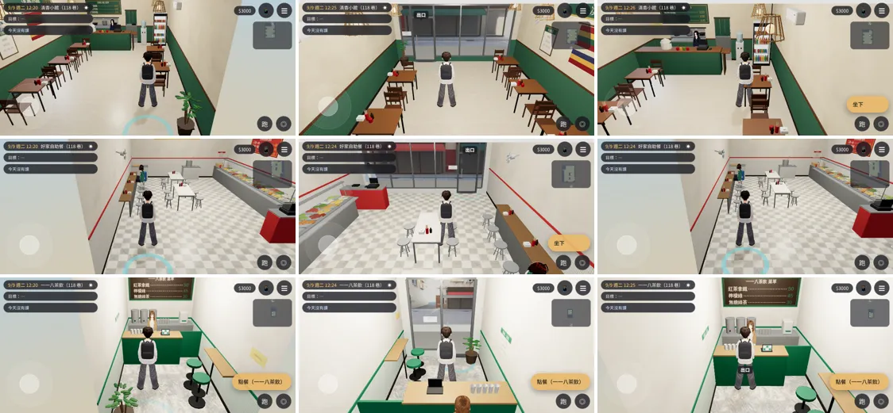
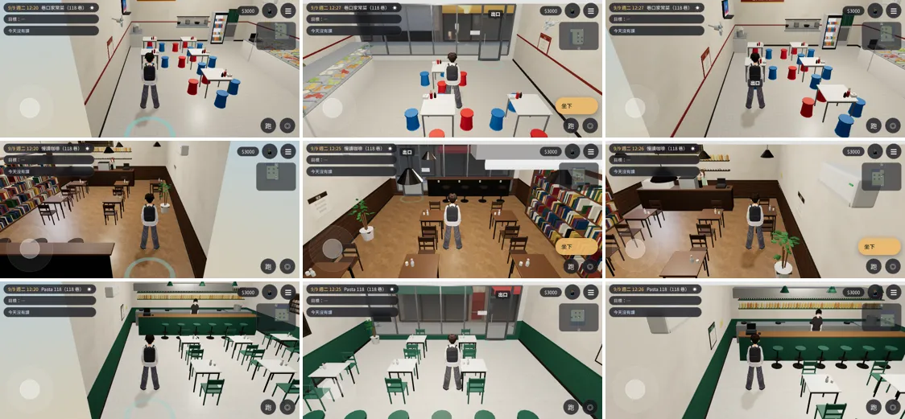
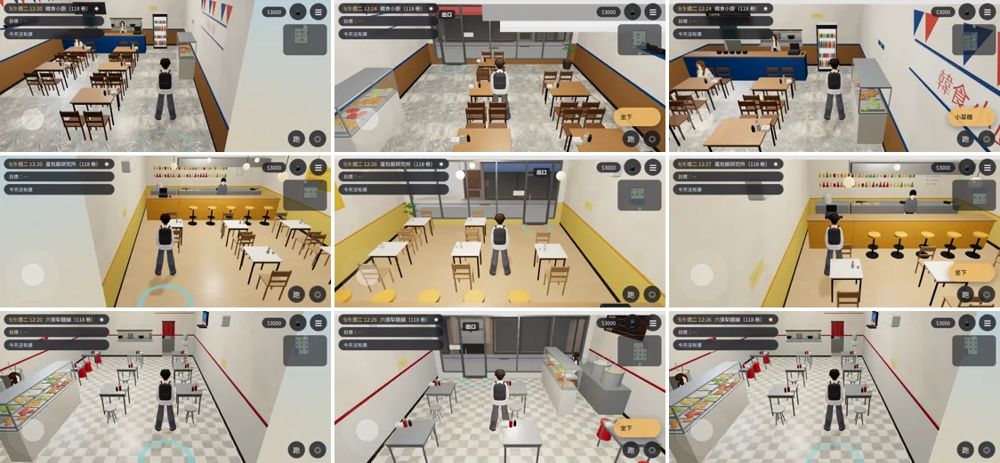

# L118-SHOPS-AUDIT-1020：118 巷九間店的美術驗收與效能

LAWWW2-C，2026-10-20。
- 使用者 10-20 第三項：118 巷九間店的美術驗收與效能——鏡頭遮擋、店員站位、座椅動線、燈具高度、材質、貼圖、效能。
- 量測工具：`tests/audit_l118_shops.py`、`tests/reachability_all.py`，在測試工作樹跑（開發分支 `207d6c43`＋九間店）。
  - Playwright 手機模擬橫向 844×390，SwiftShader；
  - 不是 iPhone 實機；
  - 效能數字只能互相比，不是手機上的幀數。

## 狀態
| 項目 | 狀態 |
|---|---|
| 九間店的模型 | **MODEL_READY**；LAWWW-C 已接進開發分支（`4560f8fd`） |
| 這次修的 | 韓食小廚重建（`l118_korea.glb`）；九間的 `.layout.json`（滇香、家常的「看」的位置、九間的說明文字）。**還沒接** |
| 走得到、按得到 | **FUNCTIONAL_VERIFIED**（模擬）：`reachability_all.py` 九間都 ALL PASS（修之前三間 FAIL） |
| 美術 | **READY_FOR_ART_REVIEW**（等使用者看） |

## 這次修掉的（`reachability_all.py`：修之前 FAIL、修好 PASS）
| 店 | 原本 | 改了什麼 |
|---|---|---|
| 滇香小館 | 「牆上的織布」的按鈕被旁邊的座位搶走，按不到 | 「看」的位置移到走道上、座位的按鈕碰不到的地方（範圍 0.9 → 0.6 m） |
| 巷口家常菜 | 「電視」的按鈕被座位搶走 | 「看」的位置移到同一面牆靠店面那一端、座位碰不到的地方（範圍 0.9 → 0.6 m） |
| 韓食小廚 | 靠店面那張桌子外側的椅子，走近點卡在玻璃邊（`stuck`） | 五張桌子重排： - 靠店面那一張離玻璃 1.55 m； - 西邊那一列離西牆層架 0.8 m； - 每個座位從桌子兩端走過來（走近點在椅子旁邊 0.5 m，兩排椅子背對背時按鈕不會被搶）。 座位數照舊 20 |

- 另外九間共同：給開發組的說明（「說明文字由 AA 寫」等）原本會顯示在遊戲裡，搬到 `dev`（遊戲不顯示）。
  - 有 AA_280 原句的照用：家常菜的電視「電視在播午間新聞，沒有人在看。」；
  - 其他的 `note` 先空著，遊戲先顯示名稱，字等 AA 寫。

## 每間的數字
| 店 | GLB | 三角形 | 材質 | 座位 | 遊戲內 draw call（沒有陰影那一輪） | 遊戲內三角形 | 從門口看得到店員 | 最低的燈（離地） |
|---|---|---|---|---|---|---|---|---|
| 滇香小館 | 1.35 MB | 15,352 | 15 | 10 | 96（80） | 142,924 | ✓ | 吊燈 2.65 m |
| 好家自助餐 | 1.25 MB | 13,264 | 15 | 14 | 161（125） | 298,924 | ✗（收銀台在門邊，進門後轉身看得到） | 日光燈 3.1 m（菜台的保溫燈 1.41 m 在菜台上面，不擋路） |
| 一一八茶飲 | 0.46 MB | 2,790 | 15 | 2 | 95（79） | 131,176 | ✓ | 日光燈 3.1 m |
| 巷口家常菜 | 1.45 MB | 16,630 | 15 | 18 | 102（86） | 148,556 | ✗（站在東邊的櫃台後面，剛好在畫面右邊外面） | 日光燈 3.1 m（保溫燈 1.45 m 在菜台上） |
| 慢讀咖啡 | 1.48 MB | 18,224 | 15 | 14 | 91（75） | 149,358 | ✓ | 吊燈 2.47 m |
| Pasta 118 | 1.49 MB | 17,408 | 15 | 16 | 95（79） | 153,816 | ✓ | 吊燈 2.52 m |
| 韓食小廚 | 1.41 MB | 15,590 | 15 | 20 | 130（100） | 290,230 | ✓ | 日光燈 3.1 m |
| 蛋包飯研究所 | 1.27 MB | 15,046 | 15 | 15 | 95（79） | 145,328 | ✓ | 吊燈 2.5 m |
| 六張犁麵舖 | 1.18 MB | 13,546 | 15 | 16 | 100（84） | 143,054 | ✓ | 日光燈 3.1 m |

- 燈：
  - 吊燈最低 2.47 m；人 1.75 m，走過去不會撞頭。
  - 1.6～2.4 m 之間沒有吊著的東西。
- 貼圖：
  - 每間 11～12 張，最大 1024 px；
  - 地板、牆、木頭是 Poly Haven CC0；
  - 菜單、招牌、海報是程式畫的，店名虛構。
- 效能：
  - 自助餐、韓食比其他間多。
  - 自助餐：菜台上一格一格的菜；韓食：五張桌子的石鍋、小菜。
  - 三角形約 29～30 萬，都是室內、只有這一間在畫。
  - 參考：霖澤館大廳 155 calls／18 萬三角形。

## 鏡頭遮擋（`audit_l118_shops.py`：進門、點餐、每個座位的走近點，鏡頭轉四個方向，看鏡頭到人物頭部那條線）
- 算出來的「被擋住」大部分不是真的：
  - 店的天花板只有朝下那一面，鏡頭在天花板上面時看不到它，量的時候卻會算進去；
  - 鏡頭在牆外面時，那一面牆會淡出，也不算。
- 扣掉這兩種，剩下的：

| 店 | 位置 | 擋住的東西 | 看截圖的結果 |
|---|---|---|---|
| 慢讀咖啡 | 兩個座位 | 書櫃上的木頭零件 | 鏡頭轉到書櫃那一側才會；擋一下人物的腳 |
| Pasta 118 | 點餐、吧檯 3 個座位 | 吧檯上方的不鏽鋼層架 | 鏡頭轉到吧檯後面（廚房那一側）往外看時才會 |
| 巷口家常菜 | 點餐 | 菜台的金屬框 | 鏡頭離人物 3.5 m 遠的地方，擋得很少 |
| 蛋包飯研究所 | 一個座位 | 桌上的東西 | 鏡頭最低的時候 |
| 六張犁麵舖 | 點餐 | 煮麵台的金屬框 | 同家常菜 |

- 截圖另外看到：
  - 韓食小廚、慢讀咖啡從店中間往門口看時，上面有一條白色的日光燈管很靠近鏡頭；
  - 鏡頭拉高才會，不擋人物。

## 截圖（每間三張：進門、店中間往門口、店員那一側）
- 9/9 週二 12:20；[捷徑] 讀檔直接到店裡、人物放到位置。

- 滇香小館、好家自助餐、一一八茶飲

- 巷口家常菜、慢讀咖啡、Pasta 118

- 韓食小廚、蛋包飯研究所、六張犁麵舖

## 已知缺點、還沒做
- 自助餐、家常菜從門口看不到店員，要轉一下鏡頭。
  - 自助餐的收銀台在門邊，照現實；
  - 家常菜可以把店員往西移 0.5 m。等 AA 看這兩間的事件站位再決定。
- Pasta 吧檯上的層架、慢讀咖啡的書櫃：鏡頭轉到後面時會擋一下。可以讓它們跟著後牆淡出，排在下一輪。
- 九間的椅子、桌子各自只有一兩款。
- 店裡的「看」：顯示的字等 AA 寫。
- iPhone 實機沒有測過。

## 交付
- 重建：`assets/models/env/second_ai/l118_korea.glb`、`.json`；九間的 `.layout.json`（其他八間的 GLB 沒變）。
- 腳本：`tools/blender/env_second/lane118_shops.py`（`table_seats` 加 `ap_side`）。
- LAWWW-C：
  1. 換上面的檔案；
  2. 重新產生 `src/data/l118_shop_layouts.js`（`tools/lane118/gen_shop_layouts.py`），或套 [`../../patches/l118_audit_layouts.diff`](../../patches/l118_audit_layouts.diff)（對 `5fc69491`）。
- 量測工具：`tests/audit_l118_shops.py`（只在我的測試工作樹；要的話再交）。
