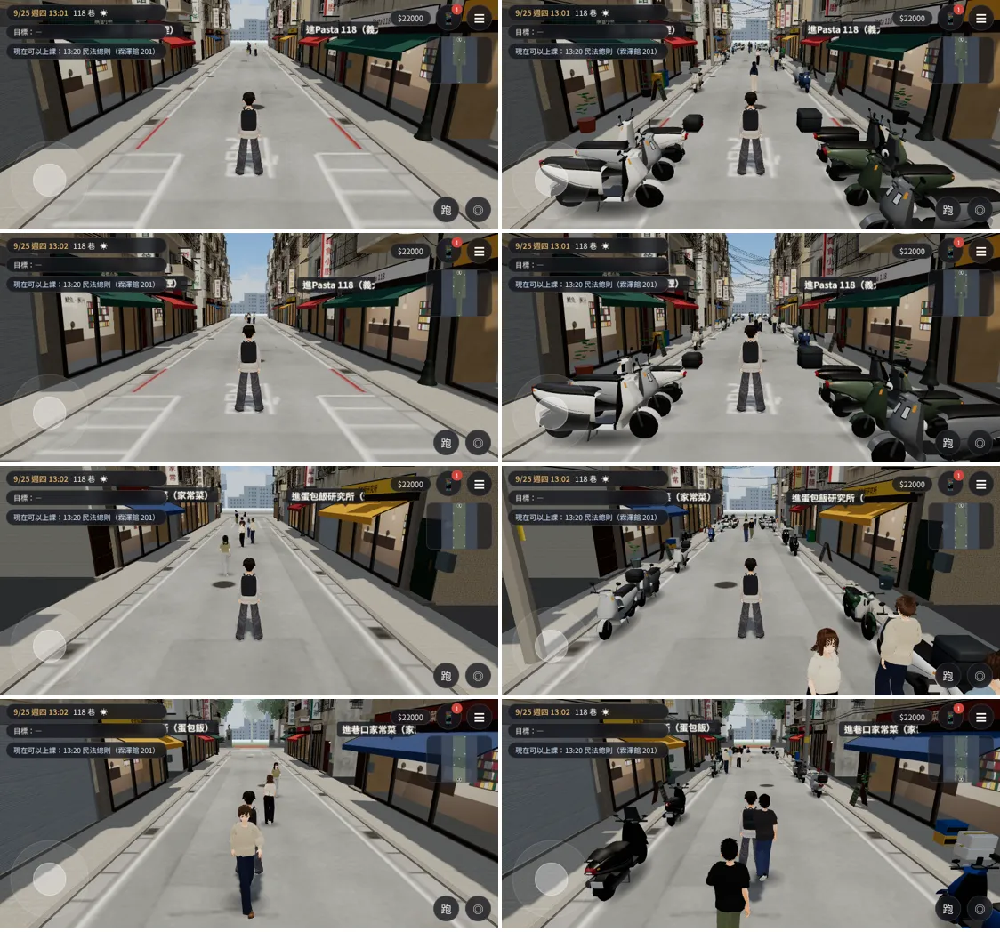
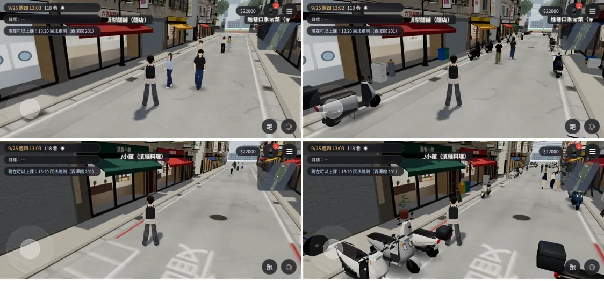
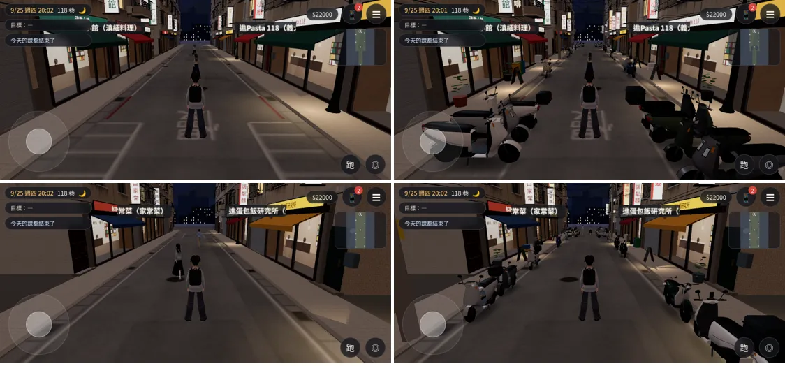
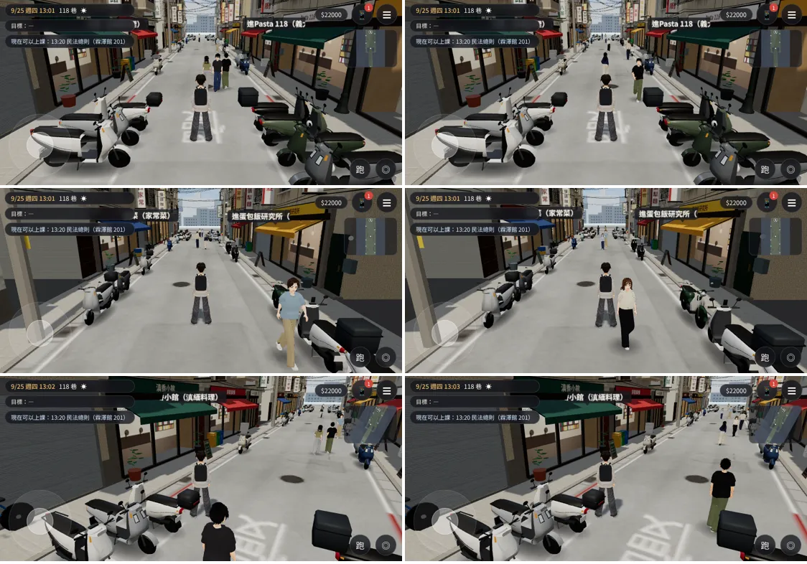

# ART-L118-LANE-1020：118 巷像巷子（機車、店門口的東西、電線、樓上招牌、路面、晚上的光）

LAWWW2-C，2026-10-20。
- 起因：LAWWW-C 10-20 19:0x 轉使用者 18:5x：「負責美術的 ai……看一下他做好的東西是不是可以更精致一點」。
- LAWWW-C 的截圖 06、07：118 巷很寬、很空，像大馬路，不像巷子。
- 要做的（LAWWW-C 的清單）：
  - 兩側停機車；
  - 店門口放盆栽、保麗龍箱、腳踏車、垃圾桶；
  - 二樓以上加冷氣、直立招牌、鐵窗；
  - 頭上拉電線；
  - 路面的大白框淡一點；
  - 晚上店裡的光灑到人行道。

## 狀態（分開標）
| 項目 | 狀態 |
|---|---|
| 模型 | **MODEL_READY** |
| 接進遊戲 | **INTEGRATED（只在我的測試工作樹）**：開發分支 `fd861eec`＋本頁的 patch |
| 測試（Playwright 手機模擬，不用 turbo，不是 iPhone 實機） | `flow_lane118.py` **ALL PASS**、`flow_l118_shops.py` 見下面、`reachability_all.py --zones lane118` 和沒套 patch 的版本**完全相同**（見下面）、截圖 ALL PASS、沒有 JS 例外 |
| 美術 | **READY_FOR_ART_REVIEW**（等使用者看） |

## 修改前／後（左：開發分支 `fd861eec`；右：加上這一次）
- 9/25 週四 13:00；[捷徑] 讀檔、把人物放到位置、設鏡頭。
- 每列依序：
  1. 巷口往北；
  2. 同一個位置抬頭（電線、樓上的招牌）；
  3. 巷子中間往北；
  4. 巷子中間往南。

- 巷底的機車格往南看、滇香小館門口：

- 晚上 20:00（店門口的人行道有暖色的光）：

## 改了什麼
| 檔案 | 誰的 | 改了什麼 |
|---|---|---|
| `assets/models/env/second_ai/lane118_props.glb`（＋`.json`、`.layout.json`，新） | LAWWW2 | 118 巷區域座標、放在原點。 - 店門口：盆栽、保麗龍箱、塑膠籃、回收桶（資源回收／一般／廚餘）、立式黑板菜單（字是虛構的菜）、瓦斯桶、靠牆的淑女車； - 每一樣離店門 1.45 m 以上，人行道還留路； - 電線桿兩支（水泥桿、橫擔、變壓器、黃色桿號牌）； - 頭上的電線：橫過巷子 8 條、電線桿到兩側的樓、桿到桿、沿著兩側立面一捆一捆。 1.67 萬三角形、3 個網格、1.4 MB。 |
| 同上的 `.layout.json` | LAWWW2 | 給遊戲： - 機車 55 台的位置：巷口、巷底的機車格垂直停，中間那一段靠路邊順著停；店門口前後 2.4 m、紅線不停； - 導航要擋的（道具、電線桿、機車那幾排）； - 晚上店門口的光（9 個）。 |
| `assets/models/env/second_ai/lane118_street.glb`（＋`.json`） | LAWWW2 | 樓上： - 一半的樓房多一塊直立招牌（套房出租、補習班、美髮、桌遊、牙醫、二樓咖啡、按摩、中醫；字由遊戲畫，虛構、不寫電話）； - 冷氣多一點（0.6 → 0.75）； - 直立招牌旁邊的窗不放冷氣、鐵窗（和公館同一條規則，不會穿過招牌）。 |
| `assets/models/env/second_ai/lane118_ground.glb`（＋`.json`） | LAWWW2 | 機車格的白線細一點、磨損多一點（`lane118_ground_tex.py`）；格子裡停了機車 |
| `src/zones3d.js`、`src/assets3d.js`、`index.html`、`src/data/lane118_props.js`（新） | **LAWWW-C**（patch） | 見下面 |

## 接線 patch：[`../../patches/l118_lane_props_wire.diff`](../../patches/l118_lane_props_wire.diff)（套在 `fd861eec`）
1. `src/data/lane118_props.js`（新，從 `lane118_props.layout.json` 產生）＋`index.html` 一行（在 `lane118_shops.js` 後面）。
2. `assets3d.js`：manifest 一筆 `bldg.lane118_props`（lazy）。
3. `zones3d.js` 的 `buildLane118`：
   - 導航：
     - 道具的 `blocks`、`circles` 擋起來；
     - 機車那幾排 `scooter_blocks` 擋起來。
   - 道具：
     - 載入前、載入失敗時是灰色方塊（`l118_props_fallback`，不是看不見的牆）；
     - 模型載入後藏起來；
     - 電線不投影。
   - 機車：
     - 和公館同一套（`bldg.wz_scooter`、`attachWzScooters`）；
     - 套件機車先合併當備用；
     - 分 10 組（一組一個 LOD）。
   - 晚上：店門口 9 個 `TK.lightPool`（半徑 2.6、最亮 0.62），跟著 `zoneTime` 亮。

## 測試（`fd861eec`＋patch）
| 測試 | 結果 |
|---|---|
| `tests/flow_lane118.py`（從霖澤館後門走進 118 巷 → 走到六張犁麵舖門口 → 進店、和阿哲點餐 → 出來 → 走回後門） | **ALL PASS**，卡住保險 0 次 |
| `tests/flow_l118_shops.py`（滇香小館門口 → 進店 → 點餐 → 坐下 → 出來回到巷子） | **ALL PASS**，卡住保險 0 次 |
| `tests/reachability_all.py --zones lane118` | 9 項 FAIL，和沒套 patch 的 `fd861eec` **一模一樣**（逐行比過）。 都是每間店門口「營業中」「沒營業」兩個重疊的按鈕裡，**隱藏的那一個**；測試沒有略過 `hidden`。 看得到的那一個兩邊都 PASS。 |
| node：`lane118_unit`、`lane118_walkers_unit`、`lane118_sched_unit`、`l118_shops_unit` | ALL PASS（不載入導航，只是確定資料沒壞） |
| 截圖（本頁） | ALL PASS，沒有 JS 例外 |

## 效能（同一次讀檔，把道具＋機車藏起來／顯示切換量；SwiftShader，只能比相對值）
| 鏡頭 | draw call 沒有 → 有 | 三角形 沒有 → 有 |
|---|---|---|
| 巷口往北 | 282 → 298 | 600,304 → 670,213 |
| 巷子中間往北 | 191 → 204 | 378,080 → 443,527 |
| 巷子中間往南 | 260 → 272 | 549,014 → 600,584 |
| 巷口抬頭 | 264 → 280 | 549,034 → 618,943 |

- 多 12～16 個 draw call、5～7 萬三角形：
  - 機車約 4 萬，不投影；
  - 道具 1.7 萬＋陰影那一輪。
- 118 巷本來就在 55～60 萬三角形（路人多）。要省的話：
  - 機車近的 LOD 距離 16 m 改小；
  - 盆栽的葉子不投影（目前和其他道具同一個網格）。
- 由 LAWWW-C 決定。

## 已知缺點、還沒做
- 電線是細的四角管：遠一點會斷斷續續（鋸齒）。
- 盆栽只有一種植物；回收桶、保麗龍箱同一款。
- 直立招牌的字由遊戲畫（和公館樓上的一樣），沒有設計稿。
- 巷口那一段機車格停滿以後，從後門一進來兩側都是機車，中間留約 3 m。
- 晚上的光是地上的光圈，不是真的燈光；牆、機車不會被照亮。
- iPhone 實機沒有測過。

## 更新：效能兩項＋互動點測試（LAWWW-C 10-20 20:48 決定；10-21 交）
- 改了什麼（patch [`../../patches/l118_perf_and_test_fixes.diff`](../../patches/l118_perf_and_test_fixes.diff)，套在開發分支 `1475d312`；模型不用換）：
  1. 118 巷的道具（盆栽、保麗龍箱、回收桶、菜單板、腳踏車、電線桿、電線）**全部不投影**。
  2. 機車近的模型換成簡化版的距離：16 m → **9 m**。
     - `attachWzScooters` 多一個參數 `lodD`，只有 118 巷傳 9；
     - 公館、溫州街照舊 16。
  3. `tests/reachability_all.py`：現在隱藏的互動點不算（`E.nearestInteractable` 本來就略過它）。
     - 118 巷店門口「營業中／沒營業」兩個重疊的按鈕，這個時段不出現的那一個以前被算成 FAIL。
- 效能（同一次讀檔，在頁面上切換「修改前／修改後」兩種狀態量；含陰影那一輪；SwiftShader，只能比相對值）：

| 鏡頭 | draw call 前 → 後 | 三角形 前 → 後 |
|---|---|---|
| 巷口往北 | 263 → 260 | 576,239 → 558,130 |
| 巷子中間往北 | 205 → 202 | 449,361 → 425,512 |
| 巷子中間往南 | 255 → 252 | 557,880 → 534,031 |
| 巷口抬頭 | 299 → 296 | 677,461 → 659,352 |

- 每個鏡頭少 3 個 draw call、約 1.8～2.4 萬三角形。
- 確認過套了 patch 的版本載入後就是這個狀態：道具投影的網格 0、機車 LOD 9 m。
- `reachability_all.py --zones lane118,gongguan`：

| | 修改前 | 修改後 |
|---|---|---|
| 118 巷 | **FAIL**（19 個互動點，其中 9 個是隱藏的重疊按鈕） | **PASS**（10 個看得到的互動點） |
| 公館 | PASS | PASS |

- 同角度截圖（左：`1475d312`；右：加上 patch；9/25 13:00）：
  1. 巷口往北；
  2. 巷子中間往北；
  3. 滇香小館門口。
- 道具沒有影子、遠一點的機車換成簡化版；這個距離看不太出來。

