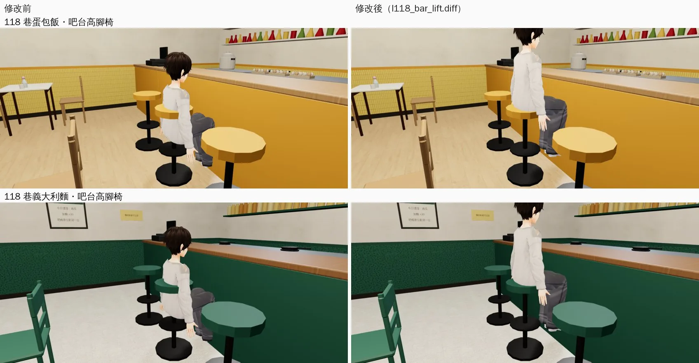

# 118 巷吧台高腳椅：人坐在凳面上，不是坐進凳子裡

帳號 A 的 LAWWW2，2026-10-22 02:3x～05:5x UTC。

- **狀態**：已交件；`READY_FOR_ART_REVIEW`（場景美術由使用者驗收）。
- **起因**：做溫州街兩家新店（WZ-SHOP-AA364-ART）時，巷子裡定食的吧台高腳凳要帶 `lift`。回頭查 118 巷四家店，吧台高腳椅都沒帶。

## 看到什麼

- 118 巷四家店的吧台高腳椅（`lane118_shops.py` 的 chair `'bar'`）座面 0.76 m。
- 「坐下」用一般椅子的坐姿（座面約 0.45 m），人坐進凳子裡：凳面卡在腰的位置，腳穿過下面的腳踏圈。
- 一一八茶飲 2 個、慢讀咖啡 4 個、Pasta 118 6 個、蛋包飯研究所 5 個座位，共 17 個。

## 改法（`patches/l118_bar_lift.diff`）

- 吧台高腳椅的座位寫 `lift: 0.31`，坐姿抬高 0.31 m：0.76 − 0.45，和 Café 吧台、巷子裡定食的做法一樣。
- 改到的檔：
  - `tools/blender/env_second/lane118_shops.py`：`BAR_LIFT`，匯出配置時寫進座位。模型沒換，GLB 不用動。
  - `src/data/l118_shop_layouts.js`：`gen_shop_layouts.py` 重新產生，只多 `lift`。
  - 四份 `assets/models/env/second_ai/l118_*.layout.json`：只多 `lift`。
  - `src/l118_shops3d.js`（LAWWW 的檔，一行）：區域的座位和「坐下」按鈕的座位都帶 `s.lift`。
  - `tests/l118_bar_lift_unit.js`：新測試。

## 遊戲內前後（佇列 j24；Playwright＋SwiftShader，不是 iPhone）

左：開發分支 `be8c1b0e`；右：套 `l118_bar_lift.diff`。從側面看坐在吧台的人。

- 修改前，凳面在腰上，大腿和凳子疊在一起。
- 修改後，坐在凳面上，腳往下放在腳踏圈附近。

## 測試

- `node tests/l118_bar_lift_unit.js`：17 個座位帶 `lift` 0.31；「坐下」按鈕的座位也帶著；其他店的座位沒有 `lift`。
  - 05:5x 在開發分支 `c08889bf` 重跑：修改前 8 FAIL（17 個座位都是 0 個 lift），套 patch 以後 ALL PASS。
  - j24（`be8c1b0e`＋patch）也是 ALL PASS。
- `node tests/l118_shops_unit.js`：ALL PASS（j24）。
- `tests/seats_on_furniture.py`（l118_cafe2、l118_pasta、l118_omu、l118_tea）：
  - j24 那一次，Playwright 找不到預設的 headless shell，沒跑起來。這不是測試失敗，也不算通過。
  - j24b 改用 `executable_path` 指到預裝的 Chromium 重跑（開發分支 `be8c1b0e`＋patch）：
    - 慢讀咖啡 14、Pasta 118 16、蛋包飯研究所 15、一一八茶飲 2 個座位；
    - 有問題 0。

## 接法（LAWWW）

1. `git apply docs/art-rebuild/second_ai/patches/l118_bar_lift.diff`
   - 對開發分支 `c08889bf`、`4660ca57` 乾淨。
   - 和 `wz0_prop_nav`、`wz_shops2`、`dorm_lounge`、`us_market_cam`、`us_ms_seethru` 一起疊著套也乾淨。
2. 跑 `node tests/l118_bar_lift_unit.js`、`node tests/l118_shops_unit.js`、`tests/seats_on_furniture.py`（四家店）。

## 還不到的地方（誠實寫）

- 截圖用的是固定的側面鏡頭（高 1.25 m）：修改後人坐高了，頭超出畫面上緣。這是截圖鏡頭的位置，不是遊戲裡的鏡頭。
- 坐姿的腳沒有特別放到腳踏圈上，只是整個人抬高；近看腳是懸空的。
- 真機沒看過。
