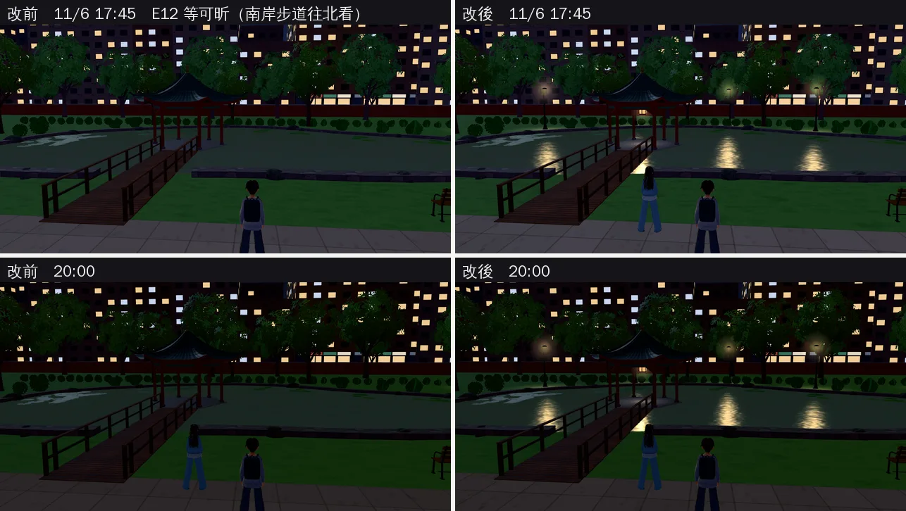
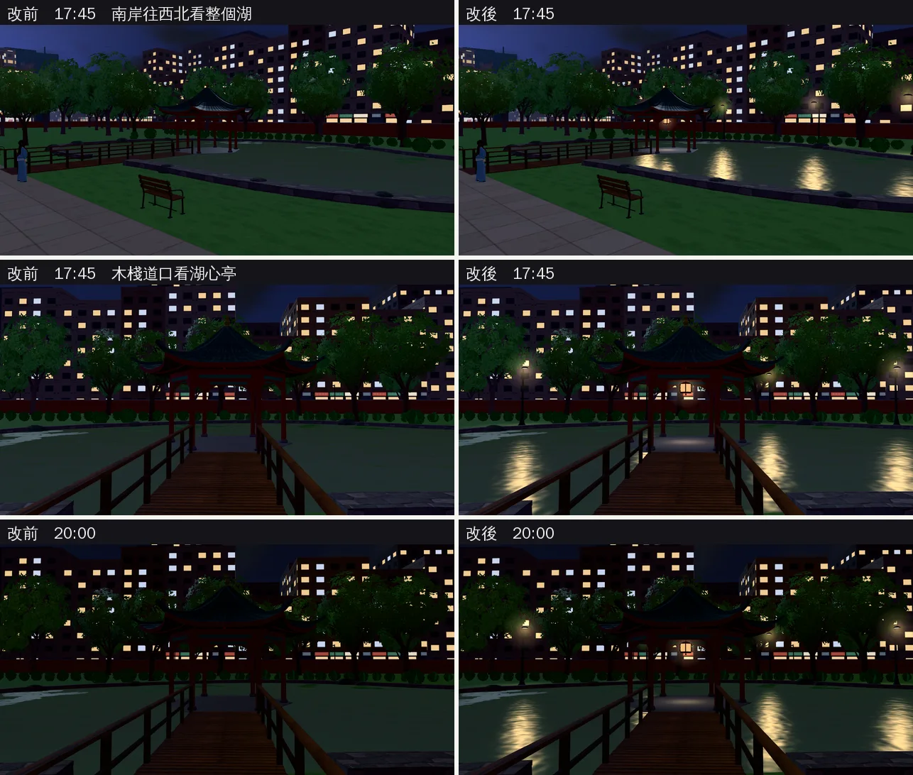

# 醉月湖晚上：北岸路燈、水面倒影、湖心亭宮燈（ART-ECON-3D-GAP-1021 D；LAWWW2-B 2026-11-01）

- **起因**：LAWWW-B 11-01 06:5x 改排：舊序章是 D99 第一項，D（醉月湖晚上）、F（兩段劇情背景）由我判斷哪些真的影響畫面。
  - 10-24 路線巡查記過：「20:00 水面很暗、湖心亭沒有燈」，當時說這一輪不做。
- **為什麼現在要做**：E12「長頸鹿的尾巴」照 AA_303 改成 11/6 17:45 在南岸步道（`econff3d.js` 的 `S.KEEP` 有它，一定會演）。
  - 傍晚照日期以後（ENGINE-SEASON-DUSK，已整合），臺北 11/6 17:17 日落，17:45 已經天黑，路燈也開了（遊戲內實測 `lampsOn` true、燈光時刻 19.26）。
  - 對白第一句「湖對面的燈一盞一盞亮起來」，可是北岸一盞燈都沒有，湖心亭也是暗的。
- **狀態**：`READY_FOR_ART_REVIEW`。場景只有使用者能標 `ART_APPROVED`。
  - 截圖是 Playwright＋SwiftShader（電腦 1280×720），不是手機實機。
  - 讀檔到 2024-11-06、舊序章那一段、放時間和玩家位置是 [捷徑]。
- **F 不做，只記錄**：「偷偷旁聽」`ev_y0_e24b2`、「登山社的行前會」`ev_y0_c2_hiking` 在開發分支已經 `retired`。
  - 原因：AA_218 決定 10/17 舊序章，這兩件刪除；定義只留給已經演過的舊存檔。
  - 不會再演，不需要背景。

## 一、改了什麼

1. **北岸四盞路燈**（`src/zones3d.js` 的 `lake()`）：
   - 外形和南岸那兩盞一樣（`W3.lampPost`），燈臂朝湖。
   - 位置是湖岸外形 80 點的第 48、56、62、70 點，往外 3.4 m（岸邊的草叢在 1.6～2.4 m），離北岸三棵樹都 3 m 以上：
     - (−50.8, −119.8)
     - (−42.8, −124.6)
     - (−32.2, −125.2)
     - (−24.5, −120.6)
   - 中間兩盞在北邊界 z −124 那排矮灌木後面，是地圖外的背景，本來就走不到。
   - 兩側兩盞在草地上，燈桿擋 0.5 m，旁邊照樣走得過去。
   - 和所有校園路燈一樣，自動有燈頭光暈、地上的光圈，入夜才開（`E.lampGlows`）。
2. **水面的倒影**（同一個水面 shader）：
   - 南岸 2 盞、北岸 4 盞、宮燈 1 盞，共 7 個燈的位置傳進 shader。
   - 倒影在水平方向要對準（窄），上下可以差很多（拉長成一條往看的人延伸的光柱）。
   - 原本的波紋法線會把光柱打碎成一段一段。
   - 只在路燈開的時候有（`updateLake`：`E.lampsOn`）。
3. **湖心亭的宮燈**（`tools/blender/env_second/campus_lake.py` → `campus_lake.glb`）：
   - 亭子正中間，從天花吊下來的六角宮燈：金色吊桿、紅漆上下蓋、六條紅框、米黃燈紙、紅色流蘇。共 +156 個三角形、+1 個網格（`lake_lantern_paper`）。
   - 燈身 2.12～2.44 m，在柱頭之間的額枋（2.48～2.84 m）下面。
     - 第一版掛在 2.62～3.02 m，遊戲內截圖從亭子外面看整個被額枋擋住，改低。
   - 流蘇最低 1.98 m。人物最高 1.85 m，走到亭子中間不會穿過。
   - 遊戲裡（`attachLakeGLB`）：燈紙晚上發暖光，用的是 `TK.addNight`，和路燈同一個開關（校園 `onLamps` → `CK.setNight`）。
   - 旁邊一團光暈、亭子平台上一圈光（`E.lampGlows`）。
4. **沒動的**：
   - 導航：除了兩側兩盞燈桿 0.5 m，其他照舊。
   - 湖岸、木棧道、水面原本的顏色。
   - 其他區域。

## 二、改前改後（同一個鏡頭、同一個時刻）

- 17:45 改前那張可昕沒出現：劇情人物的載入時機，每次讀檔不一樣，和這次修改無關。
- 看得到的差別：
  - 對岸有三盞路燈亮著（第四盞在亭子後面）；
  - 水面三條暖色、跟著波紋碎開的倒影；
  - 亭子底下有一點暖光。

- 木棧道口看得到宮燈本身（紅框、燈紙亮）、亭子平台上那一圈光、兩側路燈的倒影。

## 三、效能（同一個鏡頭，改前 → 改後）

| 鏡頭 | draw call | 三角形 |
|---|---|---|
| E12 17:45 | 89 → 100 | 13.5 萬 → 13.8 萬 |
| E12 20:00 | 118 → 129 | 20.6 萬 → 20.8 萬 |
| 南岸往西北 | 102 → 113 | 18.0 萬 → 18.3 萬 |
| 木棧道口 | 60 → 71 | 10.1 萬 → 10.3 萬 |

- +11 draw call：
  - 四盞路燈的燈桿和燈罩玻璃；
  - 晚上的光暈、光圈（白天藏著，不畫）；
  - 宮燈燈紙。
- 水面 shader 每個像素多算最多 7 個燈（只在晚上，`lampK` > 0 才進迴圈）。

## 四、還不夠的（照實寫）

- 對白說「一盞一盞亮起來」，遊戲的路燈是同一刻全部打開（`E.setLamps`）。要一盞一盞亮得改引擎的路燈開關，不是場景的事；先記錄。
- 倒影沒有遮擋：被亭子、木棧道擋住的燈，水面照樣有倒影（shader 不知道中間有東西）。目前的鏡頭看不出來。
- 水面本身的顏色（晚上灰綠）沒改；只加了燈的倒影。
- 宮燈從 E12 那個距離（約 20 m）看只有幾個像素，主要看到的是亭子底下那團暖光。
- 沒有照片可以核對真實的醉月湖湖心亭晚上有沒有燈；照一般台灣校園湖景的做法（沙盒打不開臺大網站）。

## 五、怎麼套（給 LAWWW-B）

1. **換二進位**（從我的分支 `claude/funny-albattani-iawshm` 拿）：`assets/models/env/second_ai/campus_lake.glb`、`campus_lake.json`。
2. **patch**：`docs/art-rebuild/second_ai/patches/lake_night_1101.patch`（對開發 `f812b45c3`，`git apply --check` 過）。內容：
   - `src/zones3d.js`：`lake()` 北岸路燈、水面倒影；`updateLake`；`attachLakeGLB` 燈紙；校園 build 宮燈光暈。
   - 新 `tests/lake_night_unit.js`。
3. **工具**（只在我的分支）：
   - `campus_lake.py`（宮燈）；
   - `shots/lake_night_shots.py`（這次的截圖：攔截 zones3d.js、campus_lake.glb，同一個伺服器拍改前改後）。

## 六、測試

- 新 `tests/lake_night_unit.js`（Node，不需要瀏覽器）：**開發分支原樣 6 項都 FAIL，改後 ALL PASS**。
  - ① 北岸 4 盞路燈：燈臂朝湖、有光圈、燈桿擋住導航、旁邊站得住（邊界外的除外）。
  - ② 水面 7 個燈的倒影位置對得上燈頭。
  - ③ 倒影只在晚上。
  - ④ 宮燈的光暈、平台光圈，白天藏著。
  - ⑤ GLB 的燈紙在亭子中間、額枋下面、2.0 m 以上。
  - ⑥ 燈紙晚上發光、白天不亮。
- 既有和湖、校園、路燈有關的 40 支（`lake`、`醉月湖`、`lampPost`、`ZONES.campus`）：開發分支＋這個 patch 都 ALL PASS。
- 全部 Node 的結果寫在交件訊息。
- 沒跑：手機實機；`tests/campus_layout_nav.py`、`tests/reachability_all.py`（瀏覽器，慢）。導航只多了兩側兩盞燈桿的 0.5 m，Node 的 ① 有檢查旁邊走得過去。
