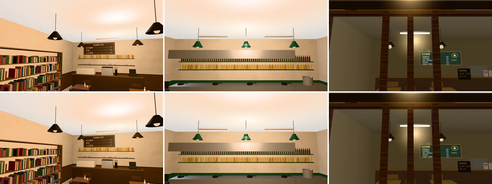

# 店內吊燈燈罩裡外相反（ART-LAMPSHADE-FLIP-1027；LAWWW2-B 2026-10-31）

- **起因**：LAWWW2-C 10-27 修 `lib2.single_side`（判斷「裡外相反」的體積改 64 位元）時發現，排 P3；LAWWW-B 19:1x 佇列第 3 件。
  - 溫州街 3 家店、118 巷的店內吊燈燈罩，車床（lathe）的輪廓方向反了。
  - 車出來的封閉殼體積是負的，也就是裡外相反。
  - 單面材質從外面看到的是背面：隔著店面玻璃看，明暗是反的。
- **狀態**：模型修正。截圖是 Playwright＋SwiftShader（電腦），不是實機；讀檔放位置、藏玩家和 NPC 是 [捷徑]。

## 一、找到的（掃 GLB：封閉、體積負、最小邊長 1 mm～1 m 的零件）

| GLB | 節點 | 哪裡 | 幾個 |
|---|---|---|---|
| `l118_cafe2.glb` | `l118_cafe2_metal` | 118 巷慢讀咖啡，桌子上方的吊燈 | 5 |
| `l118_pasta.glb` | `WALL_N_lampshade` | Pasta 118，吧檯上方的吊燈 | 3 |
| `wenzhou_street.glb` | `wz_in_shop` | 溫州街 3 家店的店內吊燈（x 41～47、z −7） | 3 |

- 原本記的是「118 巷 9 個」，這次掃到 8 個（其他七家 118 巷的店都是 0）。
- 另外溫州街 Café 附近還有一個金屬圓盤（`cafe_vc_wz_metal`，(37.3, 1.09, 5.3)，36 cm 寬、5 cm 厚）也是裡外相反。
  - 不是燈罩，我沒找到是哪個腳本做的，這一包沒動，記在這裡。

## 二、改法

1. **部署的 GLB 不重匯，只翻那 11 個零件**：新工具 `tools/blender/env_second/glb_flip_insideout.py`。
   - 那些三角形的頂點順序對調；只被它們用到的頂點，法線反向。
   - 只改 GLB 二進位裡的索引、法線。檔案大小、節點、材質、其他零件都不變。
   - **為什麼不重匯**：這幾個 GLB 是 10-25 單面化以後部署的。現在的腳本重匯，會連帶改到別的小零件：慢讀咖啡重匯和部署版差 5,051 bytes 的頂點資料，`lib2.single_side` 10-27 改 64 位元以後判斷不同。
2. **產生它們的腳本也改**，之後重匯就是對的：
   - `lane118_shops.py` 的 `pendant()`：燈罩輪廓反過來。
   - `wz_shopkit.py` 店內吊燈：輪廓由下往上。
   - Blender 驗過：輪廓反過來以後，車出來的體積從 −0.00206／−0.00386 變成 +0.00206／+0.00386。
   - 用改過的腳本重匯慢讀咖啡、Pasta 118，掃描是 0。

## 三、畫面（20:30；上＝改前，下＝改後）

- 由左到右：慢讀咖啡、Pasta 118 吧檯、溫州街的店（從街上隔著玻璃看）。

- **照實寫：畫面上的差別很小。**
  - 燈罩是深色、店內的光從各個方向來；燈罩外面的明暗只差一點。
  - 溫州街那幾盞隔著玻璃、又小。
  - 這一包主要是讓模型正確（單面材質從外面看到正面），不是看得出來的美術改善。

## 四、測試、怎麼套

- 新測試 `tests/lampshade_flip_unit.js`（Node，讀 GLB）：三個 GLB 的燈罩節點沒有裡外相反的零件、燈罩還在。**開發分支原樣 FAIL 3，改後 ALL PASS**。
- 會讀這三個 GLB 的 Node 都 ALL PASS：`singleside_streets_unit`、`aa311_l118_unit`、`wz_copy_shop_unit`、`room_ceiling_unit`、`door_open_unit`、`sq_traces_unit`……
- **換二進位**：`assets/models/env/second_ai/l118_cafe2.glb`、`l118_pasta.glb`、`wenzhou_street.glb`（`.json` 統計不用換：三角形數一樣）。
- **patch**：`docs/art-rebuild/second_ai/patches/lampshade_flip_1031.patch`（只有新測試）。
- 沒跑：手機實機。
