# ART-L118-GROUND：118 巷的地面與台大後門（v9.10）

LAWWW2-C，2026-10-18。LAWWW-C 02:10 派（P1，118 巷要進 v9.10）。狀態：`MODEL_READY`，場景美術 **READY_FOR_ART_REVIEW**（使用者看過才算）。後門 **PROPOSAL**：沒有辛亥復興門的照片，LAWWW-C 02:22 同意照一般台大校門做。

## 為什麼要做
- `lane118_street.glb`（兩側店面、招牌）沒有地面。
- LAWWW-C 接區域時在程式裡用套件暫代了：
  - 巷子柏油（`TK.road`）、兩條人行道（stoneTex 平面）；
  - 辛亥路、和平東路（`TK.road`）、斑馬線（白色長條平面）；
  - 遠景地面（灰色大平面）；
  - 後門那一側的圍牆和兩根門柱（方塊）。
- 照 D100，3D 美術是 LAWWW2 的，這一項把它們換成正式模型。

## 玩家會看到什麼
- **路面**：和溫州街同一套程序路面（`wz_road_tex.Road`），柏油照 D30 的淺灰。
  - 補過的柏油、灌縫膠的裂縫、車輪和機車壓出來的深色帶、停車處的油漬。
  - 路邊一節一節的混凝土水溝蓋、每 6 m 一塊鐵柵；人孔、手孔。
  - 白色邊線，巷口、巷底各 8 m 是禁停紅線；巷口和巷底的機車停車格（白框）。
  - 靠辛亥路那一端寫「慢」（字頭朝南，給往辛亥路開的人看）；停止線。
- **辛亥路**：雙黃線、白色虛線、路緣邊線、manhole。
  - 斑馬線：位置和寬度照配置，和 LAWWW-C 暫代的一樣。
  - 台灣路口的順序：汽車停止線 → 機車停等區（白框）→ 斑馬線。
- **人行道**：
  - 巷子兩邊、辛亥路北邊（巷口以外）、辛亥路南邊（台大圍牆前）、和平東路南邊。
  - 灰色石材地磚，邊上一條花崗石路緣。
  - **只高 3 cm**：導航是平的，人走上去腳不會陷進去。路緣高 5 cm。
  - 斑馬線那一端的路緣斷開、做成斜坡，鋪一排黃色導盲磚。
- **台大後門（PROPOSAL）**：
  - 兩根灰色花崗石門柱（1.1 × 1.1 × 3.4 m），頂上黑色燈籠，晚上亮。
  - 門柱上一塊深色牌子，**空白**。
  - 開口 8 m，就是遊戲的出口「回到台大（後門）」(0, 48.4)。地上一條滑門軌道。
  - 兩片黑色鐵滑門收在東邊圍牆後面；門內東邊一間警衛亭。
  - 圍牆：花崗石矮牆（0.9 m）＋壓頂＋黑色鐵欄杆（到 2 m），每 4 m 一根石柱。
  - 牆後：校園的草地、一小段紅磚步道、三排大樹，最後面兩棟米白色系館（遠景，D38 分類 ②）。
- **路燈**：沿用遊戲的 `W3.lampPost`。全遊戲同一款路燈，晚上的光圈、燈頭位置都調好了，這裡不換。

## 遊戲內前後截圖
Playwright、iPhone 直向 390×844 模擬；LAWWW-C 分支 `bf99b3b3`＋本 patch。上一排：擋掉 `lane118_ground.glb` 的下載（程式暫代）；下一排：載入正式模型。

| 巷口往北看 | 斑馬線上看後門 | 巷子中段 | 晚上 20:30 |
|---|---|---|---|
| 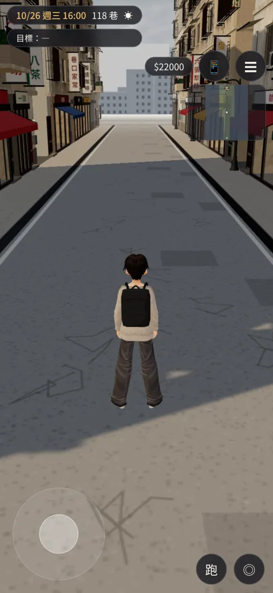 | 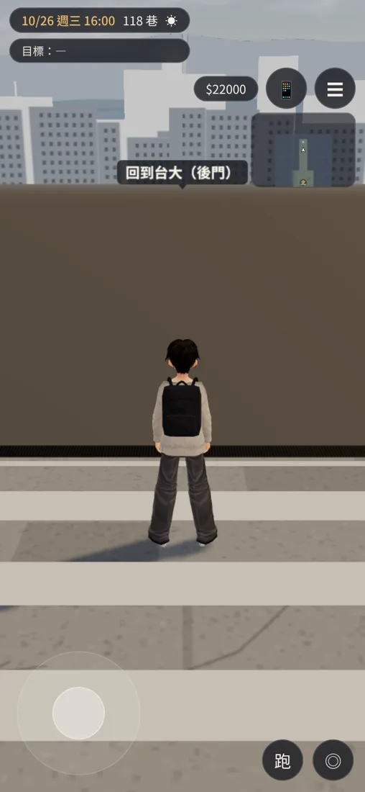 | 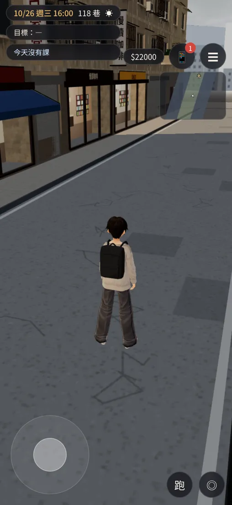 | 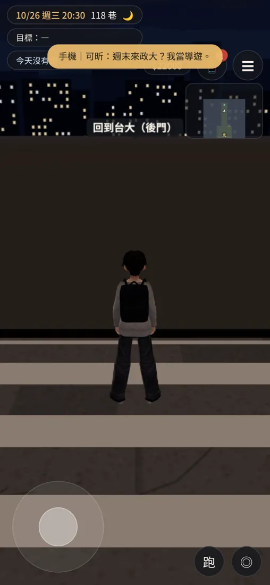 |
| 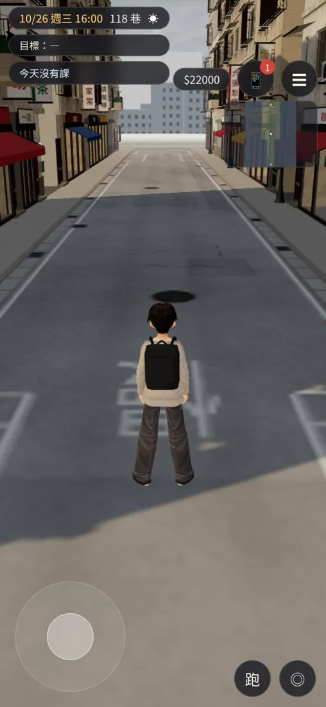 | 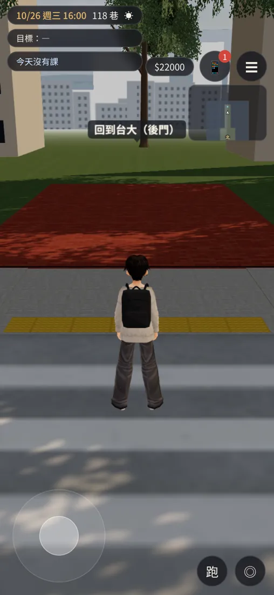 | 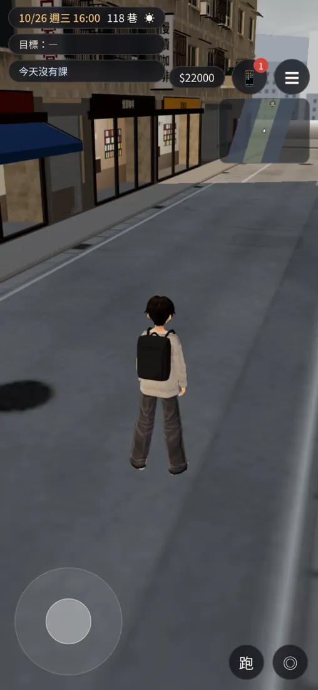 | 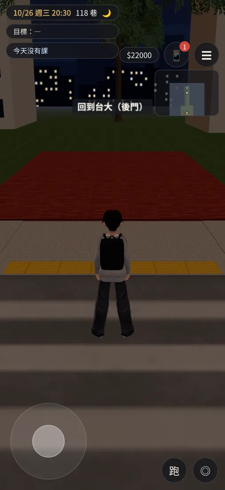 |

- 改之前：
  - 斑馬線上往後門看，整個畫面是一大片褐色（暫代的平面）。
  - 巷子是同一片淺灰重複貼的柏油，沒有水溝、標線。
- 改之後：
  - 後門那一側看得到紅磚步道、草地、大樹和遠景系館，地上有導盲磚。
  - 巷子有水溝蓋、鐵柵、人孔、紅白邊線、停車格、「慢」。

橫向（站在辛亥路上）：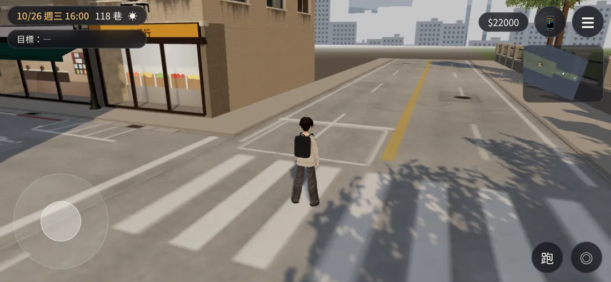

Blender 算圖（接上 `lane118_street.glb`）：

| 後門 | 巷子 | 巷口（辛亥路） | 鳥瞰 |
|---|---|---|---|
| 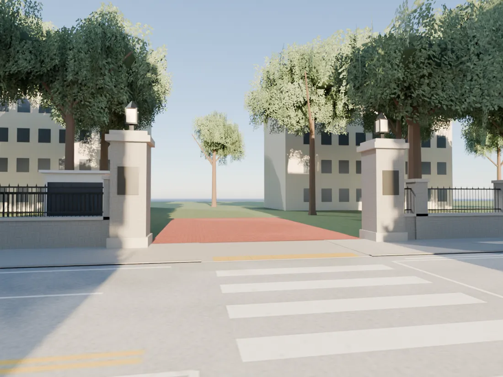 | 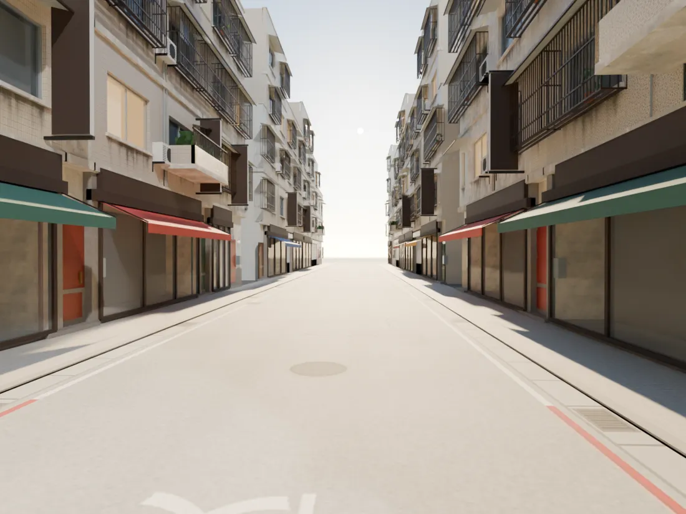 | 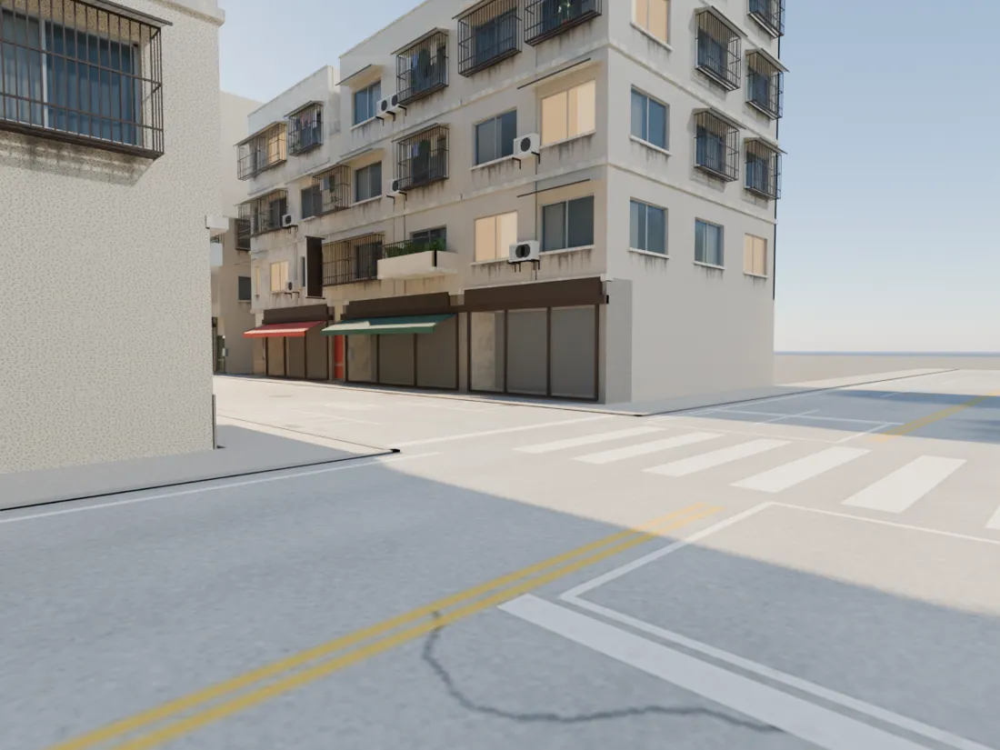 | 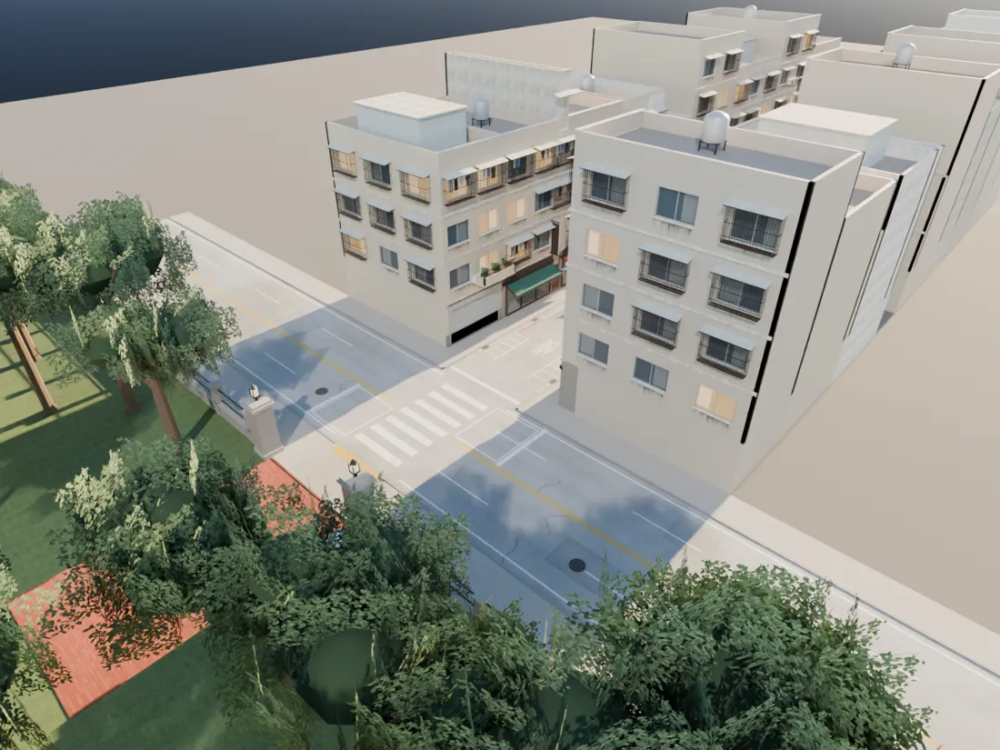 |

## 交付
- `assets/models/env/second_ai/lane118_ground.glb`：2.3 萬三角形、2.4 MB（另一個檔，`lane118_street.glb` 不動）。
  - 不併進街景：街景的窗在 `3ccc781e` 直接改過 GLB 裡的原型，重建會蓋掉那次修正。
- 腳本：
  - `tools/blender/env_second/lane118_ground_tex.py`：路面貼圖 `textures/gen/l118_road_*.jpg`，要 numpy、PIL、scipy；
  - `tools/blender/env_second/lane118_ground.py`：`--preview --cam gate|lane|corner|aerial [--with-street]`、`--stats`。
  - 座標都照 `src/data/lane118_layout.js`（和 LAWWW-C 分支的一模一樣）。
- patch：`docs/art-rebuild/second_ai/patches/lane118_ground.diff`，對 LAWWW-C 分支 `bf99b3b3`。
  - `src/assets3d.js`：加 `bldg.lane118_ground`。
  - `src/zones3d.js` 的 `buildLane118`：
    - 暫代的地面、路、斑馬線、遠景地面、圍牆門柱加上 `userData.dyn`（不然引擎載入區域時會合併，合併後就藏不掉）和 `l118g`；
    - 正式模型載入後藏起來。
    - 路面材質（`l118_road_*`）標 `asphalt`、放進 `E.roadMats`（入夜調暗，和溫州街的正式路面一樣）。
    - 燈籠（`GLOW_l118_gate_lamp`）`TK.addNight`：晚上亮。
    - 葉片 `alphaTest`。
    - 導航、互動點、出口都沒改。
  - 載入失敗時照舊是暫代的那一套。

## 測試
- 通過：
  - patch 語法（node 解析 `zones3d.js`）；
  - 遊戲內「改之後」5 張截圖沒有 JS 錯誤（橫向、晚上兩張另外重拍確認）；
  - 晚上路面跟著調暗（20:30 那張）。
- 沒測：
  - iPhone 實機；
  - LAWWW-C／BB 的 `flow_lane118`（點餐流程，沒有動導航和互動點，照理不受影響）；
  - 門柱燈籠晚上亮的樣子沒有截到正面。

## 還沒做到的（誠實列出）
- 辛亥復興門沒有照片：門柱、圍牆是一般台大校門的做法，和真的後門一定不一樣。使用者給照片以後照照片改。
- 路燈沒換（理由見上）；巷子裡沒有電線桿、電線（`lane118_street.glb` 原本也沒有）。
- 和平東路那一端只有路面和人行道，對街沒有房子（走不到、鏡頭很少看到；有霧）。
- 人行道是平的灰色地磚，沒有樹穴、消防栓、郵筒這些街道家具。
