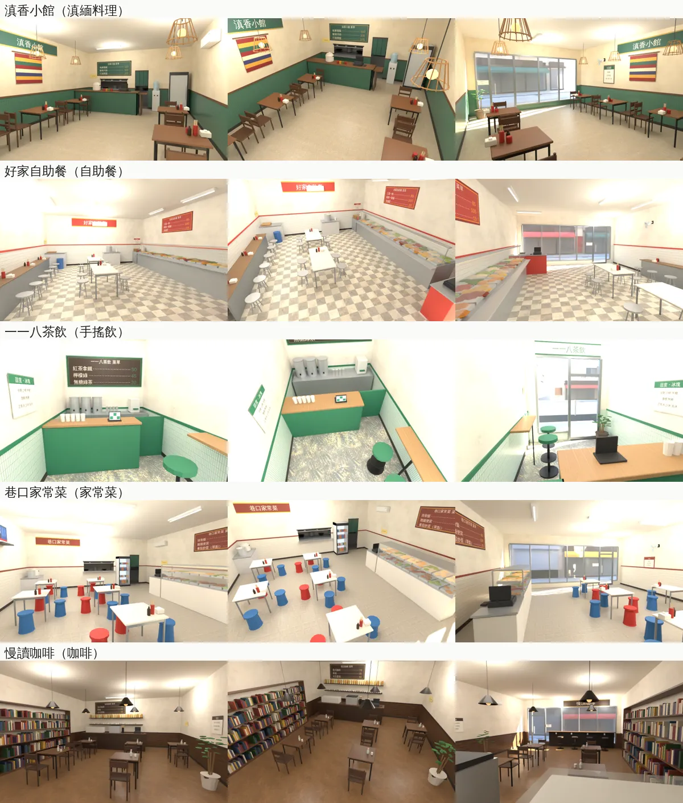
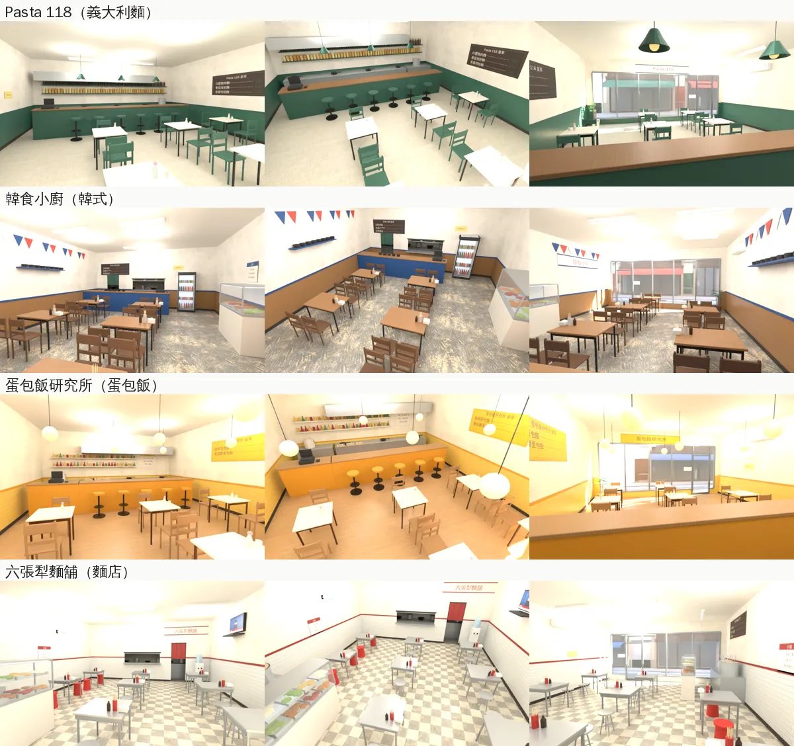

# LANE118-SHOPS-1020：118 巷九間店走得進去（室內）

LAWWW2-C，2026-10-20。
- 誰要的：使用者 10-20 試玩 v9.10.2，經 LAWWW-C 13:15 派工（P0）：
  > 「118巷店員為什麼都站在店外 我要的是店裡可以進去 店員也在裡面阿 認真設計每個店面 最好配合故事?劇情?」
  - 登記在 USER_WANTS X66、UA-LAWWW-1020-52。
- 做法：照 LAWWW-C 13:25 的確認，每間店一個獨立的室內區域，和美國的亞洲超市、法學院圖書館同一套（遊戲端 `Z3.room`＋`attachRoomGLB`）。
- 狀態：`MODEL_READY`。
  - **遊戲內還沒接**：導航、出入口、店員、點餐由 LAWWW-C 接。
  - 場景美術 **READY_FOR_ART_REVIEW**，使用者看過才算。
- 店名、菜單、營業時間、店員那一句：全部照 AA_280（`docs/story_planning/AA_280_118巷_店家菜單與午餐.md`，企劃分支）。
  - 店名虛構，不畫商標、沒有真實品牌（D77）。
- 每間店的故事、店員是誰：AA 的 LANE118-SHOP-STORY-1020。這裡只做店的樣子，和店員**站在哪裡**。

## 玩家會看到
- 在 118 巷的店門口按「進店」→ 進到店裡（門口、面向店內）。
  - 店員站在櫃台後面；
  - 走到櫃台前面「點餐」；
  - 店裡的椅子都坐得下去；
  - 從門口「離開○○」回到巷子（人行道上，離店門 1.75 m）。
- 店面玻璃外面看得到 118 巷對面的店：從遊戲的 118 巷街景模型拍的。

| 店 | 長什麼樣子 | 店員站在哪裡 |
|---|---|---|
| 滇香小館（滇緬） | 深綠瓷磚腰牆、竹編吊燈、緬甸條紋織布；後牆出菜口看得到廚房的炒鍋和湯鍋，廚房門掛門簾；十個位子 | 櫃台後面（出菜口前），面向門口：「內用嗎？椒麻雞今天比較辣喔。」 |
| 好家自助餐 | 東牆一整排保溫餐台（一格一格的菜、玻璃罩、罩子下的燈）。從後面的餐盤架拿盤子，往前夾到門口邊的結帳台；後面有自取的湯、回收台；靠牆長桌＋中間兩張長桌，不鏽鋼圓凳 | 結帳台後面（秤、收銀機），面向店裡；從巷子隔著玻璃也看得到阿姨 |
| 一一八茶飲（外帶，寬 2.6 m） | 櫃台橫在中間，後面三個茶桶、封口機、雪克杯；點餐的平板；靠牆一條窄桌＋兩張高腳椅（等飲料） | 櫃台後面，面向門口：「甜度冰塊？」 |
| 巷口家常菜 | 東牆的保溫展示櫃（兩層菜）、西牆高處的電視（午間新聞，虛構）；方桌＋紅藍塑膠凳；後面出菜口、自取的湯和白飯 | 展示櫃後面，面向店裡（老闆娘） |
| 慢讀咖啡 | 西牆一整面書架（書沒有書名）；窗邊的吧檯＋四張高腳椅，檯面下一排插座（「插座在窗邊」）；後面吧台（咖啡機、蛋糕櫃、杯子、玻璃罐）；吊燈 | 吧台後面，咖啡機旁 |
| Pasta 118 | 後面開放式廚房（四口爐、煮麵大鍋、層架上的玻璃罐和酒瓶，沒有標籤）；吧檯＋六張高腳椅（「吧檯可以嗎？」）；前面五張兩人桌、綠色瓷磚 | 開放式廚房裡、吧檯後面 |
| 韓食小廚 | 三角小旗；後面櫃台擺石鍋，西牆層板也有石鍋；東牆的小菜櫃（「小菜可以續喔」）；木頭四人桌 | 櫃台後面（出菜口前） |
| 蛋包飯研究所 | 黃色瓷磚；開放式廚房：平底鍋、一盒一盒的蛋、層架上的燒杯和錐形瓶（裝醬汁）、白板「今日實驗」；吧檯＋五張高腳椅、球形吊燈 | 開放式廚房、平底鍋前，面向吧檯 |
| 六張犁麵舖 | 店門口那一側是煮麵台（兩口大湯鍋、麵杓、一疊碗），旁邊的小菜櫃；不鏽鋼方桌＋圓凳、電視、壁扇；後面出菜口 | 煮麵台和小菜櫃中間，面向店裡（老闆：「大碗小碗？」）；從巷子隔著玻璃看得到 |

## Blender 算圖
- Cycles，`render_cycles.py --view Standard`，加幾盞點光源代替遊戲的燈。
- 每一列左到右：門口往裡看、遊戲鏡頭的高度、後面往門口看。
- 這是 Blender 算圖，**不是遊戲畫面**：遊戲內還沒接。
- 好家自助餐這一列是把冷氣移開之前算的：原本冷氣蓋住店名牌，現在的 GLB 已經移到旁邊。蛋包飯、慢讀咖啡、Pasta 的吊燈之後又往上提了 15～20 cm。




## 交付（commit 見 outbox）
- `assets/models/env/second_ai/l118_<id>.glb`：九個，0.5～1.5 MB，0.3～1.8 萬三角形，材質 15 種左右。
- `assets/models/env/second_ai/l118_<id>.layout.json`：遊戲讀這個。
  - `<id>`＝`dian self tea home cafe2 pasta korea omu noodle2`（和 `LANE118_LAYOUT.shops` 的 id 相同）。
- 腳本：
  - `tools/blender/env_second/lane118_shops.py`：共用套件＋每間店一個函式。
    - 用法：`/opt/blenv/bin/python tools/blender/env_second/lane118_shops.py -- --shop all|dian,…`
  - `lane118_shops_tex.py`：菜單、店名、營業時間、告示、螢幕的貼圖；字照 AA_280。
- 門外的巷子：`tools/blender/env_second/textures/gen/l118_view_<id>.png`，用 `render_cycles.py` 從 `lane118_street.glb`＋`lane118_ground.glb` 拍。
  - 改了 118 巷街景之後可以重拍：相機在店門口往巷子對面，`views.json` 寫在 README 最下面。

## 配置（layout.json）的欄位
座標是每間店自己的區域座標：
- x＝店面寬度方向（−W/2～W/2）；
- z＝深度（−D/2 是後牆，+D/2 是店面玻璃和門）；
- 單位公尺。

| 欄位 | 內容 |
|---|---|
| `bounds`、`h` | 室內範圍、天花板 3.2 m |
| `cam_dist` | 建議的鏡頭距離。茶飲 3.6，其他 4.2～4.4 |
| `door` | 店門在店面那面牆上的位置（x、寬度） |
| `spawn` | 進門站的位置，面向店裡（yaw π）。離「離開」1.05 m，不會一進門就站在出口上 |
| `exits[0]` | 「離開○○」，回 `lane118`。r 0.7 |
| `street.door` | 118 巷的店門口互動點（現在 `zones3d.js` 的 buildLane118 放的位置：立面 ±0.9、店面中間） |
| `street.spawn_out` | 出店門站的位置：人行道上、面向巷子對面，離店門口互動點 1.75 m（現在半徑 1.4，一出來不會顯示「進店」）。都不在機車停車格（z −30～−18、29～33）裡 |
| `counter` | 櫃台的範圍 |
| `clerk` | 店員站位（x、z、yaw），在櫃台後面。那一區用 `blocks` 圍起來，玩家進不去 |
| `order` | 「點餐（店名）」互動點（x、z、r），在櫃台前面。點餐流程（AA_280）由 LAWWW 接 |
| `seats[]` | 每張椅子：x、z、yaw（面向桌子）、kind（`eat`；茶飲是 `wait`）、table（桌子中心）；吧檯、窗邊的有 label |
| `interact[]` | 「看」的東西：織布、湯、回收台、電視、書架、小菜櫃 |
| `blocks[]` | 碰撞框：桌子、櫃台、餐台、冰箱、書架；店員那一區、廚房、開放式廚房 |
| `navcheck` | 腳本裡跑的導航檢查結果（`problems` 九間都是空的） |

**導航檢查**：和遊戲同一套規則（0.4 m 格子、牆內縮 0.25 m、`blockRect` 最小 0.4 m、站得住＝`clear(0.3)`、路線經過的格子 `clear(0.33)`）。
- 從 `spawn` 走得到出口、點餐、每個「看」；
- 每張椅子至少一個 `seatApproach` 的候選點走得到。
- 遊戲格子的原點如果不是 `bounds.x0`、`bounds.z0`，結果可能差一格。用 `node tests/reachability_all.py` 那一類真的走一遍才算數。

| 店 `id` | 室內 W × D (m) | 巷子的店門口 | 出店門站 | 進門站 | 店員 | 點餐 | 座位 | 碰撞框 | 三角形 | GLB |
|---|---|---|---|---|---|---|---|---|---|---|
| 滇香小館 `dian` | 5.6 × 8.0 | (−4.3, 25.0) | (−3.9, 26.7) | (1.5, 2.5) | (−0.6, −3.45) | (−0.6, −1.9) | 10 | 8 | 15,352 | 1.3 MB |
| 好家自助餐 `self` | 6.6 × 9.0 | (−4.3, 17.5) | (−3.9, 19.2) | (−2.2, 3.0) | (2.4, 3.55) | (1.55, 1.95) | 14 | 9 | 13,264 | 1.2 MB |
| 一一八茶飲 `tea` | 2.6 × 4.6 | (−4.3, 11.5) | (−3.9, 13.2) | (−0.5, 0.8) | (−0.35, −1.35) | (−0.35, 0.15) | 2 | 5 | 2,790 | 0.5 MB |
| 巷口家常菜 `home` | 7.6 × 8.5 | (−4.3, −2.0) | (−3.9, −0.3) | (−2.6, 2.75) | (3.35, 0.6) | (1.7, 0.6) | 18 | 11 | 16,630 | 1.5 MB |
| 慢讀咖啡 `cafe2` | 6.6 × 9.0 | (−4.3, −12.5) | (−3.9, −10.8) | (2.2, 3.0) | (−0.2, −4.0) | (0.1, −2.45) | 14 | 9 | 18,224 | 1.5 MB |
| Pasta 118 `pasta` | 7.6 × 8.5 | (4.3, 24.0) | (3.9, 25.7) | (−2.6, 2.75) | (0.0, −2.95) | (−2.7, −1.1) | 16 | 9 | 17,408 | 1.5 MB |
| 韓食小廚 `korea` | 6.6 × 8.5 | (4.3, 15.5) | (3.9, 17.2) | (2.2, 2.75) | (−0.2, −3.75) | (−0.2, −2.2) | 20 | 9 | 15,590 | 1.4 MB |
| 蛋包飯研究所 `omu` | 6.6 × 8.0 | (4.3, 1.5) | (3.9, 3.2) | (−2.2, 2.5) | (0.6, −2.55) | (−2.3, −0.7) | 15 | 9 | 15,046 | 1.3 MB |
| 六張犁麵舖 `noodle2` | 6.6 × 8.5 | (4.3, −10.5) | (3.9, −8.8) | (1.6, 2.75) | (−2.1, 2.6) | (−0.75, 2.0) | 16 | 12 | 13,546 | 1.2 MB |

## GLB 的約定（和亞洲超市、法學院圖書館一樣）
- 四面牆各自一組 `WALL_N_*`、`WALL_W_*`、`WALL_E_*`、`WALL_S_*`，props `dir`＝往室內的法線：鏡頭退到牆外面時那一面淡出。
  - 牆上的菜單、海報、電視跟著那一面牆。
- 後牆外面的廚房，從出菜口看得到：也是 `WALL_N_*`（`WALL_N_kitchen`、`WALL_N_ksteel`），鏡頭在後面時一起淡出。
- 店面玻璃 `WALL_S_glass` 是半透明的：`attachRoomGLB` 會把它當窗的零件（固定透明）。
- 門外的巷子 `WALL_S_view`：一張圖，在店面玻璃外 2.4 m。
- 發光材質：`GLOW_l118_tube`（日光燈）、`GLOW_l118_warm`（吊燈、展示櫃的燈）、`GLOW_l118_fridge`（冰箱）、`GLOW_l118_screens`（電視、收銀機、點餐平板）。和美國的超市一樣，整天亮。
- 天花板材質名稱有 `ceiling`：`attachRoomGLB` 會加和 `room()` 一樣的自發光。

## 沒做、沒測（誠實列出）
- **遊戲內沒有接、沒有截圖**：九間都只有 Blender 算圖和腳本裡的導航檢查。
  - 接線後要在遊戲裡看：牆淡出、鏡頭在小店（茶飲 2.6 m 寬）裡會不會卡在牆上、燈光。
- **門外的巷子是白天的圖**：晚上從店裡看出去還是白天。要嘛遊戲端晚上把 `l118_<id>_view` 材質調暗，要嘛我再拍一張夜景給你換，請 LAWWW-C 決定。
  - 拍的時候招牌是空白板：招牌字是遊戲畫的，Blender 裡沒有。
- **118 巷街景的店面沒有改**：現在的立面是整片玻璃加景深卡，看不出門在哪。
  - 要讓店面有真的門、看得進店裡（和室內一致），要改 `lane118_street.glb`：建議另開一項。
- 店員、常客的人物：LAWWW 照 `clerk` 放；是誰由 AA 定。
- 營業時間外：鐵門拉下來一半，在巷子那邊（AA_280），店裡不用做。
- iPhone 實機。

## 門外巷子的拍法（重拍用）
```
python3 - <<'EOF'   # views.json：每間店門口往巷子對面
import json; s=open('src/data/lane118_layout.js').read(); j=json.loads(s[s.index('{',s.index('const LANE118_LAYOUT=')):s.rindex('}')+1]); v=[]
for sh in j['shops']:
    cz=(sh['z0']+sh['z1'])/2; v.append([sh['id'],[-4.9,1.55,cz],[5.2,1.75,cz],20] if sh['side']=='W' else [sh['id'],[4.9,1.55,cz],[-5.2,1.75,cz],20])
json.dump(v,open('views.json','w'))
EOF
/opt/blenv/bin/python tools/blender/env_second/render_cycles.py -- assets/models/env/second_ai/lane118_street.glb,assets/models/env/second_ai/lane118_ground.glb <輸出> view views.json --res 1024x512 --samples 20 --view Standard
# 輸出的 view_<id>.png 改名成 tools/blender/env_second/textures/gen/l118_view_<id>.png
```
