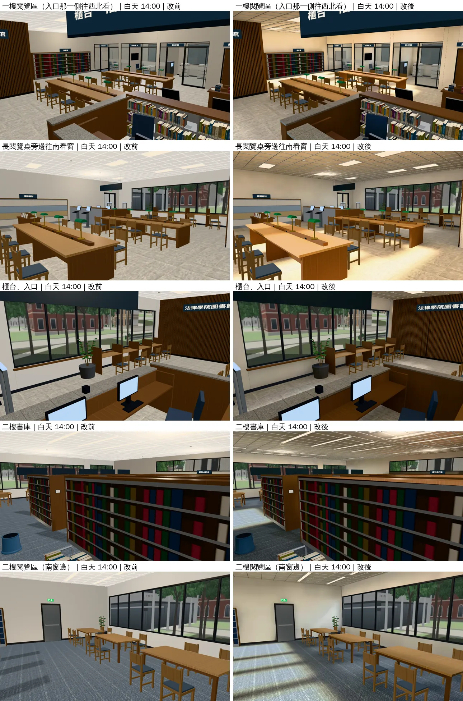
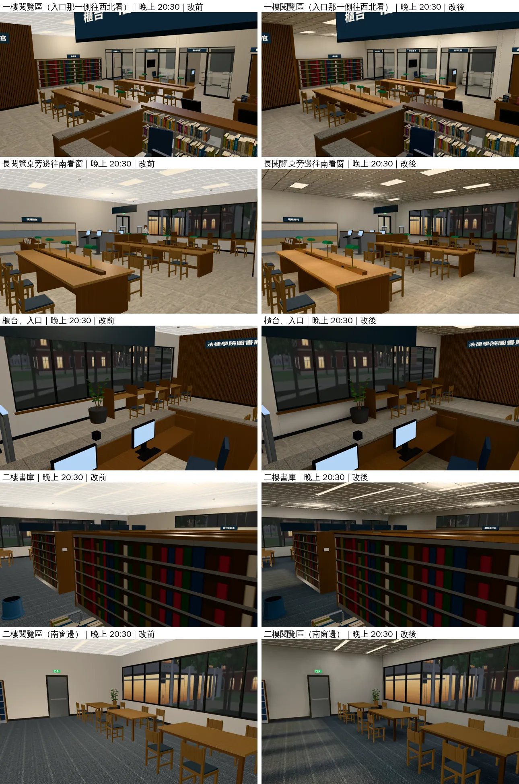

# 法律學院圖書館 室內光照烘焙（INTERIOR-AAA 第三間，LAWLIB-LM-1030；LAWWW2-B 2026-10-30）

- **起因**：使用者 10-28 P0「校內建築室內……廉價手遊感」（UA-LAWWW2-1028-01、X125）。
  - LAWWW-B 10-30 定的順序（D111）：宿舍 203 → 兩點半 Café → **法律學院圖書館**。
  - 檢討報告 `INTERIOR_AAA_REVIEW_1028.md` 第 5 節 P1（光照）。
- **狀態**：`READY_FOR_ART_REVIEW`。建築、場景的 `ART_APPROVED` 只有使用者能標。
- **截圖條件**：遊戲內固定鏡頭（藏玩家、NPC），1280×720，Playwright＋SwiftShader 模擬，**不是 iPhone 實機**。讀檔放位置是 [捷徑]。
  - 改前＝開發分支原樣；改後＝開發 `f75d60a4c`＋這一包。

## 一、交付

| 檔案 | 內容 |
|---|---|
| `assets/models/env/lawlib_interior.glb` | 多一套 UV（TEXCOORD_1）、`extras.lightmap`。2.77 → 3.06 MB |
| `assets/models/env/lawlib_interior_lm_day.webp`、`_night.webp` | 光照貼圖 1024，117 KB＋83 KB |
| `tools/blender/env_second/lightbake/bake_lawlib.sh` | 建模＋烘焙＋WebP（512 取樣約 20 分鐘） |
| `tools/blender/env_second/lightbake/lawlib_interior_lm.json` | 這次烘焙的參數紀錄 |

- **不用改程式**：`lawlib3d.js` 用 `B3.attachFormal` 接正式模型，看到 GLB 的 `extras.lightmap` 就接（`Z3.roomLightmap`，和法律系館A 大廳同一套）。
- `lawlib_interior.py`、配置都沒改：模型和原本一樣，只多光照貼圖。

## 二、怎麼烘的

- **燈**（位置照 `lawlib_interior.py` 的燈框算，燈框本身照舊自己發光）：
  - 一樓：十八片 60×120 輕鋼架燈，每片 13 W。
  - 二樓：書架走道、閱覽區上方的長條燈，每 3.2 m 11 W。
  - 一樓兩張長閱覽桌：八盞綠色燈罩的桌燈（點光源，4 W，暖色）。
- **白天**：
  - 天光＋下午的太陽（方位 200°、仰角 38°），從南面的窗照進來。南面窗朝法學院前的廣場，北面一樓也有窗。
  - 燈照樣開（圖書館白天也開燈）。
- **晚上**：只有燈。燈下亮、書架之間和牆角暗；桌燈在桌面上一圈暖光。
- **照舊即時光**：
  - 書（GPU instancing，幾千本）、書架鐵件、椅子、植物、黃銅、鋼、螢幕、小零件。
  - 原因：分不到像素。Café 第一次試烘，椅子展開以後把貼圖擠滿。
- **試烘焙**（48 取樣、燈 11／9 W）：
  - 牆上有雜訊；晚上比原本暗一點。
  - 正式版改成 512 取樣、燈 13／11 W。

## 三、改前改後（同鏡頭；左＝改前、右＝改後）

五個鏡頭：
- 一樓閱覽區；
- 長閱覽桌旁邊往南看窗；
- 櫃台、入口；
- 二樓書庫；
- 二樓閱覽區。

- **白天**：
  - 南面窗邊的地上有一塊一塊的陽光（窗框的影子），桌子底下、書架之間暗下來。
  - 天花板不再是一整片平白，燈框四周亮、遠處暗。
  - 原本整間一樣亮，看不出光從哪裡來。
- **晚上**：
  - 燈下亮、牆角和天花板暗，整體亮度和原本差不多。
  - 原本晚上和白天幾乎一樣。

## 四、測試、效能

- **全部 Node**（測試樹＝開發 `f75d60a4c`＋這一包）：766 支過、2 支 FAIL → **都是我這邊沒有 fetch 企劃線**。
  - FAIL 的兩支：`aa393_sis_jp_unit.js`、`aa539_sis_reread_unit.js`，它們用 `git show` 讀企劃線的稿。
  - `git fetch origin claude/cool-heisenberg-o8kuqx` 以後重跑：兩支都 ALL PASS。
  - 所以實際是 768／0。LAWWW-B 在乾淨的 checkout 上也是全過。
- **效能**（`tools/shots/interior_review/survey.py` 同一個玩家鏡頭，14:00，SwiftShader 量的，手機實機沒有量）：

| 方向 | draw call | 三角形 |
|---|---|---|
| 前（入口往閱覽區） | 254 → 278 | 25.4 萬 → 18.2 萬 |
| 左 | 182 → 175 | 20.9 萬 → 20.3 萬 |
| 右 | 292 → 296 | 27.9 萬 → 18.5 萬 |
| 後 | 175 → 183 | 16.6 萬 → 15.5 萬 |

- 三角形變少：烘焙工具把光照貼圖看不到的背面、被擋住的面收掉。
- draw call 差不多：前面那個方向多 24 次，是合併的網格分組不同。
- 光照貼圖兩張共 200 KB。

## 五、還沒做到的

- 人物沒有吃到烘焙的光：人物照舊是即時光，晚上看起來比旁邊的地板亮一點。和 Café、宿舍 203 一樣。
- 書、書架鐵件、椅子照即時光：晚上在暗處會比旁邊亮一點。
- 烘焙的太陽不會動：白天都是下午的位置。
- 生活感擺設（檢討報告 P4：誰在用、剛發生什麼）、牆面材質（P3）這一輪沒做，只做了光照（P1）。
