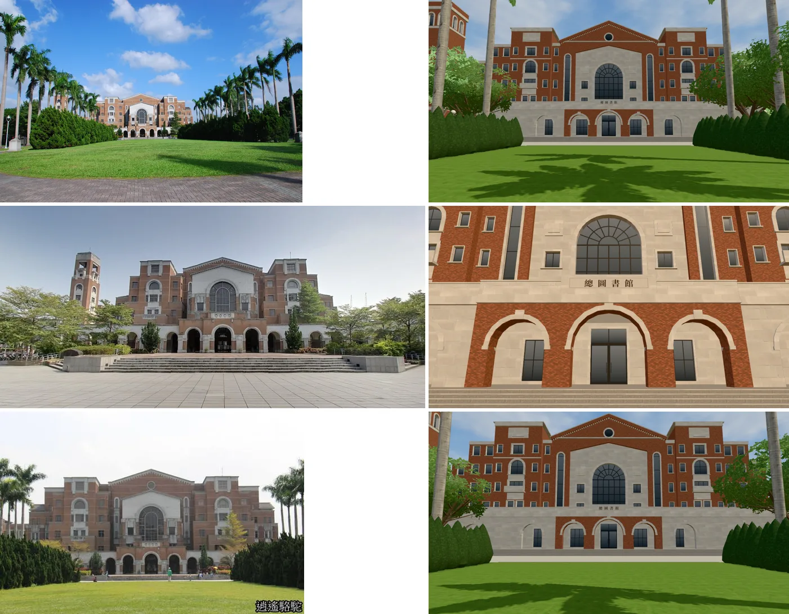
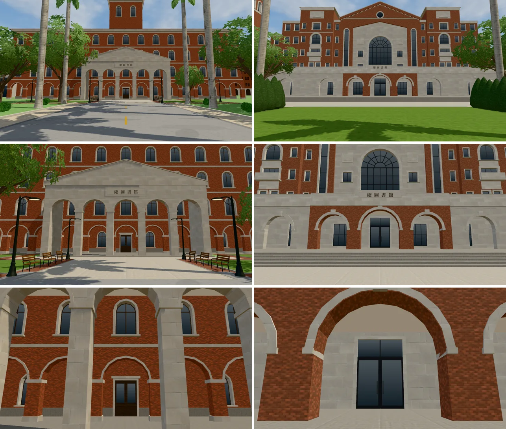
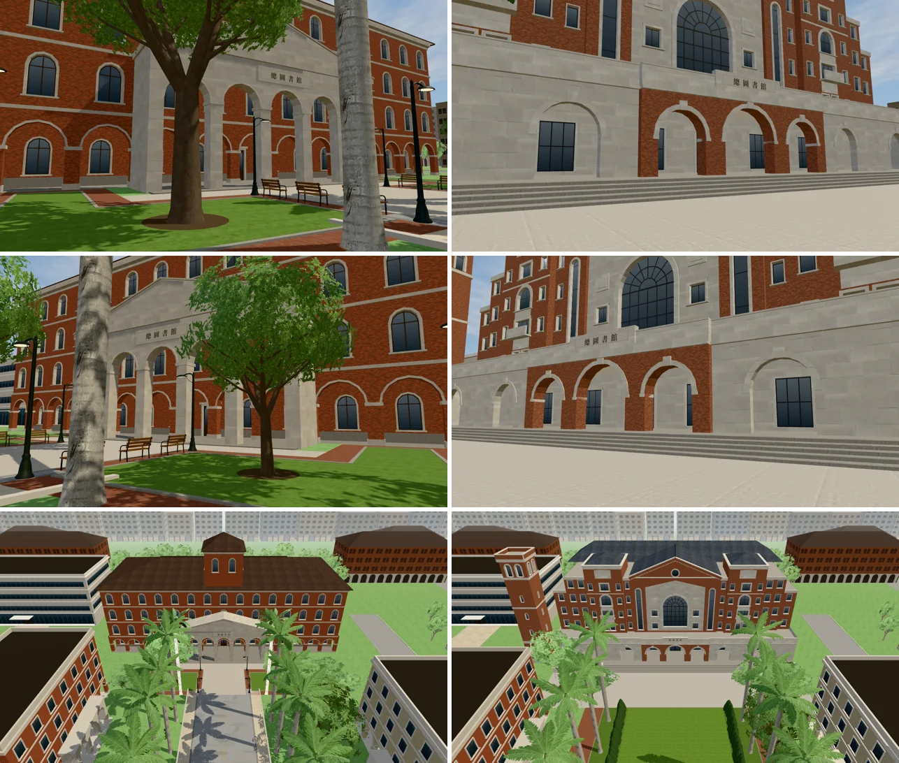
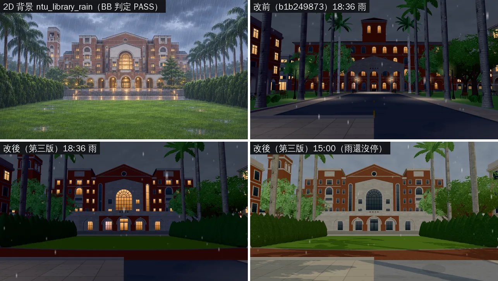
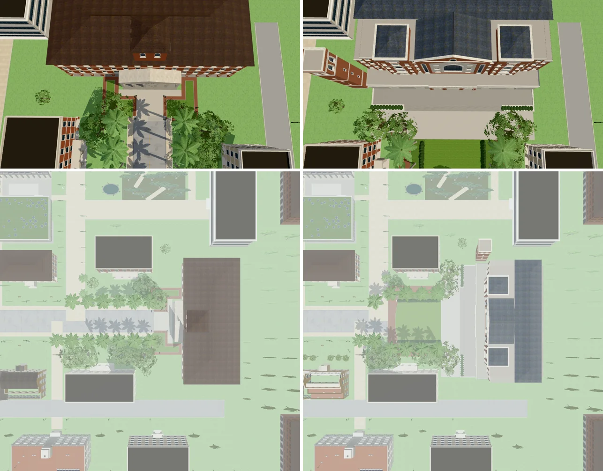
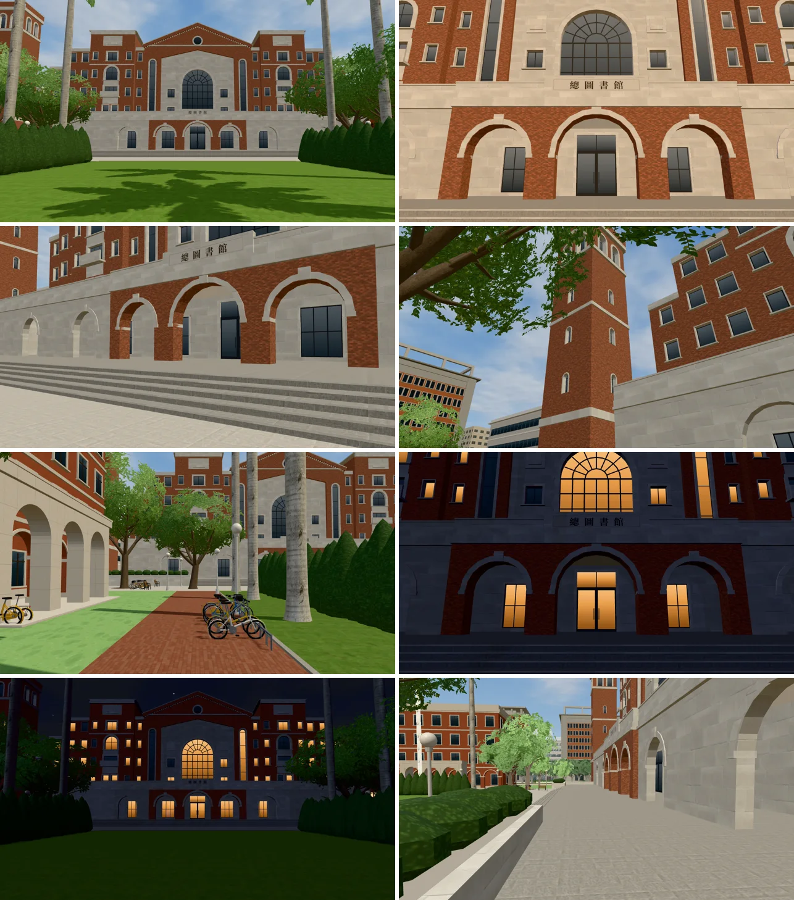
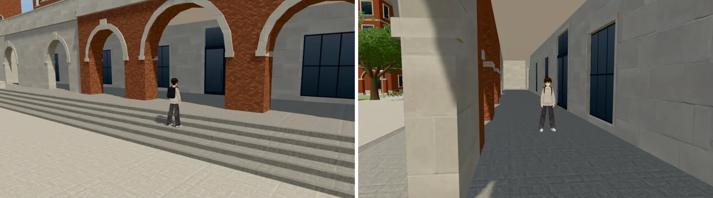

# 總圖外觀＋總圖前草坪＋走得上去的台階（LIB-FRONT-1102；LAWWW2〔帳號 A〕2026-11-02）

- **起因（使用者直接對 LAWWW2 說）**：
  - 08:45「這是總圖前草坪的樣子 你修改遊戲中建築和草皮 這件事先做」（五張照片）；
  - 08:55「總圖前的台階要做出來」；
  - 09:4x「台階下方還有磁磚 蠻寬的 之後才是草坪」（再一張照片）；
  - 10:3x 糾正「仔細看我給你的圖 總圖出來還有個平台 之後才是階梯往下」→ **第三版**（這一版）：拱廊前面 6 m 深的平台，台階在平台前面。
    第二版（f74e90c70）台階緊貼拱廊（台階頂到拱廊只有 1.35 m），沒交件、不要整合。
  - 紀錄：`docs/handoff/user_asks_LAWWW2.json` UA-LAWWW2-1102-02、-03、-08。
  - LAWWW 09:11 開任務 LIB-FRONT-1102，同意這兩件事：
    - 大道的柏油在小椰林道路口結束，後面改大草坪；
    - 總圖不搬：門口互動點 (86.4,0)、門外 (80,0)、門廊前 (82,0) 要照舊走得到。
      第三版的 (80,0) 在平台上（高 0.9，離台階頂 4 m）：從總圖出來先站在平台上，往前走 4 m 才下台階。
- **狀態**：`READY_FOR_ART_REVIEW`。
  - 場景美術由 BB 驗收（D120）。BB 08:48 要了 commit，好讓 CC 對照 2D 背景 ntu_library_rain／night。
  - 截圖是 Playwright＋SwiftShader（電腦 1280×720），不是實機。讀檔放位置、藏玩家和路人是 [捷徑]。
  - 走不走得上台階，另外用引擎真正的找路＋移動模擬驗過（第五節）。瀏覽器測試的結果在第六節。

## 一、怎麼套（給 LAWWW）

1. **換二進位**（從我的分支 `claude/second-ai-env-art` 拿）：
   - `assets/models/env/second_ai/campus_library.glb`（＋`.json`、新的 `.layout.json`）：總圖外觀重做。
   - `assets/models/env/second_ai/campus_lib_lawn.glb`（＋`.json`）：草坪第二版。
   - manifest 的 key 不變：`bldg.campus_library`、`bldg.campus_lib_lawn`。
2. **patch**：`docs/art-rebuild/second_ai/patches/lib_front_1102.patch`。
   - v3c（11-02 14:1x）；在 `b1b249873`（LAWWW 的 int/next1102 基準）、`ba125d6f3` 都 `git apply --check` 乾淨。
   - 動到的檔：
     - `src/zones3d.js`：+33／−15；
     - `src/story3d.js`：2 行，路人、腳踏車的路線（南側步道的路線點是 (37,16.2)）；
     - `tests/campus_glb_integration.py`：總圖的設計差異加進 `BBOX_TOL`（見第六節）；
     - `tests/lib_lawn_unit.js`：重寫；
     - `tests/campus_hall_pillar_seethru_unit.js`：總圖那一項；
     - `tests/lib_front_unit.js`：新增。
   - 兩個正式模型都在 manifest 才換（`LIBF`）。`?nobldg` 或 manifest 沒有時，照舊是大道到 x 72＋石板小廣場＋套件的總圖。
3. **zones3d.js 改了什麼**：
   - 大道：步道、柏油在 x 35 結束（原本 72）。x 35～63.5 是草坪，x 63.5～73.75 是石板廣場，x 73.75～76 台階，x 76～82 平台，再進拱廊。
   - 大王椰子：x > 35 那一段改到龍柏籬外面 |z| 13.4；x 70 那一棵在廣場上，拿掉。
   - 路口以東的杜鵑叢、大道長椅（x 50）、大道路燈（x 49）都拿掉。白色球形路燈在草坪模型裡。
   - 草坪的導航：龍柏籬（x 40.5～63.1、|z| 10.3～11.7）、白色球燈、石墩擋住。
     - 老樟樹搬到廣場北邊 (68.5,−25.5)，劇情「他在樟樹下等你」照舊有樟樹；南邊大樹 (68.5,25.5)。
     - 長椅 4 張在大樹兩旁（x 65.3、71.7），label 照舊「坐在總圖前的長椅上」。白色球燈兩盞在台階兩旁、花台前面 (72.8,±19.2)。
   - 總圖的導航（只在 `LIBF`）：
     - 先 `freeRect` 拿掉套件舊門廊、拱廊柱子的阻擋（x 73.7～87.2）；
     - 再照 `campus_library.layout.json` 擋：拱和拱之間的牆、花台、平台兩端的白石矮牆、拱廊兩端、後牆、主體、北邊方塔；
     - `addSurf`：台階一階一階（x 73.75～76），平台＋拱廊走道 0.9 m（x 76～86.4）；
     - 平台、台階加點地面移動的透明地面（`campusWalk`），方塔加鏡頭碰撞。
   - 大道北側那棟沒有名字的系館：原本 (57,−34)、28 m 寬，會壓到廣場西北角。改成 23 m 寬、中心 x 51.5（x 40～63）。系館位置之後 CAMPUS-RELAYOUT-1102 會照官方地圖重排。
   - 樹 (78,−38) 會碰到方塔，移到 (75,−41)；(64,−44) 移到 (68.5,−45)。
4. **story3d.js**：路人、騎腳踏車的人原本走到 x 60（現在是草坪中間）。改成：
   - 從大道走兩側紅磚步道到總圖前廣場；
   - 腳踏車停在廣場（bike3d 走上台階會自己下車，「樓梯不能騎」，這個照舊）。

## 二、照片對照（左＝使用者的照片，右＝遊戲裡同一個方向）

- **一樣的地方**：
  - 立面：中間白石面上的大拱窗、兩側細長拱窗、磚山牆＋齒狀線腳＋圓窗；
  - 兩旁五層磚塔：白框窗、四樓拱窗、三樓小陽台、頂層白色壓頂；
  - 一樓突出的拱廊：中間紅磚三拱、兩旁白石牆的拱；
  - 拱廊前的平台、平台前面的寬台階＋兩端花台、北邊方塔；
  - 長草坪、兩側修剪成尖頂的龍柏籬、籬後大王椰子、白色球燈、台階前的大片石板廣場。
- **不一樣的地方（老實說）**：
  - 草坪：真實的有一百多公尺，遊戲裡 24.5 m（整個校園是壓縮的）；平台 6 m、廣場 10.25 m 也是壓縮過的比例。
  - 一樓白石翼：比照片高、拱比較少。
  - 磚色：比照片紅一點；照片的磚偏褐、偏粉。
  - 四坡屋頂：照行政入口鳥瞰圖做的，從地面只露一點。

## 三、改前改後（同一個鏡頭；左＝開發分支原樣，右＝這一包）

- 由上到下：從草坪看總圖、大道後段、門廊前近看。

- 由上到下：從北邊斜看、從南邊斜看、鳥瞰。

- 和 2D 背景 `ntu_library_rain` 相近的角度（BB 11:40 要的）：
  - 左上＝2D 背景（BB 判定 PASS），右上＝改前；
  - 下面兩張＝改後：左是 18:36 雨天傍晚，右是 15:00 白天（同一個頁面接著拍，雨還沒停）；
  - 遊戲的鏡頭比 2D 背景窄，所以站在大道尾端（x 26）往總圖看。

- 俯視（上：總圖附近；下：整區）。

- 新角度（照片 1、照片 3 的位置、台階和平台近看、方塔、北側步道、晚上的廣場、晚上的草坪、從平台南端往北看平台）：

- 玩家（看人和建築的比例、腳有沒有陷進去）：左上＝剛走出總圖、站在平台上 (80,0) 面向草坪（前面是平台，再往前才下台階）；右上＝站在台階上；左下＝走在拱廊裡；右下＝平台南端（花台、球燈、平台沿著拱廊）：

## 四、做法

- **總圖**：`tools/blender/env_second/campus_library.py`（重寫，不再呼叫 `campus_hall.py`）。
  - 尺寸從照片 2（正面、最不變形）量比例，立面寬 60 m（和套件、導航同寬）：
    - 一樓（平台 0.9 到簷口 6.6）、二～五樓每層 3.6，主體屋頂 21.0；
    - 磚塔 23.6＋白色壓頂；山牆屋簷 21.6、頂 25.8；大拱窗 6.1×8.6 m。
  - 北邊方塔 5.4 m 見方、約 28 m 高（照片 3、09:4x 那張：比磚塔、山牆高一點）。
  - 材質名稱照舊（遊戲認名字）：ck_wall、ck_trim、ck_trim_win、seethru_ck_pier／seethru_ck_col、ck_stone_base、ck_roof、ck_ceiling、ck_frame、ck_glass、ck_board。
    - 新的有兩個：`ck_white`（白石面）、`ck_flatroof`（平屋頂、露台）。
    - 拱廊正面的牆用 seethru_ 材質：擋在鏡頭和玩家中間時網點透空（CAM-PILLAR-HALLS-1031 同一套）。
  - 窗：
    - 晚上約七成亮燈；大拱窗、大門、拱廊後牆的玻璃店面都亮。
    - 窗洞照樓層一條一條開（第一版同一列上下多扇窗只開了一個洞，遊戲裡只看到白框）。
  - 招牌「總圖書館」：大拱窗下面的白石匾額（PLATE_FACE_LIB，遊戲用 canvas 畫字）。
  - 三角形 8,771（第一版總圖 22,894），13 個材質，GLB 0.74 MB（原本 1.48 MB）。
- **草坪**：`tools/blender/env_second/campus_lib_lawn.py`（第二版）。
  - 地面：紅磚步道、草坪＋路緣、籬外草地、廣場花崗石、樹下的土。
  - 龍柏籬 44 棵：尖圓錐、表面凹凸、深綠；葉子貼圖是程式畫的 `textures/gen/juniper_foliage.png`。
  - 其他：花台上的灌木、白色石墩、白色球形路燈 10 盞（燈罩 `wz_lamp_lens` 晚上發光；GLOW_ 空節點是光暈）。
  - 三角形 13,099，10 個材質，0.79 MB。
- 貼圖：Poly Haven CC0（exterior_wall_cladding_02、sandstone_blocks_08、granite_tile、grey_roof_tiles、grass_ground、brick_pavement_04）。

## 五、平台、台階走得上去（Node：引擎真正的找路＋移動，`tests/lib_front_unit.js`，25 項 ALL PASS）

- 高度：
  - 廣場 0；台階一階 0.18 m（畫面上一階一階：0.18、0.36、0.54、0.72、0.90）；平台和拱廊走道 0.9。
  - 走出總圖先是平台：拱廊正面前面 x 76～81.6（紅磚段；白石翼到 82）整片都是平台高度，15 個點都站得住，之後才是台階往下。
- 走得到：
  - 大道（小椰林道路口）→ 草坪 → 廣場 → 台階 → 平台 → 中間的拱 → 大門口（門口互動點的範圍裡）。
  - 走路、跑步＋低幀率（dt 0.1、一步 0.41 m）都到。
- LAWWW 指定的點：
  - (80,0)：從總圖出來的位置，在平台上（高 0.9、離台階頂 4 m）；
  - (82,0)：門廊前，中間拱的開口裡；
  - 兩點都能走下台階回到草坪、從草坪走上來。
- 擋住的：龍柏籬、花台、拱和拱之間的牆、拱廊後牆、總圖裡面、方塔、平台兩端的白石矮牆（落差 0.9，走不出平台邊）。
- 走得到的：兩側步道、台階頂 → 平台 → 花台後面、白石翼的拱、拱廊走道從北到南。
- 「進入總圖書館」照舊在 (86.4,0)。
- 平台、台階點得到（點地面移動的透明地面）。

## 六、測試

- **環境**：開發分支 `ba125d6f3`＋這個 patch＋兩個 GLB（乾淨的 worktree）。Playwright＋SwiftShader（電腦 1280×720／手機 390×844 模擬），不是實機。
- **瀏覽器，一次跑一支**：

| 測試 | 結果 | 時間（UTC） |
|---|---|---|
| campus_layout_nav | ALL PASS | 11:06–11:08 |
| flow_library_floors（從校園走上台階、平台 → 進總圖 → 大樓梯上二樓 → 3F 閱覽室 → 電梯 → 存讀檔 → 下樓 → 離開總圖，回到平台上的 (80,0)） | ALL PASS | 11:08–11:25 |
| flow_library_scene（小安「總圖的下午」） | ALL PASS | 11:33–11:43 |
| guide_flow（`?turbo`） | ALL PASS | 11:43–11:45 |
| reachability_all（113 項） | ALL PASS | 11:48–11:56 |
| campus_glb_integration | **FAIL：這個 patch 之前就壞了**（下面說明） | 11:46–11:48 |

- **campus_glb_integration**：
  - 在乾淨的 `b1b249873`（沒有這個 patch）照樣 FAIL，壞法一樣（12:01 跑過）：
    - `soc` 那一項還在找 `campus_modern_glb`。開發分支的社科院有 `SOCX`（新社科院，節點叫 `campus_socsci_glb`），所以「soc 的正式模型接上」FAIL；
    - 量外框量到 soc 時，`glb` 是 undefined，`traverse` 丟例外，後面的檢查都沒跑到；
    - `TAGS` 清單還是舊的：male1、gate、boya、putong 現在都有正式模型，「先不放正式模型的」兩項 FAIL。
    - 這些不在這次的範圍，我沒改。要修的話是改 `tests/campus_glb_integration.py` 的 TAGS。
  - **這個 patch 和總圖有關的**：總圖第三版的外框和套件「設計上就不同」：
    - x0 多了拱廊前的平台＋台階；
    - z0 多了北邊方塔；
    - y1 是方塔頂。
  - 照共同教學館的做法，在 `BBOX_TOL` 加 `library` 的容許值（patch 裡改了這支測試）。
  - 改完在 patch 的樹上重跑（12:03–12:05）：總圖那兩項（外框、匾額）都 PASS；FAIL 的項目、在 soc 丟例外的地方，都和乾淨的 b1b249873 一樣。
- **Node 單元測試**：`tests/lib_front_unit.js`（新，25 項）、`lib_lawn_unit.js`、`campus_hall_pillar_seethru_unit.js` ALL PASS。
  - 全部 `tests/*_unit.js`（864 支，12:17 跑完）：863 PASS、1 FAIL。
    - FAIL 的是 `socsci_place_unit` 第 6 項：這個 patch 給路人、腳踏車加的路線點 (37,17) 剛好在草坪南側步道的一個擋住的格子上（x 37.0～37.4、z 17.0～17.8）。
    - 改成 (37,16.2)（四周都站得住）以後，`socsci_place_unit`、`crowd_depts_unit`、`lane118_walkers_unit`、`lib_front_unit`、`lib_lawn_unit` ALL PASS。這是 patch 的 v3c。

## 七、還沒做的、限制

- 草坪長度、一樓白石翼的高度、磚色，見第二節。
- **v3.1（下一包）**：照片 40（從廣場低角度拍）裡，平台上白石翼的拱前面各有一棵尖塔形針葉樹，第三版沒有。
  - 6 m 的平台放得下，平台不用加深。
  - 台階寬度照片和第三版一樣：約平台寬的 3/4，兩側是石塊花台。
  - 這是 BB 11:05 轉來的 CC 差異清單第 ③ 點。
- 總圖北側的 B1 下沉中庭（鳥瞰圖）、行政入口：這一包沒有做，排在 LIB-INTERIOR-1102（B1）一起做。
- 沒跑手機實機。
