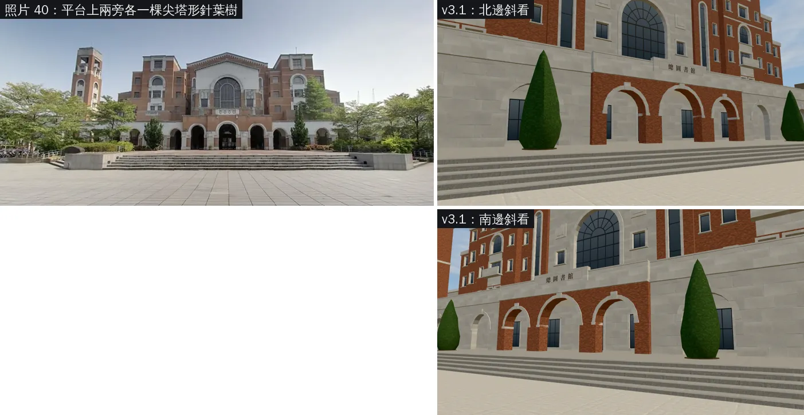
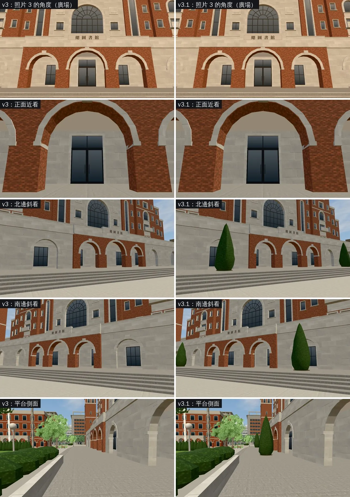

# LIB-FRONT-1102 v3.1：平台上兩棵尖塔形針葉樹（LAWWW2〔帳號 A〕2026-11-02）

- **起因**：
  - 使用者 11-02 給的照片 40（從廣場低角度拍）：平台上、白石翼的拱前面，兩旁各有一棵尖塔形針葉樹，第三版沒有。
  - BB 11:05 轉來 CC 的差異清單第 ③ 點；BB 11:40 同意排成 v3.1；BB_234 第二節第 2 點也列了。
- **這一版只加樹**：平台不加深、台階寬度不改。
  - BB_234 的 ①③④（拱廊深度、白石立面線腳、近景磚石法線）是 v3.2，另外交。
- **狀態**：`READY_FOR_ART_REVIEW`。
  - 場景美術由 BB 驗收（D120）。建築的最終美術要使用者確認。
  - 截圖是 Playwright＋SwiftShader（電腦 1280×720），不是實機。讀檔放位置、藏玩家和路人是 [捷徑]。

## 一、怎麼套（給 LAWWW）

- **已經整合第三版**（int/next1102 `3caff35d9` 起）：套 `docs/art-rebuild/second_ai/patches/lib_front_1102_v31_incr.patch`。
  - 在 `3caff35d9`、`1a5110e07` 上 `git apply --check` 都乾淨。
  - 改 2 個檔：`src/zones3d.js`、`tests/lib_front_unit.js`。
- **還沒整合第三版**：用完整版 `docs/art-rebuild/second_ai/patches/lib_front_1102_v3d.patch`（基準 `ba125d6f3`、`b1b249873`）。
- **二進位**（從我的分支 `claude/second-ai-env-art` 拿）：
  - `assets/models/env/second_ai/campus_lib_lawn.glb`
  - `assets/models/env/second_ai/campus_lib_lawn.json`
- 總圖外觀 `campus_library.glb` 這一版沒動。

## 二、照片對照

- 一樣的：平台上、紅磚段兩旁的白石翼前面各一棵，尖塔形、深綠。
- 不一樣的：照片的樹高一點，樹梢大約到拱廊上面的女兒牆；遊戲約 5.4 m，到簷口帶下緣。

## 三、第三版 vs v3.1（同一個鏡頭）

- 「照片 3 的角度」「正面近看」兩張的鏡頭太近，看不到樹，放著是為了確認其他地方沒有變。

## 四、改了什麼

- **`campus_lib_lawn.glb`**：
  - 平台上 (78.9, ±12.4) 兩棵；
  - 用龍柏籬同一個形狀，拉高 1.6 倍，約 5.4 m；
  - 樹下一圈土。
- **`src/zones3d.js`**：`nav.blockCircle(78.9, ±12.4, 0.75)`，樹幹擋住導航。
  - 要放在 LIB-FRONT 那一段 `freeRect` 後面，不然會被清掉。
- **`tests/lib_front_unit.js`**：
  - 多一項：樹擋住，兩邊照樣走得過去；
  - 平台的取樣點 z ±12 改成 ±9（±12 正好在樹上）。

## 五、測試

- **環境**：`scratchpad/devwt_k`＝`3e6855649`＋v3.1（patch＋GLB）。Playwright＋SwiftShader（電腦），不是實機。
- **Node**：`lib_front_unit`、`lib_lawn_unit`、`campus_hall_pillar_seethru_unit` ALL PASS（11-02 19:2x）。
- **瀏覽器**：
  - `campus_layout_nav`：（跑完補）
  - `reachability_all`（只跑 campus）：（跑完補）
- **截圖**：改前、改後各 5 張，沒有 JS 例外。

## 六、測試單（TEST-OFFLOAD-1102：給 BB／CC 在使用者電腦跑）

- 基準：int/next1102 最新（`1a5110e07`）＋`lib_front_1102_v31_incr.patch`＋兩個二進位。
- Node：`node tests/lib_front_unit.js`、`node tests/lib_lawn_unit.js`、`node tests/campus_hall_pillar_seethru_unit.js`。
- 瀏覽器（一次只跑一支）：
  - `tests/campus_layout_nav.py`
  - `tests/reachability_all.py --zones campus`
  - `tests/campus_glb_integration.py`（效能那一項本來就沒過，見 PERF-CAMPUS-GLB-1102；這一版只加兩棵樹，看其他項目有沒有變）
- 截圖：`test_sheet_shots.json`（改後 5 張）。

## 七、還沒做的

- v3.2：BB_234 的 ①③④（拱廊深度、白石立面線腳、近景磚石法線）。
- 沒跑手機實機。
