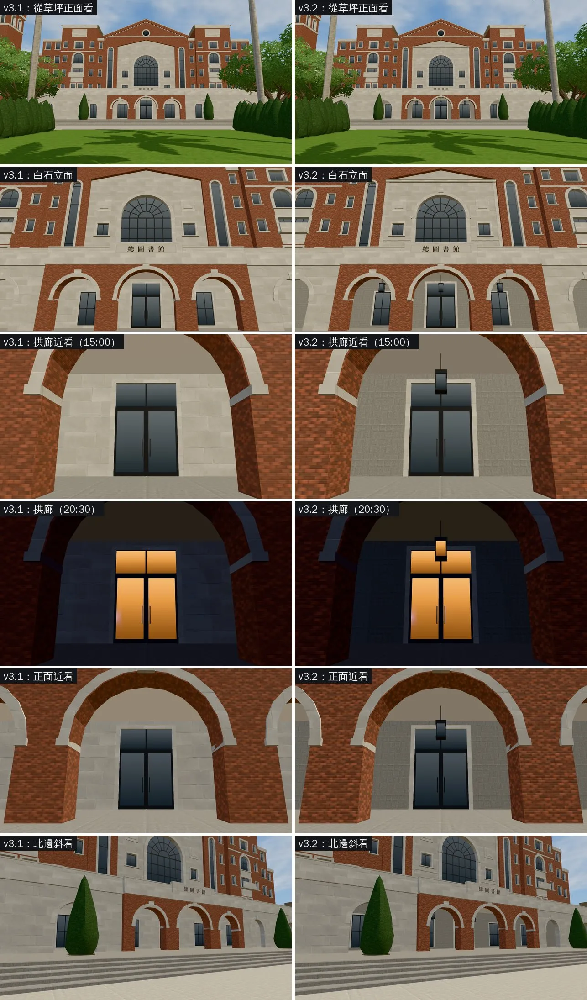

# LIB-FRONT-1102 v3.2：拱廊的深度、白石立面的線腳、近看的磚和石材（BB_234 ①③④；LAWWW2〔帳號 A〕2026-11-02）

- **起因**：BB 驗收第三版（`BB_234`，企劃分支 `claude/story-planning`）第二節列的差距，排到 v3.1／v3.2：
  - ① 一樓拱廊的深度：照片裡中間三拱是開放的，看得到裡面的拱廊和吊燈；遊戲看起來像牆上有拱框的窗。
  - ③ 白石中央立面太平：照片有線腳、浮雕框、窗台。
  - ④ 磚面和石面的材質：近看磚紋偏淡、石面沒有接縫的立體感。
  - ②（平台上的樹）是 v3.1，已交件（`d594acbee`）。⑤（鐘塔從正面看不到）BB 列為參考，不改。
- **狀態**：`READY_FOR_ART_REVIEW`。
  - 場景美術由 BB 驗收（D120）；建築的最終美術要使用者確認。
  - 截圖是 Playwright＋SwiftShader（電腦 1280×720），不是實機。讀檔放位置、藏玩家和路人是 [捷徑]。

## 一、怎麼套（給 LAWWW）

- **只換二進位**（從我的分支 `claude/second-ai-env-art` 拿）：
  - `assets/models/env/second_ai/campus_library.glb`
  - `assets/models/env/second_ai/campus_library.json`
  - `assets/models/env/second_ai/campus_library.layout.json`
- **程式不用改**：
  - `campus_library.layout.json`（導航、鏡頭碰撞）和 v3.1 一模一樣；
  - 材質還是 13 個，名字都沒變（`seethru_ck_pier`、`seethru_ck_col` 照舊會網點透空）；
  - 吊燈的玻璃用亮著的窗那一套 UV，晚上跟著窗一起亮。
- Blender 腳本：`tools/blender/env_second/campus_library.py`（`/opt/blenv/bin/python tools/blender/env_second/campus_library.py` 重產）。

## 二、改前改後（同一個鏡頭；左＝v3.1，右＝v3.2）

## 三、改了什麼

- **① 拱廊的深度**（不加材質＝不多 draw call）：
  - 拱廊後牆、走道兩端的實牆：白石 → 花崗石（`ck_stone_base`，#a8a49c，比白石暗）。從正面看得出拱裡面有一段深度。
  - 拱廊天花板、屋簷底下：#e6e1d7 → #a49d91（暗一點）。
  - 中間三拱各吊一盞方形吊燈：深色金屬框、四面玻璃，晚上亮。
- **③ 白石立面的線腳**（都是白石 `ck_trim`）：
  - 白石面兩邊的壁柱；
  - 上下兩排小窗之間的腰帶；
  - 小山牆下面兩層的簷口；
  - 大拱窗的拱心石和兩邊的拱墩。
- **④ 近看的磚和石材**：
  - 磚：法線 0.8 → 1.2、貼圖對比 1.0 → 1.25；
  - 白石、柱子、線腳：法線 0.45／0.5 → 0.9。
- **數字**：材質 13 → 13，三角形 8,771 → 9,081（+310），GLB 740 → 765 KB。

## 四、測試

- **環境**：`scratchpad/devwt_k`＝`3e6855649`＋v3.1＋v3.2 的 GLB。
- **Node**：`lib_front_unit`、`lib_lawn_unit`、`campus_hall_pillar_seethru_unit` ALL PASS。
- **截圖**：v3.2 九張、v3.1（同樣的新鏡頭）四張，沒有 JS 例外。
- **沒跑**：
  - `campus_glb_integration`：效能那一項本來就沒過（PERF-CAMPUS-GLB-1102），這一版 draw call 不變、三角形 +310；
  - 手機實機。

## 五、測試單（TEST-OFFLOAD-1102）

- 基準：int/m590 最新＋三個二進位。
- Node：`lib_front_unit`、`lib_lawn_unit`、`campus_hall_pillar_seethru_unit`。
- 瀏覽器：
  - `tests/campus_glb_integration.py`：看「總圖」那幾項，效能那一項看 plaza、porch、avenue 有沒有變；
  - `tests/reachability_all.py --zones campus`。
- 截圖：`test_sheet_shots.json`（九張）。

## 六、還沒做到照片的

- 拱廊後牆的花崗石近看是一格一格的方塊，像大塊石板。照片裡拱廊裡面是暗的，看不清楚材質。
- 白石面的線腳從草坪的距離看不太出來，近看（`白石立面`那一列）才明顯。
- 鐘塔從正面幾乎看不到（BB_234 ⑤，參考）。
