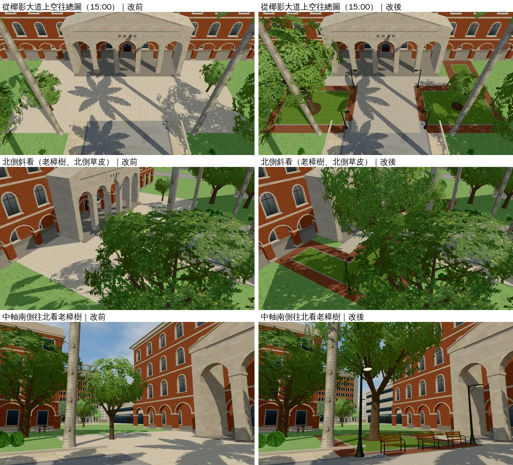
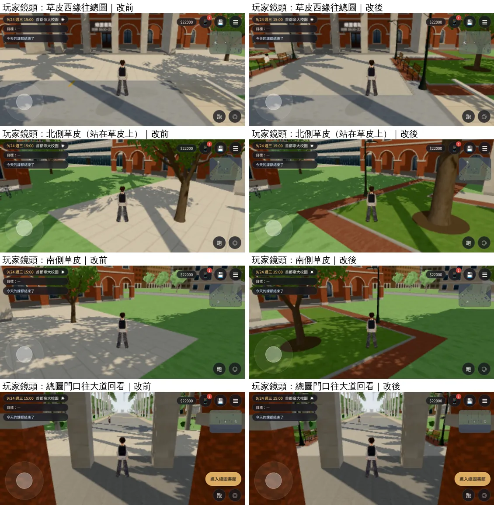
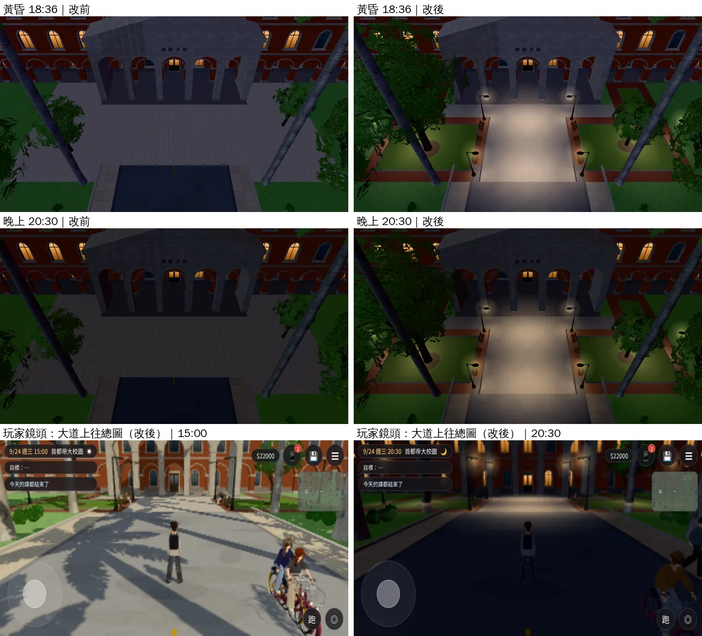

# X133 總圖前草皮 第一版（LIB-LAWN-1030；LAWWW2-B 2026-10-30）

- **使用者原話**（10-30 04:4x 對 LAWWW-B，UA-LAWWW-1030-11）：照臺大校內地圖規劃總圖前草皮。
- **規劃稿**：`test_shots/lib_lawn_plan_1030/`。LAWWW-B 10-30 核准第一版：
  - 中軸兩邊各一塊草皮；
  - 不做台階；
  - 老樟樹在北側草皮。
- **還沒回答的**（規劃稿第四節的三個問題，等使用者）：
  - 校內地圖上草皮的形狀；
  - 總圖門口要不要台階；
  - 樟樹的位置。
  - 得到回答以後照地圖調整。
- **狀態**：`READY_FOR_ART_REVIEW`。建築、場景的 `ART_APPROVED` 只有使用者能標。
- **截圖條件**：遊戲內，Playwright＋SwiftShader 模擬，**不是 iPhone 實機**。讀檔放位置是 [捷徑]。
  - 改前＝開發 `ca5f3381c`；改後＝同一版＋這一包。

## 一、交付

| 檔案 | 內容 |
|---|---|
| `assets/models/env/second_ai/campus_lib_lawn.glb`（＋`.json` 配置） | 地面：中軸花崗石鋪面、L 形草皮、紅磚步道、花崗石路緣、樹下的土。226 個三角形、5 個網格、277 KB |
| `tools/blender/env_second/campus_lib_lawn.py` | Blender 腳本（Poly Haven CC0：granite_tile、brick_pavement_04、grass_ground） |
| `docs/art-rebuild/second_ai/patches/lib_lawn_1030.patch` | `src/zones3d.js`、`src/assets3d.js`、新測試 `tests/lib_lawn_unit.js` |

## 二、配置（校園座標；北半邊，南半邊對稱）

- **中軸**：z −5～5，從椰影大道盡頭 x 70 直通總圖門廊；門廊前的前庭 x 79.4～82.8。淺色花崗石鋪面，兩邊一條收邊。
- **草皮**：L 形，包著總圖的轉角。
  - 主塊 x 71.4～78.0、z 6.4～16.6。
  - 東側一條 x 78.0～85.4、z 13.6～16.6。
  - 花崗石低路緣（7 cm）。草皮面 4.5 cm 高，走得到、坐得到（導航是平的）。
- **紅磚步道**：草皮外一圈、草皮和前庭之間。
- **樹**：
  - 北側草皮：老樟樹 (74.2, −11.6)。遊戲的樟樹（`TK.tree` sp:'camphor'，16 m，和法律系館A 前的大樟樹同一套），樹冠蓋到中軸北半邊。企劃寫「總圖前面的樟樹比總圖老」「他在樟樹下等你」。
  - 南側草皮：中型的樹 (74.7, 11.6)，校園其他闊葉樹同一套。
  - 原本廣場兩邊的兩棵樹 (74, −12)、(78, 14) 在草皮上，有草皮模型時拿掉。
- **長椅**：中軸兩邊各三張 (72.6／75.0／77.4, ±5.75)，面向中軸。全遊戲共用的正式長椅（`BENCH()`），可以坐：「坐在總圖前的長椅上」。
- **路燈**：中軸四個角 (70.8／79.0, ±5.75)、草皮外緣 (75.0, ±17.3)。全遊戲共用的 `W3.lampPost()`，晚上地上有光圈。
- **聖誕樹**：模型不做。GLB 裡留一個空節點 `XMAS_TREE_SPOT` (80.6, −8.2)，在前庭北側，不擋中軸、不擋門。
- **模型載入失敗**：照舊是石板廣場。樹、長椅、路燈還在，走得到。

## 三、改前改後（同角度；左＝改前、右＝改後）

### 白天（固定鏡頭，15:00）

- 原本是一整片石板，兩邊幾棵普通的樹。
- 現在：
  - 淺色花崗石中軸直通總圖門廊，兩邊各一塊草皮，紅磚步道圍著草皮。
  - 北側是老樟樹，樹冠蓋到中軸。
  - 中軸兩邊有長椅（NPC 也會來坐）、四個角有路燈。

### 玩家鏡頭（手機橫向，有 HUD）

- 草皮走得到：北側那張是站在草皮上。
- 從總圖門口回看，椰影大道的路接到中軸。

### 黃昏、晚上

- 原本晚上整片廣場是暗的，沒有燈。
- 現在：中軸四角、草皮外緣的路燈亮了，地上有光圈，長椅那一帶看得到。

- 第一輪截圖以後改過一次：
  - 中軸原本用大塊砂岩貼圖（large_sandstone_blocks），遊戲裡一條一條很花，改成細的花崗石鋪面。
  - 草皮原本比旁邊的校園草地暗一截，調亮。
  - 紅磚柔一點；樹下的土原本是一大圈黑的，縮小、調淺。

## 四、測試

- `tests/lib_lawn_unit.js`（新）：
  - 遊戲放的樹、長椅、路燈和模型的配置 JSON 一致。
  - 長椅、路燈在步道上：不在草皮、不擋中軸、在廣場裡。
  - 有模型時拿掉兩棵舊樹；載入後藏起石板廣場；樹下的土在草皮裡。
  - 改前 FAIL、改後 ALL PASS。
- `node tests/nav_buildings_unit.js`、`node tools/dev_scratch/kit_nav_check.js`：ALL PASS。
- 全部 Node：見第五節。
- 對開發 `ca5f3381c`：`git apply --check` 通過；和 `plate_border_cap_1030.patch` 一起套也通過。

## 五、效能、還沒做到的

（截圖跑完後補）
